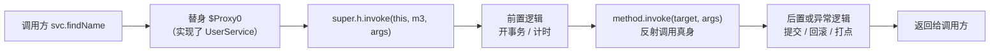

# 反射与动态代理

> [!abstract] 一句话总结
> 反射让程序在运行期"看清"一个它编译时并不认识的类（有哪些方法、字段、注解），动态代理让框架在运行期"造出"一个替身类把你的方法调用截下来。前者解决"框架怎么发现你的代码"，后者解决"框架怎么增强你的代码"——Spring AOP、`@Transactional`、MyBatis Mapper、Jackson 全站在这两件事上面。

## 🗣️ 白话版（先建立直觉）

理解这两个东西，只需要抓住一个事实：**框架比你的业务代码先写出来。**

Spring 的作者在 2003 年写代码的时候，不可能知道你 2026 年会写一个叫 `UserService` 的类。所以框架面对你的类，处境就像**拿到一个陌生零件的维修工**：

- 正常写代码 = 你照着说明书组装零件，编译期就知道有什么、该调什么方法。
- **反射** = 维修工现场拿卡尺量这个陌生零件：有几个孔、什么螺纹、上面刻了什么标记（注解）。量完才知道怎么装。`reflection` 直译"反射"其实很误导，它的本意是**照镜子**——程序跑起来之后，能反过来看见自己。
- **动态代理** = 维修工不改你的零件，而是**现场车出一个一模一样的外壳套在外面**。外面看接口完全一致，但每次转动都先经过外壳，外壳可以顺手记个数、上点油（事务、日志、鉴权）。

一句话串起来：**反射是"看见"，动态代理是"套壳"。** 框架的所有魔法都是这两下。

## 🚀 三个你天天遇到、却没想过的现象

> [!note] 现象 1：Spring 怎么"看见"你的类？
> 你只写了个 `UserService` 接口 + 实现类，从没告诉 Spring"我有哪些方法"，但注入后调用一切正常——**谁读了你的类结构？**
> → **反射**。框架在运行期拿到你的 `Class` 对象，扫描方法、字段、注解，才知道"这个 Bean 能干什么"。

> [!note] 现象 2：同一个类，为什么"两副面孔"？
> 同一个 Service，自己 `new` 出来的和 Spring 注入的行为不一样：注入的能开事务、能记日志，自己 `new` 的不行——**同一个类，方法怎么会"多出"能力？**
> → **动态代理**。Spring 注入给你的其实是个"替身"（`$Proxy`），它在调用前后替你做了事务、日志、鉴权。你 `new` 的是"本人"，本人不会这些技能。

> [!note] 现象 3：MyBatis / Jackson 怎么把数据变成你的对象？
> MyBatis 执行完 SQL，怎么把 `ResultSet` 的每一行变成你的 `User` 对象？Jackson 怎么把 JSON 变成对象？
> → **反射**。运行期按字段名反射赋值——框架从不认识你的 POJO，全靠运行期"看着字段名填"。
> 顺带解释一个更玄的：MyBatis 的 Mapper 你只写了接口、**没有写实现类**，为什么能调用？因为 MyBatis 用 JDK 动态代理给接口造了个替身，替身把方法名映射到 XML 里的 SQL。

**三个现象的本质是同一件：框架编译期不认识你的类，只能运行期靠反射"发现"它、靠动态代理"增强"它。**

## 🎯 本节定位

- **本章第 12 课，运行期机制**。前置：[[01-泛型与类型擦除]]（反射是唯一能读到被擦除的泛型元数据的途径）、[[02-异常处理最佳实践]]（本课两个异常包装陷阱都要靠 cause 链排查）。
- **动手配套**：[[02-实战-手写动态代理与排查]]——本篇只讲清机制，**手感要靠那边的 12 个可运行案例练**。原理读完就去做，尤其是案例 9（无 target 的代理）和案例 11（自调用失效复现）。
- **搭档课**：[[13-注解与注解处理器]]——注解只是"贴上去的标签"，**必须靠反射才能读出来**，且必须 `@Retention(RUNTIME)`。两课合起来才是框架的完整入口机制，建议连着看。
- **延伸阅读（本课不展开）**：Spring AOP 完整代理体系（切面织入、代理选择策略）在 04-Spring 生态章节；CGLIB 细节跟随 Spring 一起学；Java 9 模块系统 open/export 本课只提概念。

## 📌 这是什么

- **反射** = 运行期照镜子。核心四个类：`Class`（类的元数据入口）、`Constructor`（造对象）、`Field`（读写字段）、`Method`（调方法）。
- **JDK 动态代理** = 基于**接口**在运行期生成一个替身类，该接口的所有方法调用统一汇入一个 `InvocationHandler.invoke(proxy, method, args)`，你在这里加前置/后置逻辑。
- **子类代理**（CGLIB / ByteBuddy） = 没有接口时的方案：运行期生成目标类的**子类**，重写方法实现拦截。

## 🤔 解决什么问题 / 为什么需要

**没有反射会发生什么坏事**：框架无法操作未知类型。Spring 只能要求你手写 XML 把每个方法都声明一遍，Jackson 只能要求你为每个 POJO 手写一个解析器，MyBatis 的 Mapper 你必须自己写实现类。所有"约定优于配置"都会失效——因为约定的执行，靠的就是运行期扫描。

**没有动态代理会发生什么坏事**：横切逻辑必须手写进每个方法。100 个 Service 方法要加事务，就是 100 段重复的 `try { begin(); ...; commit(); } catch { rollback(); }`。这就是下面"从坏到好"要演示的东西。

**认知价值**：知道"你手上拿的可能不是本人而是替身"，才能排查一整类诡异问题——`@Transactional` 自调用失效、`final` 方法没被增强、`AOP` 切面不生效，根因都是同一句话：**调用没有经过代理对象**。

## 🆚 从坏到好（对比案例）

**需求**：给所有 Service 方法加"耗时日志 + 异常告警"。

**坏做法：手写进每个方法**

```java
public class UserServiceImpl implements UserService {
    public String findName(long id) {
        long start = System.nanoTime();          // ← 样板
        try {
            return "u" + id;                     // ← 只有这一行是业务
        } catch (RuntimeException e) {
            alert(e);                            // ← 样板
            throw e;
        } finally {
            log(System.nanoTime() - start);      // ← 样板
        }
    }
    // 还有 99 个方法，每个都这样抄一遍
}
```

**为什么不行**：业务代码 1 行、样板代码 6 行，信噪比崩了；日志格式要改就得动 100 个方法；新同事漏抄一段，这个方法就静默失去监控；这段样板和"用户业务"毫无关系，却永久污染了业务类。

**好做法：一个代理搞定全部**

```java
@SuppressWarnings("unchecked")
static <T> T withLog(T target, Class<T> iface) {
    return (T) Proxy.newProxyInstance(
        iface.getClassLoader(), new Class<?>[]{iface},
        (proxy, method, args) -> {
            long start = System.nanoTime();
            try {
                return method.invoke(target, args);
            } catch (InvocationTargetException e) {
                alert(e.getCause());             // 注意：真凶在 cause 里
                throw e.getCause();
            } finally {
                log(method.getName() + " " + (System.nanoTime() - start));
            }
        });
}

// 业务类回归干净
public class UserServiceImpl implements UserService {
    public String findName(long id) { return "u" + id; }
}

UserService svc = withLog(new UserServiceImpl(), UserService.class);
```

**好在哪**：横切逻辑只有一份，改一处全部生效；业务类零污染；对**任意接口**都能复用，不只是 `UserService`。**这就是 Spring AOP 的全部思想**，Spring 只是在此之上加了"用注解和切点表达式决定给谁套壳"。

## ⚙️ 工作原理 / 流程



**JDK 动态代理三步**：

1. `Proxy.newProxyInstance(loader, interfaces, handler)` 在运行期**生成字节码并加载**一个实现了所有指定接口的类。
2. 该类的每个方法体都是同一个模板：把预先缓存的 `Method` 常量 + 参数打包成 `Object[]`，交给 `handler.invoke`。
3. `handler.invoke` 返回什么，调用方就收到什么。真身要不要被调用、调用几次，**完全由 handler 决定**——它可以一次都不调（这就是 Mock 框架的原理）。

## 🧪 最小验证（先看见替身，再谈原理）

> 动态代理让人觉得玄，就是因为"运行期生成一个类"听着像魔法。**把它导出来看一眼，魔法立刻消失。** 建议先跑这个实验再往下读。

```java
// 一行开关，把生成的代理类字节码落到磁盘
System.setProperty("jdk.proxy.ProxyGenerator.saveGeneratedFiles", "true");

interface UserService { String findName(long id); }
UserService target = id -> "u" + id;
UserService proxy = (UserService) Proxy.newProxyInstance(
        UserService.class.getClassLoader(),
        new Class<?>[]{UserService.class},
        (p, m, a) -> m.invoke(target, a));

System.out.println(proxy.getClass().getName());   // 实测输出：$Proxy0
```

运行后用 `javap -p -c '$Proxy0.class'` 或 IDEA 反编译，看到的真实结构是这样（已简化）：

```java
public final class $Proxy0 extends Proxy implements UserService {

    private static Method m3;        // findName 的 Method 对象，静态缓存

    public $Proxy0(InvocationHandler h) { super(h); }

    public final String findName(long id) {
        try {
            return (String) super.h.invoke(this, m3, new Object[]{ id });
        } catch (RuntimeException | Error e) {
            throw e;
        } catch (Throwable t) {
            throw new UndeclaredThrowableException(t);   // ← 留意这行，后面有坑
        }
    }

    static {
        m3 = Class.forName("UserService").getMethod("findName", long.class);
        // m0 = hashCode, m1 = equals, m2 = toString 也在这里初始化
    }
}
```

**这段代码一读，五个结论全部自明，不需要背**：

| 看到什么                           | 立刻推出什么                                              |
| ------------------------------ | --------------------------------------------------- |
| `extends Proxy`                | 唯一的继承位被占了 → **JDK 代理只能实现接口，无法代理类**                  |
| 类是 `final`                     | 代理对象不能再被继承增强                                        |
| `super.h.invoke`               | handler 是**唯一入口**，所有拦截都从这一个方法过                      |
| `new Object[]{id}`             | 每次调用都要**装箱 + 建数组** → 这就是代理的固定开销                     |
| `m0/m1/m2` 也在静态块里              | `hashCode`/`equals`/`toString` **也会进 handler**（见踩坑） |
| `UndeclaredThrowableException` | 出方向的异常包装陷阱（见踩坑）                                     |

## 🔍 源码 / 原理深挖

### 为什么 JDK 动态代理只能代理接口？

上面那行 `extends Proxy` 就是答案：代理类必须继承 `Proxy` 来持有 `h` 字段，而 Java 单继承，继承位已经用完了，没法再 `extends` 你的目标类。剩下的能力只能靠实现接口获得——而接口本身就是"契约"，实现契约即可对外冒充目标。

目标类没有接口时，就只能反过来：不继承 `Proxy`，而是**生成目标类的子类并重写方法**，这就是 CGLIB。代价是继承的固有限制——`final` 类无法继承、`final`/`private`/`static` 方法无法重写，因此**这些方法无法被代理增强**。

### 代理类叫什么名字（Java 9+ 已变，别记错）

	排查 Spring 事务第一步就是打印 `bean.getClass()`，名字记错会白找。Java 9 模块化之后，规则变了：

```text
接口在你自己的代码里（未命名模块）→ $Proxy0            实测，无包名前缀
接口来自 java.base（如 Runnable）→ jdk.proxy1.$Proxy1   实测，动态模块里
```

规则是：**代理类被放在与被代理接口相同的包/模块里**（因为非 public 接口只有同包才能实现）；public 接口则放进一个动态生成的模块 `jdk.proxyN`。

> [!warning] 老资料的坑
> 很多博客写代理类在 `com.sun.proxy.$Proxy12`——那是 **Java 8 时代**的命名，Java 9+ 这个包已不存在。本库定位 Java 21，按上面的实测结果记。

### 反射为什么慢？慢到什么程度？（附实测）

`Method.invoke` 的三项成本：

1. **访问检查**：每次调用校验调用方权限（`setAccessible(true)` 可跳过）。
2. **参数适配**：`Object[] args` 的装箱/拆箱与类型转换，基本类型参数每次都要装箱。
3. **调用间接化**：不是直接的 `invokevirtual`，内联等 JIT 优化受限。

本机 Java 21 实测（5000 万次调用一个空方法）：

```text
直接调用         4.12 ms
Method.invoke  179.13 ms   (43x)
MethodHandle   120.73 ms   (29x)
```

> [!important] 别被 43 倍吓到——看绝对值
> 179 ms / 5000 万次 = **每次约 3.5 纳秒**。判断要不要优化的标准不是倍数，而是**方法体本身有多重**：
> - 方法里有一次 DB 查询（毫秒级）→ 3.5 ns 的开销完全可忽略，优化它是浪费时间。
> - 在百万级循环里反射读字段（序列化框架的处境）→ 这时才值得优化。

**优化手段按性价比排序**：① 缓存 `Method`/`Field` 对象，别在循环里反复 `getMethod`（这一步收益最大，因为 `getMethod` 内部要遍历+复制方法数组，比 `invoke` 本身还贵）；② `setAccessible(true)` 跳过访问检查；③ 热点路径改用 `MethodHandle`，或用 `LambdaMetafactory` 生成直接调用点（这才是真正接近零开销的方案，Jackson/Fastjson2 走的路）。

> [!note] Java 18+ 的实现已经换了
> **JEP 416** 把反射底层重写为基于 `MethodHandle`，旧的 **inflation 机制**（前 15 次走 native、之后动态生成字节码适配器）**已被删除**。实测异常栈里出现的是 `jdk.internal.reflect.DirectMethodHandleAccessor.invoke`，而不是老资料里的 `NativeMethodAccessorImpl`。看到老文章讲 inflation，知道那是 Java 17 及以前的事就行。

### 两个方向的异常包装陷阱（一对，一起记）

这是反射与代理排查的第一课，它们呈对称关系：

**进方向 —— `InvocationTargetException`**：`method.invoke` 时，目标方法内部抛的**任何**异常都被统一包一层再抛出。设计意图是区分"反射机制本身出错"（如参数不匹配 → `IllegalArgumentException`）和"目标方法业务出错"。代价是**真凶被藏起来了**，必须 `e.getCause()`。

**出方向 —— `UndeclaredThrowableException`**：如果 handler 抛出一个**目标方法签名里没有声明**的受检异常，代理不会原样抛出（那会破坏接口契约），而是包成这个异常。它就在上面反编译代码的最后一个 `catch` 里。这个类名很陌生，第一次遇到几乎无法定位。

记忆方式：**进去包一层 `InvocationTarget`，出来包一层 `UndeclaredThrowable`，两头都要 `getCause()`。**

### Class 对象与类加载

`Class.forName("x.Y")` 默认会**初始化**类（执行静态代码块）——这是"JDBC 驱动为什么用 `Class.forName` 注册"的原因。只想加载不初始化用三参重载 `forName(name, false, loader)`。同一个类被不同类加载器加载就是两个互不相认的 `Class`，`instanceof` 会返回 false——这是热部署、OSGi、Tomcat 应用隔离的基础，详见 [[20-Java后端/02-JVM/05-类加载机制与双亲委派|类加载机制]]。

## 💻 代码实践 / 排查命令

```java
// 反射读取泛型元数据：泛型被擦除了，但元数据还在 Signature 属性里（衔接 01 课）
Method m = Foo.class.getDeclaredMethod("bar");
Type t = m.getGenericReturnType();               // 注意：不是 getReturnType()
if (t instanceof ParameterizedType pt) {
    System.out.println(pt.getActualTypeArguments()[0]);   // List<User> 里的 User
}
```

```java
// 让 default 方法执行它自己的实现（Java 16+）
// 不写这一步，default 方法体永远不会被执行
(proxy, method, args) -> {
    if (method.isDefault()) {
        return InvocationHandler.invokeDefault(proxy, method, args);
    }
    return method.invoke(target, args);
}
```

```java
// 排查代理：打印真实类名，是判断"有没有被代理"的唯一可靠手段
System.out.println(bean.getClass().getName());
// $Proxy0 / jdk.proxy1.$Proxy1        → JDK 接口代理
// com.example.Foo$$SpringCGLIB$$0     → CGLIB 子类代理
// com.example.Foo                     → 没有代理，AOP 没生效
System.out.println(Proxy.isProxyClass(bean.getClass()));   // 更严谨的判定
System.out.println(AopUtils.isAopProxy(bean));             // Spring 环境用这个
```

## 🛠️ 排查 / 实践要点

- **代理是否生效**：打印 `bean.getClass().getName()`，按上表比对。这是 Spring AOP / 事务类问题的第一步，别跳过。
- **反射性能**：先确认瓶颈真的在反射（用 profiler，别猜）；再看是否在热点循环里重复 `getMethod`/`getField`；最后才考虑 `MethodHandle`。
- **Spring 事务失效四连问**（详情在 Spring 章节）：① 自调用 `this.method()` 绕过代理 ② 方法非 public ③ 类未被容器管理 ④ 异常被 catch 吞掉不触发回滚。前两条都是"没经过代理"的变体。
- **反射调用失败**：永远先 `getCause()`，堆栈第一层是 `InvocationTargetException` 时它一定不是真凶。

## ⚠️ 踩坑与注意事项

- **`equals`/`hashCode`/`toString` 也会进 handler**（实测：进入 handler 的方法列表为 `[hi, greet, toString, hashCode, equals]`）。后果很阴：调试器悬停一下就触发 `toString` 进入拦截逻辑，日志被打爆；把代理对象放进 `HashMap` 会触发 `hashCode` 进 handler，若 handler 依赖尚未就绪的资源，就在完全意想不到的地方抛异常。**handler 里建议对这三个方法显式短路。** 注意 `getClass` 是 `final` 的，不会被拦截。
- **`default` 方法同样被拦截**（实测确认）。很反直觉——它有实现，但代理类照样重写了它。想放行必须显式调 `InvocationHandler.invokeDefault`（Java 16+），否则 default 方法体永远不执行。
- **两个异常包装**：进去 `InvocationTargetException`，出来 `UndeclaredThrowableException`，都要 `getCause()`。
- **JDK 代理只能传接口**：`Proxy.newProxyInstance` 的第二个参数传实现类会直接抛 `IllegalArgumentException`。
- **`final` 类 / `final`、`private`、`static` 方法无法被子类代理增强**，CGLIB 也不行——继承的固有限制。
- **热点路径不缓存 `Method`**：`getMethod` 比 `invoke` 更贵（要遍历并复制方法数组），务必缓存。
- **Java 9+ 模块化**：未 `open` 的模块即使 `setAccessible(true)` 也会抛 `InaccessibleObjectException`，需靠 `--add-opens` 放行。这也是升级 JDK 时框架报错的常见原因。
- **`Method` 对象是副本**：每次 `getDeclaredMethod` 返回的都是新对象，所以 `setAccessible(true)` 的效果不会跨次共享——又一个必须缓存的理由。

## 🧠 自测题（先自己答，再展开对答案）

> 复习时只看题目，口头或纸上答完再展开。答不上来 → mastery 降一星。

> [!question]- Q1: 为什么 JDK 动态代理只能代理接口，而 CGLIB 就能代理类？请从生成出的类的结构说，不要只说"因为一个基于接口一个基于继承"。
> 因为生成的代理类必须 `extends Proxy`——它需要继承 `Proxy` 来持有 `InvocationHandler h` 字段。Java 单继承，继承位被 `Proxy` 占掉了，就再也没法 `extends` 你的目标类，剩下能获得的能力只有"实现接口"。
> CGLIB 走的是相反的路：不继承 `Proxy`，而是直接 `extends 目标类` 并重写方法，把拦截器作为自己的字段持有。所以它能代理没有接口的类，但付出继承的代价——`final` 类不能继承，`final`/`private`/`static` 方法不能重写，因此这些方法无法被增强。
> 一句话：**继承位给谁，就决定了能代理什么。**

> [!question]- Q2: 线上一个 `@Transactional` 方法事务完全不生效，给你排查权限，你按什么顺序查？
> 第一步永远是**打印 `bean.getClass().getName()`**，先确定手上是本人还是替身：
> - 输出是原始类名（如 `com.example.OrderServiceImpl`）→ 根本没被代理。查这个类有没有被容器管理（漏了 `@Service`？被 `new` 出来的？在 `@Configuration` 里手动 new 的？）。
> - 输出是 `$Proxy0` 或 `$$SpringCGLIB$$0` → 代理存在，问题在调用路径或方法本身。继续查：① 是不是同类内 `this.method()` 自调用（自调用走的是真身，根本不经过替身，拦截器无从下手）② 方法是不是 `public`（非 public 方法 CGLIB 无法重写、Spring 默认也不织入）③ 方法是不是 `final`（CGLIB 重写不了）。
> - 代理和调用路径都没问题 → 查异常：业务里 `catch` 住异常没往外抛，或者抛的是受检异常而 `@Transactional` 默认只对 `RuntimeException`/`Error` 回滚（需要 `rollbackFor = Exception.class`）。
> 记住主线：**要么没有替身，要么调用绕过了替身，要么替身收不到该回滚的信号。**

> [!question]- Q3: 反射比直接调用慢 40 多倍，那是不是所有用到反射的地方都该改成 `MethodHandle`？什么时候该优化，什么时候不该？
> 不该一概优化。43 倍是**空方法**上的放大倍数，绝对值是每次约 3.5 纳秒——倍数大只是因为分母（空方法）几乎为零。
> 判断标准是**方法体本身的耗时量级**：方法里有一次数据库查询或 RPC（毫秒级，即百万纳秒），3.5 ns 占比约百万分之三，优化它毫无意义，反而把代码搞复杂。只有当反射调用发生在**百万级循环**里、且方法体本身极轻时（典型：序列化框架逐字段读写 POJO），开销才会累积成可观的时间。
> 而且优化要按性价比来：先缓存 `Method`/`Field`（`getMethod` 比 `invoke` 还贵，收益最大），再 `setAccessible(true)`，最后才上 `MethodHandle` 或 `LambdaMetafactory`。另外 Java 18 起（JEP 416）反射底层已经是 `MethodHandle` 实现，两者差距比老资料说的小了。
> 通用原则：**先 profiler 确认瓶颈真在反射，再动手。**

## 🎯 面试问题

> [!question] 高频问题
> - **Q: JDK 动态代理和 CGLIB 的区别？**
>   - **30 秒版**：JDK 代理基于接口，运行期生成 `extends Proxy implements 你的接口` 的类，调用汇入 `InvocationHandler`；CGLIB 生成目标类的子类重写方法，不需要接口，但代理不了 `final` 类和 `final`/`private`/`static` 方法。Spring 的选择：有接口用 JDK（Spring Boot 2.x 起默认统一用 CGLIB，可由 `proxyTargetClass` 控制）。
>   - **2 分钟版**：补根因——JDK 代理的继承位被 `Proxy` 占用，只能实现接口；CGLIB 把继承位用在目标类上，换来无需接口但受继承限制。再补性能：CGLIB 早期靠 FastClass 索引调用比反射快，现代 JDK 差距已很小，选型主要看"有没有接口"和"要不要代理非接口方法"，不该以性能为主要理由。
> - **Q: 反射为什么慢？怎么优化？**
>   - **30 秒版**：访问检查、参数装箱适配、调用间接化导致 JIT 内联受限。优化：缓存 `Method`、`setAccessible(true)`、热点用 `MethodHandle`/`LambdaMetafactory`。
>   - **2 分钟版**：补量级判断——实测每次约 3.5 ns，相对倍数大但绝对值小，方法体是毫秒级业务时完全可忽略，只有百万级循环里才值得优化；补 `getMethod` 比 `invoke` 更贵所以缓存收益最大；补 Java 18 的 JEP 416 已把实现换成 `MethodHandle`，旧的 inflation 机制已删除。
> - **Q: Spring 事务为什么自调用失效？**
>   - **30 秒版**：事务拦截在**代理对象**上，同类内 `this.method()` 直接走真身，不经过代理，拦截器没有机会执行。
>   - **2 分钟版**：补解决方案及取舍——注入自身（`@Lazy` 或 `ObjectProvider` 避免循环依赖）、拆到另一个 Bean（最干净，推荐）、`AopContext.currentProxy()`（需开 `exposeProxy`，侵入性强）。补排查手法：打印 `bean.getClass()` 确认代理存在，再看调用链是否经过代理。
> - **Q: 反射调用为什么抛 `InvocationTargetException`？**
>   - **30 秒版**：`invoke` 把目标方法抛出的所有异常统一包装，以区分"反射机制自身出错"和"目标方法业务出错"；真凶在 `e.getCause()`。
>   - **2 分钟版**：补对称的另一半——handler 抛出目标方法未声明的受检异常时，代理会包成 `UndeclaredThrowableException`，因为原样抛出会破坏接口契约。两个方向都要 `getCause()`。

## 🪝 记忆钩子

- **"反射是看见，代理是套壳。"** 框架比你的代码先写出来，所以它只能先看见、再套壳。
- **"进去包 `InvocationTarget`，出来包 `UndeclaredThrowable`，两头都要 `getCause()`。"**
- **"`extends Proxy` 占了继承位 → 只能代理接口。"** 一句话记住 JDK 代理最核心的限制。
- **代理判定三态**：`$Proxy` = 接口代理，`$$SpringCGLIB` = 子类代理，**原始类名 = 根本没代理**（AOP 问题九成停在这一步）。
- **反射优化顺序**：缓存 `Method` → `setAccessible` → `MethodHandle`。**先 profiler，再动手。**

## 🧭 源码入口速查

- `Class#forName`：默认触发类初始化（静态块）；只加载用三参重载。
- `Class#getDeclaredMethods` vs `getMethods`：本类全部声明（含 private）vs 含继承的 public 成员。
- `Method#invoke` → `jdk.internal.reflect.DirectMethodHandleAccessor`（Java 18+，JEP 416 后的新实现）。
- `Proxy#newProxyInstance` → `Proxy#getProxyConstructor` → `ProxyGenerator`：字节码生成的真正现场。
- `InvocationHandler#invokeDefault`（Java 16+）：放行接口 default 方法的唯一正规途径。
- `java.lang.invoke.MethodHandle` / `LambdaMetafactory`：更快的调用路径，衔接 [[10-Lambda与Stream]] 的 invokedynamic。

## ✅ 精通检查清单

- 能从 `$Proxy0` 的反编译结构出发，推出"只能代理接口""类是 final""每次调用都装箱"这几条结论，而不是背下来。
- 能说清 `InvocationTargetException` 与 `UndeclaredThrowableException` 的方向差异和各自成因。
- 能独立跑通"导出代理类字节码"实验，并说出本机生成的类名（`$Proxy0` 还是 `jdk.proxyN.$ProxyN`）及原因。
- 拿到"AOP 不生效"的问题，能说出以打印 `bean.getClass()` 为起点的完整排查顺序。
- 能给出反射优化的正确判断标准（看方法体量级，不看倍数），并按性价比排序手段。

## 🔗 关联笔记

- **动手配套：[[02-实战-手写动态代理与排查]]** — 12 个可运行案例 + 5 件排查工具 + 排查决策树。本篇的结论全部能在那边亲手验证一遍，读完原理直接过去做。
- 本区索引：[[_index|12 · 反射与动态代理]]
- 本章内：上一课 [[11-IO与NIO]]；**搭档课 [[13-注解与注解处理器]]**（注解靠反射读取，`@Retention(RUNTIME)` 是前提）；下一课 [[14-Java新特性-Record与密封类]]（反射 API 识别 record / sealed）
- 前置：[[01-泛型与类型擦除]]（`getGenericReturnType` 是读回擦除信息的唯一途径）、[[02-异常处理最佳实践]]（cause 链排查）
- 延伸：[[20-Java后端/02-JVM/05-类加载机制与双亲委派|类加载机制]]（`Class` 对象的来源）、[[10-Lambda与Stream]]（invokedynamic 与 `LambdaMetafactory`）；Spring AOP 完整体系在 04-Spring 生态章节

## 📚 参考资料

- [JEP 416: Reimplement Core Reflection with Method Handles](https://openjdk.org/jeps/416)
- [java.lang.reflect 包文档（Java 21）](https://docs.oracle.com/en/java/javase/21/docs/api/java.base/java/lang/reflect/package-summary.html)
- [Proxy 类文档（含代理类命名规则）](https://docs.oracle.com/en/java/javase/21/docs/api/java.base/java/lang/reflect/Proxy.html)
- [Dev.java Tutorials](https://dev.java/learn/)
