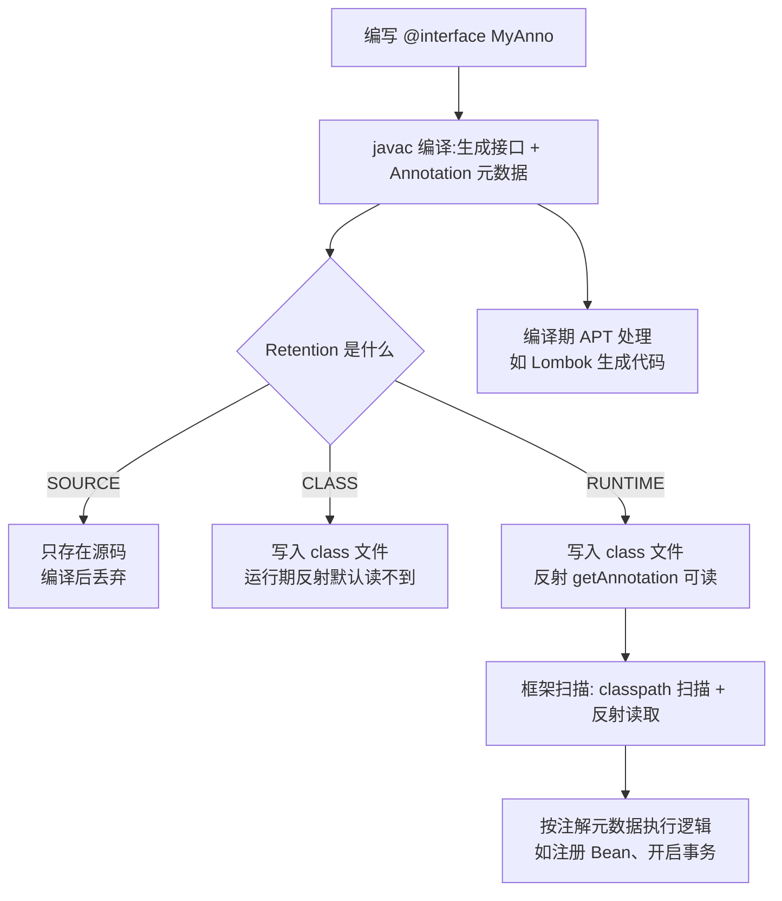

# 注解与注解处理器

> [!abstract] 一句话总结
> 注解（Annotation）是贴在代码上的结构化元数据，本身不执行任何逻辑；它的价值在于被**读取**——编译期由注解处理器（APT）读、运行期由反射读（`getAnnotations`），Spring 的 `@Component/@Transactional`、Lombok、JUnit 全部建立在这个机制上。

## 🎯 本节定位

- **本章第 13 课，运行期机制收尾**。前置：[[12-反射与动态代理/_index|12-反射与动态代理]]——运行期注解必须靠反射读取，注解的默认实现甚至就是 JDK 动态代理（衔接 08 课知识）。
- **延伸阅读（本课不展开）**：Spring 的组合注解（`@Component` 派生）、`@Transactional` 的拦截链路属于 04-Spring 生态章节；注解处理器（APT）生成代码（如 Lombok）属于编译期工具，本课讲原理不深挖插件开发。

## 📌 这是什么

- 注解是一种**接口**（`@interface` 编译后就是 interface），它的"方法"是注解元素（`String value() default ""`）。
- 注解本身**不执行任何代码**，只是结构化元数据：贴在类、方法、字段、参数上，供其他程序读取后做决策。
- 读取时机决定一切：**编译期**（注解处理器生成/校验代码）或**运行期**（反射扫描）。
- 常用内置注解：`@Override`（编译期检查）、`@Deprecated`、`@SuppressWarnings`、`@FunctionalInterface`（衔接 [[10-Lambda与Stream]]）。

## 🤔 解决什么问题 / 为什么需要

- **给代码附加语义**：`@Transactional` 声明"这个方法要开事务"、`@NotNull` 声明"这个参数不能为 null"——元数据与业务代码分离，不污染逻辑。
- **框架的配置入口**：Spring/MyBatis/JUnit 用注解替代 XML 配置，扫描 + 反射读取注解即完成装配。
- **编译期检查与代码生成**：`@Override` 防手滑、Lombok 的 `@Data` 生成样板代码、Android 的注解处理——编译期就把事情做完，运行期零开销。
- 面试必考：四个元注解、生命周期（Retention）、注解怎么被读取。

## 🧩 核心概念

| 概念         | 含义                                                                     | 精通要点                                    |
| ---------- | ---------------------------------------------------------------------- | --------------------------------------- |
| 元注解        | 注解的注解：`@Target`/`@Retention`/`@Documented`/`@Inherited`/`@Repeatable`。 | `@Target` 和 `@Retention` 是必懂的两个。        |
| @Target    | 注解能贴在哪：TYPE/METHOD/FIELD/PARAMETER/CONSTRUCTOR...                      | 贴错位置编译报错。                               |
| @Retention | 保留到什么时候：SOURCE/CLASS/RUNTIME。                                          | **运行期反射读必须 RUNTIME**。                   |
| 注解元素       | 注解里声明的"方法"，用默认值可省略。                                                    | 元素类型限基本类型/String/Class/枚举/注解/数组。        |
| APT        | 编译期注解处理器（javax.annotation.processing）。                                 | Lombok 的原理，运行期无痕迹。                      |
| 组合注解       | 元注解上再贴注解（Spring 大量使用）。                                                 | 如 `@Service` 上贴 `@Component`，扫描器看到派生注解。 |

## ⚙️ 工作原理 / 流程



**读取注解的两条路**：
1. **编译期（APT）**：javac 调用注册的处理器，处理器用 `RoundEnvironment` 拿到带注解的元素，生成新源码/校验错误——产物在运行期完全看不到注解痕迹（SOURCE/CLASS 都够）。
2. **运行期（反射）**：`Class.getAnnotation` / `getDeclaredAnnotations` 读取——**必须 `@Retention(RUNTIME)`**，且配合 `@Target` 决定从哪类元素上读。

## 🔍 源码 / 原理深挖

### 注解的默认实现就是动态代理

运行期读取 `getAnnotation(X.class)` 时，如果注解没有实现类，JVM 会通过 **JDK 动态代理**（衔接 [[12-反射与动态代理/_index|12-反射与动态代理]]）生成一个实现注解接口的代理对象：调用注解元素方法（如 `anno.value()`）时，代理从内部维护的 `memberValues` Map 里取值返回。所以 `getAnnotation` 返回的对象 `getClass()` 是 `$Proxy`，且**不是同一实例**时不能 `==` 比较（要比较内容）。

### Retention 与 class 文件

- SOURCE：注解在 `.java` 里，**编译后不写入** `.class`（如 `@Override`）。
- CLASS：写入 `.class` 的 `RuntimeVisibleAnnotations`/`RuntimeInvisibleAnnotations` 属性，但运行期反射 API 默认读不到（除非用 `getDeclaredAnnotationsByType` 的底层机制——实际上 CLASS 级别反射拿不到，只有 RUNTIME 能被反射读）。
- RUNTIME：写入 class 文件且带 `RuntimeVisibleAnnotations` 标记，反射可读。
- 面试一句话：**运行期要读的注解必须 RUNTIME**——`@Override` 是 SOURCE 所以反射永远拿不到它。

### 注解元素语法限制

元素类型只能是：基本类型、`String`、`Class`、枚举、注解、以上类型的数组。不能用对象类型（如 `List`）——因为注解值在编译期就要确定并写入 class 文件（常量），运行时对象没法序列化进去。这也是为什么 Spring 注解里配置值都是字符串/枚举/Class。

### Spring 的组合注解机制

`@Service` 上贴着 `@Component`。Spring 扫描时用元数据读取器（`MergedAnnotations`）**递归**读取"注解上的注解"，发现 `@Service` 元注解含 `@Component` 就按组件注册。这解释了为什么 `@Transactional` 可以贴在 `@Service` 类上被识别——框架读的是注解层级而不是单个注解。

## 💻 代码实践 / 排查命令

```java
// 1. 自定义运行期注解
@Retention(RetentionPolicy.RUNTIME)   // 反射要读，必须 RUNTIME
@Target({ElementType.METHOD, ElementType.TYPE})  // 可贴方法/类
public @interface ApiLog {
    String module() default "";
    boolean needAuth() default true;
}

// 2. 用反射读取注解（衔接 08 课）
@ApiLog(module = "user")
public class UserController {
    @ApiLog(module = "user", needAuth = false)
    public void findUser() {}
}

Class<?> clazz = UserController.class;
ApiLog classAnno = clazz.getAnnotation(ApiLog.class);
System.out.println(classAnno.module());            // user

Method m = clazz.getMethod("findUser");
ApiLog methodAnno = m.getAnnotation(ApiLog.class);
System.out.println(methodAnno.needAuth());         // false（默认值覆盖）

// 3. 全部注解
for (Annotation a : clazz.getAnnotations()) {
    System.out.println(a.annotationType().getSimpleName());
}
```

```bash
# 排查注解不生效：先看 Retention 和 Target
javap -v Xxx.class | findstr -i "RuntimeVisibleAnnotations"   # RUNTIME 才有
# 框架注解不生效 → 检查类是否被扫描到、代理是否保留注解（CGLIB 默认保留）
```

## 🛠️ 排查 / 实践要点

- **注解不生效三步查**：① `@Retention` 是不是 RUNTIME（反射读不到 SOURCE/CLASS）；② `@Target` 是否覆盖你贴的位置；③ 框架是否扫描到了这个类（包路径、`@ComponentScan`）。
- **代理类丢注解**：JDK 动态代理默认不保留接口上的注解（除非接口方法也标了）；Spring 用 `AnnotationUtils` 处理，但自写代理要注意。
- **别在注解里放动态值**：注解值是编译期常量，运行时变量放不进去（要动态配置用 `@Value`/properties，见 Spring 章节）。
- **Lombok 踩坑**：它是编译期 APT，IDE 需要装插件才能看到生成的方法（`mvn compile` 能过但 IDE 报错时先查 Lombok 插件）。

## ⚠️ 踩坑与注意事项

- 忘记 `@Retention(RUNTIME)`，反射 `getAnnotation` 返回 null——最经典的注解 bug。
- `@Target` 设错：注解贴在错误位置，编译期直接报错或静默无效。
- 用 `==` 比较注解对象（代理实例，应比较内容/元素值）。
- 注解元素用了不允许的类型（如 `List`）→ 编译错误。
- 在注解里塞大量复杂"配置"，导致注解难以阅读——重配置应移到外部化配置。
- 自定义注解没有消费方：写了注解没人读，等于没写（注解本身无逻辑）。

## 🎯 面试问题

> [!question]- 注解是怎么工作的？运行期怎么读取？
> 注解是接口 + 元数据。运行期读取必须 `@Retention(RUNTIME)` 并写入 class 文件，框架用反射 `getAnnotation/getAnnotations` 读取，读取结果由 JDK 动态代理实现。

> [!question]- SOURCE/CLASS/RUNTIME 区别？
> SOURCE 只存在于源码（如 @Override）；CLASS 写入 class 文件但运行期反射读不到；RUNTIME 写入 class 文件且反射可读。运行期要用的必须 RUNTIME。

> [!question]- 注解能做什么？举例。
> 编译期检查（@Override）、代码生成（Lombok @Data 走 APT）、框架配置与横切声明（Spring @Transactional/@Component 走反射扫描 + 代理拦截）。

> [!question]- 为什么注解元素不能用 List 类型？
> 注解值在编译期就要确定并写入 class 文件常量区，只能是基本类型/String/Class/枚举/注解/其数组；运行期对象无法静态写入。
## 🧭 源码入口速查

- `java.lang.annotation.Retention`/`Target`/`Documented`/`Inherited`/`Repeatable`：五个元注解。
- `Class#getAnnotation/getAnnotations/getDeclaredAnnotations`：运行期反射读取入口。
- `sun.reflect.annotation.AnnotationInvocationHandler`：注解代理实现（JDK 动态代理 + memberValues Map）。
- `javax.annotation.processing.Processor`、`RoundEnvironment`：编译期 APT 处理器接口。
- `java.lang.Class#getAnnotationsByType`：支持 `@Repeatable` 的重复注解读取。

## 🧪 最小验证

```java
// 1. Retention 决定能否反射读取
@Retention(RetentionPolicy.SOURCE)
@interface SourceAnno {}
@Retention(RetentionPolicy.RUNTIME)
@interface RuntimeAnno {}

@SourceAnno @RuntimeAnno
class Demo {}
System.out.println(Demo.class.getAnnotation(SourceAnno.class));  // null！
System.out.println(Demo.class.getAnnotation(RuntimeAnno.class)); // @RuntimeAnno()

// 2. 注解代理验证（衔接 08 课）
Method m = Demo.class.getMethod("toString");
RuntimeAnno a = Demo.class.getAnnotation(RuntimeAnno.class);
System.out.println(a.getClass());   // class jdk.proxy1.$Proxy1 —— 就是动态代理
```

生产排障顺序：注解不生效 → 查 Retention（是否 RUNTIME）→ 查 Target（位置对不对）→ 查扫描路径（类有没有被框架看到）→ 查代理（注解是否被代理类保留）。

## ✅ 精通检查清单

- 能用自己的话讲清本主题解决的问题和适用边界。
- 能指出至少 2 个源码入口或底层机制。
- 能给出一个最小代码示例或一组线上排查命令。
- 能回答本页列出的高频面试题，并补充项目中的真实取舍。

## 🔗 关联笔记

- 本课内：上一课 [[12-反射与动态代理/_index|12-反射与动态代理]]（读取机制）；应用见 [[10-Lambda与Stream]]（@FunctionalInterface）
- 延伸：Spring 组合注解与 `@Transactional` 拦截在 04-Spring 生态章节；Lombok APT 原理属编译期工具

## 📚 参考资料

- [Dev.java Tutorials](https://dev.java/learn/)
- [Oracle Java Documentation](https://docs.oracle.com/en/java/)
- [JLS 9.7 - Annotations](https://docs.oracle.com/javase/specs/jls/se21/html/jls-9.html#jls-9.7)
