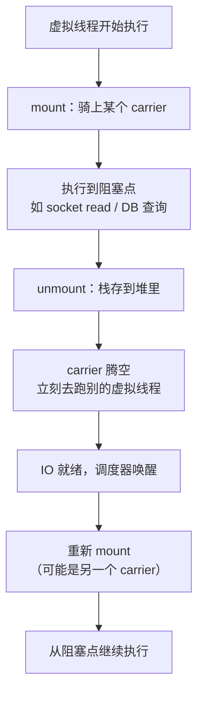

# 虚拟线程

> [!abstract] 一句话总结
> 虚拟线程（Java 21 正式）让"一个任务一个线程 + 同步阻塞写法"重新可行：线程从"昂贵的操作系统资源"变成"堆里的普通对象"，阻塞时让出底层平台线程而不是占着它，所以十万个线程也扛得住。它是 Java 21 最重要的语言级特性，也是并发章节的入口。

> [!info] 本课是入门，深入在并发章节
> 本课只讲**是什么、为什么、怎么写**，读完能正确用起来。调度器细节、pinning 的实测代价（慢 57 倍）、和线程池/CompletableFuture 的职责划分、上线要压什么、老监控为什么失真——全部在 **[[20-Java后端/03-并发编程/11-虚拟线程深入|03-并发编程 · 11 虚拟线程深入]]**。
>
> 学完本课可以直接跳过去，也可以先把并发章 01-10 读完再回来，两条路都通。

## 🗣️ 白话版：线程为什么曾经很贵

一个传统线程（**平台线程**）本质上是操作系统的一个调度单位，JVM 只是包了一层。它的成本是两块：

- **栈空间**：默认约 1MB，而且是**预留的连续内存**，用不用都占着
- **调度成本**：切换要陷入内核，由操作系统决定谁跑

所以 1 万个连接配 1 万个线程，光栈就要约 10GB，加上内核调度开销——**撑不住**。这是当年必须学 NIO 的原因（见 [[11-IO与NIO]]）。

**虚拟线程换了个思路**：栈不放在预留的内存里，而是**放在堆上**，用多少占多少、能增长也能回收；调度不交给操作系统，而是 JVM 自己用一个线程池来跑。于是一个虚拟线程的成本就降到了"堆里一个对象"的量级——**十万个也就是十万个对象**。

关键的一句因果：**阻塞时的"等待"不再占用操作系统线程，所以线程数可以开得很大。**

## 📌 这是什么

| | 平台线程 platform thread | 虚拟线程 virtual thread |
| --- | --- | --- |
| 本质 | 包装一个 OS 线程 | JVM 管理的对象 |
| 栈 | 约 1MB，预留的连续内存 | 在堆上，按需增长 |
| 谁调度 | 操作系统内核 | JVM（一个专用 ForkJoinPool） |
| 数量级 | 千级（成本问题，不是硬限制） | 十万级 |
| 创建成本 | 贵，所以要池化复用 | 廉价，**不要池化** |
| 适合 | CPU 密集计算 | 阻塞 IO（HTTP / DB / MQ） |

用法上和普通线程**几乎一样**：`Thread`、`Runnable`、`Executors`、`try-catch`、调试器，全部通用。这是它最大的价值——**你不需要学一套新的编程模型**。

## 🤔 解决什么问题

Java 处理高并发 IO 一直在两个选项之间纠结：

**选项一：一个连接一个线程（BIO）。** 代码好写好读好调试，异常栈完整，事务和 `ThreadLocal` 都正常。缺点是线程太贵，撑不住高并发。

**选项二：事件驱动 + 回调（NIO / Reactive）。** 能扛高并发，但代码难写难读难排错：回调地狱或者一长串 `CompletableFuture`，异常栈断裂，`ThreadLocal` 失效，事务上下文得手动传。

**虚拟线程是第三条路：写选项一的代码，得到选项二的承载能力。** 这就是它的全部意义。IO 密集服务（HTTP 调用、数据库查询、消息消费）是它的主场。

反过来说，**它不加速任何计算**。CPU 密集任务用虚拟线程只会更慢（多付调度开销），原因在深入篇有机制层解释。

## 🧩 核心概念（只记四个）

| 概念 | 含义 |
| --- | --- |
| **carrier** | 承载虚拟线程的平台线程。虚拟线程执行时"骑"在某个 carrier 上，数量 ≈ CPU 核数 |
| **mount / unmount** | 骑上 / 卸下。虚拟线程阻塞时 unmount（栈存到堆），IO 就绪后重新 mount 继续跑 |
| **continuation** | 可挂起 / 恢复的执行体，unmount 时保存栈的底层机制 |
| **pinning** | 虚拟线程被"钉"在 carrier 上卸不下来，carrier 也被占住 —— **最大的坑，深入篇细讲** |

## ⚙️ 一次阻塞发生了什么



**关键因果**：carrier 只有核数那么多（比如 16 个），却能服务成千上万个虚拟线程，因为**每个虚拟线程在等待时都把 carrier 让了出来**。这就是"用同步代码获得高并发"的全部原理。

注意图里那句"可能是另一个 carrier"——虚拟线程**不绑定**特定平台线程，这是它和平台线程最本质的区别。

## 💻 三种创建方式

```java
// 1. 每任务一线程的执行器（最常用，首选）
try (var executor = Executors.newVirtualThreadPerTaskExecutor()) {
    for (var url : urls) {
        executor.submit(() -> fetch(url));      // 每个请求一个虚拟线程
    }
}   // try-with-resources 会等所有任务跑完

// 2. 直接创建单个
Thread vt = Thread.ofVirtual().name("my-vt").start(() -> blockingCall());
vt.join();                                       // ★ 必须 join，见下方警告

// 3. 结构化并发（Java 21 预览）：一组任务同生共死
try (var scope = new StructuredTaskScope.ShutdownOnFailure()) {
    var a = scope.fork(() -> callA());
    var b = scope.fork(() -> callB());
    scope.join().throwIfFailed();                // 任一失败则全部取消
    return combine(a.get(), b.get());
}
```

对比一下旧写法就能看出差别：

```java
// 旧：线程池有 200 个上限，2000 个任务要排 10 轮
var pool = Executors.newFixedThreadPool(200);

// 新：几万个任务同时在飞，写法几乎没变
var ex = Executors.newVirtualThreadPerTaskExecutor();
```

> [!warning] 虚拟线程永远是守护线程，且改不了
> `isDaemon()` 恒为 `true`，`setDaemon(false)` 会抛 `IllegalArgumentException`。含义是：**`main` 方法结束时，还在跑的虚拟线程会被直接掐掉**，不像平台线程会拦住 JVM 退出。
>
> 所以要么用 `try (var ex = ...)`（自动等待全部完成），要么自己 `join()`。这是最容易踩的入门坑——任务"莫名其妙没执行"通常就是这个。

## ⚠️ 三条现在就该知道的边界

深入篇会展开，但这三条影响"能不能正确用起来"，入门就得记住：

**① 不要池化虚拟线程。** 线程池存在的意义是复用昂贵资源，虚拟线程本来就廉价（创建 ≈ new 一个对象）。池化只会重新引入排队，把优势抹掉。**要么 `newVirtualThreadPerTaskExecutor()`，要么老实用平台线程池。**

**② 线程池原本兼任限流器，换掉后要显式补回来。** `newFixedThreadPool(200)` 既提供线程，也顺手把下游并发压在 200。虚拟线程只接了"执行"这个职责，**没接限流**：

```java
var permits = new Semaphore(200);               // 显式限流，意图比线程池大小清楚
try (var ex = Executors.newVirtualThreadPerTaskExecutor()) {
    ex.submit(() -> {
        permits.acquire();
        try { return call(); } finally { permits.release(); }
    });
}
```

不补这一步，就是迁移事故最常见的成因：十万请求砸向只有 20 个连接的连接池。

**③ 长临界区用 `ReentrantLock`，别用 `synchronized`。** 在 Java 21 上，虚拟线程在 `synchronized` 里阻塞会触发 pinning，并发能力退化到 carrier 数量级。深入篇有实测：同样的任务，`synchronized` 比 `ReentrantLock` **慢 57 倍**，而且和锁竞争无关。（Java 24 的 JEP 491 已修复，但 native 路径仍会 pin。）

## 🧪 最小验证（3 分钟）

```java
// 1. 十万虚拟线程各睡 1 秒
long t0 = System.currentTimeMillis();
try (var ex = Executors.newVirtualThreadPerTaskExecutor()) {
    for (int i = 0; i < 100_000; i++) {
        ex.submit(() -> { Thread.sleep(1000); return null; });
    }
}
System.out.println("耗时 = " + (System.currentTimeMillis() - t0) + " ms");
// 实测约 2,972 ms —— 多出来的 2 秒基本是创建十万个任务本身的开销，阻塞几乎不花钱

// 2. 看清虚拟线程的真身
Thread.ofVirtual().name("my-vt").start(() ->
    System.out.println(Thread.currentThread())).join();
// 输出: VirtualThread[#39,my-vt]/runnable@ForkJoinPool-1-worker-1
//                                          ↑ @ 后面是当前骑着的 carrier
```

第二个输出里 `@` 后面那段是排查的关键入口，深入篇会讲怎么读它。

## 🧠 自测题（先自己答，再展开）

> [!question]- Q1: 虚拟线程为什么能开十万个，而平台线程只能开几千个？
> 两个成本差异。**栈**：平台线程约 1MB 预留的连续内存，用不用都占；虚拟线程的栈在堆上，按需增长、能回收。**调度**：平台线程由操作系统内核调度，切换要陷入内核；虚拟线程由 JVM 用一个 ForkJoinPool 调度，切换就是改几个对象引用。
>
> 补一句准确的：平台线程的千级**不是硬限制而是成本问题**（本机实测能创建 2 万个），只是每个都占着 OS 调度实体和栈空间，不划算。

> [!question]- Q2: 为什么虚拟线程只适合 IO 密集，不适合 CPU 密集？
> 它的收益来自"阻塞时让出 carrier"。CPU 密集任务**没有阻塞点**，收益为零，还要多付一层 JVM 调度开销，所以更慢。
>
> 更硬的理由在深入篇：调度器的 `parallelism` 默认就等于 CPU 核数，十万个虚拟线程做纯计算，同时真正在跑的仍然只有核数那么多个。

> [!question]- Q3: 把 `newFixedThreadPool(200)` 直接换成虚拟线程，可能出什么事故？
> 限流消失。旧线程池同时扮演**执行器**和**限流器**两个角色，200 这个数字既是线程数也是下游并发上限。虚拟线程只接了执行职责，于是十万请求同时打向下游或连接池，全部排队超时。
>
> 修法：用 `Semaphore(200)` 显式把限流补回来。这个写法其实更好——"限流到 200"的意图比"线程池开 200 个"清楚得多，也不再把两个概念耦合成一个数字。

## 🎯 面试问题

> [!question] 高频问题
> - Q: 虚拟线程和平台线程的区别？
>   - **30 秒版**：平台线程包装 OS 线程，约 1MB 预留栈、内核调度，千级别；虚拟线程是 JVM 调度的对象，栈在堆上按需增长，十万级别。核心机制是阻塞时 unmount 让出 carrier 平台线程。
>   - **2 分钟版**：补 carrier / mount / unmount 三个概念，补"虚拟线程不绑定特定平台线程"，补"永远是守护线程且改不了"，补数量级实测（十万虚拟线程各睡 1 秒约 3 秒跑完）。
> - Q: 虚拟线程适合什么场景？
>   - **30 秒版**：大量阻塞 IO（HTTP / DB / MQ）。阻塞不再占平台线程，所以同步代码也能获得高并发承载。不适合 CPU 密集（不增加算力）。
>   - **2 分钟版**：补它解决的是"BIO 好写但撑不住"和"NIO 扛得住但难写"之间的矛盾——写法一的代码、写法二的承载力。补三条边界：别池化、限流要显式补回来、长临界区用 ReentrantLock。
> - Q: 用了虚拟线程还需要连接池和限流吗？
>   - **30 秒版**：需要。虚拟线程只省线程成本，连接池容量、下游 QPS、限流令牌都是独立的硬上限，瓶颈从"线程数"转移到这些下游资源。
>   - **2 分钟版**：补职责拆分——执行归虚拟线程、限流归 Semaphore/连接池、编排归 CompletableFuture；平台线程时代线程池同时干了前两件，这是迁移事故的主要来源。

## 🪝 记忆钩子

- **"线程从昂贵的内核资源，变成堆里的普通对象。"**
- **carrier 是收银员（16 个），虚拟线程是顾客（十万个）**；顾客翻包找钱时收银员去服务别人，这就是 unmount。
- **"写 BIO 的代码，拿 NIO 的承载。"** 一句话说清它的定位。
- **"只接了执行，没接限流。"** 迁移事故八成出在这句上。
- **虚拟线程永远是守护线程** → `main` 一结束就被掐，记得 `join`。

## 🧭 源码入口速查

- `Thread#ofVirtual`、`Executors#newVirtualThreadPerTaskExecutor`：创建入口。
- `java.lang.VirtualThread`：实现主体，`mount()` / `unmount()` 是核心。
- `jdk.internal.vm.Continuation`：栈的挂起与恢复。
- `jcmd <pid> Thread.dump_to_file -format=json`：唯一能看到虚拟线程的 dump 方式（**`jstack` 看不到**）。

## ✅ 精通检查清单

- 能说清平台线程贵在哪两块（栈 + 调度），以及虚拟线程分别怎么绕开。
- 能画出一次阻塞的 mount → unmount → 重新 mount 流程，并说明为什么可能换 carrier。
- 能写出三种创建方式，并说出为什么必须 `join` 或用 try-with-resources。
- 能说出三条边界（别池化、限流要补、长临界区用 ReentrantLock）及各自理由。
- 能解释为什么它不加速 CPU 密集任务。

## 🔗 关联笔记

- **深入篇：[[20-Java后端/03-并发编程/11-虚拟线程深入|03-并发编程 · 11 虚拟线程深入]]** — 调度器参数、pinning 实测 57 倍、与线程池/CompletableFuture 的职责划分、监控失真、上线压测清单
- 本章内：上一课 [[14-Java新特性-Record与密封类]]（同为 Java 21 现代特性）；前置 [[11-IO与NIO]]（BIO 撑不住 → NIO 难写 → 虚拟线程的完整脉络）、[[02-异常处理最佳实践]]（任务异常与 `Future.get` 的 cause 链）
- 并发章延伸：[[20-Java后端/03-并发编程/01-线程基础与生命周期|线程基础与生命周期]] · [[20-Java后端/03-并发编程/07-线程池原理与参数|线程池原理与参数]] · [[20-Java后端/03-并发编程/09-CompletableFuture异步编程|CompletableFuture]] · [[20-Java后端/03-并发编程/10-ThreadLocal详解|ThreadLocal]]

## 📚 参考资料

- [JEP 444: Virtual Threads](https://openjdk.org/jeps/444)
- [JEP 491: Synchronize Virtual Threads without Pinning](https://openjdk.org/jeps/491)
- [Dev.java Tutorials](https://dev.java/learn/)
