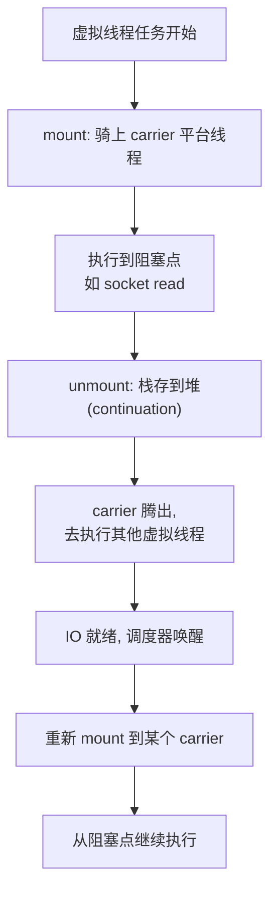

# 虚拟线程

> [!abstract] 一句话总结
> 虚拟线程（JDK 21 正式）让"一个阻塞任务一个线程"的同步写法重新可行：线程从"昂贵的内核资源"变成"廉价的 JVM 对象"，代价是下游资源（连接池、限流）成为新瓶颈；理解调度（mount/unmount）与 pinning，才能用好它而不踩坑。

## 🎯 本节定位

- **本章第 15 课（最后一课），并发主题入口**。前置：[[02-异常处理最佳实践]]（虚拟线程任务的异常处理）、[[10-Lambda与Stream]]（并行流与虚拟线程的边界）。
- **延伸阅读（本课是入门，深入在并发章节）**：线程生命周期、JMM、锁与 AQS 在 [[20-Java后端/03-并发编程/01-线程基础与生命周期|03-并发编程]]；线程池治理在 [[20-Java后端/03-并发编程/07-线程池原理与参数|线程池原理与参数]]；虚拟线程与 CompletableFuture 的取舍在 [[20-Java后端/03-并发编程/09-CompletableFuture异步编程|CompletableFuture]]。

## 📌 这是什么

- **平台线程**（platform thread）：传统线程，JVM 包装操作系统线程，1 个线程 ≈ 1MB 栈（默认）+ 内核调度实体，**创建和切换都贵**。
- **虚拟线程**（virtual thread）：JVM 自己调度的轻量线程，栈在堆上（可增长、可回收），**10 万个虚拟线程也只是堆里 10 万个对象**，创建/阻塞/切换成本远低于平台线程。
- 用法上虚拟线程**和普通线程几乎一样**：`Thread`、`Runnable`、`Executors` API 通用，业务代码可以继续写同步阻塞风格。

## 🤔 解决什么问题 / 为什么需要

- **BIO 的线程成本撑不住高并发**：一个连接一个平台线程，1 万连接就要 1 万线程（约 10GB 栈 + 大量调度开销）——这是 [[11-IO与NIO]] 讲 NIO 的原因。
- **NIO/异步又太难写**：事件驱动、回调、CompletableFuture 链式调用，代码难读难排错，事务/上下文传递易错。
- **虚拟线程给出第三条路**：**用同步阻塞代码，获得接近 NIO 的并发承载**——IO 密集服务（HTTP 调用、DB 查询、消息消费）是它的主场。
- 一句话因果：**阻塞时的"等待"不再占用操作系统线程，所以线程数可以很大**。

## 🧩 核心概念

| 概念 | 含义 | 精通要点 |
| ---- | ---- | -------- |
| 平台线程 | 包装 OS 线程，昂贵。 | 数量级：千级别。 |
| 虚拟线程 | JVM 调度的轻量线程。 | 数量级：十万级别，栈在堆上。 |
| carrier | 承载虚拟线程的平台线程。 | 虚拟线程实际执行时"骑"在某个平台线程上。 |
| mount/unmount | 虚拟线程与 carrier 的绑定/解绑。 | 阻塞时 unmount，就绪后 mount。 |
| continuation | 可挂起/恢复的执行体，虚拟线程的底层实现。 | 栈被保存到堆上。 |
| pinning | 虚拟线程被钉在 carrier 上无法卸载。 | synchronized 块/native 调用期间可能发生。 |
| 容量边界 | 线程省了，但连接池/下游/限流不省。 | 新瓶颈从"线程数"转移到"下游资源"。 |

## ⚙️ 工作原理 / 流程



**关键因果**：虚拟线程阻塞时，它**让出 carrier**（平台线程）而不是占用它。carrier 数量 ≈ CPU 核数级别，却可以服务成千上万个虚拟线程——这就是"用同步代码获得高并发"的原理。

## 🔍 源码 / 原理深挖

### 创建虚拟线程的三种方式

```java
// 1. 每任务一线程的执行器（最常用，推荐）
try (var executor = Executors.newVirtualThreadPerTaskExecutor()) {
    executor.submit(() -> blockingCall());
}

// 2. 直接创建
Thread vt = Thread.ofVirtual().name("vt-").start(() -> blockingCall());

// 3. 批量（结构化并发入口）
try (var scope = new StructuredTaskScope.ShutdownOnFailure()) {
    scope.fork(() -> callA());
    scope.fork(() -> callB());
    scope.join();
}
```

### pinning 详解（最容易踩的坑）

虚拟线程进入 **synchronized 块**或执行**某些 native 方法**（如 `FileInputStream.read`、`JNI` 调用）时，JVM 无法在阻塞点安全地卸载它的栈 → 被"钉"在 carrier 上。此时：
- 该虚拟线程阻塞，**carrier 也被占用**，其他虚拟线程无法使用这个 carrier；
- 大量线程同时 pinning 在 synchronized 上 → 并发能力退化成平台线程数量级。

**规避**：
- 长时间持锁的临界区用 `ReentrantLock`（Java 23 起 synchronized 的 pinning 在 JVM 层逐步修复，但业务代码仍建议长锁用 ReentrantLock，详见并发章节）；
- 少用同步 IO 的 native 路径（FileChannel 等）。

### 与线程池 / CompletableFuture 的边界

| 场景 | 建议 |
| --- | --- |
| 大量阻塞 IO 任务（HTTP/DB/消息） | 虚拟线程（每任务一线程，不用池） |
| CPU 密集计算 | 平台线程 + 固定线程池（核数级） |
| 需要取消/超时/编排多个异步结果 | CompletableFuture（虚拟线程下写同步代码也行） |
| 有共享长临界区锁 | 注意 pinning，考虑 ReentrantLock |

### 容量边界：省了线程，没省资源

虚拟线程数量可以很大，但**数据库连接池、HTTP 连接池、下游 QPS、限流令牌都是硬上限**：
- 10 万虚拟线程同时等 20 个数据库连接 → 连接等待时间暴涨、应用 P99 恶化；
- 虚拟线程不能替代限流：下游每秒只收 1000 请求，开 10 万线程只会更快打爆它。
- **上线前压测三件套**：应用 P99、连接池等待时间、下游 QPS/限流。

## 💻 代码实践 / 排查命令

```java
// 正确用法：阻塞 IO 服务直接每任务一线程
try (var executor = Executors.newVirtualThreadPerTaskExecutor()) {
    List<Future<String>> futures = urls.stream()
        .map(url -> executor.submit(() -> fetch(url)))   // 每个请求一个虚拟线程
        .toList();
    for (var f : futures) f.get();   // 同步等待，写法不变
}
// 对比：旧写法 newFixedThreadPool(200) 有线程数上限；虚拟线程可开到几万
```

```bash
# 观察虚拟线程（JDK 21+）
jcmd <pid> Thread.dump_to_file -format=json threads.json
# 栈里大量名为 "virtual" 的线程是正常的；注意看是否有线程卡在 synchronized/native 上（pinning 信号）
jcmd <pid> Thread.dump_to_file -format=text threads.txt
# 文本格式里 pinned 线程会标注 "Carrier thread"
```

## 🛠️ 排查 / 实践要点

- **先确认场景**：IO 密集（HTTP、DB、MQ）才用虚拟线程；CPU 密集用了反而更慢（调度开销）。
- **连接池必须治理**：虚拟线程数量 > 连接池容量时，压测连接池等待时间；必要时提高池大小或限流（连接池是新的"线程数"）。
- **pinning 观察**：压测时看线程 dump，若有大量虚拟线程 pinned 在 synchronized，换 ReentrantLock。
- **ThreadLocal 慎用**：虚拟线程数量大，ThreadLocal 数量也大（每个虚拟线程一份），注意清理（try-finally remove）。
- **异常处理不变**：任务异常按 [[02-异常处理最佳实践]] 处理，`Future.get` 抛 `ExecutionException` 取 `getCause()`。

## ⚠️ 踩坑与注意事项

- 用虚拟线程**绕过连接池容量限制** → 数据库/下游被打爆（最常见事故）。
- 在虚拟线程里长时间持有 synchronized 锁 → pinning，并发退化为平台线程水平。
- 把虚拟线程当 CPU 加速器 → 计算密集型反而更慢。
- 大量 ThreadLocal 不清理 → 内存上涨（虚拟线程多了，ThreadLocal 也跟着多）。
- 老库不兼容：某些库（如旧版 JDBC 驱动）在虚拟线程里表现异常，先小范围灰度。
- 虚拟线程**不是**"不用管资源"的银弹：限流、熔断、连接池治理照旧（见系统设计章节）。

## 🎯 面试问题

> [!question] 高频问题
> - Q: 虚拟线程和平台线程的区别？
>   - A: 平台线程包装 OS 线程，约 1MB 栈、内核调度，千级别上限；虚拟线程是 JVM 调度的轻量对象，栈在堆上可增长，十万级别。虚拟线程阻塞时让出 carrier 平台线程。
> - Q: 虚拟线程适合什么场景？为什么？
>   - A: 大量阻塞 IO 任务：阻塞等待不再占平台线程，同步代码获得高并发承载。不适合 CPU 密集（不增加算力）和共享长临界区（pinning）。
> - Q: pinning 是什么？怎么避免？
>   - A: 虚拟线程在 synchronized 块或 native 调用处无法卸载栈，被钉在 carrier 上，阻塞时 carrier 也被占用。避免：长锁用 ReentrantLock、少用同步 native IO。
> - Q: 用了虚拟线程还需要连接池/限流吗？
>   - A: 需要。虚拟线程只省线程成本，数据库连接、下游 QPS、限流令牌是独立硬上限，瓶颈会从线程数转移到这些下游资源，必须照旧治理。

## 🧭 源码入口速查

- `Thread#ofVirtual`、`Executors#newVirtualThreadPerTaskExecutor`：创建入口。
- `java.lang.VirtualThread`：虚拟线程实现（JDK 内部基于 continuation）。
- `jdk.internal.vm.Continuation`：挂起/恢复的执行体。
- `ForkJoinPool`：虚拟线程调度器（JDK 21 用专属 ForkJoinPool 作为 scheduler）。
- `jcmd <pid> Thread.dump_to_file -format=json threads.json`：诊断入口。

## 🧪 最小验证

```java
// 1. 十万虚拟线程无压力
try (var ex = Executors.newVirtualThreadPerTaskExecutor()) {
    IntStream.range(0, 100_000).forEach(i -> ex.submit(() -> {
        Thread.sleep(1000);   // 阻塞 1 秒，但不占平台线程
        return i;
    }));
}   // 等待全部完成，肉眼可见地快

// 2. 对比：同样任务用平台线程池 newFixedThreadPool(200) 会排队很久

// 3. 观察线程名
Thread vt = Thread.ofVirtual().name("my-vt").start(() -> System.out.println(Thread.currentThread()));
// 打印 java.lang.VirtualThread[my-vt] —— 线程名、栈都在堆上
```

上线 checklist：压应用 P99、连接池等待时间、下游 QPS/限流；观察线程 dump 是否有大量 pinned；ThreadLocal 是否清理；与限流熔断配合（见系统设计章节）。

## ✅ 精通检查清单

- 能用自己的话讲清本主题解决的问题和适用边界。
- 能指出至少 2 个源码入口或底层机制。
- 能给出一个最小代码示例或一组线上排查命令。
- 能回答本页列出的高频面试题，并补充项目中的真实取舍。

## 🔗 关联笔记

- 本课内：上一课 [[14-Java新特性-Record与密封类]]；前置 [[11-IO与NIO]]（阻塞模型对比）
- 延伸（深入内容）：[[20-Java后端/03-并发编程/01-线程基础与生命周期|线程基础与生命周期]]、[[20-Java后端/03-并发编程/07-线程池原理与参数|线程池原理与参数]]、[[20-Java后端/03-并发编程/09-CompletableFuture异步编程|CompletableFuture]]

## 📚 参考资料

- [JEP 444: Virtual Threads](https://openjdk.org/jeps/444)
- [Dev.java Tutorials](https://dev.java/learn/)
- [Oracle Java Documentation](https://docs.oracle.com/en/java/)
