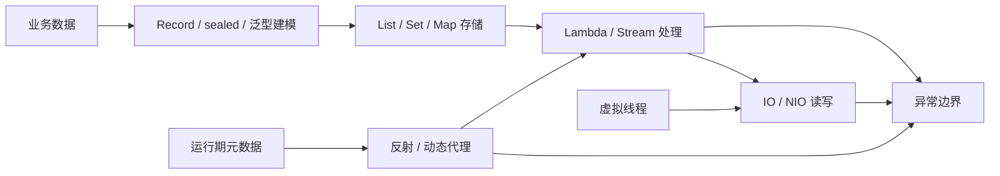

# Java 核心：本章总结与复习

> [!abstract] 一句话总结
> Java 核心的主线是：先用泛型与异常打好语言地基，用 List/Set/Map 组织数据、Stream 处理数据、IO/NIO 移动数据，再通过反射与代理理解框架的运行期机制，最后用 Record/sealed/虚拟线程完成现代建模——每一步都建立在前一步之上。

## 核心知识概览（按学习顺序）

| 模块 | 核心问题 | 关键结论 | 对应笔记 |
| --- | --- | --- | --- |
| 泛型 | 如何获得编译期类型安全并设计 API 边界 | 泛型运行期大多被擦除（为了二进制兼容）；用上界、通配符和 PECS 表达生产者与消费者 | [[01-泛型与类型擦除]] |
| 异常处理 | 如何让失败可分类、可恢复、可观测 | 保留 cause 和上下文，边界统一记录与转换；资源关闭用 try-with-resources（关闭异常进 suppressed） | [[02-异常处理最佳实践]] |
| 集合框架 | List、Set、Map 应如何选择 | 先按业务语义选接口，再按复杂度、顺序、并发边界选实现；equals/hashCode 契约是正确性地基 | [[03-集合框架-List-Map-Set源码]] |
| HashMap | 哈希访问、冲突和扩容如何工作 | 数组+链表/红黑树实现平均 O(1)；容量 2 的幂、负载因子 0.75、扩容按 hash & oldCap 拆链 | [[04-HashMap原理与扩容]] |
| Lambda 与 Stream | 如何声明式处理集合数据 | Lambda 走 invokedynamic；Stream 中间操作惰性、终端操作触发，短路与并行有明确边界 | [[05-Lambda与Stream]] |
| IO 与 NIO | 数据如何在文件、网络与内存间移动 | IO 面向流，NIO 面向 Buffer/Channel/Selector；flip/clear/compact 状态机、零拷贝、句柄泄漏 | [[06-IO与NIO]] |
| 反射与代理 | 框架如何在运行期检查、调用和增强对象 | 反射操作运行期元数据；动态代理把调用转入拦截器，必须经过代理对象才生效 | [[07-反射与动态代理]] |
| 现代 Java | 如何改善数据建模、类型约束和阻塞并发 | Record 浅不可变建模、sealed 限定继承边界、虚拟线程降低阻塞任务线程成本（深入在并发章） | [[08-Java新特性-Record-密封类-虚拟线程]] |

## 全章主线

## 学习因果链（为什么是这个顺序）

1. **泛型先于集合**：`List<String>`、`Map<K,V>`、`? extends T` 是集合 API 的语法本身，先懂擦除与 PECS，集合代码才不是"死记 API"。
2. **异常先于 IO**：所有文件/网络资源都要 try-with-resources + suppressed 语义，异常章是 IO 章的前置。
3. **集合先于 Stream**：Stream 的源头是集合，groupingBy/filter 的语义建立在 List/Map 之上。
4. **IO 与反射相对独立**：IO 管数据移动，反射管运行期机制，两者互不依赖，放哪都行——按"数据 → 机制"的顺序收尾。
5. **新特性最后**：record 做不可变 key 要用集合、反射 API 识别 record/sealed，前置齐全后再学，且虚拟线程衔接下一章（JVM/并发）。

## 快速复习

1. 泛型是编译期机制：擦除为上界或 Object；`new T()`/`new T[]`/`instanceof List<String>` 都不存在；桥接方法保多态。
2. PECS：`? extends T` 只读（生产者），`? super T` 只写（消费者）；反序列化用 TypeReference 把泛型留在匿名子类签名里。
3. 异常分 Error（不处理）与 Exception（Checked/Unchecked）；包装异常必须保留 cause；try-with-resources 的关闭异常挂 suppressed，不覆盖主异常。
4. 集合选型先看语义再看复杂度：List 保序、Set 去重、Map 键值；`List.contains` 是 O(n)，`HashSet.contains` 平均 O(1)。
5. equals/hashCode 契约：相等 ⇒ hashCode 相等；参与计算的字段不可变；两个一起重写。
6. HashMap：容量 2 的幂（位运算 + 拆链扩容）、扰动函数 `h ^ (h >>> 16)`、负载因子 0.75、链长 8 且容量 64 才树化、JDK 8 尾插避免环但并发仍不安全。
7. Lambda 走 invokedynamic（非匿名内部类）；捕获变量必须 effectively final；Stream 中间操作惰性、终端操作触发、短路找到即停。
8. NIO：flip 写→读（limit=position, position=0）、clear 丢弃未读、compact 保留未读；transferTo 零拷贝；句柄泄漏用 `lsof -p` 定位。
9. 反射慢在访问检查+装箱+间接调用，缓存 Method + setAccessible(true) 优化；`invoke` 的异常在 `InvocationTargetException.getCause()`。
10. JDK 代理只能代理接口（生成实现类），无接口用 CGLIB 子类代理；Spring 自调用不走代理所以事务失效。
11. record 浅不可变（组件引用对象仍可变）、compact constructor 可校验；sealed 收窄继承、支持穷尽匹配；虚拟线程适合阻塞 IO，瓶颈转移给连接池/下游，synchronized 长临界区会 pinning。

## 自测问题

1. 为什么 `List<? extends Number>` 不能 add、`List<? super Integer>` 不能安全读取？PECS 的因果关系是什么？
2. try-with-resources 里主逻辑和 close 都抛异常时会发生什么？为什么比手写 finally 安全？
3. 一个循环中频繁调用 `List.contains` 为什么可能成为慢接口，如何选择更合适的容器？
4. HashMap 扩容时节点为什么只会留在原索引或移动到"原索引+oldCap"？树化需要满足哪些条件、为什么？
5. Lambda 为什么只能捕获 effectively final 变量？Stream 的惰性执行和短路如何配合？
6. ByteBuffer 的 flip/clear/compact 分别在什么时机调用？忘了调用会发生什么？
7. 为什么 JDK 动态代理只能代理接口？Spring 事务自调用失效的根因是什么？
8. record 是深不可变吗？虚拟线程上线前要压哪些指标、瓶颈会转移到哪里？

## 下一章衔接

下一章进入 [[20-Java后端/02-JVM/_index|02 · JVM]]：把本章看到的类、对象、Lambda、反射、异常和线程放回 JVM 运行时——Class 对象怎么加载（类加载机制）、对象怎么布局、`fillInStackTrace` 的栈在内存里长什么样、OOM 怎么排查。虚拟线程与并发的深入内容在 [[20-Java后端/03-并发编程/_index|03 · 并发编程]]。

## 相关编号双链

- 语言地基：[[01-泛型与类型擦除]] · [[02-异常处理最佳实践]]
- 数据组织与处理：[[03-集合框架-List-Map-Set源码]] · [[04-HashMap原理与扩容]] · [[05-Lambda与Stream]]
- 数据移动与运行期：[[06-IO与NIO]] · [[07-反射与动态代理]]
- 现代建模：[[08-Java新特性-Record-密封类-虚拟线程]]
- 本章索引：[[_index]]
