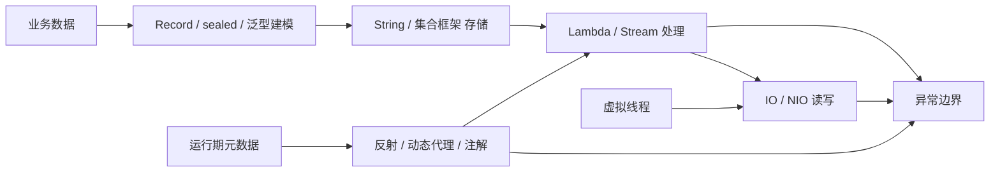

# Java 核心：本章总结与复习

> [!abstract] 一句话总结
> Java 核心的主线是：先用泛型、异常、String 打好语言地基，用集合框架（公共机制 + 各实现源码）组织数据、Stream 处理数据、IO/NIO 移动数据，再通过反射、代理、注解理解框架的运行期机制，最后用 Record/sealed 完成现代建模、用虚拟线程进入并发主题——每一步都建立在前一步之上，且面向面试（源码关键段 + 高频题）。

## 核心知识概览（按学习顺序）

| 模块 | 核心问题 | 关键结论 | 对应笔记 |
| --- | --- | --- | --- |
| 泛型 | 如何获得编译期类型安全并设计 API 边界 | 泛型运行期大多被擦除（为了二进制兼容）；用上界、通配符和 PECS 表达生产者与消费者 | [[01-泛型与类型擦除]] |
| 异常处理 | 如何让失败可分类、可恢复、可观测 | 保留 cause 和上下文，边界统一记录与转换；资源关闭用 try-with-resources（关闭异常进 suppressed） | [[02-异常处理最佳实践]] |
| String | 最常用类型如何做到安全与高效 | 不可变（安全/缓存 hashCode/池化/线程安全）；常量池复用；拼接用 StringBuilder 避免 O(N²) | [[03-String与字符串常量池]] |
| 集合总纲 | 集合框架的公共机制是什么 | 两棵家族树 + 选型表；equals/hashCode 契约、modCount/fail-fast、迭代器、Collections 工具类 | [[20-Java后端/01-Java核心/04-集合框架/01-核心机制与选型]] |
| List 实现 | 数组 vs 链表怎么选 | ArrayList 连续数组：查 O(1)、尾增摊还 O(1)、扩容 1.5 倍；LinkedList 定位 O(n)、内存 3 倍——业务默认 ArrayList | [[20-Java后端/01-Java核心/04-集合框架/02-List实现-ArrayList与LinkedList]] |
| Set 实现 | 去重与排序如何实现 | 全部委托 Map：HashSet→HashMap（O(1)）、LinkedHashSet→LinkedHashMap（保序）、TreeSet→TreeMap（O(log n) 排序）；Comparable vs Comparator | [[20-Java后端/01-Java核心/04-集合框架/03-Set实现-HashSet与TreeSet]] |
| HashMap | 哈希访问、冲突和扩容如何工作 | 数组+链表/红黑树实现平均 O(1)；容量 2 的幂、负载因子 0.75、树化 8/64、扩容按 hash & oldCap 拆链 | [[20-Java后端/01-Java核心/04-集合框架/04-HashMap原理与扩容]] |
| Map 变体 | 有顺序的 Map 怎么实现 | LinkedHashMap 加双向链表（插入序/accessOrder 做 LRU）；TreeMap 红黑树（有序、O(log n)、范围查询） | [[20-Java后端/01-Java核心/04-集合框架/05-Map实现-LinkedHashMap与TreeMap]] |
| Queue 实现 | 队列与优先级怎么实现 | ArrayDeque 循环数组（头尾 O(1)、替代 Stack）；PriorityQueue 二叉堆（入出 O(log n)、TopK） | [[20-Java后端/01-Java核心/04-集合框架/06-Queue实现-ArrayDeque与PriorityQueue]] |
| Lambda 与 Stream | 如何声明式处理集合数据 | Lambda 走 invokedynamic；Stream 中间操作惰性、终端操作触发，短路与并行有明确边界 | [[10-Lambda与Stream]] |
| IO 与 NIO | 数据如何在文件、网络与内存间移动 | IO 面向流，NIO 面向 Buffer/Channel/Selector；flip/clear/compact 状态机、零拷贝、句柄泄漏 | [[11-IO与NIO]] |
| 反射与代理 | 框架如何在运行期检查、调用和增强对象 | 反射操作运行期元数据；动态代理把调用转入拦截器，必须经过代理对象才生效 | [[12-反射与动态代理/_index|12-反射与动态代理]] |
| 注解 | 代码上的元数据如何被消费 | 注解本身无逻辑；运行期读取必须 RUNTIME（反射）；编译期由 APT 处理（Lombok）；框架靠扫描+反射 | [[13-注解与注解处理器]] |
| Record 与密封类 | 如何改善数据建模与类型约束 | Record 浅不可变数据载体（编译器生成值语义方法）；sealed 收窄继承边界、支持模式匹配穷尽 | [[14-Java新特性-Record与密封类]] |
| 虚拟线程 | 如何用同步代码获得高并发承载 | JVM 轻量线程，阻塞时让出 carrier；适合阻塞 IO，不适合 CPU 密集；容量瓶颈转移到连接池/下游 | [[15-虚拟线程]]（深入见 [[20-Java后端/03-并发编程/11-虚拟线程深入\|并发 11]]） |

## 全章主线

## 学习因果链（为什么是这个顺序）

1. **泛型先于集合**：`List<String>`、`? extends T` 是集合 API 的语法本身；PECS、桥接方法懂了，集合代码才不是"死记 API"。
2. **异常先于 IO**：所有文件/网络资源都要 try-with-resources + suppressed 语义，异常章是 IO 章的前置。
3. **String 先于集合**：String 是集合最常见的元素与 key，它的不可变性与 equals/hashCode 是"为什么 String 适合作 HashMap key"的答案。
4. **集合总纲先于实现篇**：契约、fail-fast、选型是所有实现的公共地基；实现篇只讲增量（各自的源码），不重复公共机制。
5. **集合先于 Stream**：Stream 的源头是集合，groupingBy/filter 的语义建立在 List/Map 之上。
6. **反射/注解连读**：注解必须靠反射读取（且注解默认实现就是动态代理），两者一起构成框架机制的完整图景。
7. **新特性收尾**：Record 做不可变 key 要用集合与反射 API，前置齐全后再学；虚拟线程作为并发主题入口衔接下一章（JVM/并发）。

## 快速复习

1. 泛型是编译期机制：擦除为上界或 Object；`new T()`/`new T[]`/`instanceof List<String>` 都不存在；桥接方法保多态；PECS：`? extends T` 只读、`? super T` 只写。
2. 异常分 Error（不处理）与 Exception（Checked/Unchecked）；包装异常必须保留 cause；try-with-resources 的关闭异常挂 suppressed，不覆盖主异常。
3. String 不可变四原因：安全、可缓存 hashCode、常量池共享才安全、线程安全；`+` 拼接循环内 O(N²)，用 StringBuilder。
4. 集合选型：List 保序、Set 去重、Map 键值、Queue 队列；默认 ArrayList/HashSet/HashMap/ArrayDeque，要顺序换 Linked/Tree 变体；`List.contains` O(n) vs `HashSet.contains` O(1)。
5. equals/hashCode 契约：相等 ⇒ hashCode 相等；参与计算的字段不可变；两个一起重写（record 自动生成）。
6. fail-fast：迭代器用 expectedModCount 检测结构修改，抛 ConcurrentModificationException；不是并发安全机制；循环内删除用 iterator.remove/removeIf。
7. ArrayList：扩容 `oldCapacity + (oldCapacity >> 1)`（1.5 倍）+ `Arrays.copyOf`，均摊 O(1)；remove(int) 要 arraycopy 前移 O(n)；LinkedList 定位 O(n)、内存 3 倍。
8. HashSet 一行委托 `map.put(e, PRESENT) == null`；LinkedHashSet 用 LinkedHashMap 保序；TreeSet 用 TreeMap，元素必须可比较，不允许 null。
9. HashMap：容量 2 的幂（位运算 + 拆链扩容）、扰动 `h ^ (h >>> 16)`、负载因子 0.75、链长 8 且容量 64 才树化、JDK 8 尾插避免环但并发仍不安全。
10. LinkedHashMap：before/after 双向链表，afterNodeInsertion 挂尾（插入序），accessOrder=true 时 get 移尾 + removeEldestEntry 淘汰 = LRU；TreeMap 红黑树中序遍历有序、O(log n)、不允许 null key。
11. ArrayDeque 循环数组（head/tail 绕回、不允许 null、替代 Stack）；PriorityQueue 二叉堆（siftUp/siftDown、O(log n)、迭代顺序 ≠ 优先级顺序、TopK 用小顶堆）。
12. Lambda 走 invokedynamic（非匿名内部类）；捕获变量必须 effectively final；Stream 中间操作惰性、终端操作触发、短路找到即停。
13. NIO：flip 写→读（limit=position, position=0）、clear 丢弃未读、compact 保留未读；transferTo 零拷贝；句柄泄漏用 `lsof -p` 定位。
14. 反射慢在访问检查+装箱+间接调用，缓存 Method + setAccessible(true) 优化；`invoke` 的异常在 `InvocationTargetException.getCause()`；JDK 代理只能代理接口。
15. 注解运行期读取必须 `@Retention(RUNTIME)`；注解代理实例不能 `==` 比较；注解元素只能是常量类型。
16. record 浅不可变、compact constructor 校验+防御性拷贝；sealed 收窄继承、支持穷尽匹配；虚拟线程适合阻塞 IO、瓶颈转移给连接池/下游、synchronized 长临界区会 pinning。

## 自测问题

1. 为什么 `List<? extends Number>` 不能 add、`List<? super Integer>` 不能安全读取？PECS 的因果关系是什么？
2. try-with-resources 里主逻辑和 close 都抛异常时会发生什么？为什么比手写 finally 安全？
3. `"a" + b` 在底层怎么执行？为什么 String 适合作 HashMap 的 key？
4. 集合选型：需要"去重且保插入序"用什么？需要"按 key 排序 + 范围查询"用什么？为什么？
5. ArrayList 扩容为什么是 1.5 倍？LinkedList 为什么插入不一定快？
6. HashSet 为什么能去重？TreeSet 为什么不允许 null？Comparable 和 Comparator 怎么选？
7. HashMap 扩容时节点为什么只会留在原索引或移动到"原索引+oldCap"？树化需要满足哪些条件、为什么？
8. LinkedHashMap 怎么做 LRU？TreeMap 为什么是 O(log n)？
9. ArrayDeque 为什么不允许 null？PriorityQueue 求 TopK 怎么写、复杂度多少？
10. Lambda 为什么只能捕获 effectively final 变量？Stream 的惰性执行和短路如何配合？
11. ByteBuffer 的 flip/clear/compact 分别在什么时机调用？忘了调用会发生什么？
12. 为什么 JDK 动态代理只能代理接口？Spring 事务自调用失效的根因是什么？
13. 注解的 SOURCE/CLASS/RUNTIME 区别？为什么注解默认实现是动态代理？
14. record 是深不可变吗？sealed 和 final / enum 怎么选？
15. 虚拟线程为什么能用同步代码获得高并发？pinning 是什么？上线前要压哪些指标？

## 下一章衔接

下一章进入 [[20-Java后端/02-JVM/_index|02 · JVM]]：把本章看到的类、对象、Lambda、反射、注解和线程放回 JVM 运行时——Class 对象怎么加载（类加载机制）、对象怎么布局、String 常量池存在哪、`fillInStackTrace` 的栈在内存里长什么样、OOM 怎么排查。虚拟线程与并发的深入内容在 [[20-Java后端/03-并发编程/_index|03 · 并发编程]]。

## 相关编号双链

- 语言地基：[[01-泛型与类型擦除]] · [[02-异常处理最佳实践]] · [[03-String与字符串常量池]]
- 集合域（子目录）：[[20-Java后端/01-Java核心/04-集合框架/_index|04 · 集合框架]]（6 篇：总纲/List/Set/HashMap/Map变体/Queue）
- 数据处理与移动：[[10-Lambda与Stream]] · [[11-IO与NIO]]
- 运行期机制：[[12-反射与动态代理/_index|12-反射与动态代理]] · [[13-注解与注解处理器]]
- 现代建模与并发入口：[[14-Java新特性-Record与密封类]] · [[15-虚拟线程]]（深入篇在 [[20-Java后端/03-并发编程/11-虚拟线程深入|并发编程 11]]）
- 本章索引：[[_index]]
