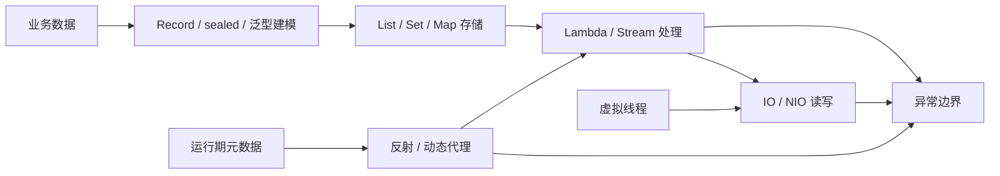

# Java 核心：本章总结与复习

> [!abstract] 一句话总结
> Java 核心的主线是用合适的数据结构和类型边界表达业务数据，用 Stream、IO 与现代语言能力处理数据，再通过反射、代理和异常体系支撑框架化与可观测的后端程序。

## 核心知识概览

| 模块 | 核心问题 | 关键结论 | 对应笔记 |
| --- | --- | --- | --- |
| 集合框架 | List、Set、Map 应如何选择 | 先按业务语义选接口，再按数据结构、复杂度、顺序和并发边界选实现 | [[01-集合框架-List-Map-Set源码]] |
| HashMap | 哈希访问、冲突和扩容如何工作 | 数组结合链表/红黑树实现平均 O(1) 访问；容量、负载因子和 key 语义决定性能与正确性 | [[02-HashMap原理与扩容]] |
| 泛型 | 如何获得编译期类型安全并设计 API 边界 | 泛型运行期大多被擦除；用上界、通配符和 PECS 表达生产者与消费者 | [[03-泛型与类型擦除]] |
| 反射与代理 | 框架如何在运行期检查、调用和增强对象 | 反射操作运行期元数据；动态代理把方法调用统一转入拦截器，但必须经过代理对象才会生效 | [[04-反射与动态代理]] |
| 异常处理 | 如何让失败可分类、可恢复、可观测 | 保留 cause 和上下文，在边界统一记录与转换；资源关闭优先用 try-with-resources | [[05-异常处理最佳实践]] |
| IO 与 NIO | 数据如何在文件、网络与内存间移动 | IO 面向流，NIO 面向 Buffer、Channel、Selector；选择取决于读写模型而非“NIO 一定更快” | [[06-IO与NIO]] |
| Lambda 与 Stream | 如何声明式处理集合数据 | Lambda 通常基于 `invokedynamic`；Stream 中间操作惰性执行，终端操作触发流水线 | [[07-Lambda与Stream]] |
| 现代 Java | 如何改善数据建模、类型约束和阻塞并发 | Record 表达浅不可变数据，sealed 限定继承层次，虚拟线程降低大量阻塞任务的线程成本 | [[08-Java新特性-Record-密封类-虚拟线程]] |

## 全章主线

## 快速复习

1. 集合选择先看语义：List 保序可重复，Set 去重，Map 表达键值；再比较访问、查找、插入的复杂度和实际数据量。
2. ArrayList 尾部追加和随机访问通常更合适；LinkedList 只有在已定位节点时插删才有优势，按下标定位仍是 O(n)。
3. HashMap 用 `(n - 1) & hash` 定位桶，默认负载因子为 0.75；扩容翻倍后按 `hash & oldCap` 拆成 low/high 两组。
4. HashMap 树化需要桶长度达到 8 且容量至少 64；可变 key、错误的 `equals/hashCode` 和并发写入都会破坏查找语义。
5. 泛型主要在编译期提供类型安全，擦除后变为上界或 Object；读取生产者用 `? extends T`，写入消费者用 `? super T`。
6. JDK 动态代理依赖接口并进入 `InvocationHandler`；子类代理不能增强 final 方法，Spring 自调用会绕过代理拦截。
7. 异常处理要保留 cause、错误码和业务上下文；边界层集中记录一次日志，try-with-resources 的关闭异常可从 suppressed 中查看。
8. NIO 的关键状态机是 `position/limit/capacity`：写后 `flip`，读完按场景 `clear` 或 `compact`；大文件不要直接 `readAllBytes`。
9. Stream 不保存数据，中间操作惰性、终端操作触发执行；`parallelStream` 默认使用 commonPool，不适合直接承载阻塞 IO 和共享可变状态。
10. Record 是浅不可变，sealed 约束合法子类型；虚拟线程适合阻塞 IO，但不能扩大数据库连接池、下游 QPS 或 CPU 容量。

## 自测问题

1. 一个循环中频繁调用 `List.contains` 为什么可能成为慢接口，如何选择更合适的容器？
2. HashMap 扩容时节点为什么只会留在原索引或移动到“原索引 + oldCap”，树化又需要满足哪些条件？
3. 类型擦除、桥接方法和 `ParameterizedTypeReference` 分别解决或暴露了什么问题？
4. 为什么 Spring 事务自调用可能失效，如何确认当前 Bean 使用的是 JDK 代理还是子类代理？
5. 面对文件读取、Stream 处理或虚拟线程任务，如何同时检查资源关闭、内存占用、副作用和下游容量边界？

## 下一章衔接

下一章进入 [[../02-JVM/_index|02 · JVM]]：把本章看到的类、对象、Lambda、反射、异常和线程放回 JVM 运行时，继续理解内存区域、对象布局、类加载、GC 与线上诊断。

## 相关编号双链

- 集合与类型：[[01-集合框架-List-Map-Set源码]] · [[02-HashMap原理与扩容]] · [[03-泛型与类型擦除]]
- 运行期与边界：[[04-反射与动态代理]] · [[05-异常处理最佳实践]] · [[06-IO与NIO]]
- 数据处理与新特性：[[07-Lambda与Stream]] · [[08-Java新特性-Record-密封类-虚拟线程]]
- 本章索引：[[_index]]

