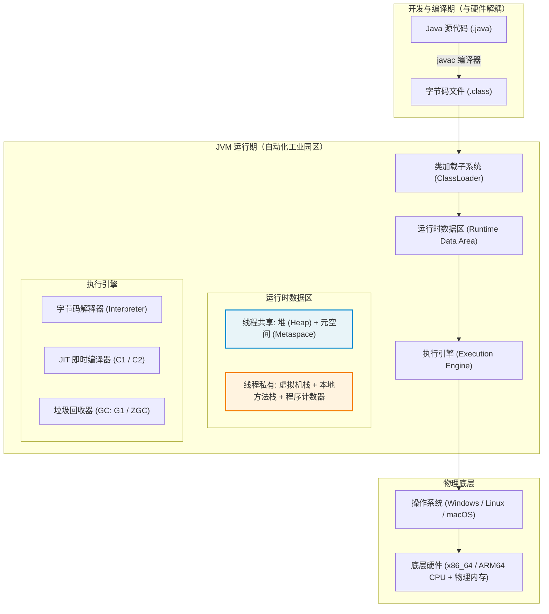
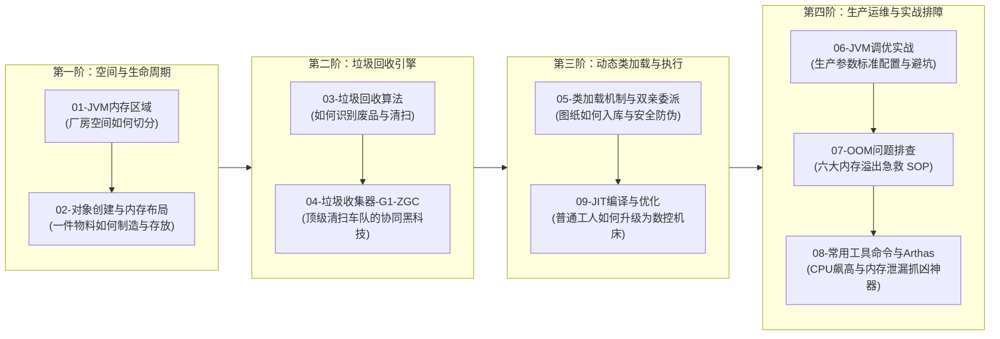

# JVM 全景与心智模型

> [!abstract] 一句话心智模型
> 如果把你的 Java 程序比作**一家现代化工业园区**：
> - **堆（Heap）** 是**自动化生产流水线与物料大车间**，所有的半成品、成品（对象实例）都在这里诞生与报废，机器日夜运转；
> - **虚拟机栈（Stack）** 是**工人的个人操作台与工作清单**，每个工人的任务井然有序，做完一项划掉一项（栈帧入栈与出栈），下班桌面空空如也；
> - **程序计数器（PC）** 是**工人的眼睛与工序指针**，精准盯住下一道工序的图纸编号（字节码行号）；
> - **元空间（Metaspace）** 是**园区的中央档案室与施工图纸库**，存放所有的标准化图纸与规格书（Class 结构与方法描述），建在园区外的永久地皮上（操作系统本地内存）；
> - **直接内存（Direct Memory）** 是**园区的保税区专用码头**，货物（NIO 数据）无需搬入车间直接从码头装船，直通操作系统内核（零拷贝）；
> - **垃圾回收器（GC）** 则是**全自动化的环卫清洁车队**，根据货物的折旧程度（弱分代假说）穿梭在流水线之间分拣与回收，确保厂房永不爆仓。

---

## 🎯 为什么需要 JVM？第一性原理推导

在没有 JVM 的 C/C++ 洪荒时代，程序员同时扮演“业务工程师”和“苦力搬砖工”：
1. **跨平台噩梦**：在 Windows 上编译的二进制可执行文件，换到 Linux 或 ARM 架构上直接报错崩溃，必须为每个硬件架构重新编译适配。
2. **手动内存管理的地狱**：每一块 `malloc()` 申请的内存，必须精准配对一次 `free()`。少写一次就会引发**内存泄漏**（系统被活活耗死），多写一次或错写就会引发**野指针悬挂与段错误（Segmentation Fault）**。

JVM 的横空出世，立足于两大终极使命：
- **一次编写，到处运行（Write Once, Run Anywhere）**：引入中间人“字节码（Bytecode）”与统一虚拟机规范，将程序员与底层硬件 CPU 指令集彻底解耦！
- **自动内存管理与垃圾回收（Garbage Collection）**：将程序员从繁琐、危险的内存申请与释放苦力活中彻底解放出来，由 JVM 自动化监控对象存活并回收空间。

---

## 🗺️ JVM 核心模块大白话对照表

| 核心区域 / 机制 | 工业园区生活化比喻 | 归属生命周期 | 核心职能与第一性原理 |
| :--- | :--- | :--- | :--- |
| **堆内存 (Heap)** | **物料总厂房 / 生产车间** | 进程生命周期（所有线程共享） | 存放几乎所有创建的 `new` 对象实例，是 GC 垃圾回收的主战场。按寿命长短细分为新生代（Eden/Survivor）与老年代。 |
| **虚拟机栈 (JVM Stack)** | **流水线工人的个人工位** | 线程私有（随线程生，随线程灭） | 记录每个线程执行的方法调用链路。每个方法对应一个**栈帧（Stack Frame）**，存放局部变量表、操作数栈、动态链接和方法出口。无需 GC！ |
| **程序计数器 (PC)** | **工人的工序编号指针** | 线程私有 | 记录当前线程正在执行的字节码指令地址。CPU 时间片轮转切换线程时，全靠它记住“上次做到哪一步了”。唯一不会 OOM 的区域！ |
| **本地方法栈 (Native Stack)**| **外包专家联络工位** | 线程私有 | 为 JVM 调用底层 C/C++ 本地方法（`native` 方法，如 JNI 调用、系统底层 API）服务的专属工作栈。 |
| **元空间 (Metaspace)** | **中央技术图纸与档案库** | 进程生命周期（所有线程共享） | 存放类的信息、方法字节码、字段描述、运行时常量池等。JDK 8+ 移出堆内存，改用物理操作系统的本地内存（Native Memory）。 |
| **堆外直接内存 (Direct Memory)** | **园区保税区专用码头** | 操作系统内存 | 通过 `Unsafe` 或 NIO `ByteBuffer.allocateDirect()` 分配，数据直接读写，避免内核缓冲区与 JVM 堆之间的二次数据拷贝（零拷贝基石）。 |
| **执行引擎 (Engine)** | **车间工人与高精数控机床** | 运行时核心 | 负责将字节码指令翻译成机器码。包含“解释执行”（随来随翻）与“JIT 编译器”（把热点循环直接编译为极速纯机器码）。 |
| **垃圾收集器 (GC)** | **全自动智能环卫清洁车队** | 后台持续运转 | 找出不再使用的废弃物料，安全回收内存空间。从最古老的单车清扫（Serial），进化到全并发多车道协同清扫（G1、ZGC）。 |

---

## 🚀 本章知识拓扑与阅读路径

为了让你不再觉得 JVM 是一堆杂乱无章的“参数列表与八股文”，我们按照**工业流水线的生产运作与运维保障闭环**，将全章划分为 4 个递进阶梯：

### 🧭 章节通关指南
1. **基础认知篇**：
   - 先读 [[01-JVM内存区域]]：彻底厘清堆、栈、元空间、直接内存的物理界限与职能。
   - 再读 [[02-对象创建与内存布局]]：从字节层面看一个 `new Object()` 在内存中到底占多少字节（对象头、指针压缩、对齐填充）。
2. **回收深水区**：
   - 研读 [[03-垃圾回收算法]]：三色标记法、漏标问题、增量更新与 SATB 的博弈。
   - 进阶 [[04-垃圾收集器-G1-ZGC]]：搞懂 G1 棋盘格与 ZGC 染色指针、读屏障，为什么 ZGC 能做到停顿时间低于 1 毫秒？
3. **加载与编译黑科技**：
   - 探索 [[05-类加载机制与双亲委派]]：为什么叫“双亲委派”？Tomcat 与 SPI 又是如何合情合理地打破它的？
   - 探索 [[09-JIT编译与优化]]：逃逸分析、方法内联、标量替换，为什么某些对象甚至根本不需要在堆上分配？
4. **工业实战救火篇**：
   - 掌握 [[06-JVM调优实战]]：微服务容器化（Docker/K8s）标准启动参数模板，参数设置背后的数学逻辑。
   - 掌握 [[07-OOM问题排查]]：六种 OOM 的精准识别与现场保留急救流程。
   - 掌握 [[08-常用工具-jstat-jmap-jstack-Arthas]]：线上 CPU 100% 与内存泄漏时，如何在 3 分钟内准确定位到具体的业务代码行。
   - 最后通关 [[99-本章总结与复习]]：全景脑图、大厂 30 秒必杀 10 连问与生产规约。
