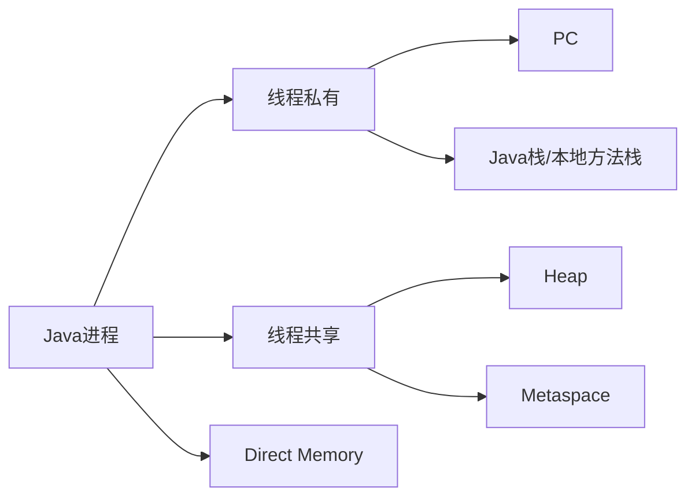

# JVM内存区域

> [!abstract] 一句话总结
> JVM 内存区域描述 Java 程序运行时数据放在哪里，是理解对象生命周期、GC、OOM 和线程栈问题的基础。

## 📌 这是什么

- 线程私有区域包括程序计数器、虚拟机栈、本地方法栈。
- 线程共享区域包括堆和方法区；HotSpot 中方法区常见实现是元空间。
- 直接内存不属于 JVM 运行时数据区规范的一部分，但 NIO 和 Netty 大量使用，排查 OOM 必须关注。

## 🤔 解决什么问题 / 为什么需要

- 看到 OutOfMemoryError 或 StackOverflowError 时能先判断是哪块内存出问题。
- 理解局部变量、对象、类元数据、常量、直接缓冲区的归属。
- 为 GC 日志分析、内存 dump 和参数调优建立地图。

## 🧩 核心概念

| 概念 | 含义 | 精通要点 |
| ---- | ---- | -------- |
| 程序计数器 | 记录当前线程执行到哪条字节码。 | 线程私有，几乎不会 OOM。 |
| 虚拟机栈 | 每次方法调用创建栈帧，保存局部变量表、操作数栈等。 | 栈太深可能 StackOverflowError。 |
| 堆 | 对象实例和数组主要分配区域。 | GC 管理重点。 |
| 元空间 | 类元数据、方法元数据等。 | 使用本地内存，受 MaxMetaspaceSize 约束。 |
| 直接内存 | 堆外内存，常见于 DirectByteBuffer。 | 受 MaxDirectMemorySize 影响。 |

## ⚙️ 工作原理 / 流程



## 🔍 源码 / 原理深挖

- HotSpot 堆通常按收集器划分为年轻代/老年代或 Region。
- 每个线程都有自己的 Java 栈，线程数过多会消耗大量栈内存。
- 类加载过多、动态生成类过多，可能导致 Metaspace OOM。

## 💻 代码实践 / 排查命令

```bash
# 常用观测命令
jcmd <pid> VM.flags
jcmd <pid> GC.heap_info
jcmd <pid> VM.native_memory summary
jmap -histo:live <pid> | head
```

## 🛠️ 排查 / 实践要点

- 堆 OOM 看 heap dump；元空间 OOM 看类加载数量和动态代理/类加载器泄漏；直接内存 OOM 看 NIO/Netty buffer。
- 容器环境同时检查 -Xmx、MaxRAMPercentage、线程栈 -Xss 和容器 memory limit。
- 内存问题不要只盯堆，RSS 远大于 Xmx 时重点看直接内存、线程栈、metaspace、JNI。

## ⚠️ 踩坑与注意事项

- 把方法区、永久代、元空间混为一谈：永久代是旧 HotSpot 实现，JDK 8 后主要是元空间。
- 以为所有 OOM 都能通过加 Xmx 解决。
- 忽略线程数对栈内存和本地内存的影响。

## 🎯 面试问题

> [!question] 高频问题
> - Q: JVM 运行时数据区有哪些？
>   - A: 线程私有有程序计数器、虚拟机栈、本地方法栈；线程共享有堆和方法区，HotSpot 常用元空间实现方法区；另外还要关注直接内存。
> - Q: 堆和栈的区别？
>   - A: 栈跟随线程和方法调用，保存栈帧和局部变量；堆在线程间共享，主要保存对象实例，由 GC 管理。
> - Q: 为什么会 Metaspace OOM？
>   - A: 类加载数量过多、动态生成类过多或类加载器无法卸载，元空间持续增长直到超过限制。

## 🧭 源码入口速查

- JVM 规范第 2.5 节定义运行时数据区：PC、Java Virtual Machine Stacks、Heap、Method Area、Run-Time Constant Pool、Native Method Stacks。
- HotSpot 参数入口：`-Xms/-Xmx` 控制堆，`-Xss` 控制线程栈，`-XX:MaxMetaspaceSize` 控制元空间上限，`-XX:MaxDirectMemorySize` 控制直接内存上限。
- `jcmd <pid> VM.native_memory summary`：需要启动时打开 `-XX:NativeMemoryTracking=summary|detail`，用于解释 RSS 大于 Xmx。
- `jcmd <pid> GC.class_stats` 在部分 JDK/配置下可看类元数据；通用场景用 `jcmd <pid> VM.classloader_stats`。

## 🧪 最小验证

```bash
java -Xms256m -Xmx256m -Xss256k -XX:MaxMetaspaceSize=128m \
  -XX:NativeMemoryTracking=summary -jar app.jar
jcmd <pid> VM.native_memory summary
```

内存排查时先画账本：`RSS = Java Heap + Metaspace + Direct Memory + Thread Stacks + Code Cache + GC/JIT/JNI/native malloc`。如果 RSS 持续增长但堆 dump 很小，方向通常不在 Java 堆。

## ✅ 精通检查清单

- 能用自己的话讲清本主题解决的问题和适用边界。
- 能指出至少 2 个源码入口或底层机制。
- 能给出一个最小代码示例或一组线上排查命令。
- 能回答本页列出的高频面试题，并补充项目中的真实取舍。

## 🔗 关联笔记

- [[_index]]

## 📚 参考资料

- [JVM Specification](https://docs.oracle.com/javase/specs/jvms/se21/html/)
- [Oracle Java Documentation](https://docs.oracle.com/en/java/)
