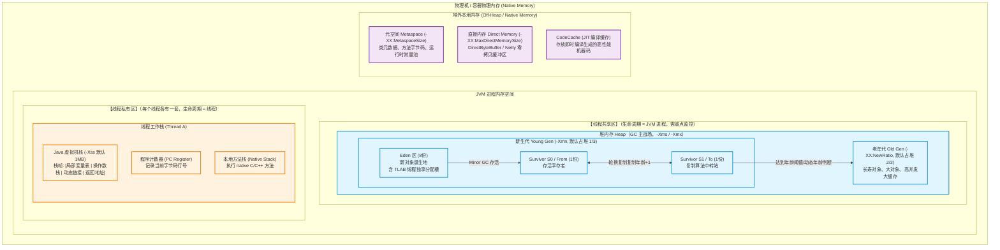
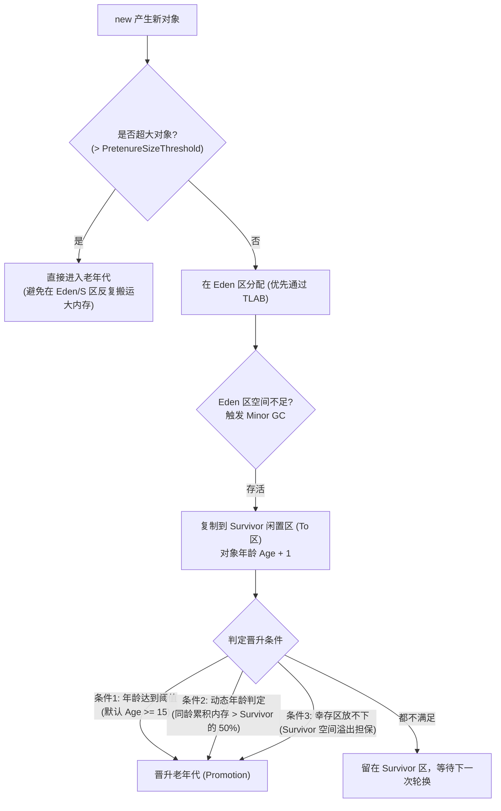
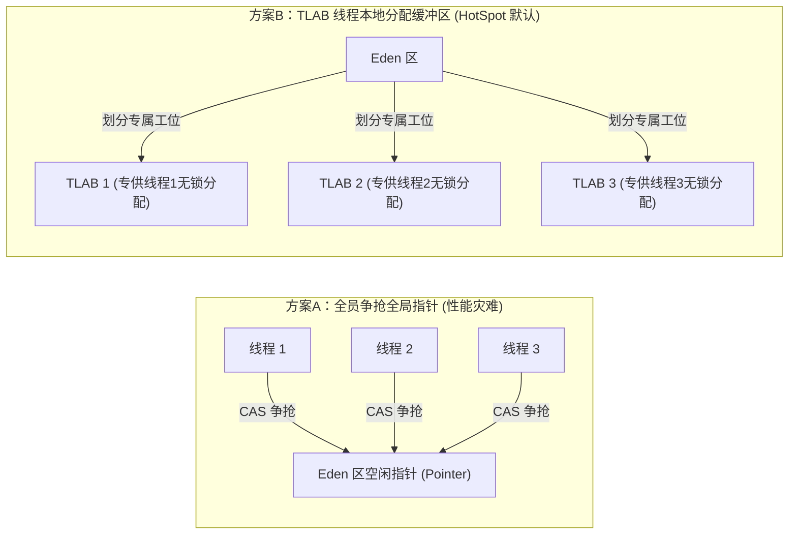
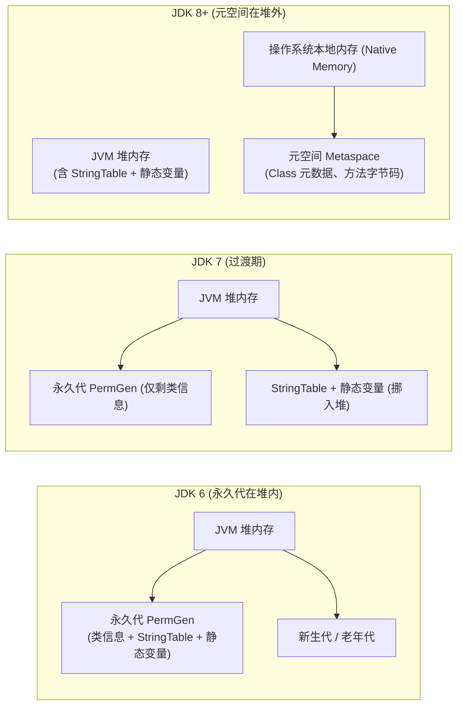
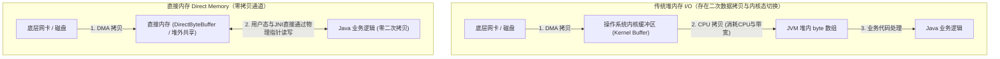

# JVM 内存区域

> [!abstract] 一句话心智模型
> JVM 内存划分为三大领地：
> - **流水线车间（堆内存 Heap）**：全厂工人共享，专为对象实例的生老病死服务，GC 的绝对主战场，内部细分为新生代（8:1:1）与老年代；
> - **工人个人工位（线程私有区）**：虚拟机栈（个人清单）、程序计数器（当前工序行号）、本地方法栈（外包联络），随线程而生，随线程而灭，天然线程安全，无需 GC；
> - **中央档案室与保税码头（元空间 + 直接内存）**：元空间在操作系统本地内存中存放类图纸（Class元数据）；直接内存专供 NIO/Netty 数据直通装卸，实现零拷贝。

---

## 🎯 工业园区版 JVM 内存全景架构图



---

## 🧩 线程共享区：堆内存（Heap）深度解构

堆是 JVM 中最大的一块内存，所有在代码中通过 `new` 关键字创建出来的对象实例和数组，几乎全都存放在这里。

### 1. 为什么堆要“分代”？（第一性原理）
计算机科学中存在一条著名的经验规律——**弱分代假说（Weak Generational Hypothesis）**：
- **绝大多数对象都是“朝生夕灭”的**（例如方法内部创建的局部变量、HTTP 请求传入的 DTO，方法执行完毕即废弃，存活率通常低于 10%）；
- **越是熬过多次 GC 的对象，越倾向于长久存活**（例如 Spring 单例 Bean、数据库连接池、长期静态缓存）。

> [!TIP] 如果不分代会发生什么？
> 如果堆不分代，垃圾回收器每次想要清理几个垃圾对象，就必须把整个 16G、32G 的堆**完完整整扫描一遍**！这就好比环卫工为了扔掉一瓶矿泉水空瓶，必须把整个工业园区的所有建筑从头到尾摸查一遍。
> 分代之后，绝大多数短命对象集中在**新生代**，几毫秒内轻量清理；长命对象集中在**老年代**，低频清理。GC 效率直接提升成百上千倍！

---

### 2. 新生代的 8:1:1 结构：为什么有两个 Survivor？

新生代默认按 `8 : 1 : 1` 的比例划分为 `Eden`、`Survivor 0 (From)`、`Survivor 1 (To)`。

```
新生代总空间（默认占堆的 1/3）
┌───────────────────────────────────────┬─────────────┬─────────────┐
│               Eden 区                 │ Survivor S0 │ Survivor S1 │
│               （80%）                 │   （10%）   │   （10%）   │
└───────────────────────────────────────┴─────────────┴─────────────┘
          新对象在这里诞生                 两块轮流交替清空的幸存者区域
```

#### 为什么是两块 Survivor（S0/S1）而不是一块？
- **如果只有一块 Survivor**：Eden 区满了触发 GC，存活对象搬到 Survivor。此时 Survivor 既有老存活对象，又有新搬来的对象，并且不断产生空间空隙，会产生极严重的**内存碎片**！
- **有两块 Survivor（采用“标记-复制”算法）**：
  1. 任何时刻，S0 和 S1 **必有一块是完全空白的（作为 To 区）**。
  2. 当 Eden 满了发生 Minor GC 时，GC 收集器将 Eden 和当前有数据的 From 区中的所有活对象，**一次性整齐复制**到空的 To 区中，同时活对象的年龄加 1。
  3. 复制完成后，原 Eden 和 From 区内的所有垃圾被**瞬间整块格式化抹除**！
  4. From 和 To 交换角色，下次轮换。
  - **结果**：空间永远紧凑工整，彻底消除内存碎片，而且可用空间高达 `80% + 10% = 90%`！

---

### 3. 对象晋升老年代的四大铁律（面试必背）

一个对象从 Eden 区出生后，究竟在什么条件下会被送入老年代？



1. **年龄阈值达到上限**：
   - 每次经历 Minor GC 存活，对象的年龄（Age）就会加 1。
   - 当年龄达到 `-XX:MaxTenuringThreshold`（HotSpot 默认值是 **15**，CMS 收集器默认为 **6**）时，晋升老年代。
   - **底层硬件限制**：为什么默认最大是 15？因为在 64 位 HotSpot 的对象头 Mark Word 中，**分代年龄只占了 4 个 bit**！二进制 `1111` 换算成十进制正好是 15。你就算在启动参数里配置 `-XX:MaxTenuringThreshold=16`，JVM 也会直接报错拒绝启动！
2. **动态年龄判断（Dynamic Age Calculation）**：
   - JVM 并不会死板地等到 15 岁才晋升。
   - **规则**：如果在 Survivor 空间中，**年龄从 1 到 N 的对象总大小超过了该 Survivor 空间的一半（50%）**，那么**所有年龄大于等于 N 的对象，无需等待 15 岁，直接全部提前晋升老年代**！
   - **设计初衷**：防止大量同龄中长期对象把 Survivor 撑爆，避免 Survivor 溢出引发更频繁的 GC。
3. **大对象直接进入老年代**：
   - 比如极长的字符串、巨大的 `byte[]` 数组。
   - 参数 `-XX:PretenureSizeThreshold` 可以设定大对象阈值（仅对 Serial 和 ParNew 有效）。
   - **设计初衷**：大对象如果在 Eden 和 Survivor 之间来回倒手复制，会导致极大的内存带宽拷贝开销。
4. **空间分配担保机制（Handle Promotion Failure）**：
   - 在发生 Minor GC 之前，JVM 会先检查：**老年代当前最大的连续可用空间，是否大于新生代所有对象的总和？**
   - 如果大于，说明这次 Minor GC 是百分之百安全的；
   - 如果小于，JVM 会检查 `-XX:HandlePromotionFailure` 设置，看是否允许担保失败。若允许，再检查老年代可用空间是否大于**历次晋升老年代对象的平均大小**；如果大于，则冒险尝试 Minor GC；如果依然小于或者不允许担保，直接触发一次**对整个堆的 Full GC**！

---

### 4. TLAB：高并发分配内存的无锁黑科技

在多线程高并发环境下，成千上万个线程同时在 Eden 区执行 `new Object()`，它们如何瓜分 Eden 区的内存空间？



- **第一性原理**：如果所有线程共享同一个 Eden 区分配指针，并发创建对象就必须用 **CAS 原子锁** 保证指针移动的安全性。在高并发场景下，CPU 核心全都在疯狂执行 CAS 重试，性能急剧崩塌！
- **TLAB（Thread Local Allocation Buffer）的破局之道**：
  - JVM 在 Eden 区预先为**每一个线程划分一小块独占的内存缓冲区**（默认仅占 Eden 的 1% 左右）。
  - 线程创建对象时，直接在自己的 TLAB 空间内通过简单的“指针碰撞（Bump the pointer）”无锁分配，**零并发竞争，速度接近 C 语言的栈分配**！
  - 只有当自己的 TLAB 空间用完，需要向 Eden 申请新的 TLAB 块时，才需要走一次 CAS 同步加锁。
  - 参数：`-XX:+UseTLAB`（默认开启）。

---

## 🧩 线程私有区：栈与程序计数器

每个线程创建时，JVM 都会为其分配独立的栈内存与程序计数器，它们不会受到其他线程干扰，**天然线程安全**。

### 1. 虚拟机栈与“栈帧（Stack Frame）”

虚拟机栈（`-Xss`，默认 1MB）描述的是 **Java 方法执行的线程内存模型**。
线程每调用一个方法，就会压入一个**栈帧**；方法执行完毕返回，对应的栈帧就会出栈弹出。

```
线程栈 (Thread Stack)
┌──────────────────────────────────────────────────────────┐
│ 当前栈帧（正在执行的方法）                                  │
│ ┌───────────────────┬──────────────┬──────────┬────────┐ │
│ │ 局部变量表         │ 操作数栈     │ 动态链接 │ 返回   │ │
│ │ (this, 参数, 局部)│ (计算临时槽) │ (常量池) │ 地址   │ │
│ └───────────────────┴──────────────┴──────────┴────────┘ │
├──────────────────────────────────────────────────────────┤
│ 上一层调用方法的栈帧                                      │
├──────────────────────────────────────────────────────────┤
│ main 方法栈帧 (栈底)                                     │
└──────────────────────────────────────────────────────────┘
```

- **局部变量表（Local Variable Table）**：
  - 存放方法参数以及方法内部定义的局部变量。
  - 最小存储单元是 **Slot（变量槽）**。32 位以内的数据类型（`int`, `float`, `boolean`, 对象引用等）占 1 个 Slot；64 位的 `long` 和 `double` 占 2 个 Slot。
  - 如果是实例方法，局部变量表的第 0 个 Slot 默认存放当前对象的引用 `this`。
- **操作数栈（Operand Stack）**：
  - 执行引擎的工作台，用于暂存字节码计算过程中的中间变量。比如执行 `iadd` 时，将栈顶的两个整数弹出相加，再把结果压回栈顶。
- **动态链接（Dynamic Linking）**：
  - 存放指向运行时常量池中该方法的符号引用，用于将运行时的“符号引用”转换为底层的“直接物理方法内存地址”。
- **方法出口（Return Address）**：
  - 记录当本方法执行完毕后，应该返回到调用方方法的哪一条字节码指令继续往下走。

> [!WARNING] 栈上常见异常
> - **`StackOverflowError`**：线程请求的栈深度超出了虚拟机允许的最大深度（最经典元凶：**没有出口的无限递归调用**）。
> - **`OutOfMemoryError: unable to create new native thread`**：当系统创建了成千上万个线程，每个线程都需要占用物理内存分配 1MB 的栈，当物理内存被耗尽无法再为新线程开辟栈空间时抛出。

---

### 2. 程序计数器（Program Counter Register）

- **职能**：记录当前线程正在执行的字节码指令地址。
- **为什么需要？**：现代 CPU 依靠**时间片轮转机制**在多个线程之间快速切换。当线程 A 的时间片用完挂起，过了一会儿 CPU 重新切换回线程 A 时，JVM 必须知道**上一次这个线程执行到哪一行字节码指令了**。程序计数器就是这个“进度书签”。
- **唯一特性**：程序计数器是 JVM 规范中**唯一一个没有任何 OutOfMemoryError 规定**的区域，占用内存极其微小且固定。

---

## 🏛️ 堆外本地内存：元空间与直接内存

很多初学者误以为 JVM 占用的内存就是堆内存（`-Xmx`）。在生产环境中，你会经常发现堆只配置了 4G，但整个 Java 进程在操作系统中却占了 6G、7G 物理内存（RSS），超出的部分主要就在**堆外本地内存**。

### 1. 方法区（规范）与元空间（实现）的演进历史

| JDK 版本 | 物理实现 | 所在位置 | 存放内容 | 淘汰/改动原因 |
| :--- | :--- | :--- | :--- | :--- |
| **JDK 6 及以前** | **永久代 (PermGen)** | **JVM 堆内** | 类元信息、方法字节码、**字符串常量池 (StringTable)**、静态变量 | 受限于 `-XX:MaxPermSize` 堆内固定上限，极易由于类过多或大量字符串导致 `OOM: PermGen space`。 |
| **JDK 7** | **永久代 (PermGen)** | **JVM 堆内** | 类元信息、方法字节码 | **将字符串常量池与静态变量率先迁入堆内存中**！因为字符串难以预估容量，移入堆中方便 GC 及时回收。 |
| **JDK 8 及以后** | **元空间 (Metaspace)** | **操作系统本地内存 (Native Memory)** | 类元信息、方法字节码、运行时常量池 | **彻底废除永久代**！改用物理机本地内存。默认只受系统物理内存限制，可通过 `-XX:MaxMetaspaceSize` 设定硬顶。从根源上极大缓解了元空间 OOM 问题。 |



---

### 2. 直接内存（Direct Memory）与零拷贝

通过 Java 的 `ByteBuffer.allocateDirect()` 或者 Netty 的 `ByteBuf` 申请的内存，属于堆外直接内存。



- **第一性原理**：如果用普通的堆内存 `byte[]` 接收网卡数据，操作系统内核先把网络包拷贝到内核缓冲区，然后再必须通过 CPU 把内核缓冲区数据拷贝一份到 JVM 堆内内存。**直接内存让 Java 代码通过 JNI 本地指针直接操作这块物理内存，避免了昂贵的二次内存拷贝！**
- **直接内存如何回收？**
  - 它不受 JVM GC 的直接管辖，如果疯狂分配而不主动释放，会直接引发 `java.lang.OutOfMemoryError: Direct buffer memory`。
  - **回收机制**：HotSpot 在创建 `DirectByteBuffer` 时，会在堆内伴生一个轻量的虚引用对象 `sun.misc.Cleaner`。当堆内的 `DirectByteBuffer` 没有人引用被 GC 回收时，GC 会将 `Cleaner` 放入引用队列，进而触发底层的 `Unsafe.freeMemory()` 释放堆外物理内存。

---

## ⚡ 一分钟面试必杀卡

> [!NOTE] 面试高频问题标准答题套路
> 
> **Q1：JVM 内存模型中，堆和栈有什么核心区别？**
> - **A**：
>   1. **功能不同**：堆解决的是**数据存储**问题（存几乎所有对象实例与数组）；栈解决的是**逻辑执行**问题（记录线程的方法调用链与局部变量）。
>   2. **共享性不同**：堆是全进程**线程共享**的，存在并发竞争与垃圾回收；栈是**线程私有**的，随线程生死，执行完自动弹栈，无需 GC。
>   3. **异常类型不同**：堆空间不足会抛出 `OutOfMemoryError: Java heap space`；栈深度超限抛出 `StackOverflowError`，线程过多内存耗尽抛出 `unable to create new native thread`。
> 
> **Q2：为什么新生代 Eden 和 Survivor 的比例是 8:1:1？**
> - **A**：基于**弱分代假说**的大量实验统计，Java 对象在经历第一次 Minor GC 时，死亡率高达 90% 以上，只有不到 10% 的对象能存活。为了使用没有任何内存碎片的**复制算法**，将存活区分为两块交替使用（S0 和 S1），所以 8:1:1 既保证了 90% 的可用空间利用率（80% Eden + 10% S0），又恰好能容纳下存活的幸存者。
> 
> **Q3：JDK 8 为什么用元空间（Metaspace）替换了永久代（PermGen）？**
> - **A**：
>   1. **避免 OOM**：永久代设置在 JVM 堆内，有硬性的初始和最大大小上限（`-XX:MaxPermSize`），而在微服务、动态代理、反射、Groovy 脚本大量使用的现代架构中，类加载数量很难精准估算，极易发生 `OOM: PermGen space`。元空间移至操作系统的本地内存，默认只受物理内存限制。
>   2. **简化 GC 与融合 JRockit**：Oracle 收购 BEA 后，为了合并 HotSpot 和 JRockit 虚拟机（JRockit 本来就没有永久代），统一了虚拟机架构。
