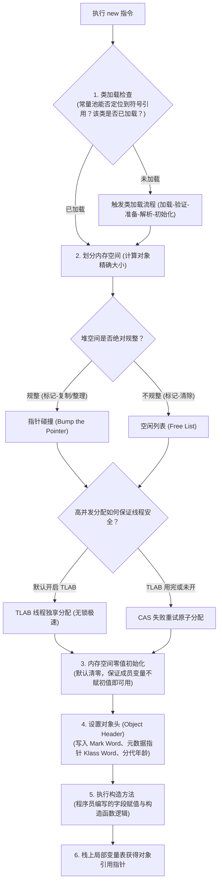
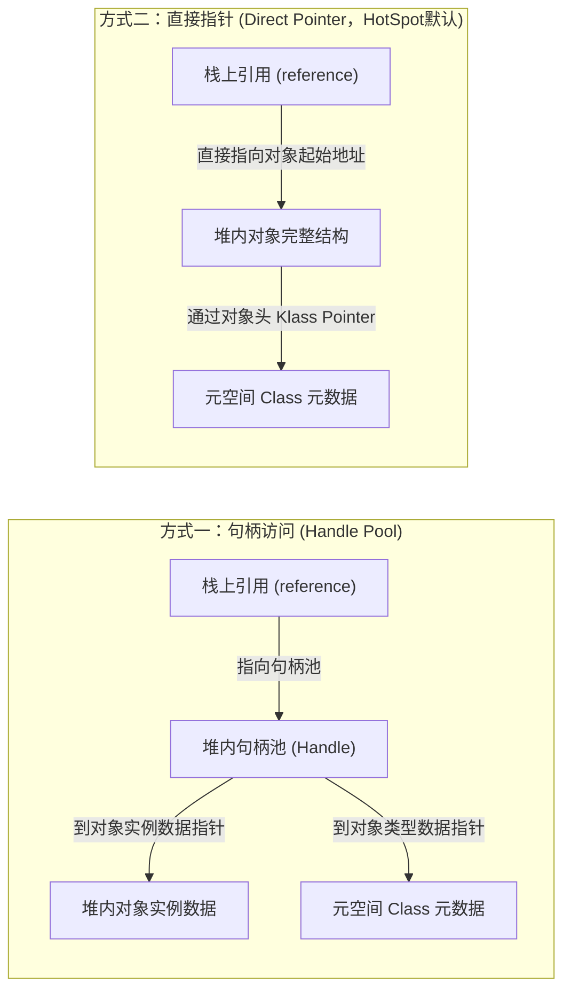

# 对象创建与内存布局

> [!abstract] 一句话心智模型
> 当你在 Java 中写下一行 `User user = new User()` 时：
> 1. **在栈上**：只是在工人的操作台（当前栈帧的局部变量表）上记下了一个物理门牌号（引用地址，占用 4 或 8 字节）；
> 2. **在堆上**：车间流水线按照图纸精确切出一块内存，像打包一件精密快递一样装配出三层结构：
>    - **快递面单（对象头 Object Header）**：记录防伪码、GC 年龄、锁状态（Mark Word），以及所属类图纸指针（Klass Pointer）；
>    - **包裹内物（实例数据 Instance Data）**：用户真实定义的各个成员变量字段（JVM 会优化重排省空间）；
>    - **缓冲泡沫（对齐填充 Padding）**：必须凑够 8 字节的整数倍，方便 CPU 64位总线一次极速抓取！

---

## 🚀 对象的六步诞生全流程（从字节码到物理内存）



### 1. 类加载检查
JVM 遇到一条 `new` 字节码指令时，首先去常量池中检查能否定位到该类的符号引用，并检查该类是否已经被加载、解析和初始化过。如果没有，必须先执行相应的**类加载过程**（详见 [[05-类加载机制与双亲委派]]）。

### 2. 划分内存空间
对象所需内存大小在类加载完成后便可**完全确定**。JVM 会在堆中切出对应大小的内存：
- **指针碰撞（Bump The Pointer）**：如果堆内存绝对规整（存活对象全在一边，空闲空间在另一边，例如使用了标记-复制或标记-整理算法的垃圾回收器），只需要把分界指针向空闲空间挪动一段与对象大小相等的距离即可。
- **空闲列表（Free List）**：如果堆内存不规整（已用和空闲内存交错，例如使用了标记-清除算法），JVM 必须维护一个可用内存碎片清单，从中找出一块足够大的空间划分给对象。

### 3. 内存空间零值初始化
内存分配完成后，JVM 将分配到的内存空间（除对象头外）全部初始化为**零值（二进制 0）**。
> [!NOTE] 为什么成员变量不赋初值也能用？
> 这就是为什么 Java 中的类的成员变量可以不赋初值就直接使用（`int` 默认为 0，`boolean` 默认为 false，引用类型默认为 null），因为在这一步 JVM 已经完成了全量清零！而方法内部的局部变量没有这一步，所以强制必须在使用前手动赋初值，否则编译报错。

### 4. 设置对象头
JVM 将对象的 GC 年龄（初始为 0）、锁状态、HashCode（初始为空，惰性计算）、类型指针等元数据写入对象头中。

### 5. 执行构造方法 `<init>`
至此，JVM 视角下的对象已经创建完毕，但 Java 程序员视角下的对象才刚刚开始。接下来 JVM 执行 `<init>` 方法，按照程序员的代码逻辑执行显式初始化与构造函数代码。

---

## 🔬 揭秘 HotSpot 64位对象内存布局

在 64 位 HotSpot 虚拟机中，一个对象在内存中由三部分严密构成：

```
┌─────────────────────────────────────────────────────────────┐
│ 1. 对象头 (Object Header)                                    │
│    ┌──────────────────────────────────────────────────────┐ │
│    │ Mark Word (标记字段，8 字节 / 64 bit)                  │ │
│    ├──────────────────────────────────────────────────────┤ │
│    │ Klass Word (元数据指针，压缩后 4 字节 / 未压缩 8 字节)  │ │
│    ├──────────────────────────────────────────────────────┤ │
│    │ 数组长度 Array Length (仅数组对象独有，固定 4 字节)     │ │
│    └──────────────────────────────────────────────────────┘ │
├─────────────────────────────────────────────────────────────┤
│ 2. 实例数据 (Instance Data)                                  │
│    存放类中定义的真实属性字段 (JVM 会进行字段重排优化紧凑度)   │
├─────────────────────────────────────────────────────────────┤
│ 3. 对齐填充 (Padding)                                        │
│    无实际业务含义，仅仅为了补齐到 8 字节的整数倍 (0 ~ 7 字节)  │
└─────────────────────────────────────────────────────────────┘
```

---

## 🏷️ Mark Word 结构全景图（锁升级与 GC 年龄核心）

Mark Word 在 64 位 JVM 中占用整整 **8 个字节（64 个 bit）**。为了在极小的空间内存储海量状态，HotSpot 将 Mark Word 设计成了**非固定数据结构的“变形金刚”**，通过末尾的标志位复用同一个 64 bit 空间：

| 锁状态 (Lock State) | 64 位 Mark Word 详细比特位分布 (高位 -> 低位) | 偏向标志 (1 bit) | 锁标志位 (2 bit) |
| :--- | :--- | :---: | :---: |
| **无锁 (Normal)** | `unused(25bit)` + `hashCode(31bit)` + `unused(1bit)` + `GC年龄(4bit)` | `0` | `01` |
| **偏向锁 (Biased)** | `线程ID(54bit)` + `epoch(2bit)` + `unused(1bit)` + `GC年龄(4bit)` | `1` | `01` |
| **轻量级锁 (Lightweight)** | `指向获得锁的线程栈中 Lock Record (锁记录) 的指针 (62bit)` | 无 | `00` |
| **重量级锁 (Heavyweight)** | `指向底层的 ObjectMonitor 监视器对象的指针 (62bit)` | 无 | `10` |
| **GC 标记 (Marked)** | `空 (仅 GC 标记清扫阶段使用，全 0)` | 无 | `11` |

### 关键细节第一性原理推导：
1. **GC 分代年龄为什么上限是 15？**
   - 观察表格中无锁状态的比特位分配：`GC年龄` 明确只占用了 **4 个 bit**。
   - 4 位无符号二进制数的最大值是：$2^4 - 1 = 15$（二进制 `1111`）。这就是为什么参数 `-XX:MaxTenuringThreshold` 永远不可能设成 16 的物理底层原因！
2. **HashCode 的惰性生成**：
   - 一个新 new 出来的对象，Mark Word 里的 31 位 HashCode 默认全是 0！
   - 只有当业务代码**第一次调用 `System.identityHashCode(obj)` 或没有重写过的 `obj.hashCode()`** 时，底层才会计算并持久写入这 31 位中。如果一个对象已经计算了 HashCode，它就无法再进入偏向锁状态（因为偏向锁的线程 ID 会覆盖掉 HashCode 的位置）。

---

## 🗜️ 指针压缩（Compressed OOPs）黑科技：为什么 32GB 是道坎？

在 64 位操作系统中，原本一个物理内存指针需要占用 8 个字节（64 bit）。这意味着只要在 Java 里放一个引用，就要白白消耗 8 字节，比 32 位系统内存占用膨胀了将近一倍！

HotSpot 引入了 **Compressed OOPs（普通对象指针压缩，`-XX:+UseCompressedOops`，JDK 8 默认开启）**，硬生生把 8 字节指针压缩成了 **4 字节（32 bit）**！

### 核心数学推导（为什么 32 位指针能寻址 32GB 空间？）
- **直觉困惑**：32 位的无符号整数，最多只能表示 $2^{32} = 4,294,967,296$ 个地址，也就是只能寻址 **4GB** 内存。怎么可能管理 32GB 的堆？
- **破局玄机：8 字节对齐（Padding）**！
  - JVM 规定，所有对象的起始物理地址必须是 **8 的整数倍**。
  - 8 的二进制是 `1000`。这意味着，**任何合法对象的内存地址，其二进制最后 3 位必然永远是 `000`**！
  - 既然最后 3 位永远是 0，何必浪费空间去存储它？
  - **存储时（压缩）**：JVM 将真实的 64 位物理地址**向右平移 3 位（除以 8）**，丢弃末尾的 3 个 0，直接以 32 位存入内存中！
  - **寻址时（解压）**：CPU 准备访问该对象时，把这 32 位数据**向左平移 3 位（乘以 8）**，末尾自动补齐 3 个 0，瞬间还原出真实物理地址！
  - **寻址上限**：$2^{32} \times 8 \text{ 字节} = 4\text{GB} \times 8 = \mathbf{32GB}$！

```
真实 64 位物理地址:  0x00000007A0000000 (末尾三位必是 000)
                              ↓ 右移 3 位 (压缩成 32 bit 存入对象引用)
压缩后的 32 位引用:  0xF4000000
                              ↓ 左移 3 位 (解压缩还原物理寻址)
还原后的物理地址:    0x00000007A0000000
```

> [!CAUTION] 生产避坑致命死穴：堆内存不要设成 32G！
> - 如果你的堆设置了 `-Xmx31g`，指针压缩正常生效，每个引用只占 4 字节。
> - 如果手抖设置了 `-Xmx33g`，**超过了 32GB 上限，指针压缩瞬间强制失效**！所有对象的引用直接从 4 字节膨胀到 8 字节。
> - **可怕的后果**：原本在 31G 堆能装下的数据，改到 33G 后，因为所有指针膨胀了 100%，实际可用对象容量反而**缩水了将近 20%**！
> - **黄金军规**：如果要配大内存，要么老老实实配 **31G** 保留指针压缩；如果要突破，就直接拉大到 **40G 以上**，跨越指针膨胀的性能劣势期。

---

## 🎯 对象的访问定位：直接指针 vs 句柄访问

当你在栈帧的局部变量表里写了 `user.getName()`，JVM 是怎么顺藤摸瓜找到堆里的真实数据的？



| 访问方式 | 核心机制 | 核心优势 | 致命劣势 | 采用虚拟机 |
| :--- | :--- | :--- | :--- | :--- |
| **句柄访问** | 栈引用指向堆中的句柄池，句柄池包含到实例数据的指针和到类型数据的指针。 | **对象移动极度轻量**：GC 发生对象整理移动时，只需修改句柄池中的实例数据指针，栈上的引用地址完全无需变动。 | **两次指针寻址**，访问速度相对慢一点。 | 古老 JVM 实现 |
| **直接指针** | 栈引用直接存储堆中对象的真实物理内存起始地址。对象头内自带类型指针。 | **速度极快**！仅需一次指针解引用即可读取字段数据，执行效率极致。 | GC 整理移动对象时，必须同步扫描所有线程栈，**全量修正栈上的引用指针**。 | **HotSpot 默认选用** |

---

## 💻 实战代码：用 JOL 亲眼目睹内存字节对齐

想要真正看清一个对象在内存中的每一个字节？使用 OpenJDK 官方的 **JOL（Java Object Layout）** 工具库：

```xml
<dependency>
    <groupId>org.openjdk.jol</groupId>
    <artifactId>jol-core</artifactId>
    <version>0.16</version>
</dependency>
```

```java
import org.openjdk.jol.info.ClassLayout;

public class ObjectMemoryTest {
    static class User {
        int id;          // 4 字节
        String name;     // 4 字节 (开启指针压缩时的引用)
        byte flag;       // 1 字节
    }

    public static void main(String[] args) {
        User user = new User();
        // 打印该对象的内存布局与字节分布
        System.out.println(ClassLayout.parseInstance(user).toPrintable());
    }
}
```

**控制台真实输出拆解**：
```text
OFF  SZ               TYPE DESCRIPTION               VALUE
  0   8                    (object header: mark)     0x0000000000000001 (non-biasable; age: 0)
  8   4                    (object header: class)    0xf800c140
 12   4                int User.id                   0
 16   4   java.lang.String User.name                 null
 20   1               byte User.flag                 0
 21   3                    (alignment/padding gap)   loss & padding
Instance size: 24 bytes
Space losses: 3 bytes internal + 0 bytes external = 3 bytes total
```

- **对象头**：8 字节 Mark Word + 4 字节 Klass Pointer = **12 字节**；
- **实例数据**：4 字节 `int` + 4 字节 `name引用` + 1 字节 `byte` = **9 字节**；
- **对齐填充**：当前总大小为 $12 + 9 = 21$ 字节。因为必须是 8 的倍数，JVM 自动在末尾填充了 **3 字节空白**；
- **最终总大小**：刚好凑满 **24 字节**！

---

## ⚡ 一分钟面试必杀卡

> [!NOTE] 面试高频问题标准答题套路
> 
> **Q1：一个空对象 `new Object()` 在 64 位 HotSpot 虚拟机中占几个字节？**
> - **A**：默认开启指针压缩的情况下占用 **16 个字节**！
>   - 对象头中的 Mark Word 占 **8 字节**；
>   - 开启指针压缩的类型指针 Klass Pointer 占 **4 字节**；
>   - 空对象没有实例数据，此时总共 12 字节；
>   - 因为 HotSpot 要求对象大小必须是 8 字节的整数倍，所以自动填充了 **4 字节 Padding**，最终 $8 + 4 + 4 = 16$ 字节。
>   - （加分项：如果手动关闭指针压缩 `-XX:-UseCompressedClassPointers`，Klass 指针占 8 字节，正好 $8 + 8 = 16$ 字节，此时无需 padding）。
> 
> **Q2：为什么对象的起始地址和总大小必须是 8 字节对齐？**
> - **A**：
>   1. **硬件与总线性能**：现代 64 位 CPU 的数据总线和缓存行（Cache Line）通常按 64 位（8 字节）对齐读取。对齐后，CPU 可以一次内存周期完整读入一个基础数据或指针，避免发生跨 Cache Line 读取导致的二次内存访问开销。
>   2. **指针压缩算法的基石**：正是因为末尾 3 位必为 0，才使得 32 位的指针通过左移 3 位能够寻址高达 32GB 的堆空间！
