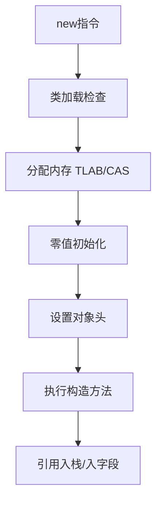

# 对象创建与内存布局

> [!abstract] 一句话总结
> 对象创建包含类加载检查、内存分配、对象头初始化和构造方法执行，内存布局由对象头、实例数据和对齐填充组成。

## 📌 这是什么

- new 指令不只是分配内存，还要确保类已加载、初始化对象头、执行 <init>。
- HotSpot 对象通常由 Mark Word、Klass Pointer、实例字段和 padding 组成。
- 分配路径可能走 TLAB 指针碰撞，也可能进入慢路径加锁或 CAS。

## 🤔 解决什么问题 / 为什么需要

- 理解对象分配成本、锁状态、GC Roots、引用压缩和缓存局部性。
- 分析内存占用时能解释为什么一个对象比字段大小之和更大。
- 为逃逸分析、标量替换、锁优化和 JOL 分析打基础。

## 🧩 核心概念

| 概念 | 含义 | 精通要点 |
| ---- | ---- | -------- |
| Mark Word | 保存 hash、GC 年龄、锁状态等运行时信息。 | 锁升级和对象 hashCode 都会影响它。 |
| Klass Pointer | 指向类元数据。 | 压缩类指针会影响对象头大小。 |
| TLAB | 线程本地分配缓冲区。 | 减少多线程堆分配竞争。 |
| 对象对齐 | 对象大小按对齐粒度补齐。 | 常见 8 字节对齐。 |

## ⚙️ 工作原理 / 流程



## 🔍 源码 / 原理深挖

- 字节码 new 创建未初始化对象，dup 复制引用，invokespecial 调用构造方法。
- TLAB 分配通常是 bump pointer，失败后可能申请新 TLAB 或走全局分配。
- 开启压缩普通对象指针和压缩类指针会改变引用和对象头大小。

## 💻 代码实践 / 排查命令

```bash
# 查看对象布局可使用 JOL
# java -jar jol-cli.jar internals java.lang.String

public class AllocationDemo {
    static class User { long id; int age; Object ref; }
    public static void main(String[] args) {
        Object o = new User();
    }
}
```

## 🛠️ 排查 / 实践要点

- 内存占用异常时，用 MAT 看 dominator tree，用 JOL 验证单对象布局。
- 大量小对象分配导致 GC 压力时，先找分配热点，再考虑复用、批处理、减少装箱。
- 对象头锁状态相关问题可结合 JOL、jstack 和同步热点分析。

## ⚠️ 踩坑与注意事项

- 只按字段大小估算对象内存，忽略对象头、引用大小和对齐填充。
- 在高吞吐路径创建大量临时对象后只调大堆，不优化分配率。
- 误以为 new 一定会落到堆；逃逸分析可能做标量替换。

## 🎯 面试问题

> [!question] 高频问题
> - Q: 一个对象在内存里由什么组成？
>   - A: 通常包括对象头 Mark Word、类型指针、实例数据和对齐填充；数组对象还会有数组长度。
> - Q: 对象创建过程是什么？
>   - A: 类加载检查、分配内存、零值初始化、设置对象头、执行构造方法，最后引用指向对象。
> - Q: TLAB 有什么作用？
>   - A: 为每个线程分配一小块堆内缓冲区，线程内对象分配可指针碰撞完成，减少全局分配竞争。

## 🧭 源码入口速查

- 字节码入口：`new` 分配未初始化对象，`dup` 复制引用，`invokespecial <init>` 调构造器。
- HotSpot 分配快路径：TLAB 内指针碰撞；TLAB 不足时走 slow path 申请新 TLAB 或全局分配。
- JOL 入口：`org.openjdk.jol.info.ClassLayout.parseClass(X.class).toPrintable()` 查看对象头、字段偏移和 padding。
- 关键参数：`-XX:+UseCompressedOops`、`-XX:+UseCompressedClassPointers`、`-XX:ObjectAlignmentInBytes=8`。

## 🧪 最小验证

```java
class Layout {
    boolean flag;
    int age;
    long id;
    Object ref;
}
System.out.println(ClassLayout.parseClass(Layout.class).toPrintable());
```

看到对象大小后要解释每一字节：对象头、压缩类指针、字段重排、引用大小、8 字节对齐。面试里只说“对象头加实例数据”不够，要能说明为什么字段声明顺序不一定等于内存偏移顺序。

## ✅ 精通检查清单

- 能用自己的话讲清本主题解决的问题和适用边界。
- 能指出至少 2 个源码入口或底层机制。
- 能给出一个最小代码示例或一组线上排查命令。
- 能回答本页列出的高频面试题，并补充项目中的真实取舍。

## 🔗 关联笔记

- [[_index]]

## 📚 参考资料

- [JVM Specification](https://docs.oracle.com/javase/specs/jvms/se21/html/)
- [Oracle Java Documentation](https://docs.oracle.com/en/java/)
