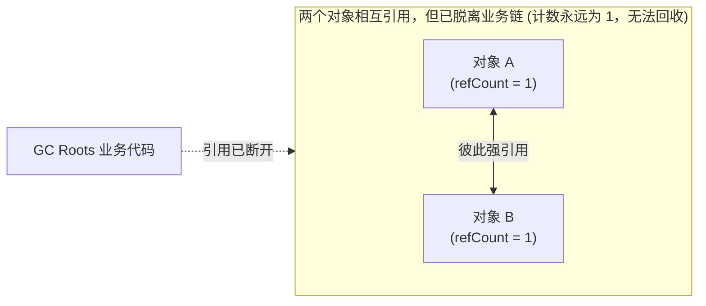
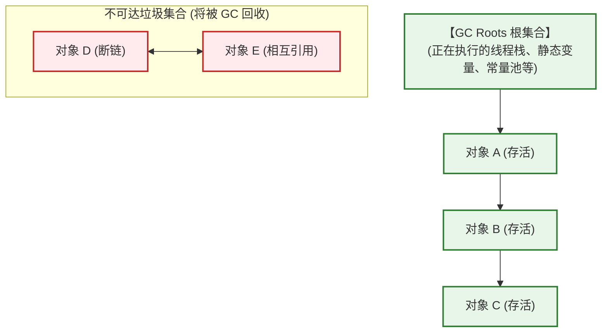
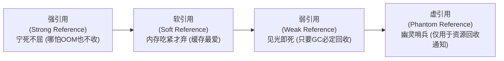
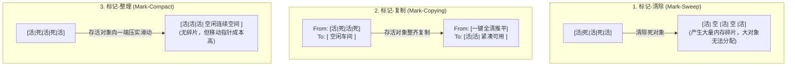
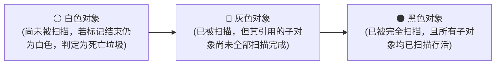
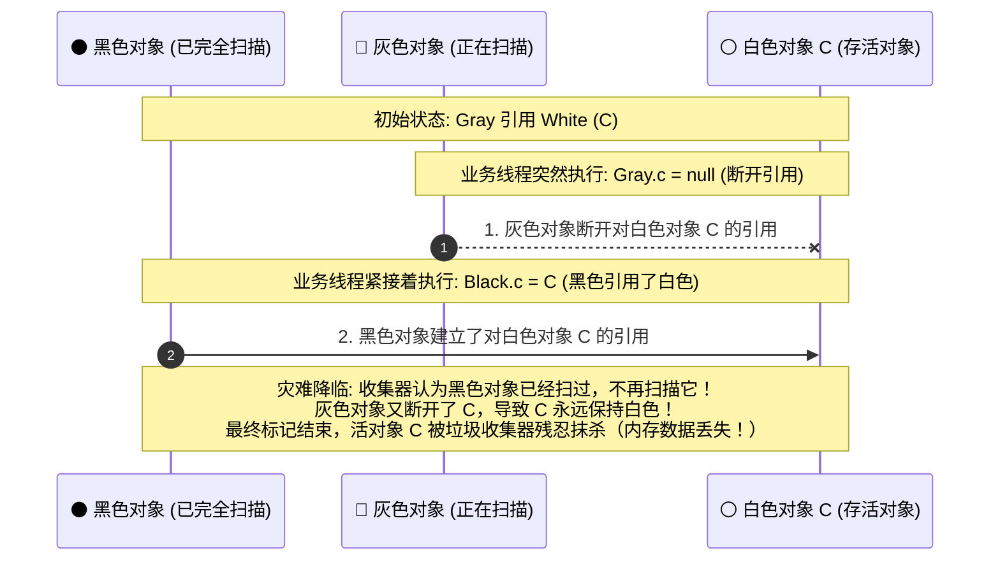
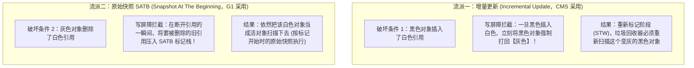
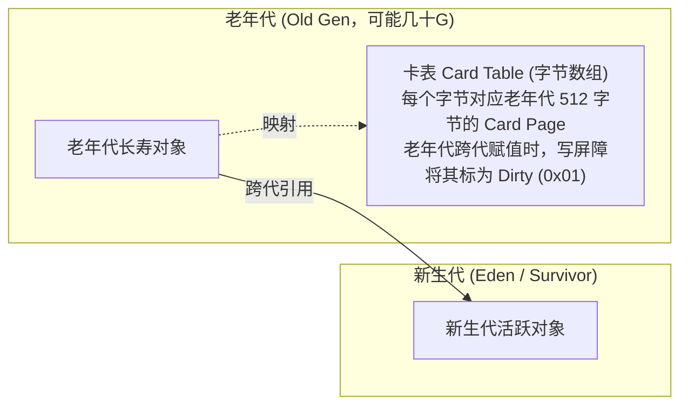

# 垃圾回收算法

> [!abstract] 一句话心智模型
> 如果垃圾收集器（GC）是园区的**自动化智能环卫系统**：
> 1. **生死裁决（如何判断废品）**：靠**可达性分析（GC Roots）**沿着物料依赖链排查，绝不用容易陷入死循环的“引用计数”；
> 2. **清扫三板斧（基础回收算法）**：
>    - **标记-清除（Mark-Sweep）**：当场扔掉废品，但地上一块块坑洼（产生内存碎片）；
>    - **标记-复制（Mark-Copy）**：把好东西整齐搬到另一个空车间，原车间一键推平（整洁无碎片，但浪费空间，Eden/Survivor 8:1:1 的工程妥协）；
>    - **标记-整理（Mark-Compact）**：在原车间把好东西全部往一侧推挤对齐，剩下的空间整块腾空（老年代最爱）；
> 3. **并发清扫的生死博弈（三色标记与漏标）**：边跑业务边扫垃圾，如何防止活对象被环卫车当垃圾误杀？CMS 的**增量更新**与 G1 的**原始快照（SATB）**上演了一场精妙绝伦的写屏障防御战。

---

## 🧭 一、如何判断对象已经“死亡”？

### 1. 为什么不用“引用计数法”？（循环引用死穴）
在对象头中加一个计数器，每有一个地方引用它就 +1，引用失效就 -1。计数器为 0 就回收。
- **致命死穴**：**循环引用（Circular Reference）**。

`objA.ref = objB; objB.ref = objA;`。如果将 `objA = null; objB = null;`，这两个对象在业务上已经彻底废弃，但因为彼此引用着对方，引用计数永远是 1，系统永远不敢回收它们，造成死锁式内存泄漏！

---

### 2. 可达性分析算法（Reachability Analysis）

现代主流虚拟机（HotSpot 等）均采用**可达性分析算法**。
从一系列名为 **GC Roots** 的根对象出发，沿着引用关系向下搜索，能够被遍历到的对象称为**可达的（存活）**；如果一个对象到 GC Roots 没有任何引用链相连，则证明该对象已经不可用，判定为垃圾。

#### 究竟哪些对象可以作为“GC Roots”？（面试考题）
1. **虚拟机栈（栈帧中的局部变量表）中引用的对象**：正在运行的方法里的参数、局部变量等；
2. **方法区中类静态属性引用的对象**：Java 类的 `public static Object instance`；
3. **方法区中常量引用的对象**：如运行时常量池中的字符串引用（`final` 常量）；
4. **本地方法栈中 JNI（即 native 方法）引用的对象**；
5. **Java 虚拟机内部的引用**：基本数据类型对应的 Class 对象，系统类加载器，常驻异常对象（NullPointerException 等）；
6. **被同步锁（`synchronized` 关键字）持有的对象**。

---

## 🧬 二、Java 四种引用类型与生死心智模型

为了让对象在不同内存压力下拥有更灵活的生存能力，Java 设计了四种引用强度层次：

| 引用类型 | 创建方式示例 | 回收时机 | 典型工业应用场景 |
| :--- | :--- | :--- | :--- |
| **强引用 (Strong)** | `Object obj = new Object();` | **只要引用在，GC 绝不回收**。宁可抛出 OOM 崩溃也绝不动它。 | 99% 的普通业务变量。 |
| **软引用 (Soft)** | `SoftReference<byte[]> soft = new SoftReference<>(data);` | **当系统内存充裕时不回收；当内存不足即将 OOM 前，强制回收**。 | **内存敏感型高速缓存**（如图片缓存、网页缓存）。 |
| **弱引用 (Weak)** | `WeakReference<byte[]> weak = new WeakReference<>(data);` | **只要垃圾收集器开始扫描，无论当前内存是否充足，统统回收！** | `WeakHashMap`、`ThreadLocal` 中的 Entry key。 |
| **虚引用 (Phantom)** | `PhantomReference<Object> p = new PhantomReference<>(obj, queue);` | **形同虚设，无法通过它访问对象。随时可能被回收**。必须与引用队列（ReferenceQueue）联合使用。 | **监控对象被回收的时机**。例如 `DirectByteBuffer` 的堆外内存清理（Cleaner 机制）。 |

> [!WARNING] 经典避坑：ThreadLocal 内存泄漏底层机理
> `ThreadLocalMap` 的底层 Entry 继承了 `WeakReference<ThreadLocal<?>>`。
> - 它的 **Key 是弱引用**，一旦外面的强引用断开，下一次 GC 时 Key 就会被自动收掉变成 `null`；
> - 但 **Value 却是强引用**！依然被长期存活的线程池核心线程通过 `ThreadLocalMap` 死死抓着！
> - **后果**：Key 变成了 null，业务代码再也无法通过 key 找到那个 value，但 value 又无法被 GC 回收，日积月累直接导致 **OOM**！
> - **铁律**：使用完 ThreadLocal 之后，必须在 `finally` 块中显式调用 `threadLocal.remove()`！

---

## 🧹 三、三大基础垃圾收集算法

### 1. 标记-清除（Mark-Sweep）
- **步骤**：首先标记出所有需要回收的对象，标记完成后统一回收被标记的对象。
- **缺点**：
  1. **执行效率不稳定**：如果堆中包含大量需要回收的对象，标记和清除的执行效率都会随对象数量增长而降低。
  2. **内存空间的碎片化**：清除后会产生大量不连续的内存碎片。当以后需要分配大对象（如大数组）时找不到足够的连续内存，不得不提前触发另一次垃圾收集。

### 2. 标记-复制（Mark-Copying）
- **步骤**：将可用内存按容量划分为大小相等的两块，每次只使用其中一块。当这一块内存用完，就将还存活着的对象复制到另一块上面，然后再把已使用过的内存空间一次清理掉。
- **优缺点**：内存分配时无需考虑碎片，只需移动堆顶指针（指针碰撞），分配极快；缺点是把可用内存直接腰斩浪费了一半。
- **现代改造**：IBM 研究表明新生代 98% 的对象朝生夕灭，所以 HotSpot 将新生代划分为 **Eden:Survivor0:Survivor1 = 8:1:1**，内存利用率高达 **90%**！

### 3. 标记-整理（Mark-Compact）
- **步骤**：针对老年代对象的存活率较高特点设计。标记过程与标记-清除一样，但后续不是直接清理死亡对象，而是让所有存活的对象都向内存空间的一端移动，然后直接清理掉边界以外的内存。
- **优缺点**：消除了内存碎片，老年代空间规整；但移动存活对象并更新所有引用地址是一项极其沉重的负荷，在移动过程中必须全程挂起用户线程（Stop The World，STW）。

---

## 🎨 四、三色标记法与并发漏标大揭秘（G1/ZGC 灵魂基石）

在早期的垃圾收集器中，标记阶段必须完全停止用户线程（STW）。为了追求更低的停顿时间，现代垃圾收集器（CMS、G1、ZGC）引入了**并发标记**（业务线程与垃圾回收线程同时跑）。

并发标记的核心理论工具就是：**三色标记法（Tri-color Marking）**。

- **白色（White）**：表示对象尚未被垃圾收集器访问过。在刚开始时，所有对象都是白色的；若在标记结束阶段仍是白色的，代表不可达，属于垃圾！
- **灰色（Gray）**：表示对象已经被垃圾收集器访问过，但这个对象上引用的至少还有一个其他对象尚未被扫描。
- **黑色（Black）**：表示对象已经被垃圾收集器访问过，且这个对象包含的所有引用都已经被扫描过。黑色对象是安全存活的，绝对不能当垃圾回收！

---

### 🚨 致命危机：并发标记中的“对象漏标”

如果业务线程在并发标记期间改动了引用链，可能会发生最可怕的灾难：**一个原本活着的对象，被系统当成垃圾给清除了！**

#### 漏标成立的两个充要条件（必须同时满足）：
1. **赋值插入**：黑色对象插入了一条指向白色对象的新引用；
2. **赋值删除**：灰色对象删除了原本指向该白色对象的直接或间接引用。

---

### 🛡️ 破局之策：两种写屏障机制（CMS vs G1）

只要能打破上面两个条件中的任意一个，就能彻底杜绝漏标！两大流派应运而生：

| 对比维度 | 增量更新 (Incremental Update) | 原始快照 (SATB) |
| :--- | :--- | :--- |
| **代表收集器** | **CMS** | **G1** |
| **拦截时机** | 引用被**写入/赋值**时（Post-Write Barrier） | 引用被**覆盖/断开**前（Pre-Write Barrier） |
| **底层做法** | 只要黑色引用了白色，把黑色变成灰色，下次重新标记再扫一遍。 | 把旧引用保存下来，不管你现在有没有断开，仍按并发标记开始那一刻的快照扫。 |
| **优缺点** | 更加精确，浮动垃圾少；但重新标记（STW）阶段需要重扫的对象多，停顿长。 | **重新标记停顿极短**；但可能会产生一些“浮动垃圾”（即使后来真正死了本轮也不收，留待下轮回收）。在低延迟收集器中是更明智的妥协！ |

---

## 🃏 五、跨代引用与卡表（Card Table）

在进行 Minor GC（只清理新生代）时，有一个极度棘手的问题：**老年代的对象可能引用了新生代的对象（跨代引用）！**
为了确定新生代对象的存活状态，难道 Minor GC 必须连带着把整个庞大的老年代也全盘扫描一遍吗？如果全盘扫描，分代收集的高性能优势将荡然无存！

- **破局方案：卡表（Card Table）**
  - JVM 把老年代划分为一块块固定大小（通常是 **512 字节**）的内存区域，称为**卡页（Card Page）**。
  - 卡表是一个最基础的字节数组（`byte[]`），数组的每一个元素对应一个卡页。
  - **写屏障（Write Barrier）暗度陈仓**：每当有代码修改了老年代对象的引用字段，给它赋予了一个新生代对象时，JVM 会在字节码底层通过**写屏障**拦截这次赋值操作，瞬间将该卡页在卡表里对应的那个字节标记为 `0x01`（称为**变脏 Dirty**）。
  - **Minor GC 闪电战**：垃圾收集器发起 Minor GC 时，根本不需要扫描整个老年代！只需要扫描卡表，挑出那些被标为“脏（Dirty）”的极少数卡页，将卡页里的对象加入 GC Roots 一起扫描即可。GC 扫描耗时降低 99%！

---

## ⚡ 一分钟面试必杀卡

> [!question]- Q1：为什么 CMS 会有重新标记（Remark）阶段，它在干什么？
> - 在 CMS 的并发标记阶段，业务线程和 GC 线程并发运行，业务代码可能会改变对象的引用关系（发生漏标）。
> - CMS 采用**增量更新**机制，每当黑色对象新引用了白色对象，写屏障就会记录下来并将其变灰。
> - 因此必须有一个短暂的 STW 重新标记阶段，专门用来**修正并发标记期间由于用户程序继续运行而导致标记产生变动的那一部分对象的标记记录**，防止存活对象被误杀。

> [!question]- Q2：什么是安全点（SafePoint）？为什么不能立刻停下所有线程？
> - JVM 进行 STW 时，不能在任意机器指令处强行叫停用户线程，因为此时线程可能正处于寄存器赋值、内存未初始化的中间脆弱状态。
> - **安全点**是程序执行过程中能够安全停顿下来的特定代码位置（如方法返回前、循环跳转处、抛出异常处等）。
> - JVM 发起 GC 时，会设置一个全局标记位，所有用户线程轮询到该标记位后，主动跑到最近的安全点挂起等待。