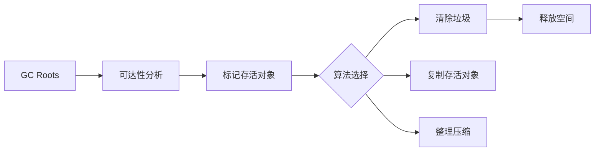

# 垃圾回收算法

> [!abstract] 一句话总结
> 垃圾回收算法围绕“如何判断对象可回收”和“如何整理可用内存”展开，核心是可达性分析、标记、复制、清除和整理。

## 📌 这是什么

- Java 主流 GC 使用可达性分析，从 GC Roots 出发找存活对象。
- 基础算法包括标记-清除、复制、标记-整理，现代收集器通常组合使用。
- 分代假说认为大部分对象朝生夕死，少数对象存活较久。

## 🤔 解决什么问题 / 为什么需要

- 读懂 GC 日志中的 Young GC、Mixed GC、Full GC。
- 理解吞吐、停顿、碎片、复制成本之间的取舍。
- 为选择 G1、ZGC、Parallel、Shenandoah 等收集器做准备。

## 🧩 核心概念

| 概念 | 含义 | 精通要点 |
| ---- | ---- | -------- |
| GC Roots | 可达性分析起点。 | 栈引用、静态字段、JNI 引用、监视器持有对象等。 |
| 标记-清除 | 标记存活对象后清理垃圾。 | 会产生碎片。 |
| 复制算法 | 把存活对象复制到另一块空间。 | 适合存活率低的新生代。 |
| 标记-整理 | 标记后移动存活对象压缩空间。 | 减少碎片但移动成本高。 |
| 写屏障 | 对象引用写入时记录额外信息。 | 增量/并发收集器的重要基础。 |

## ⚙️ 工作原理 / 流程



## 🔍 源码 / 原理深挖

- Minor GC 通常处理年轻代，存活对象年龄增加或晋升老年代。
- Full GC 往往代价较高，可能涉及老年代、元空间等更大范围。
- 现代低延迟 GC 通过并发标记、读/写屏障和区域化管理减少停顿。

## 💻 代码实践 / 排查命令

```bash
# 开启统一GC日志
java -Xms2g -Xmx2g -Xlog:gc*,safepoint:file=gc.log:time,uptime,level,tags ...

# 快速看GC次数和耗时
jstat -gcutil <pid> 1000 10
```

## 🛠️ 排查 / 实践要点

- 频繁 Young GC：看对象分配速率、Eden 大小、批处理临时对象。
- 频繁 Full GC：看老年代增长、晋升失败、元空间、System.gc。
- 长停顿：结合 GC 日志、safepoint 日志和线程栈判断是 GC 还是安全点等待。

## ⚠️ 踩坑与注意事项

- 只看 GC 次数，不看单次停顿、分配速率和业务延迟。
- 以为手动 System.gc 能解决内存问题。
- 没有固定 -Xms/-Xmx 导致堆动态伸缩干扰观测。

## 🎯 面试问题

> [!question] 高频问题
> - Q: 如何判断对象可以回收？
>   - A: 主流 JVM 用可达性分析，从 GC Roots 出发不可达的对象可被回收；引用计数无法解决循环引用问题。
> - Q: 三种基础 GC 算法优缺点？
>   - A: 标记-清除简单但碎片多；复制算法适合低存活率但浪费空间；标记-整理减少碎片但移动成本高。
> - Q: 为什么要分代？
>   - A: 基于大多数对象很快死亡的经验假设，新生代用复制算法高效回收，老年代用更适合高存活率的算法。

## 🧭 源码入口速查

- GC Roots 常见来源：线程栈局部变量、静态字段、JNI handles、持有 monitor 的对象、活跃 ClassLoader。
- JDK 9+ 日志入口：`-Xlog:gc*,safepoint:file=gc.log:time,uptime,level,tags`。
- GC 日志字段要看：暂停原因、回收前后容量、用户态/内核态/真实耗时、晋升、Humongous、Full GC 触发原因。
- MAT 入口：Dominator Tree 看谁保留内存最多，Path To GC Roots 看为什么回收不了。

## 🧪 最小验证

```bash
java -Xms128m -Xmx128m -Xlog:gc*,safepoint:file=gc.log:time,uptime,level,tags GcDemo
grep -E "Pause|Full|Humongous|Allocation" gc.log
```

判断 GC 问题不要只看“次数多”。Young GC 每秒多次但单次 2ms，可能只是分配率高；Full GC 每小时一次但暂停 8s，可能已经影响 P99。结论必须同时带上分配率、停顿、业务延迟和回收后余量。

## ✅ 精通检查清单

- 能用自己的话讲清本主题解决的问题和适用边界。
- 能指出至少 2 个源码入口或底层机制。
- 能给出一个最小代码示例或一组线上排查命令。
- 能回答本页列出的高频面试题，并补充项目中的真实取舍。

## 🔗 关联笔记

- [[_index]]

## 📚 参考资料

- [JVM Specification](https://docs.oracle.com/javase/specs/jvms/se21/html/)
- [Oracle Java Documentation](https://docs.oracle.com/en/java/)
