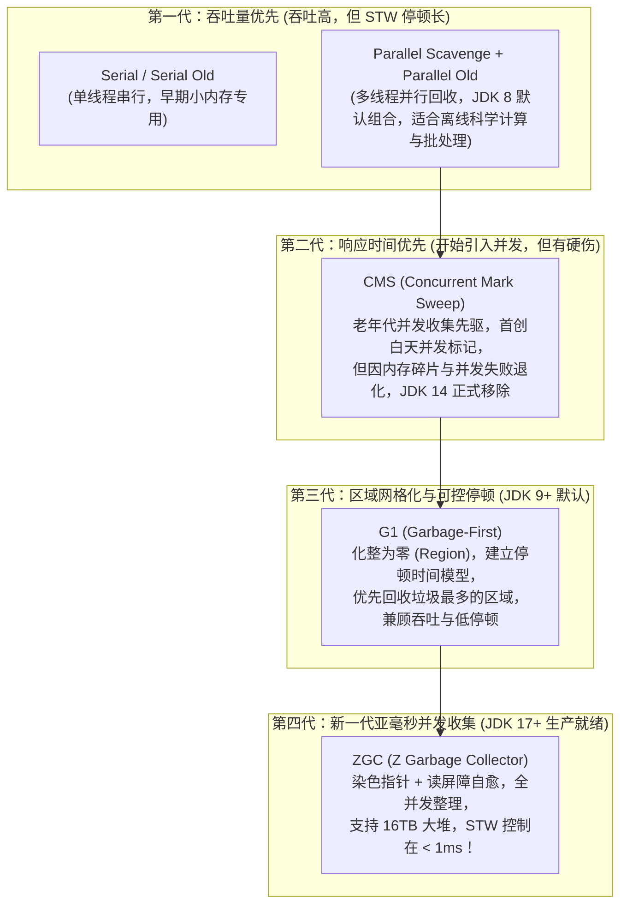
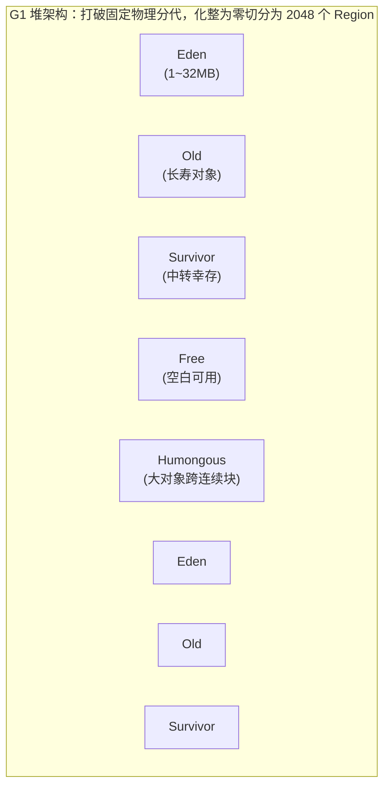
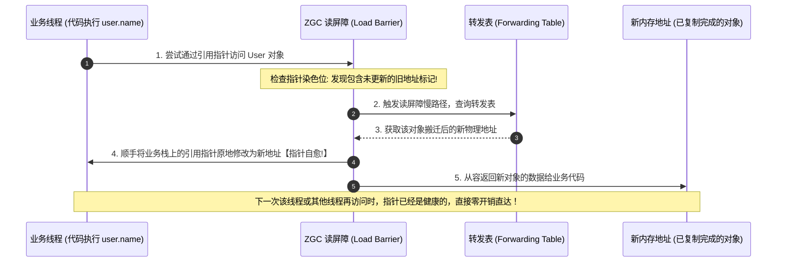

# 垃圾收集器：G1 与 ZGC

> [!abstract] 一句话心智模型
> 如果把 JVM 垃圾收集器的进化史比作**城市环卫体系的跨时代升级**：
> - **Parallel 时代（大卡车批量倒运）**：只管吞吐量，不管扰民。装卸垃圾时把整条街彻底封路几秒甚至十几秒（全量 STW），后台离线批处理很喜欢，在线 Web 服务直呼要命；
> - **CMS 时代（白天人车混跑环卫工）**：首次允许白天人车混跑（并发标记），但因为只扫不理（标记-清除），满地坑洼（碎片），一碰上大件垃圾就全城大堵车（退化为 Serial Old 漫长卡顿）；
> - **G1 时代（网格化智能调度保洁）**：打破传统行政区（物理分代），将全城划为 2048 个棋盘格（Region）。保洁中心掐表算时间（`-XX:MaxGCPauseMillis=200`），哪个网格垃圾最多、收益最高就先收哪个（Garbage-First）；
> - **ZGC 时代（亚空间量子传送门）**：通过**染色指针（Colored Pointers）**在地址上贴防伪芯片，配合**读屏障自愈（Load Barrier）**。哪怕面对 16TB 超大堆，也能在业务车辆疾驰的同时瞬间传送重组物料，全阶段并发，停顿时间强控在 **1 毫秒以内**！

---

## 🏛️ 一、垃圾收集器的进化编年史



---

## 💥 二、CMS 的辉煌与为什么被无情淘汰？

CMS（Concurrent Mark Sweep）是 HotSpot 历史上第一款真正意义上的**并发垃圾收集器**，它第一次实现了让垃圾收集线程与用户业务线程同时工作。

### CMS 的四阶段工作流程
1. **初始标记（Initial Mark）**：仅标记 GC Roots 能直接关联到的对象，**需要 STW**，但耗时极短（几毫秒）。
2. **并发标记（Concurrent Mark）**：从 GC Roots 开始遍历整个对象图，与业务线程并发运行，**不 STW**，耗时最长。
3. **重新标记（Remark）**：修正并发标记期间因用户程序运行而导致标记产生变动的对象（增量更新），**需要 STW**，耗时较短。
4. **并发清除（Concurrent Sweep）**：清理掉已经死亡的对象，与业务线程并发运行，**不 STW**。

### CMS 为什么被 JDK 9 废弃、JDK 14 彻底移除？（三大致命死穴）
1. **内存碎片与 Full GC 暴击**：
   - CMS 底层采用**标记-清除算法**，不会移动活对象，因此老年代必然产生大量不连续的碎片。
   - 当系统需要给一个大对象分配空间时，老年代虽然总空闲内存很大，但**找不出一块足够大的连续空间**！此时 CMS 束手无策，不得不触发 Full GC，退化成单线程的 **Serial Old** 进行整理，导致长达几秒甚至几十秒的全系统卡死！
2. **并发模式失败（Concurrent Mode Failure）与浮动垃圾**：
   - 在并发标记和并发清除阶段，业务线程还在源源不断地产生垃圾，这些垃圾被称为**浮动垃圾（Floating Garbage）**，本轮无法回收，只能留到下次。
   - 这就要求老年代必须**提前预留足够的内存空间**供业务线程使用（默认老年代占用达到 92% 时就必须启动 CMS）。如果业务突发高峰，预留内存被耗尽，发生 `Concurrent Mode Failure`，同样立刻退化为 Serial Old 停顿暴击！
3. **对 CPU 资源极度敏感**：
   - 在并发阶段，CMS 至少会占用 `(CPU核数 + 3) / 4` 的算力，在 4 核以下的服务器上会直接吞噬 25%~50% 的业务吞吐量。

---

## 🧩 三、G1（Garbage-First）深度内幕

为了彻底解决 CMS 的内存碎片和停顿不可控问题，JDK 7 引入、JDK 9 设为默认的 **G1 收集器**诞生了。



### 1. 核心设计 1：Region 化与 Humongous 大对象
- **化整为零**：G1 不再将堆切分成两块巨大的物理连续空间。而是将整个堆均匀划分为约 **2048 个大小相等的独立单元（Region）**，大小为 1MB 到 32MB（必须是 2 的幂次方，可通过 `-XX:G1HeapRegionSize` 设定）。
- **动态角色**：每一个 Region 在逻辑上扮演 Eden、Survivor 或 Old 角色，但不是固定的。这次它是 Eden，GC 释放后下次就可以用来当 Old。
- **Humongous 巨型大对象区**：
  - 如果一个对象的大小超过了 Region 容量的一半（`> 0.5 * RegionSize`），G1 就认为它是超大对象。
  - 大对象不会放入普通的 Eden 或 Old，而是专门分配在**连续的 Humongous Region** 中。如果找不到连续的空闲 Region，就会直接触发 Full GC！

---

### 2. 核心设计 2：可预测的停顿时间模型（软实时）
G1 的最大卖点是：你可以给它立一个军令状——**`-XX:MaxGCPauseMillis=200`（默认期望单次 GC 停顿不超过 200 毫秒）**。
- **G1 是如何做到的？**
  - G1 会跟踪每一个 Region 里面的垃圾堆积价值（回收该 Region 能释放多少空间，以及历史上回收该 Region 耗费了多少时间），计算出**回收效益比（垃圾量 / 回收耗时）**。
  - G1 维护着一个按回收收益排序的优先级列表。每次准备 GC 时，G1 根据你设定的 200ms 预算，通过衰减标准差算法预估：**“在 200ms 内，我最多能回收多少个收益最高的 Region”**。
  - 挑出这批最高收益的 Region 组成**回收集（Collection Set，CSet）**进行回收！这就是名字 **Garbage-First（垃圾优先）** 的由来。

> [!WARNING] 生产避坑：停顿时间切忌设得太小！
> 很多工程师盲目追求极致性能，把 `-XX:MaxGCPauseMillis` 设为 20ms 甚至 10ms。
> - **严重后果**：G1 发现时间太紧张，每次 GC 只敢挑选 2~3 个 Region 进行回收，导致**垃圾回收的速度远远赶不上业务产生垃圾的速度**！
> - 堆空间被迅速填满，最终触发 **G1 的 Full GC（单线程或多线程串行全堆压缩整理）**，一次性带来数秒的超长卡顿，适得其反！通常建议设置在 **100ms ~ 300ms** 之间。

---

### 3. 核心设计 3：RSet（Remembered Set）跨 Region 引用
2048 个 Region 之间可能存在错综复杂的相互引用。如果回收某几个 Region 时，难道要扫描其他 2000 多个 Region 吗？
- **解决方案**：每个 Region 都配备了一个专属的 **RSet（记忆集）**。
- **机制**：RSet 记录的是**“谁引用了我”（Points-into）**。当别处的 Region 引用了本 Region 内的对象时，底层通过**写后屏障（Post-Write Barrier）**将引用记录写进本 Region 的 RSet。
- **GC 收益**：回收本 Region 时，只需要拿自己的 RSet 加上 GC Roots，就能精确完成可达性分析，彻底避免扫描全堆！
- **代价**：RSet 本身需要占用额外的内存空间，通常会吃掉整个堆内存的 **10% ~ 20%**！

---

### 4. G1 的回收循环类型
1. **Young GC**：当所有 Eden Region 都被占满时触发。选定**所有的 Eden 和 Survivor Region** 进行标记-复制，回收存活对象并移至新的 Survivor 或晋升 Old。全过程 STW。
2. **并发标记周期（Concurrent Marking Cycle）**：当老年代占用堆空间的比例达到 **IHOP 阈值**（`-XX:InitiatingHeapOccupancyPercent`，默认 **45%**）时触发，全堆并发标记垃圾。
3. **Mixed GC（混合回收）**：并发标记完成后触发。回收**所有的新生代 Region + 按照收益排序挑选出来的一部分老年代 Region**。通常会分成几次连续完成。
4. **Full GC**：当发生**对象分配失败（Allocation Failure）**或**对象复制转移失败（Evacuation Failure）**，且没有足够的空闲 Region 兜底时，被迫触发全堆 Full GC。

---

## ⚡ 四、ZGC：亚毫秒级停顿的降维打击

ZGC（Z Garbage Collector）是 HotSpot 自 JDK 11 引入、JDK 17 达到生产就绪（Production-Ready）的革命性低延迟垃圾收集器。

> [!IMPORTANT] ZGC 的终极指标
> - **停顿时间（STW）强控在 1 毫秒以内**（JDK 16 以后甚至达到了微秒级）；
> - **停顿时间与堆大小完全无关**！不管是 4GB 堆，还是 16TB 的超巨型堆，停顿时间都恒定在 1ms 左右；
> - 吞吐量下降相比 G1 极为轻微（不超过 15%）。

ZGC 是如何实现这一神迹的？核心归功于两大工业黑科技：**染色指针（Colored Pointers）** 与 **读屏障（Load Barrier）+ 指针自愈**。

---

### 1. 黑科技 1：染色指针（Colored Pointers）

以往的垃圾收集器（如 CMS、G1），对象的 GC 标记信息（存活状态、锁、GC 年龄）都是存放在对象头内部的 **Mark Word** 里的。
而 ZGC 做了一个极其大胆的底层重构：**直接将 GC 状态信息硬编码进 64 位的虚拟内存指针地址本身！**

```
ZGC 64 位指针地址结构（Linux x86_64）：
+-------------------+-------------+-----------------------------------------------+
| 16 bit (保留未用)  | 4 bit (染色位)|             44 bit (物理对象寻址空间)          |
| 00000000 00000000 | [M0|M1|Remapped|Finalizable] | 最大寻址 16TB 内存空间 (2^44)  |
+-------------------+-------------+-----------------------------------------------+
```

- **44 bit 寻址**：支持最大 $2^{44} = 16\text{TB}$ 的堆内存！
- **4 bit 颜色标记位**：
  - `Marked0` / `Marked1`：活对象标记位（两轮交替使用，解决标记翻转）；
  - `Remapped`：该对象是否已经被重新映射并移动到了新位置；
  - `Finalizable`：只能通过 Finalizer 访问的对象。

#### 染色指针的第一性原理优势：
1. **并发整理的核心保障**：只要看一眼指针本身的颜色，甚至**根本不需要去访问对象在内存里的真实内容**，就能瞬间知道它是否存活、是否已经被搬迁！
2. **极大降低内存开销**：无需像 G1 那样维护极度庞大沉重的 RSet 记忆集。

---

### 2. 黑科技 2：读屏障（Load Barrier）与“指针自愈”

GC 最长、最折磨人的阶段不是标记，而是**把存活对象搬迁到新地址、消除内存碎片的过程（整理/复制阶段）**。
以往的收集器在搬迁对象时，必须强制 STW。因为一旦在搬迁对象的同时用户线程去读写这个旧地址，数据就会读写错乱甚至崩溃。

**ZGC 实现了真正的全并发对象整理移动！它的秘诀就是：读屏障 + 指针自愈！**



- **原理剖析**：
  1. ZGC 后台线程在并发移动对象。对象 A 被复制到了新地址 A'，但栈上的引用可能还指着老地址 A。
  2. 此时业务线程突然执行 `obj.field`。在真正读取内存之前，ZGC 的**读屏障**瞬间介入拦截！
  3. 读屏障检查引用指针的染色位，发现该指针属于“已搬迁但未更新（Not Remapped）”。
  4. 读屏障立刻查阅内部的**转发表（Forwarding Table）**，找到新地址 A'，**顺便把栈上的引用指针原地修正为 A'（这叫指针自愈 Self-Healing！）**。
  5. 修正完毕后，正常读取 A' 的数据返回给业务线程。
  - **成果**：除了最初极短的触发点需要挂起线程（< 1ms），**后续对象的搬迁、寻址、指针更新全部在业务线程奔跑的同时并发自愈完成！**

---

## ⚖️ 五、选型终极指南：Parallel vs CMS vs G1 vs ZGC

| 核心维度 | Parallel Scavenge / Old | CMS (已废弃) | G1 (当前企业主流) | ZGC (下一代低延迟王者) |
| :--- | :--- | :--- | :--- | :--- |
| **JDK 版本** | JDK 8 默认 | JDK 8 可选，JDK 14 移除 | JDK 9 ~ 21 默认 | JDK 11 实验，**JDK 17+ 生产推荐** |
| **设计核心目标** | **吞吐量优先** (最大化 CPU 运算) | **停顿时间优先** (老年代并发标记) | **软实时可控停顿** (垃圾优先) | **亚毫秒极限低延迟** (< 1ms STW) |
| **堆内存推荐规模** | 2GB ~ 4GB | 4GB ~ 8GB | **6GB ~ 32GB** | **16GB ~ 16TB** |
| **STW 停顿时间** | 百毫秒到**数十秒** (随堆线性增长) | 百毫秒到数秒 (退化时几十秒) | **100ms ~ 300ms** (可预测调节) | **< 1ms** (与堆大小完全无关) |
| **回收算法** | 标记-复制 + 标记-整理 | 标记-清除 (无整理，产生碎片) | 标记-复制 (Region 级化整为零) | 标记-复制 (染色指针 + 读屏障并发整理) |
| **内存额外开销** | 极小 (< 1%) | 较小 | 较大 (RSet 卡表占 10%~20%) | 极小 (无 RSet，主要为转发表开销) |
| **典型适用场景** | 离线大数据批处理、科学计算、报表汇总 | 早期互联网小型 Web 服务 | **当前 90% 企业的 Spring Boot 微服务标准配置** | **金融交易、电商秒杀、实时高频量化、超大堆缓存** |

---

## ⚡ 一分钟面试必杀卡

> [!question]- Q1：G1 收集器的 Garbage-First（垃圾优先）到底是什么含义？
> - G1 打破了传统连续分代，把整个堆划分为约 2048 个独立的 Region。
> - G1 内部会实时追踪每个 Region 回收所能获得的空闲空间大小，以及历史上回收该 Region 所需要的耗时，建立一个动态的**垃圾回收效益模型**。
> - 在满足用户配置的期望停顿时间（`-XX:MaxGCPauseMillis`）内，**优先挑选垃圾最多、回收收益最大的 Region 组成回收集进行回收**，这就是 Garbage-First 的真正含义。

> [!question]- Q2：ZGC 为什么能够做到无论堆多大，停顿时间都在 1ms 以内？
> - 传统收集器停顿时间长，是因为“对象的复制转移”以及“所有引用的更新”必须在 STW 期间一口气做完。
> - ZGC 依靠 **染色指针（Colored Pointers）** 和 **读屏障（Load Barrier）**，将对象标记、对象复制搬迁、引用指针重映射这三个最耗时的阶段，全部变成了与用户线程并行的**并发执行**。
> - 唯一的 STW 阶段仅仅是初始标记和短暂的安全点握手，只扫描最浅层的 GC Roots，耗时与堆大小无关，仅与 Roots 数量微弱相关，因此可以在 16TB 超大堆下依然把停顿锁定在 1 毫秒内。