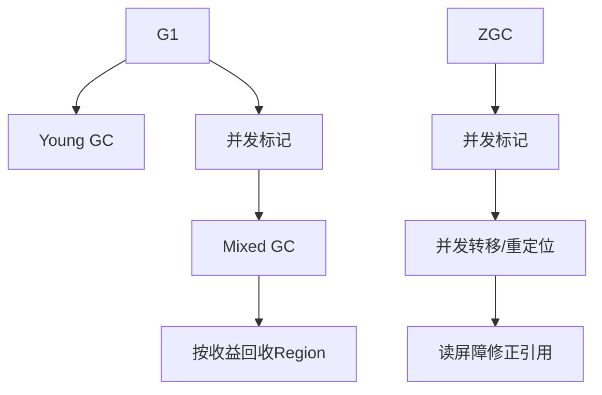

# 垃圾收集器-G1-ZGC

> [!abstract] 一句话总结
> G1 面向可预测停顿的通用服务，ZGC 面向大堆低延迟场景，二者都通过并发化和区域化降低 STW 时间。

## 📌 这是什么

- G1 把堆划分为 Region，按回收收益优先选择集合，目标是可预测停顿。
- ZGC 使用 Region、染色指针和读屏障，实现大部分工作并发执行。
- 选择收集器要看 JDK 版本、堆大小、延迟目标、吞吐要求和团队排查能力。

## 🤔 解决什么问题 / 为什么需要

- 线上 Java 服务常见问题是 GC 停顿影响 P99/P999 延迟。
- G1 是现代 JDK 服务端默认常见选择，ZGC 适合更低延迟需求。
- 面试常要求比较 CMS、G1、ZGC 的设计差异。

## 🧩 核心概念

| 概念 | 含义 | 精通要点 |
| ---- | ---- | -------- |
| Region | 把堆切成多个等大小区域。 | G1/ZGC 都基于区域管理。 |
| Remembered Set | 记录跨 Region 引用。 | G1 避免全堆扫描。 |
| Mixed GC | G1 同时回收年轻代和部分老年代 Region。 | 按垃圾收益选择。 |
| 染色指针 | ZGC 在指针中编码对象状态。 | 配合读屏障处理并发移动。 |
| 读屏障 | 读引用时执行额外逻辑。 | ZGC 低停顿的关键机制之一。 |

## ⚙️ 工作原理 / 流程



## 🔍 源码 / 原理深挖

- G1 重要参数包括 MaxGCPauseMillis、InitiatingHeapOccupancyPercent、G1HeapRegionSize。
- ZGC 重要目标是把停顿控制在很短范围，JDK 15 后进入生产可用阶段，JDK 21 有分代 ZGC。
- G1 写屏障维护 RSet，ZGC 读屏障处理并发重定位后的引用访问。

## 💻 代码实践 / 排查命令

```bash
# G1 示例
java -XX:+UseG1GC -XX:MaxGCPauseMillis=200 -Xlog:gc* ...

# ZGC 示例，适合低延迟大堆评估
java -XX:+UseZGC -Xlog:gc* ...
```

## 🛠️ 排查 / 实践要点

- G1 停顿长：看 Evacuation Pause、Humongous allocation、RSet 更新、Mixed GC 效果。
- ZGC 内存占用高：关注并发 GC 需要的余量，堆不能卡得太死。
- 切换收集器必须压测 P50/P99/P999、吞吐、CPU、内存占用和 GC 日志。

## ⚠️ 踩坑与注意事项

- 只凭“ZGC 更先进”直接替换，不做业务压测。
- 把 MaxGCPauseMillis 当硬性保证；它只是目标。
- 忽略 JDK 版本差异，同名收集器在不同版本能力差异很大。

## 🎯 面试问题

> [!question] 高频问题
> - Q: G1 为什么叫 Garbage First？
>   - A: 它把堆划分为 Region，并根据垃圾比例和回收收益优先选择值得回收的 Region，尽量在停顿目标内回收最多垃圾。
> - Q: ZGC 为什么停顿短？
>   - A: 标记、转移、重定位大多并发完成，借助染色指针和读屏障让应用线程访问引用时完成必要修正。
> - Q: G1 和 ZGC 怎么选？
>   - A: 通用服务先用 G1；超大堆、低延迟且能接受额外 CPU/内存成本时评估 ZGC，最终以压测和线上指标决定。

## 🧭 源码入口速查

- G1 日志关键字：`Pause Young`、`Concurrent Mark Cycle`、`Pause Remark`、`Pause Cleanup`、`Pause Mixed`、`Humongous regions`。
- G1 参数：`-XX:MaxGCPauseMillis`、`-XX:InitiatingHeapOccupancyPercent`、`-XX:G1HeapRegionSize`、`-XX:G1ReservePercent`。
- ZGC 日志关键字：`Garbage Collection`、`Concurrent Mark`、`Concurrent Relocate`、`Allocation Stall`。
- ZGC 参数：`-XX:+UseZGC`、JDK 21 分代 ZGC 可评估 `-XX:+ZGenerational`，是否可用取决于实际 JDK。

## 🧪 最小验证

```bash
# 对同一压测脚本分别启动两组实例，其他参数保持一致
java -Xms8g -Xmx8g -XX:+UseG1GC -Xlog:gc*:file=g1.log app.jar
java -Xms8g -Xmx8g -XX:+UseZGC  -Xlog:gc*:file=zgc.log app.jar
```

比较结果要列同一张表：QPS、P50/P99/P999、CPU、RSS、GC 总暂停、最长暂停、错误率。ZGC 暂停短不代表吞吐一定更高，G1 达不到停顿目标也不代表只能换收集器，可能是 Humongous 对象、分配率或 Mixed GC 配置问题。

## ✅ 精通检查清单

- 能用自己的话讲清本主题解决的问题和适用边界。
- 能指出至少 2 个源码入口或底层机制。
- 能给出一个最小代码示例或一组线上排查命令。
- 能回答本页列出的高频面试题，并补充项目中的真实取舍。

## 🔗 关联笔记

- [[_index]]

## 📚 参考资料

- [JVM Specification](https://docs.oracle.com/javase/specs/jvms/se21/html/)
- [Oracle Java Documentation](https://docs.oracle.com/en/java/)
