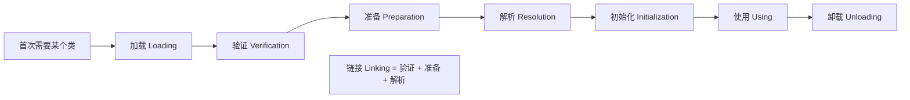
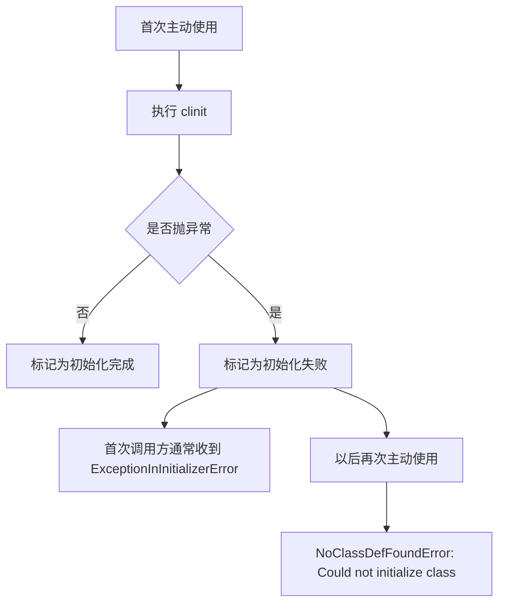
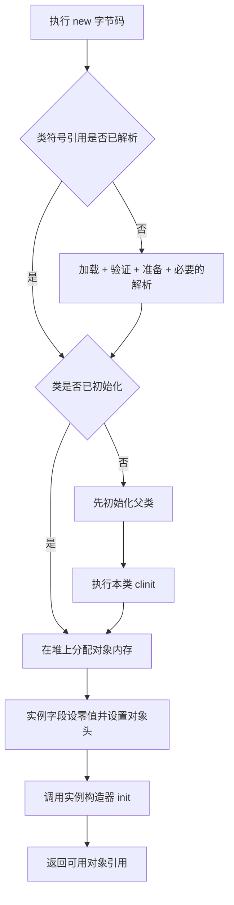
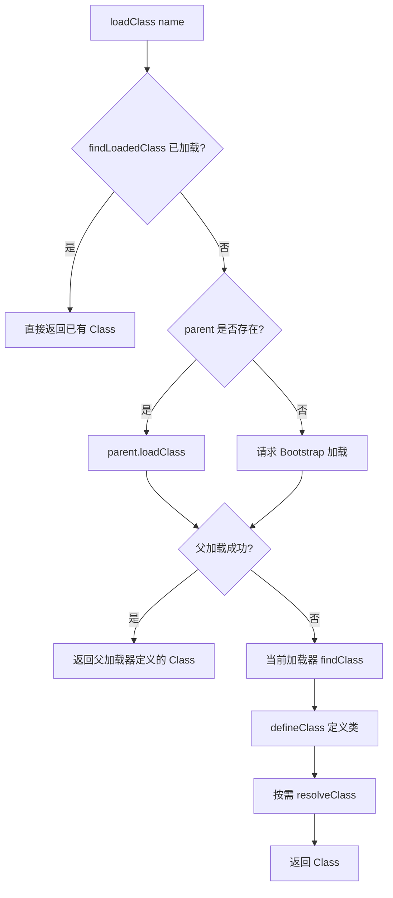
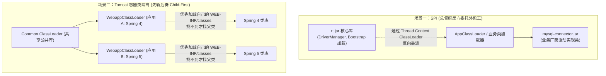

# 类加载机制与双亲委派

> [!abstract] 一句话心智模型
> 如果把类加载比作**工业园区中央档案室的“图纸入库审核与防伪鉴真”**：
> - **五步入库**：**加载**（把图纸文件读进内存） -> **验证**（检查图纸格式与恶意后门） -> **准备**（为静态物料先划出空槽并清零） -> **解析**（把图纸上的代号变成真实车间门牌号） -> **初始化**（执行 `<clinit>` 真正按图索骥装配初始值）；
> - **双亲委派（啃老机制）**：小职员遇到图纸先向主管领导请示，领导再向总督府（Bootstrap）请示，只有各级领导都表示“我没见过这图纸”，小职员才敢自己去加载；**这从根本上杜绝了黑客伪造一份 `java.lang.String` 篡改核心系统的安全隐患**！
> - **打破委派（实战破局）**：Tomcat 为了多应用版本隔离必须“先斩后奏”（Child-First 破坏委派），SPI 通过“线程上下文类加载器”实现“总督府反向委派给外包工”。

## 🎯 本节先解决四个问题

1. JVM 在什么情况下开始处理一个类？
2. 加载、验证、准备、解析、初始化分别做了什么，完成后得到了什么？
3. 双亲委派发生在哪一步，为什么同名类仍可能不是同一种类型？
4. `ClassNotFoundException`、`NoClassDefFoundError`、`VerifyError`、`ExceptionInInitializerError` 分别对应哪一段失败？

> [!note] 先区分两个“类加载”
> 日常说“类加载”经常指**从加载到初始化的完整生命周期**；JVM 规范中的“加载（Loading）”只是第一阶段。下文凡是单独写“加载阶段”，都特指第一阶段。

## 🗺️ 完整生命周期总览



| 阶段 | JVM 主要做什么 | 阶段完成后的结果 | 典型失败 |
| --- | --- | --- | --- |
| 加载 | 找到字节流、读取并解析 class 基本结构、创建运行时类表示 | JVM 认识了“这个类是谁”，并得到对应 `Class<?>` 对象 | `ClassNotFoundException`、`NoClassDefFoundError`、`ClassFormatError` |
| 验证 | 检查文件格式、元数据、字节码和符号引用是否合法 | 确认字节码不会破坏 JVM 类型与内存安全 | `VerifyError`、`UnsupportedClassVersionError` |
| 准备 | 为类变量（`static` 字段）建立存储并设置初始值 | 普通静态字段先得到零值，尚未执行源码中的赋值表达式 | `OutOfMemoryError` 等 |
| 解析 | 把运行时常量池中的符号引用解析为可直接定位的引用 | 后续能直接找到目标类、字段或方法 | `NoSuchMethodError`、`NoSuchFieldError`、`IllegalAccessError` |
| 初始化 | 执行 `<clinit>`，按源码顺序完成静态字段赋值和静态代码块 | 类进入已初始化状态，可以正常主动使用 | `ExceptionInInitializerError`、后续 `NoClassDefFoundError` |

> [!warning] 解析不是绝对固定在初始化之前一次性完成
> “验证 -> 准备 -> 解析”是理解链接阶段的逻辑顺序，但 JVM 允许**延迟解析**：某个字段或方法的符号引用可以等到真正使用时再解析。因此，运行很久的程序仍可能在调用某个分支时才抛出 `NoSuchMethodError`。

## 🚪 什么操作会触发初始化

类可以已经被加载、验证、准备，却还没有初始化。JVM 遇到下面这些“主动使用”时，才会保证目标类完成初始化：

1. 执行 `new`、`getstatic`、`putstatic`、`invokestatic` 对应的操作，即创建对象、读取或写入非常量静态字段、调用静态方法。
2. 使用反射 API 主动调用类，例如 `Class.forName("com.example.User")` 默认会初始化。
3. 初始化子类时，先初始化其尚未初始化的父类。
4. JVM 启动时，初始化包含 `main` 方法的启动类。
5. 首次调用某些动态语言支持产生的 `MethodHandle` 时，其最终对应静态字段或静态方法访问。

以下操作通常属于“被动使用”，**不会触发目标类初始化**：

```java
System.out.println(User.class);                        // 类字面量
Class.forName("com.example.User", false, loader);    // 明确只加载，不初始化
User[] users = new User[10];                           // 创建的是数组类
System.out.println(User.MAX_SIZE);                     // 编译期常量可能已内联到调用方
System.out.println(Child.PARENT_VALUE);                // 只初始化真正声明该字段的 Parent
```

## 1️⃣ 加载：把字节流变成 JVM 中的类

### 具体做什么

1. JVM 根据类的二进制名称，如 `com.example.User`，向某个类加载器发起加载请求。
2. 类加载器先按委派规则寻找已经存在的定义；需要自己加载时，通过 `findClass` 获取 class 字节流。
3. 字节流不一定来自磁盘，也可以来自 JAR、网络、数据库、运行期生成的字节码。
4. JVM 解析 class 文件的魔数、版本、常量池、字段、方法等结构。
5. JVM 创建内部的运行时类元数据，并创建供 Java 代码使用的 `java.lang.Class` 对象。

### 完成后得到了什么

- JVM 已知道这个类的名称、父类、接口、字段、方法和常量池结构。
- Java 代码可以拿到它的 `Class<?>` 对象。
- **此时不等于静态代码已执行**，静态字段也不一定已经得到源码里写的值。

### 类身份为什么包含 ClassLoader

JVM 判断两个类是否相同，依据的是：

```text
类身份 = 二进制类名 + 定义它的 ClassLoader
```

所以两个加载器分别定义的 `com.example.User`，即使字节码完全相同，也属于两个不同类型；互相强转会抛出 `ClassCastException`。

> [!note] 定义加载器与初始加载器
> 真正调用 `defineClass` 创建类的是**定义加载器（defining loader）**；最初发起请求但最终委派给别人的加载器是**初始加载器（initiating loader）**。类身份取决于定义加载器。

## 2️⃣ 验证：确认字节码合法且安全

验证不是检查“业务逻辑对不对”，而是保证 class 文件符合 JVM 约束，不会通过伪造字节码破坏类型安全或内存安全。

| 验证内容 | 具体检查 | 示例 |
| --- | --- | --- |
| 文件格式 | 魔数、版本号、常量池标签、各结构长度是否合法 | 高版本 class 交给低版本 JVM 会失败 |
| 元数据 | 类是否有合法父类、是否错误继承 `final` 类、方法覆盖是否合法 | 普通类的父类最终应能追溯到 `Object` |
| 字节码 | 操作数栈类型与深度、局部变量类型、跳转位置、返回值是否匹配 | 声明返回 `int` 的方法不能用对象返回指令 |
| 符号引用 | 目标是否存在、是否有访问权限、引用类型是否匹配 | 访问不可见方法可能抛出 `IllegalAccessError` |

验证过程中可能按需加载其他类来确认继承和类型关系，但**加载其他类不代表初始化它们**。

## 3️⃣ 准备：给静态字段建立存储并设初始值

准备阶段处理的是**类变量（`static` 字段）**，不处理对象实例字段，也不执行构造器。

```java
class Config {
    static int timeout = 30;
    static String name = "prod";
    static final int MAX_RETRY = 3;
    static final Integer BOXED = 3;
}
```

可以按下面的两步理解：

| 字段 | 准备阶段 | 初始化阶段 |
| --- | --- | --- |
| `timeout` | `0` | 执行 `timeout = 30` |
| `name` | `null` | 执行 `name = "prod"` |
| `MAX_RETRY` | 根据 class 文件中的常量值处理 | 不需要普通赋值代码 |
| `BOXED` | `null` | 执行装箱并赋值为 `Integer.valueOf(3)` |

关键区别：

- `static int timeout = 30` 中的 `30`，通常要等 `<clinit>` 执行才写入。
- `static final int MAX_RETRY = 3` 是编译期常量，值记录在 class 文件的 `ConstantValue` 属性中，JVM 会在类初始化逻辑执行前完成常量字段赋值。
- `static final Integer BOXED = 3` 需要执行方法调用，不是编译期常量，仍在 `<clinit>` 中赋值。

## 4️⃣ 解析：把“名字”变成可直接定位的目标

class 文件中的常量池最初保存的是符号信息，例如：

```text
类：java/lang/String
字段：com/example/Config.timeout:I
方法：java/io/PrintStream.println:(Ljava/lang/String;)V
```

解析阶段把这些**符号引用**转换成 JVM 能直接定位的类、字段、方法、方法句柄等运行时引用，并执行存在性与访问权限检查。


这也解释了为什么“编译通过”不代表运行期一定没问题：如果编译时依赖 `lib-v2.jar`，运行时却放入缺少该方法的 `lib-v1.jar`，真正解析调用点时会抛出 `NoSuchMethodError`。

## 5️⃣ 初始化：执行类自己的静态初始化逻辑

### `<clinit>` 从哪里来

编译器会把以下内容按**源码出现顺序**合并到类初始化方法 `<clinit>()V`：

- 静态字段的赋值表达式；
- `static { ... }` 静态代码块。

```java
class Example {
    static int a = 10;       // <clinit>：a = 10
    static int b = a + 1;    // <clinit>：b = 11
    static {                 // <clinit>：继续按源码顺序执行
        b = 20;
    }
}
```

不是每个类都有 `<clinit>`：如果类没有需要执行的静态初始化语句，编译器可以不生成它。`<clinit>` 也不同于实例构造器 `<init>`：

| 对比 | `<clinit>` | `<init>` |
| --- | --- | --- |
| 用途 | 初始化类的静态状态 | 初始化一个对象实例 |
| 次数 | 每个类加载器定义的类最多成功执行一次 | 每次 `new` 都执行 |
| 调用方式 | JVM 自动调用，Java 源码不能直接调用 | `new` 最终通过 `invokespecial` 调用 |
| 顺序 | 父类先初始化，再初始化子类 | 父类构造器先执行，再执行子类构造器 |

### JVM 如何保证只初始化一次

初始化不是简单调用一个方法，JVM 会为每个类维护初始化状态并进行同步：

1. 多个线程同时首次使用某个类时，只有一个线程执行它的 `<clinit>`。
2. 其他线程等待初始化完成，随后直接使用已经初始化的类。
3. 同一线程在 `<clinit>` 中递归请求初始化本类时，不会再次执行 `<clinit>`。
4. 初始化子类前，JVM 先初始化尚未初始化的父类，以及规范要求先初始化的相关父接口。
5. `<clinit>` 正常结束后，类被标记为初始化完成。

### 初始化失败后为什么会连续报错



JVM 不会在下一次访问时自动重试 `<clinit>`。因此静态代码块中连接数据库、读取远程配置等复杂操作一旦失败，往往会让该类在当前类加载器生命周期内持续不可用。

## 6️⃣ 使用与卸载：类初始化之后去了哪里

初始化完成后，程序可以创建实例、访问静态成员、调用方法和使用反射，这些都属于使用阶段。**类的生命周期通常比单个对象长**：对象不可达后可以被 GC，但只要定义该类的 ClassLoader 仍然可达，类元数据一般不会被卸载。

一个类具备卸载条件，通常需要同时满足：

1. 该类的所有实例都已不可达；
2. 代表该类的 `Class<?>` 对象不可达；
3. 定义该类的 ClassLoader 不可达，并且它定义的其他类也不再需要。

因此 Bootstrap、Platform、Application ClassLoader 加载的类通常伴随 JVM 进程存活；热部署、插件系统频繁创建的自定义 ClassLoader 才是常见卸载对象。如果旧加载器被线程、`ThreadLocal`、静态集合、JDBC Driver 或缓存持续引用，它定义的全部类元数据都可能留在 Metaspace，形成类加载器泄漏。

## 🧱 一次 `new` 的完整因果链

执行 `new OrderService()` 时，可以沿着下面这条链理解：



因此，“类加载完成”和“对象创建完成”不是一回事：

- 类加载链路准备的是**类型本身**，通常每个定义加载器只做一次；
- 对象创建链路分配并初始化的是**具体实例**，每次 `new` 都会发生。

对象内存分配、零值初始化和对象头设置的细节见 [[02-对象创建与内存布局]]。

## 👪 双亲委派：加载阶段到底如何找类

JDK 9+ 常见的类加载器层级是：

```text
Bootstrap ClassLoader   加载 java.base 等核心模块，Java 中通常显示为 null
        ↑
Platform ClassLoader    加载 Java 平台的非核心模块
        ↑
Application ClassLoader 加载应用 classpath/module path 上的类
        ↑
Custom ClassLoader      插件、容器、热部署等自定义加载器
```

这里的“父子”是**委派关系**，不是 Java 类继承关系。`ClassLoader#loadClass` 的核心流程是：



### 为什么要先委派父加载器

1. **避免重复定义**：应用加载器请求 `java.lang.String` 时，最终复用 Bootstrap 已定义的核心类。
2. **保持公共类型一致**：共享 API 由上层加载器定义，下面的插件才能围绕同一个接口类型交互。
3. **保护核心命名空间**：应用自己的同名 class 不会优先覆盖 JDK 核心实现；JVM 对 `java.*` 包还有额外保护。

双亲委派不是 JVM 强制所有加载器遵守的唯一算法，而是 `ClassLoader#loadClass` 的默认实现与 JDK 生态的通用约定。自定义加载器可以调整顺序，但必须明确处理类型隔离和公共 API 共享问题。

## 🔄 工业实战：打破双亲委派的三大经典场景

虽然双亲委派是 JDK 的推荐规范，但在很多复杂工业场景下，如果死守双亲委派，系统根本无法运转！



### 1. 经典场景一：SPI 与 JDBC 驱动（父加载器反向委托子加载器）
- **痛点矛盾**：
  - JDBC 核心规范接口（`java.sql.Driver`、`DriverManager`）存放在 JDK 核心库 `rt.jar` 中，是由最顶层的 **Bootstrap ClassLoader** 加载的。
  - 但是，具体的数据库驱动实现类（例如 `com.mysql.cj.jdbc.Driver`）是由第三方数据库厂商编写的，打包在业务 classpath 中，Bootstrap 根本看不到、加载不到这个类！
  - 按照双亲委派，子加载器可以委托父加载器，但**父加载器绝对无法主动调用子加载器去加载类**！
- **破局之道：线程上下文类加载器（TCCL）**：
  - Java 引入了 `Thread.currentThread().getContextClassLoader()`。
  - 在当前线程启动时，JVM 会默认把 **Application ClassLoader** 绑定为线程上下文类加载器。
  - 当 `DriverManager` 需要初始化驱动时，它通过 `ServiceLoader.load(Driver.class)`，悄悄拿到当前线程上下文绑定的 AppClassLoader，**跨层反向去加载 classpath 下的第三方 MySQL 实现类**！这就打破了严格的“自底向上委派”单向通道。

---

### 2. 经典场景二：Tomcat 容器的多应用隔离（Child-First 先斩后奏）
在传统的 Tomcat 生产服务器中，常常在一台机器上部署两个不同的 WAR 包应用：
- 应用 A 依赖 `Spring 4.0`；
- 应用 B 依赖 `Spring 5.0`；
- **痛点**：如果 Tomcat 严格遵循双亲委派，应用 A 加载了一个 `org.springframework.context.ApplicationContext` 后，由于委托给父加载器（AppClassLoader），全局就只会存在一个 Spring 4 的版本。当应用 B 试图使用 Spring 5 特有的新方法时，会当场抛出 `NoSuchMethodError` 崩溃！
- **Tomcat 如何打破双亲委派？**
  - Tomcat 为每一个部署的 Web 应用程序都创建了一个独立的 **`WebappClassLoader`**。
  - `WebappClassLoader` 重写了 `loadClass` 方法，颠覆了委派顺序：
    1. 先在自身缓存中查找；
    2. 如果没有，优先在自身应用程序的 `/WEB-INF/classes` 和 `/WEB-INF/lib` 中查找并直接加载（**Child-First，先斩后奏！**）；
    3. 只有当自己这里根本找不到这个类时，才向上委托给父类加载器（CommonClassLoader / AppClassLoader）。
    - **特例保护**：对于 `java.*` 核心基础类库，Tomcat 依然严格委派给 Bootstrap，防止用户代码恶意篡改系统基础库。
  - **成果**：应用 A 拥有自己的 Spring 4，应用 B 拥有自己的 Spring 5，两套类库在同一 JVM 进程中井水不犯河水！

---

### 3. 经典场景三：热部署与动态插件（卸载类加载器）
- **痛点**：JVM 规范明确规定，**一个类一旦被加载入内存，只要它的类加载器还活着，这个类就不可能被单独卸载或原地重新定义（除非使用非常有限的字节码热替换技术）**。
- **破局方案**：
  - 将需要动态更新的模块代码交由一个专门的 **Custom ClassLoader** 加载。
  - 当代码发生改动需要热部署时：
    1. 将当前模块的业务引用切断；
    2. **直接将旧的 ClassLoader 实例置为 null 并抛弃**；
    3. 触发 GC 后，旧 ClassLoader 以及它加载的所有 Class 元数据一起从元空间彻底回收；
    4. **新建一个全新的 ClassLoader 实例**，重新读取磁盘上修改后的 `.class` 字节码文件！
  - 这就是 OSGi、Arthas、各类热加载框架实现模块热插拔的底层秘密。

## 💥 异常对应哪一个阶段

| 异常或错误 | 常见阶段 | 真实含义 | 优先检查 |
| --- | --- | --- | --- |
| `ClassNotFoundException` | 显式加载 | `loadClass` / `Class.forName` 按指定加载器没找到类 | 类名、classpath、调用方使用的 ClassLoader |
| `NoClassDefFoundError` | 链接或使用 | JVM 使用已编译引用时找不到定义，或该类此前初始化失败 | 最早的 `Caused by`、JAR 是否缺失、之前的初始化异常 |
| `UnsupportedClassVersionError` | 验证 | class 的字节码版本高于当前 JVM 支持版本 | 编译 JDK、`--release`、运行 JDK |
| `ClassFormatError` | 加载/验证 | class 文件结构损坏或不符合格式 | JAR 损坏、字节码生成器 |
| `VerifyError` | 验证 | 字节码类型流、栈或跳转不合法 | 增强工具、混淆器、版本不兼容 |
| `NoSuchMethodError` / `NoSuchFieldError` | 解析 | 编译时存在的成员在运行时版本中不存在 | 依赖冲突、实际加载来源 |
| `IllegalAccessError` | 解析 | 运行期访问权限不满足 | 依赖版本、模块边界、成员可见性 |
| `ExceptionInInitializerError` | 初始化 | 首次执行 `<clinit>` 时抛出了非 `Error` 异常 | 静态字段赋值和静态代码块的根因 |
| `ClassCastException` 且类名相同 | 使用 | 两个同名类由不同加载器定义 | 两边的 `ClassLoader` 与 `CodeSource` |

> [!note] `ClassNotFoundException` 和 `NoClassDefFoundError` 的区别
> 前者通常是代码**主动按名字查找**失败，是受检异常；后者通常是 JVM 在执行已编译代码时发现所需类不可用，是 `LinkageError`。看到 `Could not initialize class` 时，真正根因通常出现在更早的首次初始化失败日志中。

## 🔬 可运行验证：看清“加载”和“初始化”不是一回事

```java
public class ClassLoadingDemo {
    static class Parent {
        static int value = mark("1. Parent 静态字段赋值");

        static {
            System.out.println("2. Parent 静态代码块");
        }

        Parent() {
            System.out.println("5. Parent 构造器");
        }
    }

    static class Target extends Parent {
        static final int CONSTANT = 42;
        static int value = mark("3. Target 静态字段赋值");

        static {
            System.out.println("4. Target 静态代码块");
        }

        Target() {
            System.out.println("6. Target 构造器");
        }
    }

    static int mark(String message) {
        System.out.println(message);
        return 1;
    }

    public static void main(String[] args) throws Exception {
        ClassLoader loader = ClassLoadingDemo.class.getClassLoader();

        Class.forName("ClassLoadingDemo$Target", false, loader);
        System.out.println("A. 只加载，尚未初始化");

        System.out.println("B. 编译期常量=" + Target.CONSTANT);
        System.out.println("C. 首次读非常量静态字段=" + Target.value);

        new Target();
        new Target();
    }
}
```

执行：

```bash
javac ClassLoadingDemo.java
java -Xlog:class+load=info ClassLoadingDemo
javap -v -c 'ClassLoadingDemo$Target'
```

业务输出的关键顺序是：

```text
A. 只加载，尚未初始化
B. 编译期常量=42
1. Parent 静态字段赋值
2. Parent 静态代码块
3. Target 静态字段赋值
4. Target 静态代码块
C. 首次读非常量静态字段=1
5. Parent 构造器
6. Target 构造器
5. Parent 构造器
6. Target 构造器
```

从结果可以直接得到四个结论：

1. `Class.forName(..., false, loader)` 可以加载但不初始化。
2. 读取编译期常量没有触发 `Target` 初始化。
3. 首次读取非常量静态字段时，先初始化父类，再初始化子类；同一类只初始化一次。
4. 每次 `new` 都执行父子构造器，但不会重复执行静态初始化。

## 🛠️ 线上排查闭环

### 1. 先确认“谁加载、从哪里加载”

```java
Class<?> type = obj.getClass();
System.out.println("class=" + type.getName());
System.out.println("loader=" + type.getClassLoader());
System.out.println("source=" + type.getProtectionDomain().getCodeSource());
System.out.println("tccl=" + Thread.currentThread().getContextClassLoader());
```

### 2. 再观察 JVM 实际加载记录

```bash
# JDK 9+
java -Xlog:class+load=info -jar app.jar

# 已运行进程可先查看类加载器统计
jcmd <pid> VM.classloader_stats
jcmd <pid> VM.classloaders
```

### 3. 最后查构建依赖是否与运行时一致

```bash
mvn dependency:tree -Dverbose
jdeps --multi-release 21 app.jar
```

排查顺序建议固定为：**异常最早根因 -> 目标类的 ClassLoader -> CodeSource 实际 JAR -> 依赖树版本 -> 类加载日志**。只看 Maven 依赖树不能证明生产运行时实际加载了哪一个 JAR。

## ⚠️ 常见误区

- **误区：加载完成就会执行静态代码块。** 实际上加载与初始化可以相隔很久。
- **误区：准备阶段会执行 `static int n = calculate()`。** 准备阶段只建立静态存储和默认值，方法调用在 `<clinit>` 中执行。
- **误区：解析永远在初始化前一次性完成。** JVM 可以延迟解析到首次真正使用某个符号引用时。
- **误区：全限定类名相同就是同一个类型。** 还必须由同一个定义加载器加载。
- **误区：双亲委派等于“父加载器加载完再由子加载器重复加载”。** 父加载成功后直接返回，子加载器不会再定义同名类。
- **误区：修改 classpath 后就能恢复初始化失败的类。** 类已被标记为初始化失败时，通常要卸载对应 ClassLoader 或重启进程。

## 🎯 面试问题

> [!question] Q：一个类从 class 文件到可用，完整过程是什么？
> A：先由类加载器读取字节流并创建运行时类表示；链接阶段依次完成验证、准备，并按需解析符号引用；首次主动使用时执行初始化，先初始化父类，再执行本类按源码顺序生成的 `<clinit>`。准备阶段普通静态字段只有默认值，源码显式赋值通常在初始化阶段发生。

> [!question] Q：双亲委派的实际流程是什么？
> A：`loadClass` 先查 `findLoadedClass`，未命中则委派父加载器；父加载器失败后当前加载器才执行 `findClass` 和 `defineClass`。它用于避免重复定义、保持公共类型一致和保护核心类，但容器、插件与 SPI 会按隔离或反向发现需求调整加载策略。

> [!question] Q：为什么首次报 `ExceptionInInitializerError`，后面变成 `NoClassDefFoundError`？
> A：首次 `<clinit>` 失败后，JVM 会把该类标记为初始化失败，不会自动重试；后续主动使用发现类处于错误状态，因此抛出 `NoClassDefFoundError: Could not initialize class`。根因应回到第一次失败的异常链查找。

## 🧭 源码与规范入口

- `ClassLoader#loadClass`：查看 `findLoadedClass -> parent.loadClass -> findClass` 的默认委派流程。
- `ClassLoader#defineClass`：把 class 字节数组交给 JVM 定义为运行时类。
- `Class#forName(String, boolean, ClassLoader)`：用 `initialize` 参数区分“只加载”和“加载后初始化”。
- `ServiceLoader#load`：观察 SPI 如何使用线程上下文类加载器发现实现。
- JVM 启动观测：JDK 8 用 `-verbose:class`，JDK 9+ 用 `-Xlog:class+load=info`。
- JVMS 第 5 章：Loading、Linking、Initialization 的规范定义与错误时机。

## ✅ 精通检查清单

- 能画出加载、验证、准备、解析、初始化五个阶段，并说明每一步的输入、动作和结果。
- 能解释普通静态字段、编译期常量和对象实例字段分别在哪个阶段获得值。
- 能区分 `<clinit>` 与 `<init>`，并说明父类和子类的执行顺序。
- 能写出 `ClassLoader#loadClass` 的实际委派顺序。
- 能根据异常类型判断失败发生在查找、验证、解析还是初始化。
- 遇到同名类转换失败时，能同时检查 `ClassLoader` 和 `CodeSource`。

## 🔗 关联笔记

- [[02-对象创建与内存布局]] —— 类初始化完成后，`new` 如何分配并初始化对象
- [[01-JVM内存区域]] —— 类元数据、`Class` 对象与对象实例分别位于哪里
- [[07-OOM问题排查]] —— 类加载器泄漏为什么会造成 Metaspace OOM
- [[08-常用工具-jstat-jmap-jstack-Arthas]] —— 如何从运行中 JVM 获取类加载证据
- [[_index]]

## 📚 参考资料

- [JVMS 5.3 - Creation and Loading](https://docs.oracle.com/javase/specs/jvms/se21/html/jvms-5.html#jvms-5.3)
- [JVMS 5.4 - Linking](https://docs.oracle.com/javase/specs/jvms/se21/html/jvms-5.html#jvms-5.4)
- [JVMS 5.5 - Initialization](https://docs.oracle.com/javase/specs/jvms/se21/html/jvms-5.html#jvms-5.5)
- [Java SE 21 ClassLoader API](https://docs.oracle.com/en/java/javase/21/docs/api/java.base/java/lang/ClassLoader.html)
