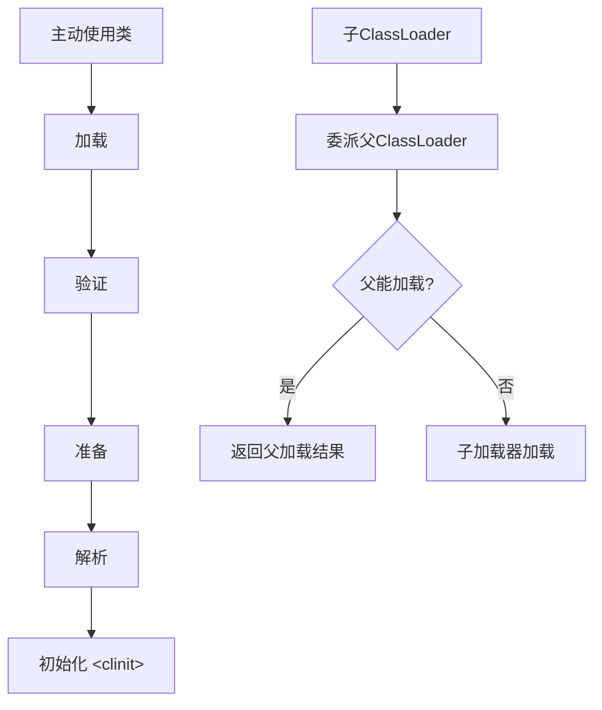

# 类加载机制与双亲委派

> [!abstract] 一句话总结
> 类加载把 class 字节码变成 JVM 可用的 Class 对象，双亲委派通过加载器层级保证核心类安全和类身份一致。

## 📌 这是什么

- 类加载过程包括加载、验证、准备、解析、初始化。
- 类加载器不仅加载字节码，也参与决定类身份：类名相同但加载器不同，JVM 认为不是同一个类。
- 双亲委派是先让父加载器尝试加载，父加载不了子加载器才加载。

## 🤔 解决什么问题 / 为什么需要

- 排查 ClassNotFoundException、NoClassDefFoundError、LinkageError、ClassCastException。
- 理解 SPI、Tomcat、OSGi、插件化为什么会打破或调整委派模型。
- 解释 static 初始化时机和类加载死锁/循环依赖。

## 🧩 核心概念

| 概念 | 含义 | 精通要点 |
| ---- | ---- | -------- |
| 加载 | 读取 class 字节流并创建 Class 对象。 | 来源可以是文件、jar、网络、动态生成。 |
| 链接 | 验证、准备、解析。 | 准备阶段给静态变量分配默认值。 |
| 初始化 | 执行 <clinit>，包括静态变量显式赋值和静态代码块。 | 首次主动使用触发。 |
| 双亲委派 | 先父后子。 | 保护 JDK 核心类，避免重复加载。 |
| 线程上下文类加载器 | 让父层代码可反向加载应用层实现。 | SPI 常用。 |

## ⚙️ 工作原理 / 流程



## 🔍 源码 / 原理深挖

- ClassLoader.loadClass 默认实现先查 findLoadedClass，再委派 parent，最后调用 findClass。
- Bootstrap ClassLoader 加载核心类，Platform/App ClassLoader 负责平台和应用类路径。
- ServiceLoader 常通过线程上下文类加载器发现 META-INF/services 下的实现。

## 💻 代码实践 / 排查命令

```java
Class<?> clazz = Class.forName("com.example.Plugin");
System.out.println(clazz.getClassLoader());
System.out.println(Thread.currentThread().getContextClassLoader());
```

## 🛠️ 排查 / 实践要点

- ClassNotFoundException：当前加载路径找不到类；NoClassDefFoundError：编译存在但运行解析/初始化失败或缺失。
- ClassCastException 显示同名类不能转换时，打印两个对象的 getClass().getClassLoader。
- 排查 jar 冲突用 mvn dependency:tree、jdeps、启动参数 -verbose:class 或 -Xlog:class+load。

## ⚠️ 踩坑与注意事项

- 以为全限定类名相同就是同一个类，忽略加载器。
- 在 static 块里做复杂外部依赖初始化，导致类初始化失败后持续 NoClassDefFoundError。
- 自定义类加载器不遵守委派，误加载 JDK 或公共 API 类。

## 🎯 面试问题

> [!question] 高频问题
> - Q: 类加载过程是什么？
>   - A: 加载、验证、准备、解析、初始化。准备阶段分配默认值，初始化阶段执行静态赋值和静态代码块。
> - Q: 什么是双亲委派？
>   - A: 类加载器收到加载请求后先委派给父加载器，父加载不了才自己加载，用于保证核心类安全和类加载一致性。
> - Q: 为什么有些框架打破双亲委派？
>   - A: 例如 SPI、容器和插件系统需要父层框架加载子层应用实现，或隔离不同应用依赖，因此会使用上下文类加载器或自定义加载策略。

## 🧭 源码入口速查

- `ClassLoader#loadClass`：先 `findLoadedClass`，再委派 parent，最后 `findClass`。
- `URLClassLoader#findClass`：传统 jar/classpath 加载路径的典型实现。
- `ServiceLoader#load`：SPI 常用线程上下文类加载器加载实现。
- 启动观测：JDK 8 用 `-verbose:class`，JDK 9+ 用 `-Xlog:class+load=info`。
- 依赖排查：`mvn dependency:tree -Dincludes=groupId:artifactId`、`jdeps --multi-release`。

## 🧪 最小验证

```java
System.out.println(String.class.getClassLoader()); // bootstrap 通常打印 null
System.out.println(Thread.currentThread().getContextClassLoader());
Class<?> c = Class.forName("com.example.Plugin", false, loader);
```

同名类冲突时不要只看包名。把两个对象的 `obj.getClass()`、`getClassLoader()`、`ProtectionDomain().getCodeSource()` 都打印出来，能直接定位到底是重复 jar、容器隔离、热部署残留还是自定义加载器策略。

## ✅ 精通检查清单

- 能用自己的话讲清本主题解决的问题和适用边界。
- 能指出至少 2 个源码入口或底层机制。
- 能给出一个最小代码示例或一组线上排查命令。
- 能回答本页列出的高频面试题，并补充项目中的真实取舍。

## 🔗 关联笔记

- [[_index]]

## 📚 参考资料

- [JVM Specification](https://docs.oracle.com/javase/specs/jvms/se21/html/)
- [Oracle Java Documentation](https://docs.oracle.com/en/java/)
