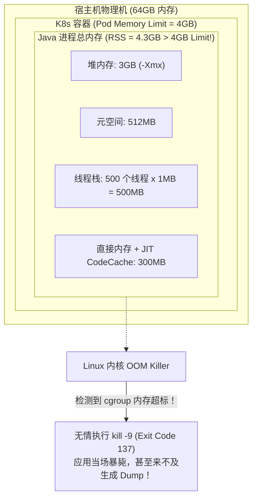
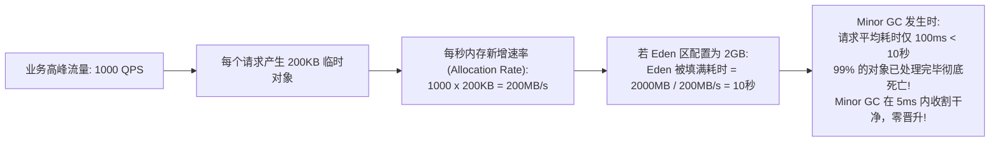
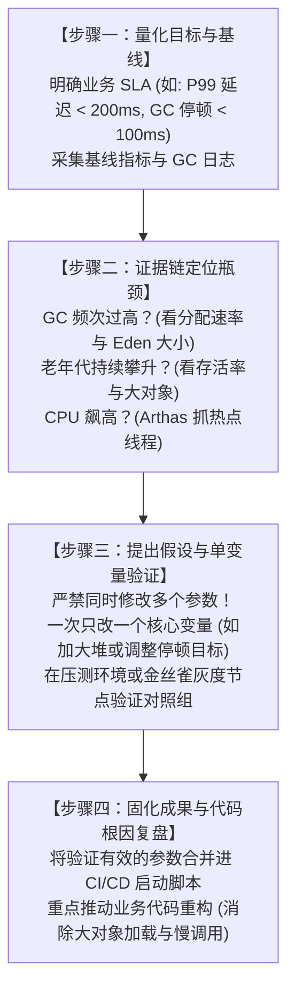

# JVM 调优实战

> [!abstract] 一句话心智模型
> JVM 调优就像是**工业流水线的产能规划与治水工程**：
> - **第一原则**：**90% 的线上性能问题根源在业务代码（慢 SQL、大集合加载、死循环、连接泄漏），绝不能指望改几个 JVM 参数就能“大力出奇迹”**；
> - **调优第一性原理**：让新生对象**在新生代（Eden）从容诞生并在 Minor GC 中迅速消亡**，尽可能避免对象非正常过早晋升老年代，杜绝任何毁灭性的 Full GC；
> - **容器生存军规**：在 Docker/K8s 容器中，JVM 必须开启容器感知（`-XX:+UseContainerSupport`），永远使用百分比（`-XX:MaxRAMPercentage=75.0`）为堆外和操作系统预留生命通道，严防 Exit Code 137（OOM Killer 强杀）。

---

## 🏗️ 一、大厂生产就绪标准启动参数模板

不要把参数一个个死记硬背，直接参考大厂生产验证过的标准配置模板：

### 1. Spring Boot 3 + JDK 17/21（4C8G 容器标准推荐）
```bash
java \
  # 1. 内存基线与容器感知 (核心：为堆外预留 25% 缓冲，防止 K8s OOM Killer)
  -XX:+UseContainerSupport \
  -XX:InitialRAMPercentage=75.0 \
  -XX:MaxRAMPercentage=75.0 \
  -XX:MinRAMPercentage=75.0 \
  -Xss512k \
  -XX:MetaspaceSize=256m \
  -XX:MaxMetaspaceSize=512m \
  \
  # 2. 收集器选择与可预测停顿 (默认 G1)
  -XX:+UseG1GC \
  -XX:MaxGCPauseMillis=200 \
  -XX:InitiatingHeapOccupancyPercent=45 \
  -XX:G1ReservePercent=10 \
  \
  # 3. 现场保留与死因保全 (线上暴毙时的唯一破案线索！)
  -XX:+HeapDumpOnOutOfMemoryError \
  -XX:HeapDumpPath=/data/logs/heap_dump.hprof \
  -XX:+ExitOnOutOfMemoryError \
  \
  # 4. JDK 9+ 统一 GC 日志语法 (低开销，保留近 5 个轮转日志)
  -Xlog:gc*,safepoint=info:file=/data/logs/gc.log:time,uptime,pid:filecount=5,filesize=100M \
  \
  -jar app.jar
```

### 2. JDK 8 + 8C16G 物理机 / 云主机经典模板
```bash
java \
  # 1. 堆大小完全对齐：-Xms 必须等于 -Xmx (杜绝堆内存伸缩抖动与系统调用开销)
  -Xms12g -Xmx12g \
  -Xss1m \
  -XX:MetaspaceSize=512m -XX:MaxMetaspaceSize=512m \
  \
  # 2. G1 收集器
  -XX:+UseG1GC \
  -XX:MaxGCPauseMillis=200 \
  -XX:InitiatingHeapOccupancyPercent=45 \
  \
  # 3. OOM 现场保留
  -XX:+HeapDumpOnOutOfMemoryError \
  -XX:HeapDumpPath=/data/logs/heap_dump.hprof \
  \
  # 4. JDK 8 经典 GC 日志配置
  -XX:+PrintGCDetails \
  -XX:+PrintGCDateStamps \
  -XX:+PrintTenuringDistribution \
  -Xloggc:/data/logs/gc.log \
  -XX:+UseGCLogFileRotation \
  -XX:NumberOfGCLogFiles=5 \
  -XX:GCLogFileSize=100M \
  \
  -jar app.jar
```

---

## 🔍 二、三大核心黄金法则深度剖析

### 法则 1：为什么 `-Xms` 必须等于 `-Xmx`？（第一性原理）

很多新手认为：“把 `-Xms` 设小一点（比如 2G），把 `-Xmx` 设大一点（比如 8G），让 JVM 弹性伸缩，省内存，多好啊！”
- **事实真相：这是生产环境的性能灾难！**
- **底层原理**：
  1. 当流量突然飙升，2G 初始堆内存被占满时，JVM 必须向 Linux 操作系统发起系统调用（`brk` 或 `mmap`）申请更多虚拟内存页面。
  2. 操作系统在分配物理内存时，伴随着页表建立、缺页中断（Page Fault）和内存置零。
  3. 更可怕的是，在内存扩容或收缩的过程中，**JVM 会伴随发生 Stop The World 停顿与全堆重新规划**！
  4. 当流量回落时，JVM 试图收缩内存，过会儿流量又来又扩容，整个 JVM 处于剧烈的**堆抖动（Heap Thrashing）**状态。
- **铁律结论**：将 `-Xms` 与 `-Xmx` 设置为完全一致，让 JVM 在启动时就一次性向操作系统申请好全部物理地址空间，**杜绝任何运行期的内存扩张抖动与系统开销**！

---

### 法则 2：Docker / K8s 容器环境“Exit Code 137”的生与死

在容器化部署日益普及的今天，无数 Java 应用在线上莫名其妙地被杀，K8s 事件日志赫然显示：`OOMKilled: true (Exit Code 137)`。



#### 破案三部曲：
1. **死因真相**：
   - 开发者误以为：**“Java 进程占用的内存 == `-Xmx` 堆内存”**。
   - 实际上：**`容器真实占用内存 (RSS) = 堆内存 + 元空间 + 线程栈总和 + 直接内存 + CodeCache + JVM自身C++开销`**！
   - 如果你给 K8s 容器配置了 `limit: 4Gi`，却把 JVM 堆设置成 `-Xmx4g`，那么只要线程数稍多一点，或者 Netty 申请了一点直接内存，总内存瞬间突破 4GB。
   - Linux 内核通过 `cgroup` 机制检测到该容器超标，直接降下神罚：发送 `SIGKILL (kill -9)`，容器瞬间蒸发！
2. **正确破局姿势**：
   - **绝不能把 `-Xmx` 设置为等于容器的 limit！**
   - 生产黄金公式：**堆内存应该占容器 Limit 的 70% ~ 75%**，把剩下的 25% ~ 30% 留给线程栈、元空间、直接内存和操作系统。
   - 配置 `-XX:+UseContainerSupport` 和 `-XX:MaxRAMPercentage=75.0`，JVM 会自动读取 cgroup 的内存配额并按比例划分堆，容器扩容缩小参数完全自适应！

---

### 法则 3：分代容量估算的数学模型（拒绝盲猜）

怎么判断你的微服务该分配多大的堆？Eden 区应该设多大？



#### 数学推导实战：
- **场景**：某电商订单查询服务，压测峰值 QPS 为 1000，平均每个请求经历 Controller -> Service -> DAO，会产生约 200KB 的 DTO、VO 和 JSON 字符串。平均接口耗时为 100ms。
- **计算每秒新生对象量**：$1000 \times 200\text{KB} = 200\text{MB/s}$。
- **推导 Eden 区容量**：
  - 如果 Eden 区设置过小（例如仅 400MB），那么每 $400 / 200 = 2\text{秒}$ 就会被装满触发一次 Minor GC。此时由于大量耗时稍长的异步请求或批处理对象还在处理中，对象来不及死亡，存活率高，Survivor 装不下，直接**提前逃逸晋升到老年代**！导致老年代迅速被垃圾填满，几十分钟就来一次 Full GC！
  - 如果我们将 Eden 区扩大到 **2GB**，那么装满 Eden 需要整整 **10 秒**！在 10 秒的漫长时间里，绝大多数执行只需 100ms 的请求早已经结束，对象死亡率高达 99%。Minor GC 触发时只需复制极少量的活对象，**耗时只需 3~5 毫秒，几乎对业务零感知，老年代水位长期保持平稳！**

---

## 🛠️ 三、JVM 调优排查标准闭环 SOP



### 生产排查口诀：
1. **CPU 飙高看线程**：`top -Hp` 找高占用线程，转 16 进制，`jstack` 抓具体代码行；
2. **GC 频繁看分配**：`jstat -gcutil` 观察年轻代填满速度，看是流量突增还是 Eden 划分过小；
3. **老年代涨满看泄露**：Full GC 之后老年代水位能否回落？若回落说明是突发大对象；若居高不下，必须抓 Dump 用 MAT 分析 GC Roots 强引用链！

---

## ⚡ 一分钟面试必杀卡

> [!question]- Q1：你们生产环境的 JVM 是怎么配置调优的？
> 1. **参数基线**：我们在容器（K8s）环境下统一使用 JDK 17，开启 `-XX:+UseContainerSupport`，通过 `-XX:MaxRAMPercentage=75.0` 将 75% 容器内存划给堆，预留 25% 空间防范堆外内存溢出导致容器被 OOM Killer 强杀（Exit Code 137）。
> 2. **垃圾回收器**：选用 G1 收集器，配置期望停顿时间 `-XX:MaxGCPauseMillis=200`，保证 P99 延迟平稳。
> 3. **故障自愈与日志**：必配 `-XX:+HeapDumpOnOutOfMemoryError` 并在固定持久盘生成 Dump，统一开启 `-Xlog:gc*` 滚动日志以便监控告警。
> 4. **代码级优先**：在调优前，优先通过 JFR / Arthas 排查是否有慢 SQL、大集合加载或本地缓存无上限等代码级问题。