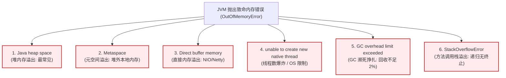
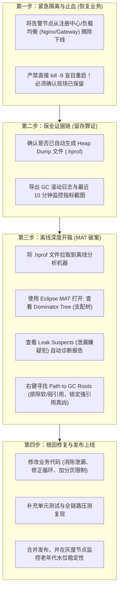

# OOM 问题排查

> [!abstract] 一句话心智模型
> 如果把 JVM 比作一栋大厦，`OutOfMemoryError`（OOM）不是简单的“地方不够用了”，而是**六种完全不同楼层的挤爆灾难**：
> 1. **车间仓库堆满（Java heap space）**：成品物料堆积如山，要么是真泄漏（垃圾占着不走），要么是假泄漏（一口气塞入百万级大集合）；
> 2. **图纸室塞爆（Metaspace）**：动态生成了成千上万份新图纸（CGLIB 动态代理或 Groovy 脚本未复用类加载器）；
> 3. **保税区码头瘫痪（Direct buffer memory）**：Netty 堆外缓冲区用完未调用 `release()` 释放；
> 4. **保安队编制超标（unable to create new native thread）**：招募了成千上万个线程，不仅耗尽内存，还触发了操作系统 `ulimit` 上限；
> 5. **清洁工累死罢工（GC overhead limit exceeded）**：清洁工花了 98% 的精力扫地，却只清出不到 2% 的空间，系统绝望断气。

---

## 🗺️ 生产环境 OOM 六大死法全景地图

---

## 🔬 六大 OOM 场景靶向剖析与根因

### 1. `java.lang.OutOfMemoryError: Java heap space`（堆内存溢出）

这是开发中最常碰到的 OOM，排查时第一件事是**分清是“真内存泄漏”还是“假内存泄漏（突发大对象）”**！

| 判定分类 | 现象与根因 | 典型排查案例 | 解决方案 |
| :--- | :--- | :--- | :--- |
| **真内存泄漏 (Memory Leak)** | 对象已经不再使用，但由于错误的强引用链，导致 GC 永远不敢回收它，内存呈阶梯状持续攀升直至暴毙。 | 1. `static Map` 长期作为全局缓存，只放不删。 2. `ThreadLocal` 用完未调用 `remove()`。 3. 事件监听器 / 观察者注册后未解绑。 | 找出那条通往 GC Roots 的错误强引用链，在业务完成后显式解绑或清理。 |
| **假内存泄漏 (Memory Overflow)** | 内存并没有泄漏，但短时间内业务瞬时分配了远超堆容量上限的巨型对象。 | 1. 运营后台导出报表，SQL 忘记加 `LIMIT`，一次性把全表 200 万条数据 `select *` 查进内存 List！ 2. 批量上传超大 Excel，解析时全量载入内存。 | 1. 强制分页分批查询。 2. 针对 Excel 使用基于流式 SAX 解析的框架（如阿里的 EasyExcel）。 |

---

### 2. `java.lang.OutOfMemoryError: Metaspace`（元空间溢出）

- **报错根因**：JDK 8 以后，类的元数据（Class 元数据、方法描述符、常量池）存放在操作系统本地内存的 Metaspace 中。当加载的 Class 数量无节制膨胀，突破了 `-XX:MaxMetaspaceSize` 时抛出。
- **典型作案现场**：
  1. **动态代理框架狂欢**：使用 Spring AOP、CGLIB、Javassist 时，配置不当导致每次请求都动态生成全新的代理类，而没有利用代理类缓存。
  2. **Groovy / 动态脚本引擎滥用**：在规则引擎或计算表达式中，每次解析脚本都 `new GroovyClassLoader().parseClass(script)`，导致产生海量同名匿名类，迅速撑爆元空间！
- **排查命令**：`jcmd <pid> VM.classloader_stats` 查看类加载器数量；查看 GC 日志中是否伴随大量的 Full GC。

---

### 3. `java.lang.OutOfMemoryError: Direct buffer memory`（直接内存溢出）

- **报错根因**：Java NIO 的 `ByteBuffer.allocateDirect()` 或 Netty 申请的堆外直接内存超出了 `-XX:MaxDirectMemorySize`（默认等于堆最大值 `-Xmx`）。
- **底层暗坑**：
  - 直接内存的释放依赖于堆内 `DirectByteBuffer` 对象的被动 GC（通过虚引用 Cleaner 触发底层 `Unsafe.freeMemory()`）。
  - **致命时序错位**：如果此时堆内存非常宽裕，JVM 迟迟不触发 GC，那么堆外的物理直接内存哪怕已经爆满，GC 依然纹丝不动，直到直接内存彻底耗尽当场抛出 OOM！
- **Netty 工业避坑**：
  - Netty 采用了引用计数机制（`ReferenceCounted`）。每次将 `ByteBuf` 传递到 ChannelPipeline 的终点，如果自己消费了而没有向后传递，必须显式调用 `ReferenceCountUtil.release(msg)`！否则必发生直接内存泄漏。

---

### 4. `java.lang.OutOfMemoryError: unable to create new native thread`

- **报错根因**：Java 无法向底层操作系统申请创建新的物理线程。
- **两大元凶排查**：
  1. **元凶 A：内存被瓜分耗尽**
     - 一个线程在 Linux 上对应一个轻量级进程（LWP），默认每个线程分配 `-Xss1m` 的栈空间。
     - 如果系统物理内存仅剩 100MB，你却试图创建 200 个新线程，需要 200MB 物理内存，操作系统直接拒绝。
  2. **元凶 B：操作系统限制（ulimit / pid_max）**
     - Linux 操作系统为了防范 fork 炸弹，对每个用户能创建的最大进程/线程数有严格限制：
       - `ulimit -u`（max user processes）：默认通常是 1024 或 4096。
       - `/proc/sys/kernel/pid_max`：全局最大 PID 数。
     - 如果业务代码里滥用 `new Thread()` 而不使用线程池，并发一上来瞬间创建几千个线程，当场被操作系统限流拒绝！

---

### 5. `java.lang.OutOfMemoryError: GC overhead limit exceeded`

- **报错根因**：这是 JVM 自带的**安乐死保护机制**！
- **触发硬性判定条件（同时满足）**：
  - JVM 耗费了超过 **98% 的 CPU 时间**用于执行垃圾回收；
  - 并且回收释放出来的堆内存空间 **不足全堆的 2%**；
  - 这种情况连续发生了 5 次以上。
- **第一性原理**：JVM 发现自己几乎把所有算力都耗在垃圾回收上了，用户业务线程全被 STW 冻结，而且每次 GC 拼了命也只能腾出丁点儿空间，再撑下去整个系统也是卡死假死。JVM 决定主动抛出此异常自尽，让外界监控系统及时发现并重启！

---

## 🚨 生产环境 OOM 黄金救援 4 步 SOP

### 实战：如何用 MAT（Memory Analyzer Tool）一分钟抓出真凶？

1. **看 Dominator Tree（支配树）**：
   - 支配树展示了“谁支配了谁的生死”。如果一个对象被销毁，被它支配的对象也会全部被销毁。
   - 打开 Dominator Tree，按照 **Retained Heap（保留内存大小）** 倒序排序，排在第一行的往往就是吃掉了 80% 内存的“大胃王”！
2. **看 Leak Suspects（疑似泄漏报告）**：
   - MAT 会自动运行启发式算法，直接在首页为你生成一份人类可读的报告：`Problem Suspect 1: One instance of "com.example.OrderCache" loaded by "..." occupies 75.3% of the memory.`
3. **右键 -> Path to GC Roots -> Exclude all phantom/weak/soft references**：
   - 这个操作能瞬间剔除那些无关痛痒的虚引用、弱引用干扰，**只保留死不撒手的“强引用链”**。
   - 沿着链条层层展开，你会精准看到是哪个类中的哪个 `static List` 或者哪个 Spring Bean 字段牢牢抓着这批对象不放！

---

## ⚡ 一分钟面试必杀卡

> [!question]- Q1：线上突然发生了 OOM，你的第一反应和排查排障步骤是什么？
> 1. **优先保障线上可用性（止血）**：第一时间将发生 OOM 的实例从网关或注册中心摘流下线，防止流量持续涌入导致雪崩；拉起备用节点或扩容节点保障用户访问。
> 2. **保留犯罪现场**：检查由 `-XX:+HeapDumpOnOutOfMemoryError` 自动生成的 `.hprof` 堆快照文件是否完整保存在持久盘上，同时保留 GC 日志与监控指标。
> 3. **离线工具剖析**：把 Dump 文件下载到离线环境，使用 Eclipse MAT 工具打开。先看 Dominator Tree 找出保留内存最大的对象；再通过 Path to GC Roots 顺藤摸瓜排查强引用链，判断是静态集合泄漏、ThreadLocal 泄漏还是瞬时批量查询引发的大对象膨胀。
> 4. **代码级修复**：修改业务逻辑（修复集合清理、增加分页深分页限制等），经压测验证后上线复盘。

> [!question]- Q2：内存泄漏（Memory Leak）和内存溢出（Memory Overflow）有什么本质区别？
> - **内存泄漏**是“因”：指程序申请了内存后，由于代码疏忽导致对象失去了继续使用的业务价值，但到 GC Roots 的引用链没有切断，GC 无法回收它。泄漏的对象越积越多，最终必然导致内存溢出。
> - **内存溢出**是“果”：指程序在申请内存时，可用物理内存不足以满足此次分配需求。引起内存溢出的原因既可能是长期的**内存泄漏**导致的温水煮青蛙，也可能是没有内存泄漏但瞬时业务并发冲顶、查询全表等导致的**容量不足**。