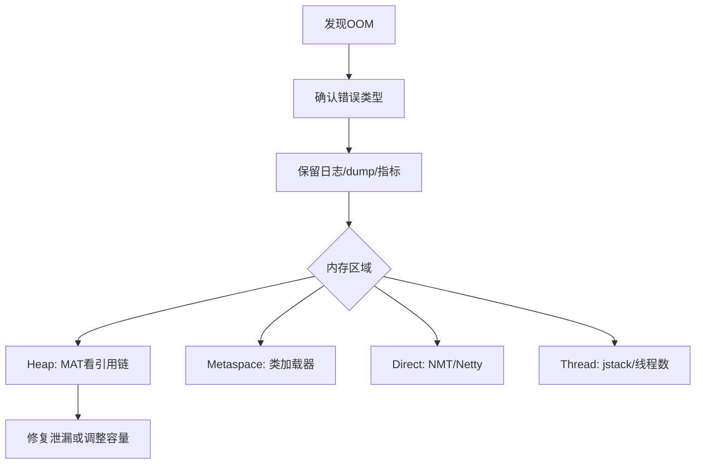

# OOM问题排查

> [!abstract] 一句话总结
> OOM 排查要先识别错误类型，再保留现场，用 dump、GC 日志、NMT 和引用链判断是泄漏、容量不足还是本地内存问题。

## 📌 这是什么

- OutOfMemoryError 不是只有 Java heap space，还包括 Metaspace、Direct buffer memory、unable to create native thread、GC overhead limit exceeded。
- 不同 OOM 类型对应不同证据和修复方向。
- 排查目标不是简单加内存，而是找出增长来源和是否合理。

## 🤔 解决什么问题 / 为什么需要

- OOM 会导致请求失败、实例重启、缓存丢失甚至雪崩。
- 错误修复可能把堆加大后让 GC 停顿更长。
- 面试常要求给出线上 OOM 的完整处理流程。

## 🧩 核心概念

| 概念 | 含义 | 精通要点 |
| ---- | ---- | -------- |
| Heap OOM | 堆对象无法分配。 | 看 heap dump 和 dominator tree。 |
| Metaspace OOM | 类元数据占用过高。 | 看类加载数量和加载器泄漏。 |
| Direct Memory OOM | 堆外直接内存不足。 | 常见于 NIO/Netty。 |
| Native Thread OOM | 无法创建本地线程。 | 看线程数、Xss、系统 ulimit、容器限制。 |

## ⚙️ 工作原理 / 流程



## 🔍 源码 / 原理深挖

- -XX:+HeapDumpOnOutOfMemoryError 可在堆 OOM 时自动导出 dump。
- jcmd <pid> GC.heap_dump 可手动导出，jcmd VM.native_memory summary 需要开启 NMT。
- MAT Dominator Tree、Leak Suspects、Path to GC Roots 是堆 dump 分析常用入口。

## 💻 代码实践 / 排查命令

```java
java -XX:+HeapDumpOnOutOfMemoryError \
  -XX:HeapDumpPath=/data/dumps \
  -XX:NativeMemoryTracking=summary \
  -jar app.jar

# 现场命令
jcmd <pid> GC.heap_dump /data/dumps/heap.hprof
jcmd <pid> VM.native_memory summary
jcmd <pid> Thread.print
```

## 🛠️ 排查 / 实践要点

- 堆 OOM：看最大对象、集合大小、缓存策略、ThreadLocal、监听器和静态 Map。
- Metaspace OOM：查动态代理、脚本引擎、热部署、重复创建 ClassLoader。
- Direct OOM：查 DirectByteBuffer、Netty ByteBuf 是否释放，比较 RSS 与 Xmx。
- 线程 OOM：统计线程数、线程栈大小、线程池创建位置和系统限制。

## ⚠️ 踩坑与注意事项

- OOM 后实例自动重启但没有 dump，现场丢失。
- 看到 Java heap space 就直接加 Xmx，不分析对象引用链。
- 容器内只看 JVM 参数，忽略 cgroup memory limit。

## 🎯 面试问题

> [!question] 高频问题
> - Q: 线上 OOM 怎么排查？
>   - A: 先确认 OOM 类型，保留 GC 日志、dump、线程栈和监控；堆 OOM 用 MAT 看 dominator 和 GC Roots，非堆看 NMT、类加载器或线程数；最后区分泄漏和容量不足。
> - Q: 内存泄漏和内存溢出区别？
>   - A: 泄漏是对象不再需要但仍被引用，长期增长；溢出是可用内存不足，可能是泄漏，也可能是业务峰值或容量配置不足。
> - Q: ThreadLocal 为什么可能导致泄漏？
>   - A: 线程池线程长期存活，ThreadLocalMap 中 value 可能持续被线程引用；使用后要 remove。

## 🧭 源码入口速查

- 堆 OOM：`-XX:+HeapDumpOnOutOfMemoryError -XX:HeapDumpPath=/data/dump`，MAT 看 Dominator Tree 和 GC Roots。
- 元空间 OOM：`jcmd <pid> VM.classloader_stats`、`jcmd <pid> GC.class_histogram`，重点看 ClassLoader 是否增长。
- 直接内存 OOM：对比 `jcmd VM.native_memory summary`、RSS、`-XX:MaxDirectMemorySize`，Netty 看 ByteBuf 泄漏日志。
- 线程 OOM：`jcmd <pid> Thread.print`、`ps -eLf | grep <pid> | wc -l`、`ulimit -u`、`-Xss`。
- GC overhead：看 GC 日志里 Full GC 后堆是否几乎不下降，通常是泄漏或堆太小。

## 🧪 最小验证

```bash
jcmd <pid> GC.heap_info
jcmd <pid> GC.class_histogram | head -40
jcmd <pid> VM.native_memory summary
jcmd <pid> Thread.print > thread.txt
```

OOM 现场优先保全：错误日志、启动参数、GC 日志、dump、线程栈、容器事件和最近发布记录。自动重启能恢复服务，但会丢失增长曲线；至少要把 dump 路径挂到持久盘，并确认磁盘空间足够。

## ✅ 精通检查清单

- 能用自己的话讲清本主题解决的问题和适用边界。
- 能指出至少 2 个源码入口或底层机制。
- 能给出一个最小代码示例或一组线上排查命令。
- 能回答本页列出的高频面试题，并补充项目中的真实取舍。

## 🔗 关联笔记

- [[_index]]

## 📚 参考资料

- [JVM Specification](https://docs.oracle.com/javase/specs/jvms/se21/html/)
- [Oracle Java Documentation](https://docs.oracle.com/en/java/)
