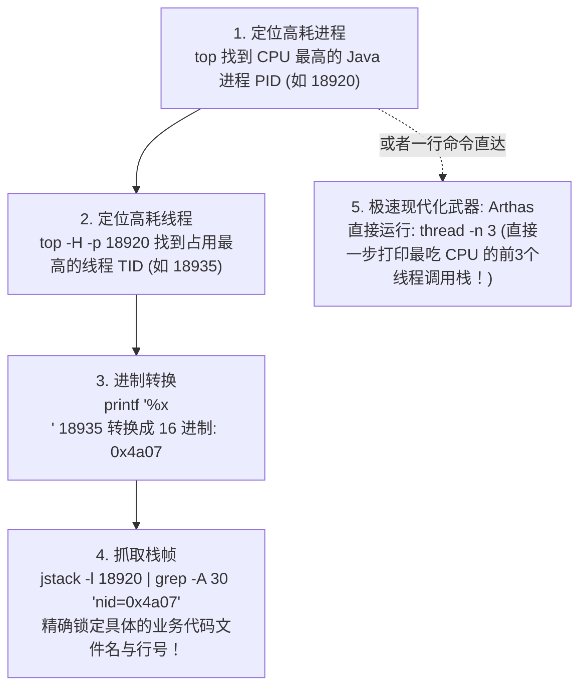

# JVM 常用工具速查

> [!abstract] 一句话总结
> 工具是"把理论转化成证据"的手段：`jstat` 看 GC 趋势、`jmap/jcmd` 看堆对象、`jstack` 看线程阻塞、`JFR` 低开销采样、`Arthas` 在线动态诊断。**工具要组合用**——CPU 高/内存涨/接口慢 各有一套标准链路，能把链路说全才算真正掌握工具。

## 🎯 本节定位

- **02 章第 8 课，排查闭环**。前置：[[01-JVM内存区域]]（知道内存在哪）、[[03-垃圾回收算法]]（看懂 GC 日志）、[[07-OOM问题排查]]（OOM 的排查路径）。本篇是工具的"说明书 + 实战链路"。
- **面试重点**：三条标准排查链路（CPU 高/内存涨/接口慢）、每种工具的适用场景和风险点。

---

## 一、工具全景与定位

| 工具                                 | 适用场景        | 特点                   | 生产风险                     |
| ---------------------------------- | ----------- | -------------------- | ------------------------ |
| `jstat`                            | GC 趋势实时观察   | 轻量，无侵入               | 几乎无                      |
| `jcmd`                             | 统一诊断命令（推荐）  | JDK 7+，功能全           | 部分操作有影响                  |
| `jmap -histo`                      | 堆对象统计（按类型）  | 快速看大对象               | `-histo:live` 触发 Full GC |
| `jmap -dump` / `jcmd GC.heap_dump` | 完整堆 dump    | MAT 分析内存泄漏           | **大堆 STW + 大文件**         |
| `jstack` / `jcmd Thread.print`     | 线程栈快照       | 死锁、阻塞、热线程            | 极低                       |
| `JFR`（Java Flight Recorder）        | 低开销持续采样     | 分配、锁、IO、方法采样         | 极低（<1% overhead）         |
| `async-profiler`                   | CPU/内存/锁火焰图 | 精准定位热点               | 极低                       |
| `Arthas`                           | 在线动态诊断      | trace/watch/jad/ognl | watch 高频大对象会加压           |

> [!tip] 优先用 jcmd
> `jcmd <pid> help` 列出所有支持的命令。很多旧命令（jmap/jstack）等价于 `jcmd GC.heap_dump`/`Thread.print`，jcmd 更统一、对容器更友好。

---

## 二、三条标准排查链路

### 链路 1：CPU 飙高 100% 抓凶（经典三步法）



**常见原因靶向分析**：
- **RUNNABLE 且在业务代码**：死循环、正则表达式灾难性回溯、超大 JSON 序列化、复杂递归。
- **RUNNABLE 且在 VM Thread / GC 线程**（如 `G1 Conc#0`、`ParallelGC Threads`）：**说明堆内存已严重不足，GC 线程正在疯狂进行垃圾回收但收效甚微！** 此时表面是 CPU 高，**真凶其实是内存泄漏或堆不足**！
- **现代神器 async-profiler 生成 CPU 火焰图**：
  ```bash
  # 采集 30 秒 CPU 样本并直接输出交互式 HTML 火焰图
  ./profiler.sh -d 30 -f /tmp/flamegraph.html <pid>
  ```
  > [!TIP] 火焰图怎么看？
  > - **看宽度**：Y 轴代表调用栈深度，X 轴代表该方法采样消耗 CPU 的时间比例（越宽耗时越长）。
  > - **看“平顶山”**：如果某个方法在最顶层呈现宽阔的“平顶”，说明大量的 CPU 时间全死在这个方法自身的代码里，它就是绝对的性能瓶颈所在！

### 链路 2：内存持续增长（疑似泄漏）

```
第一步：确认趋势（GC 后是否下降）
jstat -gcutil <pid> 2000 30
# 观察 O（老年代占比）：
#   Full GC 后 O 能回落 → 容量不足，考虑加堆
#   Full GC 后 O 几乎不降 → 泄漏！

第二步：看哪类对象最多（轻量）
jcmd <pid> GC.class_histogram | head -40
# 按实例数/占用排序，找异常大的 Map/List/byte[]

第三步：保留现场（抓 dump）
# 生产建议：低峰、从节点、先确认磁盘空间（大堆 dump 几个 G）
jcmd <pid> GC.heap_dump /data/dumps/heap.hprof
# 或启动时加 -XX:+HeapDumpOnOutOfMemoryError -XX:HeapDumpPath=/data/dumps

第四步：MAT 分析
# 打开 heap.hprof，Dominator Tree：看谁保留内存最多
# Path to GC Roots：看为什么该对象没被回收（找引用链根）
# Leak Suspects：MAT 自动分析疑似泄漏
```

**常见泄漏来源**：
- 静态 `Map`/`List` 持续 put 不清理
- `ThreadLocal` 不 `remove()`（见 [[03-垃圾回收算法]] 引用类型小节）
- 监听器/回调注册后不注销
- 缓存无上限
- 连接/流未关闭（资源泄漏）

### 链路 3：接口慢 / 延迟高

```
第一步：区分 GC 停顿 vs 业务逻辑慢
grep -E "Pause|Full" gc.log | tail -20
# STW 停顿时间和接口慢的时间点是否重合？

第二步：如果不是 GC，定位慢在哪层
Arthas:
  dashboard  →  快速看 CPU、内存、线程概况
  thread -n 10  →  看最耗 CPU 的 10 个线程
  trace com.example.OrderService createOrder '#cost > 200'
  # trace 追踪方法调用树 + 每层耗时（200ms 以上才显示）
  watch com.example.OrderService createOrder '{params,returnObj,throwExp}' -x 2
  # watch 观察入参/返回值/异常（-x 2 展开 2 层）

第三步：如果是锁/阻塞
jstack -l <pid> > /tmp/thread.txt
# 看 "BLOCKED" 状态的线程：等谁的锁
# 看 "waiting to lock <0x...>"：找锁持有者
# 连续抓 3 次（间隔 2s），某线程一直 BLOCKED 才是问题
```

**接口慢常见原因**：
- GC 停顿（P999 尖刺）→ 优化收集器或分配率
- 数据库慢查询 → Arthas trace 到 DAO 层找耗时
- 锁竞争 → jstack 看 BLOCKED 线程
- 线程池队列积压 → `jcmd Thread.print` 看线程池状态
- 远程调用超时 → trace 到 HTTP/RPC 调用层

---

## 三、工具命令速查（备查）

### jstat（GC 趋势）

```bash
jstat -gcutil <pid> 1000 30    # 每秒输出，共 30 次
# 字段含义：
# S0/S1：Survivor 区使用率
# E：Eden 使用率（持续 100% → Minor GC 频率高）
# O：老年代使用率（Full GC 后不降 → 泄漏）
# M：元空间使用率
# YGC/YGCT：Young GC 次数/总耗时
# FGC/FGCT：Full GC 次数/总耗时
# GCT：GC 总耗时

jstat -gccapacity <pid>    # 各区域容量（字节）
```

### jcmd（统一诊断命令）

```bash
jcmd <pid> help                                    # 列出所有支持命令
jcmd <pid> GC.heap_info                            # 堆使用概况
jcmd <pid> GC.heap_dump /tmp/heap.hprof            # 导出 dump
jcmd <pid> GC.class_histogram | head -40           # 对象类型直方图
jcmd <pid> Thread.print > /tmp/thread.txt          # 线程栈
jcmd <pid> VM.native_memory summary               # 本地内存（需 NMT）
jcmd <pid> VM.flags                               # 当前 JVM 参数
jcmd <pid> JFR.start name=t1 settings=profile duration=120s filename=/tmp/t1.jfr
jcmd <pid> JFR.stop name=t1
```

### jstack（线程栈）

```bash
jstack -l <pid> > /tmp/thread.txt    # -l 打印锁信息（死锁、monitor）
# 关注线程状态：
# RUNNABLE：正在执行（CPU高时的目标）
# BLOCKED：等锁（竞争热点）
# WAITING / TIMED_WAITING：park/sleep/wait（正常等待，偶发阻塞）
# 快速找死锁：
grep -A 5 "deadlock" /tmp/thread.txt
```

### Arthas（在线动态诊断）

```bash
# 安装启动
curl -O https://arthas.aliyun.com/arthas-boot.jar
java -jar arthas-boot.jar <pid>

# 常用命令
dashboard                                         # 总览
thread -n 10                                      # CPU 最高的 10 个线程
thread -b                                         # 死锁检测

# 方法耗时（超过 200ms 才记录，避免刷屏）
trace com.example.UserService findById '#cost > 200'

# 观察参数/返回/异常（-x 深度，条件过滤）
watch com.example.UserService findById '{params,returnObj,throwExp}' \
  '#cost > 100' -x 3

# 查看线上实际字节码（判断是否发布正确版本）
jad com.example.UserService findById

# 执行表达式（OGNL），调试静态方法或变量
ognl '@com.example.Config@getInstance().getMaxConnections()'

# 方法调用链路
stack com.example.UserService findById    # 看谁调用了这个方法
```

> [!warning] Arthas 使用注意
> - `watch` 不加条件 + 高频接口 → 额外序列化开销、日志压力，生产必须加 `'#cost > 200'` 这类条件；
> - `trace` 会增加方法调用开销，高并发入口要谨慎；
> - `redefine` 可以热替换字节码，但影响类加载器，不是紧急情况别用。

---

## 四、生产运维最佳实践

### 启动参数模板（诊断友好）

```bash
java \
  -Xms4g -Xmx4g \                                    # 固定堆（避免动态伸缩干扰观测）
  -XX:+UseG1GC \
  -XX:MaxGCPauseMillis=200 \
  -Xlog:gc*,safepoint:file=/var/log/app/gc.log:time,uptime,level,tags:filecount=10,filesize=50m \
  -XX:+HeapDumpOnOutOfMemoryError \                   # OOM 时自动导出 dump
  -XX:HeapDumpPath=/data/dumps/ \                     # dump 目录（确保磁盘空间）
  -XX:NativeMemoryTracking=summary \                  # 开启 NMT（VM.native_memory 需要）
  -jar app.jar
```

### 排查时的操作顺序（避免踩坑）

```
1. 先看日志、GC 日志、APM 监控 → 不要上来就 dump
2. 用 jstat/dashboard 轻量确认方向 → CPU？内存？GC？
3. 按链路 1/2/3 操作（见上文）
4. dump 放最后 → 大堆会 STW + 产生大文件，低峰期/从节点执行
5. 出结论要带"现象 → 命令 → 指标 → 假设 → 验证"全链路
```

## 🎯 面试问题

> [!question]- CPU 飙高怎么排查到代码行？
> `top -H -p <pid>` 找 CPU 高的线程 TID，转十六进制，`jstack -l <pid>` 找对应 `nid` 的栈帧；精确场景用 JFR 或 async-profiler 生成火焰图定位热点方法。

> [!question]- jmap -histo:live 和 -histo 有什么区别？风险在哪？
> `-histo:live` 先触发一次 Full GC 再统计，结果更准确但会 STW 并产生停顿，大堆风险大；`-histo` 直接统计当前堆，包含部分待回收对象，生产优先用后者或 `jcmd GC.class_histogram`。

> [!question]- 什么情况下才 dump 堆？
> 确定是内存泄漏且 jstat/histo 无法定位时。dump 前要确认：①从节点或低峰期执行 ②磁盘空间足够（大堆 dump 几个 G）③做好回滚预案。平时应配置 `-XX:+HeapDumpOnOutOfMemoryError` 让 OOM 自动触发。

> [!question]- Arthas trace 和 watch 的区别？
> `trace` 展示方法内部的调用树和每层耗时（适合定位慢在哪一步）；`watch` 观察指定方法的入参、返回值、异常和耗时（适合调试参数/返回是否正确）。两者都要加条件避免高频刷入打垮服务。
## ✅ 精通检查清单

- 能说出 CPU 高、内存涨、接口慢三条完整排查链路（命令 + 关注点 + 下一步）。
- 能说出 `jstat -gcutil` 每个字段的含义（S0/S1/E/O/M/YGC/FGC）。
- 能说出 heap dump 的风险和正确执行时机。
- 能写出 Arthas trace 加条件过滤的正确姿势（避免生产事故）。
- 能用 jstack 识别 BLOCKED/WAITING/RUNNABLE 线程并判断是否异常。

## 🔗 关联笔记

- [[01-JVM内存区域]] —— RSS 各区域来源（VM.native_memory 拆解）
- [[03-垃圾回收算法]] —— GC 日志看什么（STW 停顿/分配率/存活率）
- [[04-垃圾收集器-G1-ZGC]] —— G1/ZGC 日志关键字
- [[06-JVM调优实战]] —— 调优方法论（基线→假设→验证）
- [[07-OOM问题排查]] —— OOM 排查路径（堆/元空间/直接内存/线程）
- [[_index]]

## 📚 参考资料

- [Arthas 官方文档](https://arthas.aliyun.com/doc/)
- [async-profiler GitHub](https://github.com/async-profiler/async-profiler)
- [JFR & JMC 官方文档](https://docs.oracle.com/en/java/javase/21/jfapi/)
- `jcmd <pid> help`：当前 JVM 支持的诊断命令列表
