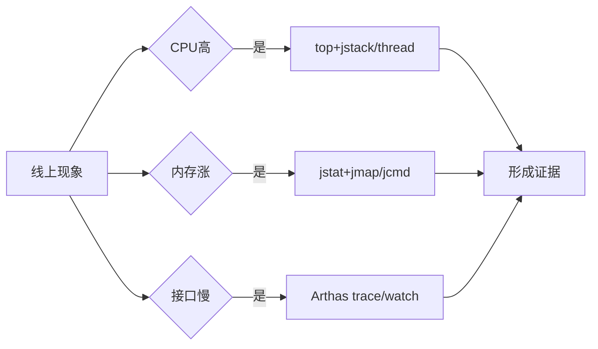

# 常用工具-jstat-jmap-jstack-Arthas

> [!abstract] 一句话总结
> JVM 工具链的价值在于低成本拿证据：jstat 看 GC 趋势，jmap 看堆，jstack 看线程，Arthas 做在线诊断。

## 📌 这是什么

- jstat 适合快速看 GC 次数、容量和使用率趋势。
- jmap/jcmd 可导出堆 dump、看类直方图。
- jstack/jcmd Thread.print 用于线程状态、死锁、阻塞和 CPU 热线程定位。
- Arthas 提供 dashboard、thread、watch、trace、jad、ognl 等在线能力。

## 🤔 解决什么问题 / 为什么需要

- 线上排查不能只靠猜，要快速从 CPU、内存、线程、方法调用四个方向拿证据。
- 掌握工具组合能把“偶发慢”变成可复现、可定位的问题。
- 面试中工具使用要讲清命令、观察点和下一步判断。

## 🧩 核心概念

| 概念 | 含义 | 精通要点 |
| ---- | ---- | -------- |
| jstat | 查看 GC 和类加载统计。 | 趋势工具，不给对象引用链。 |
| jmap/jcmd | 堆直方图、heap dump。 | 大堆 dump 有风险。 |
| jstack | 线程栈快照。 | 定位死锁、阻塞、CPU 热线程。 |
| Arthas | Java 在线诊断工具。 | 适合无侵入观察方法参数、耗时和调用链。 |

## ⚙️ 工作原理 / 流程



## 🔍 源码 / 原理深挖

- jstat -gcutil 输出 S0/S1/E/O/M 使用率和 YGC/FGC 次数。
- jmap -histo:live 会触发 Full GC，生产使用要谨慎。
- Arthas trace 可看方法内部调用耗时，watch 可观察入参返回值异常。

## 💻 代码实践 / 排查命令

```bash
# GC趋势
jstat -gcutil <pid> 1000 10

# 线程栈和死锁
jstack -l <pid> > thread.txt
jcmd <pid> Thread.print > thread.txt

# 堆对象直方图
jmap -histo <pid> | head

# Arthas
dashboard
thread -n 5
trace com.example.UserService findUser "#cost > 100"
watch com.example.UserService findUser "{params, returnObj, throwExp}" -x 2
```

## 🛠️ 排查 / 实践要点

- CPU 高：top -H -p <pid> 找线程 id，转十六进制后在 jstack 中找 nid。
- 接口慢：Arthas trace 先圈定慢方法，再下钻到 DAO、RPC、缓存或锁。
- 内存涨：jstat 看是否 GC 后回落，再用 histo/dump 判断对象类型和引用链。

## ⚠️ 踩坑与注意事项

- 在生产高峰对大堆执行 live histo 或 heap dump。
- 只抓一次 jstack 就下结论，线程问题常需要连续多次快照。
- Arthas watch 打印大对象或高频方法导致额外压力。

## 🎯 面试问题

> [!question] 高频问题
> - Q: jstat、jmap、jstack 分别看什么？
>   - A: jstat 看 GC 趋势，jmap/jcmd 看堆对象和 dump，jstack/jcmd Thread.print 看线程状态、锁和调用栈。
> - Q: CPU 飙高怎么定位到代码？
>   - A: top 找进程和线程，线程 id 转 16 进制，在 jstack 中匹配 nid，结合多次栈和 profiler 判断热点方法。
> - Q: Arthas trace 和 watch 有什么区别？
>   - A: trace 看方法内部调用路径和耗时，watch 观察指定方法的参数、返回值或异常。

## 🧭 源码入口速查

- `jcmd <pid> help`：统一查看当前 JDK 支持的诊断命令，很多场景优先于老的 `jmap/jstack`。
- `jstat -gcutil <pid> 1000`：看趋势；`YGC/FGC` 增长、`O` 回收后是否下降是关键。
- `jstack -l <pid>`：`-l` 会打印锁信息，死锁和 monitor/ownable synchronizer 更清楚。
- Arthas：`thread -n 10` 看热点线程，`trace` 看调用耗时，`watch` 看参数/返回/异常，`jad` 看线上实际字节码。

## 🧪 最小验证

```bash
top -H -p <pid>
printf "%x\n" <tid>
jstack -l <pid> | grep -A 30 "nid=0x<hexTid>"
```

使用 Arthas watch/trace 要加条件和深度限制，例如 `"#cost > 200"`、`-x 2`。不要对高频入口无条件打印完整对象，否则诊断工具本身会制造新的 CPU、日志和序列化压力。

## ✅ 精通检查清单

- 能用自己的话讲清本主题解决的问题和适用边界。
- 能指出至少 2 个源码入口或底层机制。
- 能给出一个最小代码示例或一组线上排查命令。
- 能回答本页列出的高频面试题，并补充项目中的真实取舍。

## 🔗 关联笔记

- [[_index]]

## 📚 参考资料

- [JVM Specification](https://docs.oracle.com/javase/specs/jvms/se21/html/)
- [Oracle Java Documentation](https://docs.oracle.com/en/java/)
