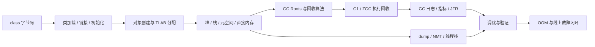

# JVM：本章总结与复习

> [!abstract] 一句话总结
> JVM 学习要先建立类加载、对象分配和内存区域地图，再理解 GC 算法与收集器取舍，最后用日志、指标、dump、线程栈和在线工具完成证据驱动的调优与故障排查。

## 核心知识概览

| 模块 | 核心问题 | 关键结论 | 对应笔记 |
| --- | --- | --- | --- |
| 内存区域 | Java 进程的内存用在哪里 | 堆与元空间线程共享，栈和程序计数器线程私有；直接内存、线程栈等也会推高 RSS | [[01-JVM内存区域]] |
| 对象创建与布局 | `new` 如何变成内存中的对象 | 经过类加载检查、分配、零值初始化、对象头设置和构造；布局包含对象头、实例数据与对齐填充 | [[02-对象创建与内存布局]] |
| GC 算法 | JVM 如何判活并回收空间 | 从 GC Roots 做可达性分析，再组合标记-清除、复制和标记-整理；取舍集中在停顿、吞吐、碎片与复制成本 | [[03-垃圾回收算法]] |
| G1 与 ZGC | 如何按延迟与吞吐目标选择收集器 | G1 通过 Region 和收益优先控制停顿，ZGC 通过并发阶段、染色指针和读屏障追求大堆低延迟 | [[04-垃圾收集器-G1-ZGC]] |
| 类加载 | class 如何成为具有明确身份的 Class 对象 | 加载、链接、初始化构成生命周期；类身份由类名和 ClassLoader 共同决定，默认加载遵循双亲委派 | [[05-类加载机制与双亲委派]] |
| 调优闭环 | 参数该如何调整 | 先明确业务目标和基线，再采证据、提假设、单变量修改并通过压测或灰度验证 | [[06-JVM调优实战]] |
| OOM 排查 | 内存溢出后如何定位根因 | 先识别 Heap、Metaspace、Direct Memory、Native Thread 等类型，再保留现场并区分泄漏与容量不足 | [[07-OOM问题排查]] |
| 诊断工具 | 如何低成本获取现场证据 | jstat 看趋势，jmap/jcmd 看堆，jstack 看线程，Arthas 观察在线方法调用；高开销操作必须评估风险 | [[08-常用工具-jstat-jmap-jstack-Arthas]] |

## 全章主线

## 快速复习

1. 先做内存账本：`RSS = Heap + Metaspace + Direct Memory + Thread Stacks + Code Cache + GC/JIT/JNI/native malloc`；RSS 远大于 Xmx 时不要只查堆。
2. 线程私有区域包括程序计数器、虚拟机栈和本地方法栈；共享区域包括堆和方法区，HotSpot 中方法区常由元空间实现。
3. 对象创建经过类加载检查、TLAB/CAS 分配、零值初始化、对象头设置和 `<init>`；对象大小还受压缩指针、字段重排与对齐影响。
4. GC 以可达性分析判活；复制适合低存活率，标记-清除会产生碎片，标记-整理以对象移动换连续空间。
5. Young GC 次数多不等于一定有问题，必须一起看分配率、单次停顿、回收后余量和业务 P99；Full GC 少但停顿长也可能更危险。
6. G1 的关键词是 Region、RSet、Young/Mixed GC 和 Humongous；`MaxGCPauseMillis` 是目标，不是硬性保证。
7. ZGC 依靠并发标记/重定位、染色指针和读屏障缩短停顿，但仍需为并发回收留内存余量，并以同压测条件比较吞吐、CPU 与 RSS。
8. 类加载依次经历加载、验证、准备、解析、初始化；同名类由不同 ClassLoader 加载时不是同一个类型，SPI 常借助线程上下文类加载器反向发现实现。
9. 调优必须保留基线并一次只改一个变量；CPU 高、GC 频繁、内存涨和接口慢要分别用线程栈、GC 日志、dump、JFR 或 Arthas 建立证据链。
10. OOM 先按错误文案分流：Heap 看 dominator/GC Roots，Metaspace 看类加载器，Direct 看 NMT/缓冲区，Native Thread 看线程数、`-Xss`、系统与容器限制。
11. 生产诊断要控制观察成本：大堆 dump、`histo:live` 和无条件 Arthas `watch/trace` 都可能制造新的停顿、CPU 或磁盘压力。

## 自测问题

1. 当容器 RSS 持续增长但 heap dump 很小时，如何按 JVM 内存账本继续缩小范围？
2. 一个对象从 `new` 字节码到构造完成经历哪些步骤，JOL 输出中为什么会出现字段大小之外的空间？
3. 如何从一段 GC 日志判断问题更接近高分配率、晋升压力、Humongous 对象还是 Full GC？
4. G1 与 ZGC 应比较哪些指标，为什么不能仅凭“停顿更短”决定切换？
5. 线上出现 Heap、Metaspace、Direct Memory 或 Native Thread OOM 时，各自最先保留和检查什么证据？

## 下一章衔接

下一章进入 [[../03-并发编程/_index|03 · 并发编程]]：在 JVM 的线程栈、内存占用、线程 dump 和虚拟线程背景上，继续学习线程生命周期、同步机制、并发容器、线程池与异步执行。

## 相关编号双链

- 运行时地图：[[01-JVM内存区域]] · [[02-对象创建与内存布局]] · [[05-类加载机制与双亲委派]]
- GC 体系：[[03-垃圾回收算法]] · [[04-垃圾收集器-G1-ZGC]]
- 调优与排障：[[06-JVM调优实战]] · [[07-OOM问题排查]] · [[08-常用工具-jstat-jmap-jstack-Arthas]]
- 本章索引：[[_index]]

