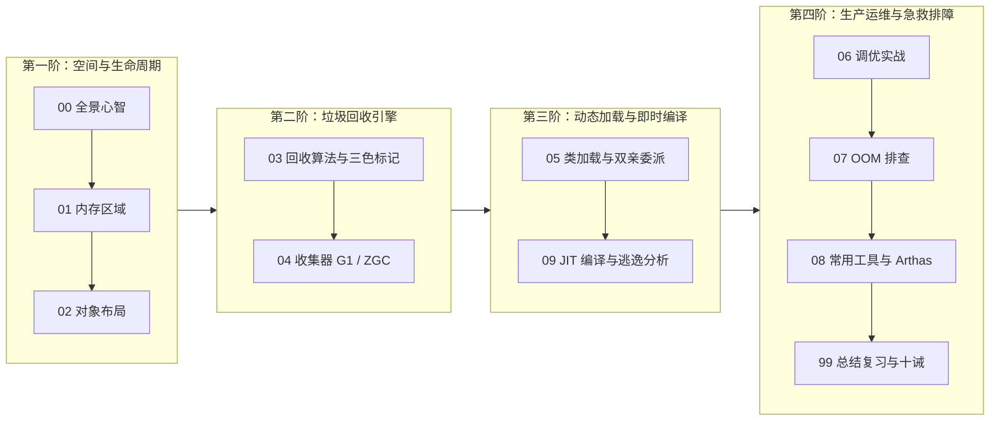

# ⚙️ 02 · JVM

> [!info] 本区心智模型
> JVM 是 Java 程序跨平台运行的基石。核心体系涵盖：运行时数据区划分、对象生命周期与内存布局、垃圾回收机制、类加载与 JIT 即时编译，以及生产排障与性能调优。各篇按技术依赖层层递进，建议按序阅读。

## 📚 知识笔记清单

- [x] [[00-JVM全景与心智模型]] — **架构概览**（运行时数据区、执行引擎、类加载与垃圾回收全局架构及第一性原理）
- [x] [[01-JVM内存区域]] — **内存划分**（程序计数器、虚拟机栈、堆新生代 8:1:1、TLAB 无锁分配、元空间演进与直接内存）
- [x] [[02-对象创建与内存布局]] — **对象模型**（对象分配流程、对象头 Mark Word 结构、32GB 指针压缩原理与 JOL 内存布局）
- [x] [[03-垃圾回收算法]] — **判定与算法**（GC Roots 可达性分析、四种引用类型、标记-清除/复制/整理、三色标记与读写屏障）
- [x] [[04-垃圾收集器-G1-ZGC]] — **收集器演进**（CMS 机制与局限、G1 Region 划分与停顿预测模型、ZGC 染色指针与读屏障自愈）
- [x] [[05-类加载机制与双亲委派]] — **类加载机制**（加载/连接/初始化五步流程、双亲委派模型及 SPI/Tomcat 打破委派实战）
- [x] [[06-JVM调优实战]] — **生产配置实践**（生产就绪参数模板、`-Xms == -Xmx` 机制、容器 Exit Code 137 防范与容量推导）
- [x] [[07-OOM问题排查]] — **内存溢出诊断**（堆溢出/元空间/直接内存泄漏排查、线程数受限与 MAT 支配树分析 SOP）
- [x] [[08-常用工具-jstat-jmap-jstack-Arthas]] — **排障诊断工具**（CPU 100% 经典定位四步法、async-profiler 火焰图与 Arthas 线上诊断）
- [x] [[09-JIT编译与优化]] — **即时编译优化**（分层编译 C1/C2、热点探测计数器、方法内联优化、逃逸分析与标量替换）
- [x] [[99-本章总结与复习]] — **全景复盘**（JVM 全景对照大表、大厂高频面试题深度复盘与生产调优十诫）

---

## 🧭 四阶通关路线（按工业流水线推进）

---

## 🧪 终极通关能力自测

1. 能否用一张图向别人解释清楚：为什么新生代是 8:1:1？TLAB 是如何解决多线程并发抢内存指针撞车问题的？
2. 为什么堆内存配置超过 32GB 时，指针压缩会失效？底层数学推导公式是什么？
3. 三色标记法中，漏标发生的充要条件是什么？CMS 的“增量更新”和 G1 的“原始快照（SATB）”分别是如何打破它的？
4. 为什么 ZGC 能够做到在 16TB 堆下依然将 STW 停顿控制在 1 毫秒以内？染色指针和读屏障自愈的协同过程是怎样的？
5. 在 K8s 容器环境下，Java 进程报 `Exit Code 137` 的根本原因是什么？生产标准参数应该如何配置？
6. 线上服务器 CPU 占用 100% 时，如何在 3 分钟内使用经典 Linux 命令与 Arthas 准确定位到具体的业务代码行？

---

## 🔗 跨模块串联

- 上级：[[../00-总览/学习仪表盘|Java 学习仪表盘]]
- 前置章节：[[../01-Java核心/_index|01 · Java 核心]]（面向对象、集合框架与异常体系在 JVM 里的底层映射）
- 后续章节：[[../03-并发编程/_index|03 · 并发编程]]（在 JVM 栈帧与内存模型基石之上，探索 JMM、AQS、线程池与虚拟线程）
- 存储基石：[[../05-数据库与存储/_index|05 · 数据库与存储]]（从 JVM 内存到磁盘 I/O，揭秘 B+树与 Redis 缓存体系）
