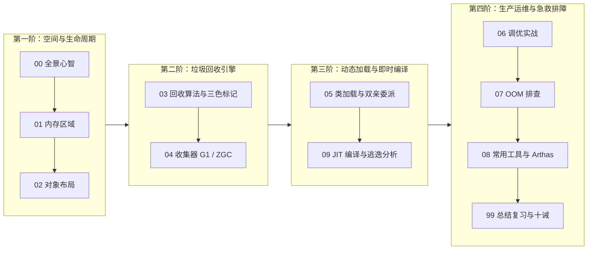

# ⚙️ 02 · JVM

> [!info] 本区心智模型
> JVM = **现代化工业园区的空间划分与自动化垃圾分拣回收流水线**。
> 堆是物料车间（8:1:1分代）、栈是个人工位、元空间是中央档案室、直接内存是零拷贝保税区。五件事合起来才能排查线上问题、解释性能现象。**每一篇都是下一篇的前置**，不要跳读。

## 📚 知识笔记清单

- [x] [[00-JVM全景与心智模型]] — **宏观心智模型**（工业园区全景对照、第一性原理、架构图谱与学习路线）
- [x] [[01-JVM内存区域]] — **空间划分**（堆内分代 8:1:1、分代年龄 15 上限、动态年龄判定、TLAB 无锁分配、元空间演进、直接内存零拷贝）
- [x] [[02-对象创建与内存布局]] — **物料制造**（创建六步走、Mark Word 变形金刚、32GB 指针压缩数学原理、直接指针 vs 句柄、JOL 字节实战）
- [x] [[03-垃圾回收算法]] — **生死判定与清扫**（可达性分析 GC Roots、四种引用、三大基础算法、三色标记与漏标、增量更新 vs SATB、卡表写屏障）
- [x] [[04-垃圾收集器-G1-ZGC]] — **顶级清扫车队**（CMS 淘汰三大死穴、G1 棋盘格 2048 Region 与软实时停顿预测、ZGC 染色指针与读屏障自愈、全维度选型树）
- [x] [[05-类加载机制与双亲委派]] — **图纸审核与入库**（五步生命周期、初始化 `<clinit>` 触发条件、双亲委派啃老机制、Tomcat/SPI 打破委派实战）
- [x] [[06-JVM调优实战]] — **工业生产配置**（4C8G/8C16G 生产就绪模板、`-Xms == -Xmx` 原理、容器 Exit Code 137 防暴毙、分代容量数学推导）
- [x] [[07-OOM问题排查]] — **六大死法急救**（堆溢出真假泄漏、元空间、直接内存、线程数受限、GC 开销濒死、MAT 支配树破案 SOP）
- [x] [[08-常用工具-jstat-jmap-jstack-Arthas]] — **抓凶工具箱**（CPU 100% 抓凶四步法、async-profiler 火焰图解读、内存泄漏与死锁、Arthas 生产避坑）
- [x] [[09-JIT编译与优化]] — **数控机床蜕变**（分层编译 C1/C2、热点探测计数器、方法内联优化之母、逃逸分析与标量替换）
- [x] [[99-本章总结与复习]] — **全景复盘**（工业园区大对照表、大厂 30 秒必杀 10 连问、生产规约十诫）

---

## 🧭 四阶通关路线（按工业流水线推进）

---

## 🧪 终极通关能力自测

1. 能否用一张图向别人解释清楚：为什么新生代是 8:1:1？TLAB 是如何解决多线程并发抢内存指针撞车问题的？
2. 为什么堆内存配置超过 32GB 时，指针压缩会失效？底层数学推导公式是什么？
3. 三色标记法中，漏标发生的充要条件是什么？CMS 的“增量更新”和 G1 的“原始快照（SATB）”分别是如何打破它的？
4. 为什么 ZGC 能够做到在 16TB 堆下依然将 STW 停顿控制在 1 毫秒以内？染色指针和读屏障自愈的协同过程是怎样的？
5. 在 K8s 容器环境下，Java 进程报 `Exit Code 137` 的根本原因是什么？生产标准参数应该如何配置？
6. 线上服务器 CPU 占用 100% 时，如何在 3 分钟内使用经典 Linux 命令与 Arthas 准确定位到具体的业务代码行？

---

## 🔗 跨模块串联

- 上级：[[20-Java后端/00-总览/学习仪表盘|Java 学习仪表盘]]
- 前置章节：[[20-Java后端/01-Java核心/_index|01 · Java 核心]]（面向对象、集合框架与异常体系在 JVM 里的底层映射）
- 后续章节：[[20-Java后端/03-并发编程/_index|03 · 并发编程]]（在 JVM 栈帧与内存模型基石之上，探索 JMM、AQS、线程池与虚拟线程）
- 存储基石：[[20-Java后端/05-数据库与存储/_index|05 · 数据库与存储]]（从 JVM 内存到磁盘 I/O，揭秘 B+树与 Redis 缓存体系）
