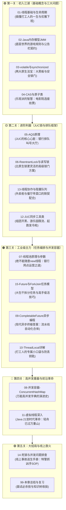

# 🚀 00 · 并发编程心智模型与学习路线

> **一句话导读**：并发编程不是背诵八股文，而是一场“既要快，又要准”的权衡博弈。读完这篇，你将建立起整个并发世界的全景上帝视角，不再盲目迷失在琐碎细节中。

---

## 🎯 为什么我们需要多线程？（天下武功，唯快不破）

试想一下生活中的这个场景：

> 你去一家餐厅吃饭。
> - **单线程模式**：整个餐厅只有 1 个服务员。他去后厨传菜，你就必须在座位上干等，后面的客人也不能点菜；他收银算账，整个餐厅所有人全部静止等他算完。
> - **多线程模式**：餐厅雇佣了多个服务员（多线程）。有人负责招待点单，有人负责跑堂端菜，有人负责收银，大家各司其职，甚至后厨有多位厨师同时在炒菜（多核 CPU 并行）。

在计算机里也是一样：
- 现代 CPU 早就不是单核了，通常有 8 核、16 核甚至更多。如果你的程序只有一个主线程，那就相当于**买了一辆 8 缸超跑，却永远只用 1 个缸在爬坡**，其余 7 个核心全在“摸鱼”。
- 当你的程序在等待磁盘读取、等待网络数据库返回（I/O 等待）时，CPU 是闲置的。多线程可以让 CPU 在等待的时候转头去处理其他请求，**把硬件资源压榨到极致，让系统吞吐量飙升**。

---

## 💥 为什么并发编程这么难？（多线程的“三宗罪”）

服务员多了，餐厅翻台率确实高了，但**灾难也随之而来**：

1. **两个服务员同时卖出同一张桌子（超卖问题 / 原子性 Bug）**：
   服务员 A 看到 5 号桌空着，准备带客人过去；就在这 1 秒内，服务员 B 也看到 5 号桌空着，直接带另一位客人坐下了。结果两桌客人撞在一起大吵大闹！
2. **老板改了菜单价格，前台却不知道（可见性 Bug）**：
   老板在后厨小黑板上把特价菜从 100 元改成 80 元，但前台服务员脑子里记的还是 100 元，结账时依然收了顾客 100 元。
3. **后厨先炒菜还是先洗菜？（有序性 Bug / 指令重排）**：
   为了追求极限速度，后厨厨师自作聪明调换了工序，甚至还没洗菜就先把锅烧热了，导致系统莫名其妙崩盘。

这就是并发编程著名的**三大核心矛盾**：
- **原子性（Atomicity）**：一连串操作要么全部成功，要么全部不发生，中途绝不能被别人横插一脚。
- **可见性（Visibility）**：一个线程修改了数据，其他线程能不能“立刻、马上”看到。
- **有序性（Ordering）**：为了执行效率，编译器和 CPU 会悄悄调整代码执行顺序，但这可能在多线程下引发诡异灾难。

**我们接下来学的所有并发工具（锁、CAS、线程池、队列），本质上全都是为了解决这三大矛盾而发明的“安全防护装备”！**

---

## 🗺️ 并发知识闯关全景地图

不要试图一上来就啃最难的底层源码！请按照我们为你量身定制的**“五大认知阶梯”**循序渐进通关：

---

## 💡 给学习者的三条锦囊妙计

1. **先抓“心智模型”，再背“技术名词”**：
   看到一个新概念（比如 AQS、CAS），先别急着记方法名和位运算，先在脑海中想象：它是现实里的什么？它为了解决谁的痛点？
2. **一定要亲手看一次“翻车现象”**：
   每篇文档里的代码我都为你准备了“有问题的代码”和“修复后的代码”。一定要在自己电脑上跑一遍，亲眼看看数据加丢了、死锁了是什么样子，印象才会刻在骨子里。
3. **不要惧怕底层**：
   底层的指令重排、缓存一致性听起来唬人，但其实跟人际交往的规则一模一样。后面的文章会用通俗的语言带你一层层剥开洋葱。

准备好了吗？让我们直接从打工人的起点——[[01-线程基础与生命周期]] 开始！
