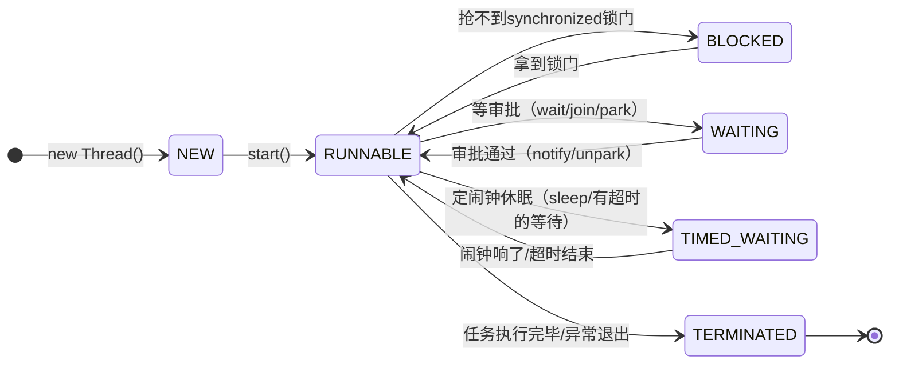

# 🧵 01 · 线程基础与生命周期（搞懂打工人的一生）

> **一句话导读**：线程就像操作系统分派给 Java 进程的“打工人”。搞清他从入职、干活、摸鱼、请假到离职的全过程，你就掌握了多线程最底层的指挥权。

---

## 🏢 进程与线程：公司与打工人的故事

很多人分不清**进程（Process）**和**线程（Thread）**，用一个生活比喻就能彻底搞定：

| 概念 | 操作系统本质与核心定义 | 资源分配与运行特征 | 场景类比说明（辅助理解） |
| :--- | :--- | :--- | :--- |
| **进程 (Process)** | **操作系统分配资源的独立单元**。每个进程拥有独立的虚拟地址空间、系统文件句柄与运行环境。 | 创建与销毁开销大；进程间相互隔离，跨进程通信（IPC）需经由操作系统内核管道、套接字或共享内存，成本高。 | 类比为独立注册的实体公司 |
| **线程 (Thread)** | **CPU 调度与执行的最小单元**。一个进程内部可创建并并发运行多个线程，共享宿主进程的资源。 | 创建轻量；同进程内线程共享堆内存和方法区元空间，但各自拥有独立的程序计数器（PC）与 Java 栈帧。 | 类比为公司内部协同作业的员工 |

> 💡 **核心结论**：
> - 为什么多线程效率高？因为雇新员工（创建线程）比再注册一家子公司（创建进程）省钱得多。
> - 为什么多线程容易翻车？因为所有员工共用一个公用卫生间（共享内存），如果不加锁，两个人同时冲进去就会出大事！

---

## 🛠️ 创建线程的姿势：别再纠结“有几种方式”了

面试官总爱问：“Java 中创建线程有几种方式？”（有人说 2 种，有人说 3 种，甚至 4 种）。
**从第一性原理来看，创建执行线程的本质只有一种：通过 `Thread` 类向操作系统申请一条执行路径！**
至于 `Runnable`、`Callable`，它们本质只是**“要执行的任务”**，而不是线程本身。

### 推荐写法：Lambda 表达式（任务与执行解耦）

```java
// 现代 Java 推荐做法：通过 Lambda 定义任务，传给 Thread 执行
Thread worker = new Thread(() -> {
    System.out.println("员工 [" + Thread.currentThread().getName() + "] 正在努力干活...");
}, "工号-007");

worker.start();
```

### ⚠️ 致命误区：`start()` 和 `run()` 的天壤之别

- **`worker.start()`**：相当于**正式指派员工去干活**。通知操作系统创建新线程，并在新线程中异步执行 `run()` 方法。
- **`worker.run()`**：相当于**老板自己亲自动手干**。只是在当前的主线程（main 线程）里调用了一个普通的方法，根本没有创建新线程！

---

## 🚦 线程的 6 大状态：打工人的生命周期

Java 官方在 `Thread.State` 枚举中严格定义了线程的 **6 大生命状态**：



### 用打工人的一天，秒懂 6 大状态：

1. **NEW（新建）**：
   - **比喻**：拿到 Offer 刚办入职手续，还没正式去工位坐下（刚 `new Thread()`，还没调用 `start()`）。
2. **RUNNABLE（运行中/可运行）**：
   - **比喻**：已经坐在工位上了，可能正在键盘狂敲，也可能在等待老板分配任务（包含了操作系统层面的 Ready 和 Running 两种状态）。
3. **BLOCKED（被阻塞）**：
   - **比喻**：**想去公共卫生间，发现门被别人从里面反锁了！** 只能站在门外傻等锁打开（仅限于等待进入 `synchronized` 同步代码块时竞争 Monitor 锁）。
   - 💡 *新手提示：如果你还没学过 `synchronized`，不用慌！这里只需把它当成一把最基础的“卫生间排他门锁”；它的语法、底层锁升级与使用细节，我们在 [[03-volatile与synchronized]] 会专门从零精讲！*
4. **WAITING（无限期等待）**：
   - **比喻**：**等老板给批复邮件**，老板不回邮件（没人调用 `notify` / `unpark`），你只能无限期停手干等。例如：`Object.wait()`、无超时的 `thread.join()`、`LockSupport.park()`。
5. **TIMED_WAITING（限时等待）**：
   - **比喻**：**定了个 30 分钟的午休闹钟**，或者在饮水机接水最多等 5 秒，到点不管接没接到都继续干别的。例如：`Thread.sleep(1000)`、有超时参数的 `join(1000)`。
6. **TERMINATED（终止）**：
   - **比喻**：正式离职交接完毕，生命周期终结。**已经进入 TERMINATED 的线程绝对不能再次调用 `start()`，否则会抛出 `IllegalThreadStateException`！**

---

## 💻 动手实验：亲眼观察状态流转

保存为 `ThreadLifeDemo.java`，直接运行感受：

```java
public class ThreadLifeDemo {
    public static void main(String[] args) throws InterruptedException {
        Thread worker = new Thread(() -> {
            try {
                // 模拟干活与午休
                Thread.sleep(500);
            } catch (InterruptedException e) {
                Thread.currentThread().interrupt();
            }
        });

        // 1. 刚创建
        System.out.println("1. 刚 new 出来: " + worker.getState()); // NEW

        // 2. 启动
        worker.start();
        System.out.println("2. 调用 start() 后: " + worker.getState()); // RUNNABLE

        // 主线程稍等 100ms，让 worker 进入 sleep
        Thread.sleep(100);
        System.out.println("3. 正在 sleep 中: " + worker.getState()); // TIMED_WAITING

        // 4. 等待 worker 彻底干完活
        worker.join();
        System.out.println("4. 任务结束之后: " + worker.getState()); // TERMINATED
    }
}
```

**运行输出：**
```text
1. 刚 new 出来: NEW
2. 调用 start() 后: RUNNABLE
3. 正在 sleep 中: TIMED_WAITING
4. 任务结束之后: TERMINATED
```

---

## 🛑 怎么优雅地让线程停下来？（千万别杀员工！）

### ❌ 历史毒药：为什么 `stop()` 被废弃？
早期的 Java 有个 `thread.stop()` 方法。它就像**保安直接冲进办公室把正在写代码的员工一棍子打晕拖走**！
- 此时该员工手头的账本可能只改了一半；
- 占用的数据库连接可能没关；
- 共享对象处于极度混乱的中间状态。
因此，`stop()` 早就被标记为 `@Deprecated`，**严禁在生产代码中使用！**

### ✅ 正确姿势：协作式中断（`interrupt()`）
现代多线程停机的核心哲学是：**协商与协作**。
不是我暴力杀你，而是我给你发一封微信通知：“亲，系统要下线了，请你尽快把手头的工作收尾并退出。”

| 方法 | 谁调用的？ | 作用 |
| :--- | :--- | :--- |
| **`worker.interrupt()`** | 外部线程通知 worker | 向 worker 发送中断信号（设置其中断标志位为 `true`） |
| **`worker.isInterrupted()`** | 任何线程都可以查 | 查看 worker 是否收到了中断通知（**不会**清除标志位） |
| **`Thread.interrupted()`** | worker 自己在当前线程查 | 查看自己是否收到中断通知，并**顺便把标志位清空复位为 `false`** |

### 优雅停机标准代码模板

```java
public class GracefulStopDemo {
    public static void main(String[] args) throws InterruptedException {
        Thread worker = new Thread(() -> {
            System.out.println("打工人开始干活...");
            // 守则1：在循环中不断检查自己的中断标志
            while (!Thread.currentThread().isInterrupted()) {
                try {
                    // 模拟周期性工作
                    System.out.println("正在处理任务批次...");
                    Thread.sleep(1000); 
                } catch (InterruptedException e) {
                    // 守则2：如果 sleep 等待期间被 interrupt，会抛出 InterruptedException
                    // 注意：抛出异常的同时，Java 会把中断标志复位为 false！
                    System.out.println("收到催命中断通知！准备收拾工位下班...");
                    // 关键动作：再次恢复中断标志，或者直接 break 退出循环
                    Thread.currentThread().interrupt();
                    break;
                }
            }
            // 守则3：执行资源清理工作
            System.out.println("工位收拾完毕，体面打卡下班！");
        });

        worker.start();
        Thread.sleep(2500); // 让它跑两秒多

        // 外部发起中断请求
        worker.interrupt();
        worker.join(); // 优雅等待它彻底结束
        System.out.println("主线程：确认打工人已安全离职。");
    }
}
```

> [!CAUTION]
> **生产避坑铁律**：遇到 `InterruptedException` 时，**千万不要用空的 `catch` 块把异常吞掉**！如果你吞掉了异常又不恢复中断标志，外层的调度系统就会以为任务还在正常运行，导致线程永远无法退出，变成线上僵尸线程。

---

## 💂 守护线程（Daemon）：保洁阿姨与公司员工

Java 里的线程分为两种：
1. **用户线程（User Thread）**：公司里的正式业务员工。**只要还有任何一个业务员工没下班，公司大门就不能关（JVM 不会退出）**。默认创建的线程都是用户线程。
2. **守护线程（Daemon Thread）**：公司的保洁阿姨 / 保安。负责做垃圾回收、后台心跳监测等辅助工作。**一旦所有的正式员工都下班了，保洁阿姨不管活有没有干完，JVM 直接强制关门下班！**

```java
Thread daemonWorker = new Thread(() -> {
    while (true) {
        System.out.println("保洁阿姨后台扫地中...");
    }
});
// 必须在 start() 之前设置为守护线程！
daemonWorker.setDaemon(true);
daemonWorker.start();
```

---

## 🧠 一分钟复盘与高频面试连环问

> [!question]- Q1：`sleep()` 和 `wait()` 有什么本质区别？
> - `sleep()` 来自 `Thread` 类，执行时**不释放任何锁资源**，超时后自动唤醒恢复就绪状态。
> - `wait()` 来自 `Object` 类，**必须在 `synchronized` 同步块/方法中调用，调用时会彻底释放锁资源并挂起**，必须等待其他线程调用 `notify()` / `notifyAll()` 或超时才能被唤醒重新争抢锁。

> [!question]- Q2：一个线程执行完毕后，能再次调用 `start()` 重新启动吗？
> **绝对不能**。Java 线程的生命周期是单向不可逆的状态机流转，进入 `TERMINATED` 终结状态后无法倒退回 `NEW`，再次调用 `start()` 会直接抛出 `IllegalThreadStateException`。如果需要重复执行任务，应当复用 `Runnable` 任务对象或提交至**线程池**循环调度。

---

## 🧭 下一步

搞懂了线程的生命周期与底层状态流转，接下来我们将直面多线程带来的并发安全挑战——当多个并发线程同时读写共享变量时，数据是如何发生竞争与不一致的？
请进入下一篇：[[02-Java内存模型JMM]]！
