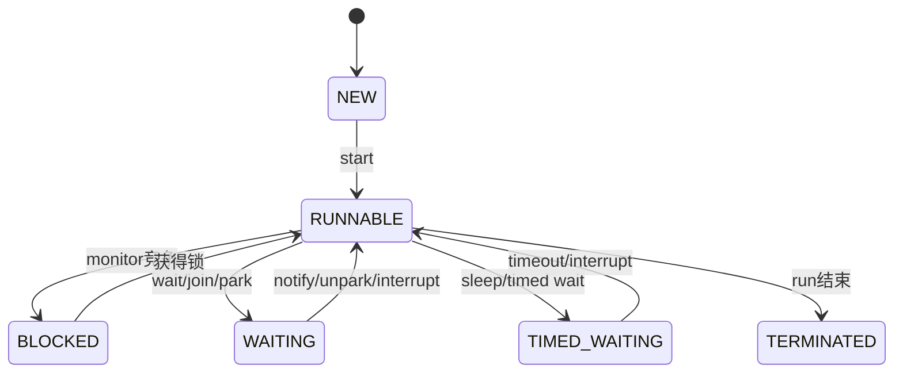

# 线程基础与生命周期

> [!abstract] 一句话总结
> 线程是 Java 并发执行的基本单位，生命周期状态、interrupt 协作中断和线程栈是排查并发问题的入口。

## 📌 这是什么

- Java Thread 状态包括 NEW、RUNNABLE、BLOCKED、WAITING、TIMED_WAITING、TERMINATED。
- RUNNABLE 在 JVM 中包含就绪和运行，是否真正占用 CPU 由操作系统调度。
- interrupt 不是强杀线程，而是设置中断标志并唤醒部分阻塞方法。

## 🤔 解决什么问题 / 为什么需要

- 死锁、阻塞、线程泄漏、CPU 高都要从线程状态和栈开始看。
- 正确处理中断是线程池、Future、阻塞队列和优雅停机的基础。
- 面试常要求解释 wait/sleep/join、start/run、守护线程和线程状态转换。

## 🧩 核心概念

| 概念 | 含义 | 精通要点 |
| ---- | ---- | -------- |
| NEW | 创建后未 start。 | 只可 start 一次。 |
| RUNNABLE | 可运行或正在运行。 | CPU 高常见大量 RUNNABLE。 |
| BLOCKED | 等待进入 synchronized 监视器。 | 看 blocked on 哪个锁。 |
| WAITING/TIMED_WAITING | 等待通知或超时。 | wait/join/park/sleep 常见。 |
| interrupt | 协作式取消信号。 | 阻塞方法可能抛 InterruptedException 并清除标志。 |

## ⚙️ 工作原理 / 流程



## 🔍 源码 / 原理深挖

- Thread.start 会创建本地线程并异步执行 run；直接调用 run 只是普通方法调用。
- Object.wait 必须持有 monitor，并会释放锁；Thread.sleep 不释放 monitor。
- LockSupport.park/unpark 是 AQS 等同步器的底层阻塞工具。

## 💻 代码实践 / 排查命令

```java
Thread worker = new Thread(() -> {
    while (!Thread.currentThread().isInterrupted()) {
        try {
            doWork();
        } catch (InterruptedException e) {
            Thread.currentThread().interrupt();
        }
    }
});
worker.start();
worker.interrupt();
```

## 🛠️ 排查 / 实践要点

- 线程数异常增长：jcmd <pid> Thread.print 或 jstack，看线程名、创建栈和线程池配置。
- 死锁：jstack 会直接报告 Java-level deadlock。
- 优雅停机：用 interrupt、volatile 标志、线程池 shutdown/shutdownNow 和超时 awaitTermination 配合。

## ⚠️ 踩坑与注意事项

- 把 interrupt 当作强制杀线程。
- 捕获 InterruptedException 后不恢复中断标志。
- 重复调用 Thread.start。
- 业务线程未命名，排查时全是 pool-1-thread-1。

## 🎯 面试问题

> [!question] 高频问题
> - Q: start 和 run 区别？
>   - A: start 创建新线程并由 JVM/OS 调度执行 run；直接调用 run 只是在当前线程执行普通方法。
> - Q: sleep 和 wait 区别？
>   - A: sleep 是 Thread 静态方法，不释放 monitor；wait 是 Object 方法，必须持有 monitor，调用后释放锁并等待 notify/interrupt/timeout。
> - Q: BLOCKED 和 WAITING 区别？
>   - A: BLOCKED 是等待进入 synchronized；WAITING 是已经通过 wait/join/park 等主动等待某个条件。

## 🧭 源码入口速查

- `Thread#start`：只能调用一次，最终创建本地线程并回调 `run`。
- `Thread#interrupt`、`isInterrupted`、`interrupted`：一个设置标志，一个读取不清除，一个读取并清除。
- `Object#wait/notify/notifyAll`：必须持有 monitor，`wait` 会释放 monitor。
- `LockSupport#park/unpark`：AQS、ForkJoinPool、CompletableFuture 等阻塞/唤醒的基础工具。
- `jstack` 中看 `java.lang.Thread.State`、`nid`、`locked`、`waiting on`、`parking to wait for`。

## 🧪 最小验证

```java
Thread t = new Thread(() -> {
    while (!Thread.currentThread().isInterrupted()) {}
    System.out.println("stopped");
}, "demo-worker");
t.start();
t.interrupt();
```

线上线程问题先分类：CPU 高看 RUNNABLE 热栈，锁竞争看 BLOCKED 和 monitor，队列等待看 WAITING/TIMED_WAITING，线程泄漏看线程名数量和创建栈。没有线程名的线程池，排查成本会直接翻倍。

## ✅ 精通检查清单

- 能用自己的话讲清本主题解决的问题和适用边界。
- 能指出至少 2 个源码入口或底层机制。
- 能给出一个最小代码示例或一组线上排查命令。
- 能回答本页列出的高频面试题，并补充项目中的真实取舍。

## 🔗 关联笔记

- [[_index]]

## 📚 参考资料

- [Dev.java Tutorials](https://dev.java/learn/)
- [Oracle Java Documentation](https://docs.oracle.com/en/java/)
