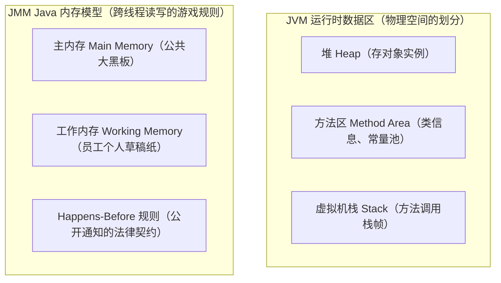
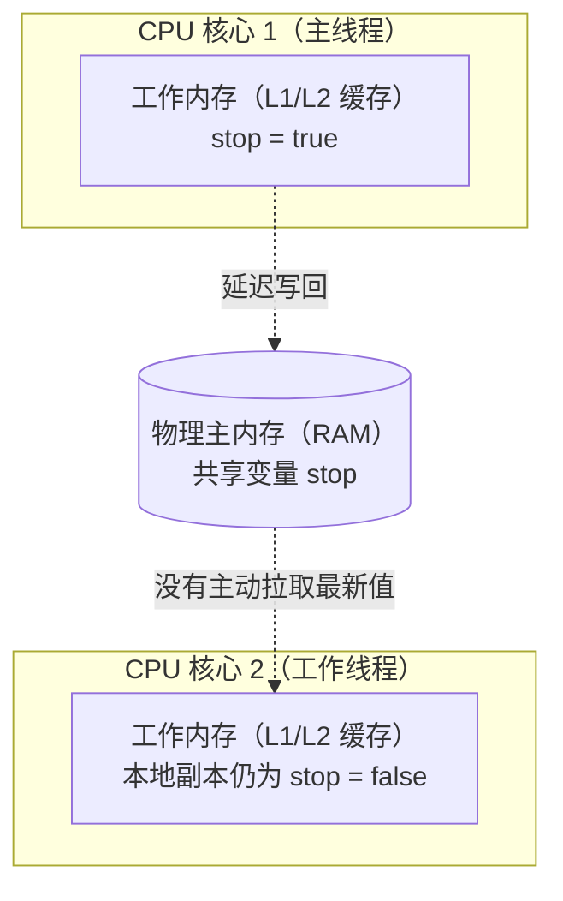
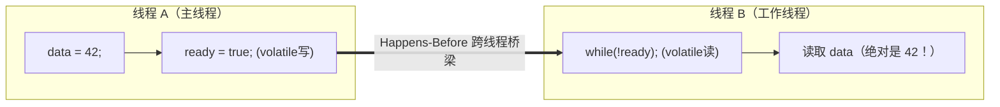

# 🧠 02 · Java 内存模型 JMM（通俗讲透底层世界契约）

> **一句话导读**：JMM 既不是 JVM 的堆和栈，也不是物理内存条，而是一套**“跨线程沟通的保密与公开协议”**。搞懂了它，你就能一眼看穿各种“见鬼了”的并发 Bug。

---

## 🚨 先扫清第一个致命误区：JMM ≠ JVM 内存区域

在很多初学者脑海里，常常把这两个概念混为一谈：



- **JVM 内存区域**：回答的是**“Java 运行时把数据存放在哪里”**（堆、栈、方法区）。
- **JMM（Java 内存模型）**：回答的是**“多线程读写同一个共享变量时，什么时候看得见、按什么顺序执行”**的规则规范。

---

## 💥 翻车现场：为什么这段代码会陷入死循环？

先来看一段震撼新手的翻车代码。保存为 `VisibilityProblemDemo.java`：

```java
public class VisibilityProblemDemo {
    // 普通布尔变量，控制工作线程是否停止
    private static boolean stop = false;

    public static void main(String[] args) throws InterruptedException {
        Thread worker = new Thread(() -> {
            System.out.println("工作线程：开始狂奔...");
            // 只要 stop 为 false，就一直死循环
            while (!stop) {
                // 空循环，为了模拟极速执行
            }
            System.out.println("工作线程：终于停下来了！");
        });

        worker.start();
        Thread.sleep(1000); // 让工作线程跑满 1 秒

        System.out.println("主线程：我把 stop 改成 true 了！");
        stop = true; // 主线程修改了共享变量
    }
}
```

### 运行现象：
在大多数 64 位现代 JVM（开启了 JIT 编译优化）下运行这段代码，你会看到控制台打印出：
```text
工作线程：开始狂奔...
主线程：我把 stop 改成 true 了！
（程序永远不会结束，工作线程死循环卡死！）
```

### 为什么会这样？（个人草稿纸 vs 办公室公共大黑板）

在现代计算机体系中，CPU 运转速度是内存读取速度的几百倍。为了不让 CPU 闲得发慌，每个 CPU 核心都有自己的**高速缓存（L1/L2/L3 Cache）**：



1. **工作内存（Working Memory）**：可以理解为每个线程私有的**“个人小草稿纸”**（对应 CPU 寄存器和高速缓存）。线程读写共享变量，必须先从主内存拷贝一份到自己的小草稿纸上。
2. **主内存（Main Memory）**：公司的**“公共大黑板”**（对应物理内存）。
3. **真相揭秘**：
   - 工作线程在 `while (!stop)` 极速狂奔时，JIT 编译器发现 `stop` 没人改它，为了极致效率，**直接把 `stop` 缓存在了 CPU 寄存器中，根本不去主内存重新看大黑板！**
   - 主线程虽然把大黑板改成了 `true`，但工作线程浑然不知，依旧拿着自己草稿纸上的旧值 `false` 跑到天荒地老！
   - 这就是典型的**可见性问题（Visibility）**！

---

## 🌪️ 翻车现场 2：不可思议的“指令重排序”

你以为你写的代码是按从上到下的顺序一行行执行的吗？
**在单线程下是的，但在底层和多线程下，绝不是！**

编译器和 CPU 为了榨干流水线性能，只要保证单线程最终运行结果不变（**as-if-serial 语义**），它们就会**肆无忌惮地打乱指令的执行先后顺序**！

### 经典案例：半初始化对象的“幽灵”

```java
public class Singleton {
    private static Singleton instance;
    private int data;

    private Singleton() {
        this.data = 42; // 步骤 B：初始化对象成员
    }

    public static Singleton getInstance() {
        if (instance == null) {
            synchronized (Singleton.class) {
                if (instance == null) {
                    // 这行经典的 new 操作，在底层其实分为三步：
                    // 1. memory = allocate(); 分配内存空间
                    // 2. ctorInstance(memory); 初始化对象（调用构造方法）
                    // 3. instance = memory;    把引用指向分配的内存地址
                    instance = new Singleton();
                }
            }
        }
        return instance;
    }
}
```

如果在底层发生了**指令重排序**，步骤 2 和步骤 3 颠倒了：
1. 线程 A 执行了 `1. 分配空间`，紧接着执行了 `3. instance 引用被赋值`（此时对象还没初始化完成，是个空壳！）。
2. 就在这一瞬间，线程 B 进来了，判断 `instance != null` 为真，直接兴高采烈把这个空壳对象拿去用了！
3. 线程 B 读取 `instance.data`，赫然发现不是 42，而是默认值 0，甚至直接报空指针异常崩溃！

这就是**有序性问题（Ordering）**！

---

## 📜 救世主：Happens-Before 原则（保密与公开契约）

既然底层 CPU 和编译器会乱搞缓存和重排序，那 Java 程序员怎么写出正确的并发代码？
**答案就是 JMM 给我们提供的法律契约——Happens-Before 原则！**

> 💡 **通俗定义**：
> 如果操作 A **happens-before** 操作 B，就意味着：**A 产生的所有影响（修改了变量值、发出了通知），在 B 发生的那一刻，B 都能看得一清二楚，而且从逻辑上看，A 确实发生在 B 之前。**

你不需要死记硬背枯燥的规范，重点掌握以下 **4 条与日常开发息息相关的铁律**：

### 1. 单线程程序次序规则（Program Order Rule）
- **执行语义**：在一个线程内部，按照控制流顺序，书写在前面的操作先行发生于书写在后面的操作。单线程内无需担心顺序颠倒导致自身逻辑错乱。

### 2. 监视器锁规则（Monitor Lock Rule）
- **核心语义**：**对一个锁的 `unlock()` 解锁操作，先行发生于后面对同一个锁的 `lock()` 加锁操作。**前一个持有锁的线程在临界区内所做的所有变量修改，对下一个成功获取该锁的线程完全可见。
```java
synchronized (lock) {
    count = 100; // 线程 A 修改
} // A 释放锁 unlock

// ---- happens-before ----

synchronized (lock) { // B 获取同一把锁 lock
    System.out.println(count); // 绝对能看到 100！
}
```
> 💡 *新手提示：`synchronized` 是 Java 原生提供的同步关键字（相当于一把独占门锁）。在此处你先体会它在契约中起到的“前人开门、后人必定看清”的作用即可；关于它的用法、Mark Word 对象头原理与锁升级全过程，下一篇 [[03-volatile与synchronized]] 会为你全面揭秘！*

### 3. volatile 变量规则（Volatile Variable Rule）
- **核心语义**：**对一个 `volatile` 变量的写操作，先行发生于后面对这个变量的读操作。**写线程写入新值后强制刷入主内存，后续任何线程读取该变量必定能观测到该最新值，且该写操作之前的所有普通写操作也一并可见。

### 4. 线程启动与终止规则（Thread Start & Join Rule）
- **核心语义**：
  - 主线程在调用 `worker.start()` 之前对共享变量的所有写入，在子线程 `worker` 启动执行后全部立即可见。
  - 子线程 `worker` 执行结束退出前所做的所有操作，在主线程成功调用 `worker.join()` 返回后，对主线程全部立即可见。



---

## 🧱 底层揭秘：硬件与 JVM 到底是怎么做到的？

JMM 的美好承诺不是凭空实现的，它在底层依赖两大硬核技术：

1. **内存屏障（Memory Barrier / Fence）**：
   - JVM 在编译字节码时，会在特定的指令前后插入硬件级别的“屏障指令”（如 x86 的 `mfence`、`lock` 前缀）。
   - 屏障就像**交通路口的红灯**：告诉 CPU 绝对禁止把红灯后面的指令调到红灯前面；同时强制把 CPU 高速缓存里的数据立刻冲刷（flush）到主内存，并让其他 CPU 核心的缓存行立刻失效！
2. **MESI 缓存一致性协议**：
   - 多核 CPU 通过总线嗅探（Bus Snooping）机制，只要发现某个 CPU 核心修改了某个内存地址，其他 CPU 核心立刻把自己缓存里的对应副本标记为失效（Invalid），下次再读必须从总线重新拉取。

---

## 🧠 一分钟复盘与思考题

1. **JMM 究竟解决了什么问题？**
   - 屏蔽不同操作系统和 CPU 硬件的内存访问差异，给 Java 开发者提供一套统一且可预测的**可见性与有序性保障规则**。
2. **为什么单靠 happens-before 还不够？**
   - happens-before 解决了可见性和有序性，但如果两个线程同时对一个变量做 `count++`（原子性问题），依然会发生数据覆盖丢失！

---

## 🧭 下一步

解决并发安全，我们需要有力的武器。最经典的“大杀器”就是 `synchronized` 与轻量级的 `volatile`。
它们究竟如何落地实现内存屏障与锁保护？
请进入下一篇：[[03-volatile与synchronized]]！
