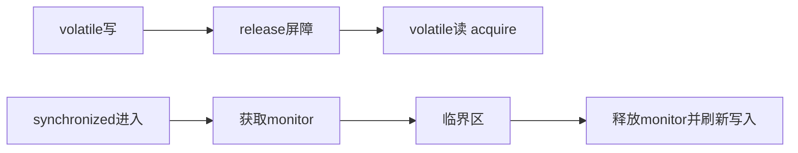

# volatile与synchronized

> [!abstract] 一句话总结
> volatile 解决轻量可见性和有序性，synchronized 同时提供互斥、可见性和可重入监视器语义。

## 📌 这是什么

- volatile 修饰变量后，读写会建立内存屏障语义。
- synchronized 基于对象 monitor，进入临界区互斥执行，退出时刷新写入。
- 两者都能建立 happens-before，但适用场景不同。

## 🤔 解决什么问题 / 为什么需要

- 正确实现停止标志、双重检查锁、懒加载、临界区保护。
- 理解锁竞争、锁升级、偏向锁历史、轻量级锁和重量级锁。
- 面试常比较 volatile 与 synchronized 的能力边界。

## 🧩 核心概念

| 概念 | 含义 | 精通要点 |
| ---- | ---- | -------- |
| volatile 可见性 | 写后其他线程读可见。 | 适合状态标志和单次发布。 |
| volatile 有序性 | 限制特定重排序。 | DCL 单例需要它防止引用先发布。 |
| monitor | 对象关联的监视器锁。 | monitorenter/monitorexit 字节码。 |
| 可重入 | 同一线程可重复获得同一把锁。 | 避免递归或嵌套调用死锁。 |

## ⚙️ 工作原理 / 流程



## 🔍 源码 / 原理深挖

- volatile 字段访问在字节码层仍是 getfield/putfield，但字段带 ACC_VOLATILE，JIT 生成相应屏障。
- synchronized 方法通过 ACC_SYNCHRONIZED 标志，代码块通过 monitorenter/monitorexit。
- HotSpot 会根据竞争情况做锁消除、锁粗化和锁膨胀等优化。

## 💻 代码实践 / 排查命令

```java
class Singleton {
    private static volatile Singleton instance;

    static Singleton getInstance() {
        Singleton local = instance;
        if (local == null) {
            synchronized (Singleton.class) {
                local = instance;
                if (local == null) {
                    instance = local = new Singleton();
                }
            }
        }
        return local;
    }
}
```

## 🛠️ 排查 / 实践要点

- 只需要跨线程状态可见且写入简单，用 volatile。
- 需要保护多个变量的一致性或复合操作，用 synchronized/Lock。
- 锁竞争严重时用 jstack、JFR Java Monitor Blocked、async-profiler lock 事件看热点。

## ⚠️ 踩坑与注意事项

- 用 volatile 修饰 count 后执行 count++，以为线程安全。
- 锁对象选择错误，例如锁住可变 String 或对外暴露对象。
- 在 synchronized 中执行慢 IO 或远程调用，放大锁持有时间。

## 🎯 面试问题

> [!question] 高频问题
> - Q: volatile 和 synchronized 区别？
>   - A: volatile 提供可见性和有序性，不提供复合操作互斥；synchronized 提供互斥、可见性、有序性和可重入，但有锁竞争成本。
> - Q: DCL 为什么要 volatile？
>   - A: new 对象可能出现分配内存、赋默认值、引用赋值、构造初始化的重排序风险，volatile 防止未初始化完成的对象引用被其他线程看到。
> - Q: synchronized 锁的是什么？
>   - A: 普通同步方法锁 this，静态同步方法锁 Class 对象，同步代码块锁括号中的对象。

## 🧭 源码入口速查

- `javap -v` 查看字段是否带 `ACC_VOLATILE`，同步代码块是否有 `monitorenter/monitorexit`。
- `synchronized` 普通方法在方法标志上带 `ACC_SYNCHRONIZED`，静态同步方法锁 Class 对象。
- HotSpot 锁状态可用 JOL 观察 Mark Word；JDK 15 起偏向锁默认关闭，后续版本已移除相关路径。
- JFR 事件 `Java Monitor Blocked`、`Java Monitor Wait` 可定位锁等待和 wait。

## 🧪 最小验证

```java
volatile int count;
void inc() { count++; } // getfield, iadd, putfield 三步，不是原子操作
```

如果要保护“余额扣减 + 流水记录 + 状态变更”这种多变量不变量，`volatile` 不是答案，必须把整个临界区放进同一把锁或用数据库/分布式事务提供原子边界。

## ✅ 精通检查清单

- 能用自己的话讲清本主题解决的问题和适用边界。
- 能指出至少 2 个源码入口或底层机制。
- 能给出一个最小代码示例或一组线上排查命令。
- 能回答本页列出的高频面试题，并补充项目中的真实取舍。

## 🔗 关联笔记

- [[_index]]

## 📚 参考资料

- [Dev.java Tutorials](https://dev.java/learn/)
- [Oracle Java Documentation](https://docs.oracle.com/en/java/)
