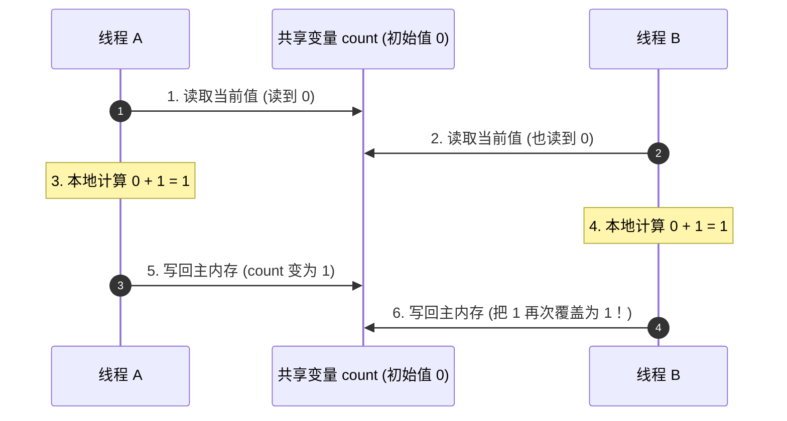

# 🔐 03 · volatile 与 synchronized（原生双雄的攻防之道）

> **一句话导读**：并发世界里的两大原生门神——`volatile` 是全透明的“中央通知大黑板”，`synchronized` 是独占互斥的“卫生间安全门锁”。搞清它们各自的边界，你就避开了 80% 的多线程陷阱。

---

## 🎭 核心心智模型：两位门神的生活大白话

很多初学者容易把这两个关键字搞混，其实只要记住两个生活场景：

| 门神 | 现实比喻 | 能保证什么？ | 治不了什么？ | 适用场景 |
| :--- | :--- | :--- | :--- | :--- |
| **`volatile`** | **办公室中央的透明大黑板** | 1. **可见性**（谁改了，所有人抬头立刻看到）<br>2. **有序性**（禁止上下指令颠倒重排） | ❌ **不保证原子性**（两个人同时冲去抢粉笔写字，依然会撞车覆盖） | 状态标记开关、双重检查单例 DCL、无需依赖当前值的单一赋值 |
| **`synchronized`** | **公共洗手间的物理安全门锁** | 1. **原子性**（一人独占反锁，别人进不去）<br>2. **可见性**（开门出来前所有操作必对下一个人可见）<br>3. **有序性**（内部指令对外互斥） | ❌ **开销相对偏重**（竞争激烈时需要排队阻塞线程，引发上下文切换） | 计数器多步累加、扣减库存、复杂状态多字段联动修改 |

---

## 💥 翻车实战：为什么 `volatile int count` 还是会加丢？

经常有同学问：“我已经给 `count` 加了 `volatile` 保证可见性了，为什么 10 个线程同时对它 `count++`，最后结果还是不对？”

保存为 `VolatileNotAtomicDemo.java` 亲自跑一下：

```java
public class VolatileNotAtomicDemo {
    // 尽管加了 volatile，依然无法保证 count++ 的安全！
    private static volatile int count = 0;

    public static void main(String[] args) throws InterruptedException {
        Thread[] threads = new Thread[10];
        
        // 启动 10 个线程，每个线程累加 1000 次，期望总数：10000
        for (int i = 0; i < 10; i++) {
            threads[i] = new Thread(() -> {
                for (int j = 0; j < 1000; j++) {
                    count++; // 翻车现场！
                }
            });
            threads[i].start();
        }

        // 等待 10 个线程全部执行完毕
        for (Thread t : threads) {
            t.join();
        }

        // 最终输出：很大概率小于 10000（如 8752、9210）
        System.out.println("期望结果：10000，实际结果：" + count);
    }
}
```

### 🔬 逐帧慢动作：`count++` 到底犯了什么罪？

在 Java 语法里，`count++` 只有简短的一行。但在 CPU 和字节码视角下，它被无情地拆解成了 **3 个独立的原子动作**：



1. **`getstatic`（读）**：从内存把 `count` 读到操作数栈顶；
2. **`iadd`（改）**：在 CPU 寄存器里执行 `+1` 操作；
3. **`putstatic`（写）**：把计算结果重新写回内存。

> 🚨 **真相揭秘**：
> `volatile` 只能确保在步骤 1 读的时候是最新鲜的、步骤 3 写完立刻让别人看见。**但在步骤 1 和步骤 3 之间，线程 A 早就拿着旧值去算加法了！** 线程 B 抢先一步算完写回，线程 A 随后也把自己的结果写回，直接覆盖了线程 B 的成果！这就是经典的**丢失更新（Lost Update）**。

---

## 🛡️ 解药登场：用 `synchronized` 把门反锁

要保证这 3 步“一气呵成、中途绝不许插队”，就必须上锁：

```java
public class SynchronizedDemo {
    private static int count = 0;

    // 用 synchronized 修饰方法，确保同一时刻只有 1 个线程能进门操作！
    public static synchronized void increment() {
        count++; // 读、改、写三合一，受到独占保护！
    }

    public static void main(String[] args) throws InterruptedException {
        Thread[] threads = new Thread[10];
        for (int i = 0; i < 10; i++) {
            threads[i] = new Thread(() -> {
                for (int j = 0; j < 1000; j++) {
                    increment();
                }
            });
            threads[i].start();
        }
        for (Thread t : threads) t.join();
        
        System.out.println("最终结果：" + count); // 永远精准等于 10000！
    }
}
```

---

## 🔑 深度辨析：synchronized 锁住的究竟是谁？

很多新手以为写了 `synchronized` 就能高枕无忧，结果多线程依然互相踩踏。
**核心原则：两个线程必须争抢“同一把锁对象”，互斥才能生效！**

| 使用方式 | 代码示例 | 实际上锁的对象 | 注意事项 / 坑点 |
| :--- | :--- | :--- | :--- |
| **修饰普通实例方法** | `public synchronized void test()` | **`this`（当前对象实例）** | 如果 `new` 了两个不同的对象分别调用，它们拿的是两把不同钥匙，互不阻塞！ |
| **修饰静态方法** | `public static synchronized void test()` | **当前类的 `Class` 对象**（如 `Demo.class`） | 无论 `new` 多少个实例，或者直接类名调用，全局只有这一把锁！ |
| **修饰代码块** | `synchronized(objLock) { ... }` | **括号里的 `objLock` 实例** | **严禁**使用 `String` 常量池字符串当锁（会锁死全局不相干代码）；**严禁**在方法内部 `synchronized(new Object())`（每次都是新钥匙，锁了个寂寞！）。 |

### 🔄 什么是“可重入锁”？（进完大门进卧室）

`synchronized` 是**天然可重入**的：
- **生活比喻**：你拿着家里的钥匙开门进了大门（拿到锁），发现卧室门也是同一套钥匙系统。你不需要先把大门钥匙交出来再申请卧室钥匙，你可以直接拿手里的钥匙拧开卧室门！
- **底层原理**：JVM 的每个 Monitor 对象内部都有一个**计数器 `_count`** 和一个**持有者指针 `_owner`**。
  - 线程第一次拿到锁，`_owner` 指向该线程，`_count = 1`；
  - 该线程再次进入该锁保护的另一个方法，发现持有者就是自己，`_count` 直接加 1 变成 2；
  - 退出一层方法，`_count` 减 1；直到退出最外层，`_count` 归 0，锁才真正释放给别人。

---

## 🌟 经典面试压轴题：DCL 双重检查单例的 volatile 能省吗？

看懂了这个，你就真正融会贯通了 `volatile` 与 `synchronized` 的默契配合：

```java
public class SafeDoubleCheckSingleton {
    // 灵魂拷问：这里的 volatile 到底能不能去掉？
    private static volatile SafeDoubleCheckSingleton instance;

    private SafeDoubleCheckSingleton() {}

    public static SafeDoubleCheckSingleton getInstance() {
        // 第一重检查：绝大部分请求在对象创建后直接返回，避免无脑加锁的性能灾难！
        if (instance == null) {
            synchronized (SafeDoubleCheckSingleton.class) {
                // 第二重检查：防止两个线程同时穿透第一重检查后重复创建！
                if (instance == null) {
                    // ⚠️ 重点在这里：new 操作会被底层拆为三步指令！
                    instance = new SafeDoubleCheckSingleton();
                }
            }
        }
        return instance;
    }
}
```

> 🎯 **满分回答**：
> **绝对不能省！**
> 因为 `instance = new SafeDoubleCheckSingleton();` 在底层实际上分为三步：
> 1. `memory = allocate();` // 分配内存空间
> 2. `ctorInstance(memory);` // 初始化对象（执行构造方法）
> 3. `instance = memory;`    // 将引用指向该内存地址
> 
> 如果没有 `volatile`，CPU 可能会发生**指令重排序**把顺序颠倒为 `1 -> 3 -> 2`。
> 此时，线程 A 刚执行完 1 和 3，对象内存还没被初始化（还是个空架子半成品），线程 B 走到最外层的 `if (instance == null)`，发现 `instance` 不为 null，于是直接把这个半成品拿走去调用它的成员方法，直接引发不可预知的空指针或数据错乱崩溃！
> **`volatile` 在此处的关键作用就是插入内存屏障，禁止 2 和 3 重排序，确保对象完全初始化后才把引用公开！**

---

## 🔬 底层探秘：JVM 内部的锁优化（锁升级的真相）

在早期的 JDK 1.6 之前，`synchronized` 是众所周知的“性能杀手”（重量级锁），每次加锁都要请求操作系统进行内核态切换，挂起和唤醒线程开销巨大。

HotSpot 团队为此引入了**锁优化机制**。在对象的对象头（**Mark Word**）中记录锁状态：


> [!NOTE]
> **关于偏向锁的最新认知**：
> 很多陈旧教材还在大篇幅讲“偏向锁”。但事实上，**JDK 15 起偏向锁已被默认禁用并废弃（JEP 374），现代 Java 21+ 中主要在无锁、轻量级锁（自旋）与重量级锁（Monitor）之间流转。**
> - **轻量级锁**：当几个线程只是交替执行，或者等待时间极短时，通过 CAS 自旋几圈等待，避免操作系统内核态切换的巨大开销。
> - **重量级锁**：当竞争激烈、自旋拿不到锁时，锁膨胀为重量级锁，底层生成一个 `ObjectMonitor`，拿不到锁的线程进入 `_EntryList` 队列挂起等待。

---

## 🧠 一分钟复盘速查表

| 对比维度 | `volatile` | `synchronized` |
| :--- | :--- | :--- |
| **本质作用** | 变量的可见性与禁止重排序 | 资源的独占互斥访问与全套同步 |
| **能否保证原子性？** | **否**（不能保证复合操作原子性） | **能**（临界区代码完全原子化） |
| **线程会不会阻塞？** | **永远不会阻塞**（无锁，轻量级极速） | **可能阻塞**（未抢到锁的线程进入 BLOCKED） |
| **修饰位置** | 只能修饰成员变量（Field） | 修饰方法或代码块 |
| **硬件实现** | 内存屏障（Memory Barrier / lock前缀） | JVM `monitorenter`/`monitorexit` + OS 互斥量 |

---

## 🧭 下一步

`synchronized` 虽好，但它毕竟是一把**悲观排他锁**——只要有人进去了，其他人只能死等。
在很多高并发场景下（如高频计数、无锁队列），我们能不能“不加锁”也能保证原子安全呢？
请进入下一篇：[[04-CAS与原子类]]！
