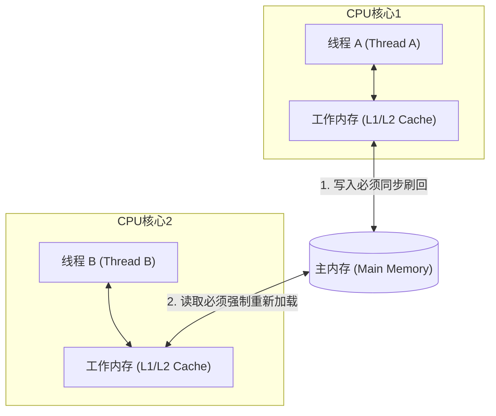
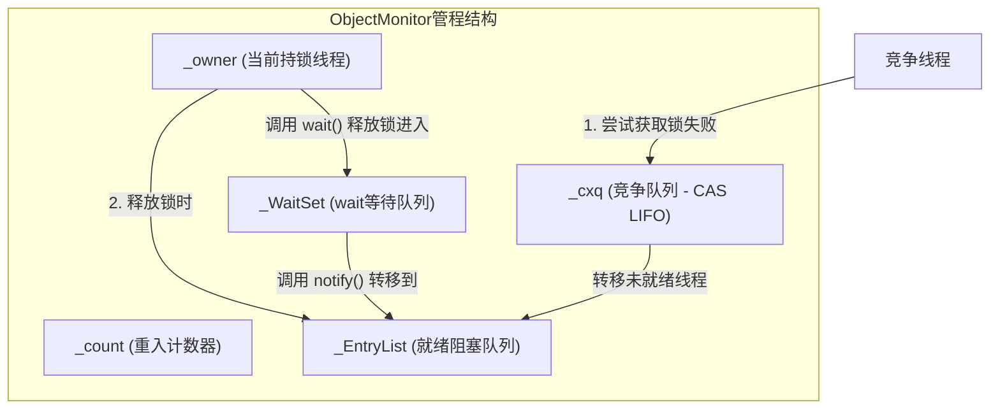
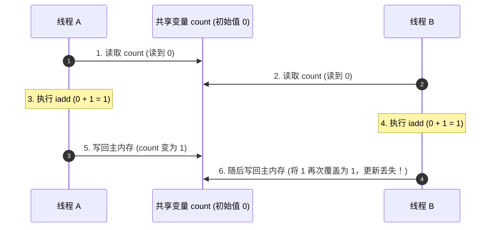
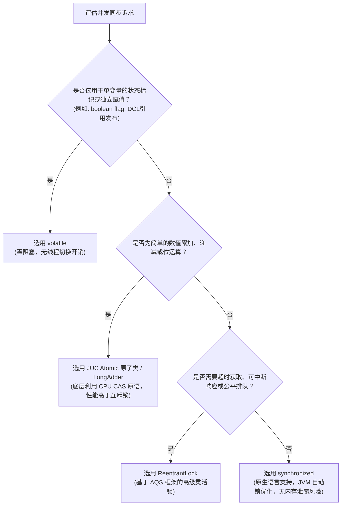

# 03 · volatile 与 synchronized 原理与底层机制

> **导读**：在 Java 并发编程中，`volatile` 与 `synchronized` 是语言原生支持的两种基础同步机制。`volatile` 提供轻量级的可见性与有序性保证，而 `synchronized` 则提供重量级的独占互斥与原子性保护。本文从 Java 内存模型（JMM）、JVM 字节码、对象头结构（Mark Word）及硬件级 CPU 缓存一致性协议出发，深入剖析两者的底层运行机制与选型边界。

---

## 一、核心能力定义与机制对比

并发编程的三大核心要素为：**可见性（Visibility）**、**有序性（Ordering）**、**原子性（Atomicity）**。`volatile` 与 `synchronized` 在能力保障上存在严格的边界划分。

### 1. 核心能力对比矩阵

| 对比维度 | `volatile` | `synchronized` |
| :--- | :--- | :--- |
| **核心定位** | 轻量级无锁同步修饰符 | 互斥型悲观锁机制 |
| **原子性保证** | ❌ **不保证复合操作原子性**（仅保证单次 32/64 位读/写操作的原子性） | ✅ **完全保证**（通过监视器锁建立互斥临界区） |
| **可见性保证** | ✅ **完全保证**（写操作强刷主存，读操作强从主存加载） | ✅ **完全保证**（加锁清空工作内存，释放锁强刷修改至主存） |
| **有序性保证** | ✅ **完全保证**（底层插入内存屏障，禁止指令重排序） | ✅ **完全保证**（同一时刻单线程执行，临界区对外表现为有序） |
| **线程阻塞状态** | ❌ **不阻塞**（无锁操作，不触发上下文切换） | ⚠️ **可能阻塞**（线程未获取到锁进入 `BLOCKED` 状态，触发内核态切换） |
| **修饰目标** | 仅能修饰成员变量（Field） | 修饰普通方法、静态方法、代码块 |
| **底层硬件/JVM实现** | 内存屏障（Memory Barrier）与 CPU `lock` 前缀指令 | 字节码 `monitorenter`/`monitorexit`、HotSpot `ObjectMonitor` |

---

## 二、volatile 底层实现原理

### 1. Java 内存模型（JMM）与可见性缺失根源
在现代多核 CPU 架构中，每个核心均配备独立的 L1/L2 缓存与写缓冲区（Store Buffer）。Java 内存模型将内存划分为**主内存（Main Memory，线程共享）**与**工作内存（Working Memory，线程私有）**。
- 线程修改一个普通变量时，先写入本地工作内存，随后在不确定的时间点刷回主内存。
- 另一个线程读取该变量时，若本地工作内存中已有缓存且未失效，则直接读取本地旧值，导致数据不一致。



### 2. 内存屏障（Memory Barrier）与有序性保障
为了提高执行效率，编译器与 CPU 会在不改变单线程执行结果（as-if-serial 语义）的前提下对机器指令进行**重排序**。但在多线程并发场景下，重排序会导致严重的线程安全故障。

JMM 在 JSR-133 规范中通过在 `volatile` 读写操作前后插入**内存屏障（Memory Barrier）**来禁止特定类型的重排序：

| 屏障类型 | 插入位置 | 屏障作用与禁止规则 |
| :--- | :--- | :--- |
| **StoreStore 屏障** | `volatile` 写操作之前 | 禁止上面的普通写与下面的 `volatile` 写重排序，保证前面所有普通写全部刷新至主存。 |
| **StoreLoad 屏障** | `volatile` 写操作之后 | 禁止上面的 `volatile` 写与下面可能存在的 `volatile` 读/写重排序（全能屏障，刷新写缓冲区）。 |
| **LoadLoad 屏障** | `volatile` 读操作之后 | 禁止上面的 `volatile` 读与下面后续的普通读重排序。 |
| **LoadStore 屏障** | `volatile` 读操作之后 | 禁止上面的 `volatile` 读与下面后续的普通写重排序。 |

### 3. CPU 硬件级汇编实现：`lock` 前缀指令
在 x86 架构下，JIT 编译器将 `volatile` 变量的写操作编译为带有 **`lock` 前缀** 的汇编指令（如 `lock addl $0x0,(%esp)`）：
1. **写回主存并失效缓存**：`lock` 前缀指令引发 CPU 锁总线（早前方案）或利用 **MESI 缓存一致性协议（Cache Coherency）** 锁定当前缓存行，将写缓冲区中的数据强制写回主内存。
2. **嗅探机制（Cache Snooping）**：总线上的其他 CPU 核心通过总线嗅探监听到该内存地址的变化，立即将其本地缓存对应的 Cache Line 置为无效（Invalid）状态。
3. **强制重读**：当其他核心再次需要访问该变量时，发现本地缓存失效，必须发起总线事务从主内存重新读取最新数据。

---

## 三、synchronized 底层实现原理

`synchronized` 是 JVM 层面的内置锁（Built-in Lock / Monitor Lock），基于管程（Monitor）概念实现。

### 1. 字节码指令与 Monitor 机制
通过 `javap -c -v` 反编译包含 `synchronized` 代码块的 `.class` 文件：

```java
public void syncBlock() {
    synchronized (this) {
        // 临界区业务代码
    }
}
```

字节码层面对应：
- **`monitorenter`**：每个对象关联一个 Monitor。线程执行到此指令时尝试获取该对象的 Monitor 所有权。若计数器为 0 则获取成功并置为 1；若持有者为当前线程则计数器累加（**可重入性**）；若已被其他线程持有，当前线程进入阻塞等待。
- **`monitorexit`**：将 Monitor 计数器减 1。减至 0 时完全释放锁所有权。
> [!NOTE] 异常安全保障
> 在生成的字节码中，通常会存在 **1 个 `monitorenter` 与 2 个 `monitorexit`** 指令。其中第 2 个 `monitorexit` 被注册在异常表（Exception Table）的 `any` 路径中，确保无论代码正常执行完毕还是中途抛出任何异常，锁均能被必定释放，杜绝死锁。

### 2. HotSpot 虚拟机 `ObjectMonitor` 核心结构
在 OpenJDK HotSpot 源码中，每个重量级锁对象都关联一个 C++ 实现的 `ObjectMonitor` 对象，核心成员变量如下：

```cpp
class ObjectMonitor {
    void*            _owner;       // 指向当前持有该锁的线程指针
    volatile intptr_t _count;      // 锁计数器（支持重入次数记录）
    volatile intptr_t _waiters;    // 等待线程计数
    ObjectWaiter*    _cxq;         // 无锁竞争后 CAS 入队的单向竞争队列
    ObjectWaiter*    _EntryList;   // 处于 BLOCKED 状态、等待锁被释放后被唤醒的线程队列
    ObjectWaiter*    _WaitSet;     // 调用 wait() 后处于 WAITING 状态的等待线程队列
};
```



### 3. 对象头（Mark Word）与锁升级膨胀机制
在 64 位 JVM 中，对象在堆内存中的布局分为：**对象头（Object Header）**、**实例数据（Instance Data）**与**对齐填充（Padding）**。对象头中的 **Mark Word（64 bits）** 负责记录锁状态：

| 锁状态 | 存储内容（高位到低位） | 标志位（2 bit） | 是否偏向锁（1 bit） | 状态说明 |
| :--- | :--- | :---: | :---: | :--- |
| **无锁（Normal）** | 对象的 HashCode、分代年龄（4 bit） | `01` | `0` | 无任何线程竞争 |
| **偏向锁（Biased）** | 偏向线程 ID、偏向时间戳 Epoch、分代年龄 | `01` | `1` | 锁偏向于第一个访问它的线程（JDK 15+ 已废弃） |
| **轻量级锁（Lightweight）** | 指向线程栈中锁记录（Lock Record）的指针 | `00` | - | 线程交替执行，自旋无阻塞竞争 |
| **重量级锁（Heavyweight）** | 指向堆外 `ObjectMonitor` 监视器对象的指针 | `10` | - | 竞争激烈，线程阻塞并挂起 |


> [!IMPORTANT] 现代 JVM 锁升级技术演进说明
> 1. **偏向锁的淘汰**：偏向锁在撤销（Revocation）时需要等待全局安全点（SafePoint）并暂停拥有锁的线程（STW），在现代高并发多核架构下的维护成本远高于其带来的收益。**JDK 15（JEP 374）起已默认禁用并标记废弃，现代生产级 Java（JDK 17/21 LTS）中锁状态主要在“无锁 $\to$ 轻量级锁 $\to$ 重量级锁”之间转换。**
> 2. **自适应自旋（Adaptive Spinning）**：轻量级锁竞争时，线程在进入操作系统内核态挂起之前会进行自旋。自旋次数由前一次在同一个锁上的自旋时间及锁持有者的状态动态决定（如果上次自旋成功拿到了锁，JVM 会认为这次自旋成功的概率也很高，允许自旋更长时间；反之直接挂起）。

---

## 四、经典问题与实战陷阱剖析

### 1. 陷阱一：`volatile` 无法保证复合操作原子性（`count++` 丢失更新）
`count++` 在底层不是一条原子指令，而是由三条 JVM 字节码指令组合而成：
1. `getstatic`：从主内存读取 `count` 变量加载到操作数栈顶；
2. `iadd`：在 CPU 寄存器中执行加 1 计算；
3. `putstatic`：将累加后的结果写回主内存。



> **结论**：`volatile` 只能确保步骤 1 读取时数值最新，以及步骤 6 写回时令其他线程缓存失效。但在步骤 1 与步骤 6 之间，多个线程已经基于旧值独立完成了算术计算，最终导致写回覆盖，产生**丢失更新（Lost Update）**。复合操作必须使用 `synchronized` 或 `AtomicInteger`（CAS）。

### 2. 陷阱二：DCL 双重检查单例中 `volatile` 为何不可省略？

```java
public class SafeDoubleCheckSingleton {
    // 此处的 volatile 关键用于禁止指令重排序
    private static volatile SafeDoubleCheckSingleton instance;

    private SafeDoubleCheckSingleton() {}

    public static SafeDoubleCheckSingleton getInstance() {
        if (instance == null) { // 第一次检查：避免无竞争时频繁加锁
            synchronized (SafeDoubleCheckSingleton.class) {
                if (instance == null) { // 第二次检查：防止并发穿透后重复创建
                    instance = new SafeDoubleCheckSingleton(); // 核心危险点
                }
            }
        }
        return instance;
    }
}
```

对象实例化语句 `instance = new SafeDoubleCheckSingleton();` 在底层被拆解为三步：
1. `memory = allocate();` // 1. 分配对象的内存空间
2. `ctorInstance(memory);` // 2. 调用构造方法，初始化成员变量
3. `instance = memory;`    // 3. 将引用变量指向刚分配的内存地址

**重排序风险**：编译器或 CPU 可能将指令重排序为 `1 -> 3 -> 2`。
- 当线程 A 执行完步骤 1 和步骤 3，尚未执行步骤 2 时，`instance` 已经非 `null`；
- 此时线程 B 调用 `getInstance()`，外层第一次检查判断 `instance != null`，直接将**尚未初始化的半成品对象（Half-Initialized Object）** 返回；
- 线程 B 访问该对象的成员属性时，可能抛出 `NullPointerException` 或读取到脏数据。
- **添加 `volatile` 后，通过插入内存屏障严格禁止指令 2 与指令 3 重排序，彻底杜绝半初始化对象的逸出。**

### 3. 陷阱三：synchronized 锁对象的锁定范围误区

| 锁使用语法 | 实际锁定的对象引用 | 核心注意事项与常见陷阱 |
| :--- | :--- | :--- |
| `public synchronized void method()` | 当前实例对象 `this` | 若多个线程持有不同的实例对象分别调用，无法形成互斥效果。 |
| `public static synchronized void method()` | 当前类的全局 Class 对象（如 `Target.class`） | 全局唯一，无论实例化多少个对象，所有线程均互斥访问。 |
| `synchronized(lockObj) { ... }` | 显式指定的 `lockObj` 引用 | 1. **严禁使用不可变对象或常量池对象**（如 `String` 常量池、`Integer.valueOf()` 会导致不同业务逻辑误锁同一把全局锁）；<br>2. **严禁在方法内 `synchronized(new Object())`**（每个线程每次执行创建独立对象，无法形成互斥）。 |

---

### 场景演示：公示大屏与会议室门禁

- **大厅电子公示大屏（`volatile` 变量）**：任何部门更新了通知，全厅路过的人抬头立即可见（**内存可见性**）；但若多人同时根据大屏旧数字各自算加法写回，会相互覆盖丢失（**不防并发写冲突，不保证复合原子性**）；
- **机密会议室电子门锁（`synchronized` 监视器锁）**：刷卡进门（`monitorenter`）后反锁独占，门外其他人排队等待（`BLOCKED` 入 `_EntryList` 队列）；
- **手持门禁卡进会议室内小隔间（可重入性 Reentrant）**：持锁者可直接刷开属于同一把锁保护的内层方法，计数器累加；
- **办完事推门交还门禁卡（`monitorexit`）**：离开时释放锁，并强制将屋内整理的所有修改成果完整刷回展示（**保障原子性、有序性与可见性**）。

---

## 六、综合复盘与技术选型决策树

在实际高并发系统研发中，应根据具体的业务特征选择合适的同步机制：



---

## 🧭 下一步

`synchronized` 提供了开箱即用的悲观独占保护，但在极高频并发读写（如秒杀计数、高吞吐无锁队列）场景下，互斥锁带来的线程排队开销依然不可忽视。
想要实现“既不加互斥锁、又能确保复合操作原子性”的超高性能并发控制，底层依赖的核心硬件原语正是 **CAS（Compare-And-Swap）**。
请进入下一篇：[[04-CAS与原子类]]！
