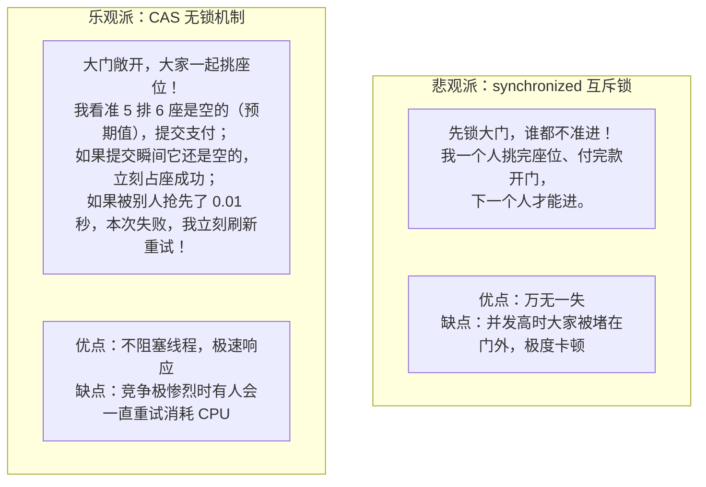
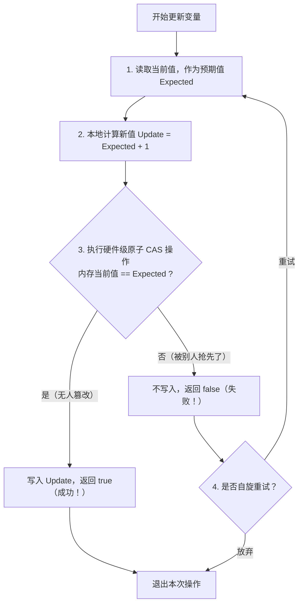
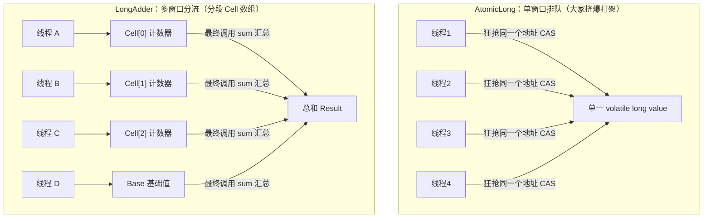

# ⚡ 04 · CAS 与原子类（乐观派的智慧与高性能无锁方案）

> **一句话导读**：嫌 `synchronized` 排队锁门太慢？CAS 带着“电影院选座抢票”的乐观思想登场，不用阻塞线程也能实现原子安全更新，更是整个 JUC 并发包的动力引擎。

---

## 🎟️ 核心心智模型：电影院选座抢票

面对“多人修改同一个共享数据”的难题，技术界分化出了两大哲学门派：



---

## 🔍 CAS 到底是什么？

CAS 的全称是 **Compare And Swap（比较并交换）**，或者叫 **Compare And Set**。
它由三个核心操作数构成：
- **`V`（Variable）**：要修改的内存变量地址。
- **`E`（Expected）**：我之前读到的预期旧值。
- **`U`（Update）**：我准备写入的新值。

### 核心运作逻辑：
> **“我认为现在的数值是 E。如果是，请帮我改成 U；如果不是，说明别人趁我不注意改过了，请不要修改，并告诉我失败了，我再决定怎么做。”**



### 💻 极简代码初体验

```java
import java.util.concurrent.atomic.AtomicInteger;

public class CasBasicsDemo {
    public static void main(String[] args) {
        AtomicInteger ticket = new AtomicInteger(100);

        // 尝试把 100 改为 101（成功，因为当前确实是 100）
        boolean success1 = ticket.compareAndSet(100, 101);
        System.out.println("第一次抢占结果：" + success1 + "，当前值：" + ticket.get()); // true, 101

        // 再次尝试把 100 改为 102（失败！因为当前已经是 101 了，不符合预期 100）
        boolean success2 = ticket.compareAndSet(100, 102);
        System.out.println("第二次抢占结果：" + success2 + "，当前值：" + ticket.get()); // false, 101
    }
}
```

---

## 🔬 底层探秘：为什么 CAS 能做到“比对 + 赋值”不可分割？

有同学会问：“你先比对再赋值，这不又是两步操作吗？难道中间不会被其他线程横插一脚？”

**答案是：这是 CPU 硬件指令直接支持的原子操作！**
- 在 Java 源码中，`AtomicInteger` 调用的是底层 `Unsafe` 类中的本地方法（native method）。
- 在现代 x86 CPU 架构下，JVM 会把 CAS 方法直接翻译为汇编指令：`lock cmpxchg`。
- **`lock` 前缀会锁住 CPU 缓存行（或总线）**，确保在比较和写入这微秒级的一瞬间，其他任何 CPU 核心绝对无法访问该内存地址！这是纯硬件层面的原子性承诺。

---

## ⚠️ CAS 的三大软肋（大厂面试高频必考）

天下没有免费的午餐，CAS 带来了无锁的高性能，但也伴随着三大天然缺陷：

### 1. 循环开销大（高并发下 CPU 飙高 100%）
- 如果 1000 个线程同时去 CAS 抢同一个计数器，只有 1 个能成功，其余 999 个全在 `while` 循环里不断自旋重试。
- 这会导致 CPU 在空转中被疯狂消耗，甚至把服务器 CPU 跑满到 100%！

### 2. 只能保证“单变量”的原子性
- CAS 只能针对一个内存地址进行原子比对。
- 如果你的业务逻辑需要**同时更新账户余额和扣减优惠券**（涉及两个独立变量），普通的 CAS 就无能为力了，必须借助锁或者把多个字段打包封装成一个复合对象。

### 3. 经典的“ABA 问题”（偷梁换柱）

#### 🎭 生活人话比喻：
> 1. 你把一个装有 1000 元现金的保险箱（状态 A）锁在桌上出门了；
> 2. 你的室友趁你不在，开箱把 1000 元拿去赌博输光，借高利贷换成了伪钞放回箱子里（状态 B）；
> 3. 室友良心发现，又赚了 1000 元真钞换回来放好（状态 A）；
> 4. 你回家打开箱子一看，里面还是 1000 元真钞（当前值依然是预期值 A），你欣喜地以为“什么都没发生过”！
> 5. 但实际上，**过程已经被篡改过了，潜藏着巨大的隐患！**

#### 💥 技术危害：
在并发无锁栈/单向链表中，如果节点 A 被弹栈，B 成为栈顶，接着又有人把 A 放回栈顶。此时另一个线程以为 A 还是原来的 A，继续用它保存的旧 `next` 指针修改链表，会导致整个链表结构彻底错乱！

#### 🛡️ 终极解药：带版本号的邮戳（`AtomicStampedReference`）
不仅仅比对“数值对不对”，还要比对**“版本号（时间戳）对不对”**！

```java
import java.util.concurrent.atomic.AtomicStampedReference;

public class AbaSolveDemo {
    public static void main(String[] args) {
        String initialRef = "A";
        int initialStamp = 1; // 初始版本号 1

        AtomicStampedReference<String> asr = new AtomicStampedReference<>(initialRef, initialStamp);

        // 模拟别人把 A -> B (版本号+1 变为 2)
        asr.compareAndSet("A", "B", 1, 2);
        // 模拟别人又把 B -> A (版本号+1 变为 3)
        asr.compareAndSet("B", "A", 2, 3);

        // 此时数值虽然变回了 A，但版本号已经变成了 3！
        // 偷懒的线程依然拿着旧版本号 1 来更新，必然失败！
        boolean result = asr.compareAndSet("A", "C", 1, 4);
        System.out.println("更新是否成功：" + result); // false！完美避坑！
    }
}
```

---

## 🚀 性能怪兽：LongAdder 为什么能吊打 AtomicLong？

在超高并发场景下（例如双十一每秒几十万笔订单统计），`AtomicLong` 会因为多线程疯狂争抢同一个变量自旋重试而性能断崖式下跌。

Java 8 为此祭出了一款性能怪兽：**`LongAdder`**。它的底层设计体现了极度精妙的架构哲学——**空间换时间，分段累加！**



### 核心运作机理：
1. **低竞争时**：直接通过 CAS 修改基础值 `base`；
2. **高竞争时**：检测到 CAS 冲突，立刻将压力分散到一个 `Cell[]` 数组中。每个线程通过自己的哈希值找到专属的 `Cell[i]` 独立累加，互不打扰！
3. **统计结果时**：调用 `longAdder.sum()`，把 `base` 和各个 `Cell` 的数值加在一起即可。

> 💡 **选型建议**：
> - 纯累加统计类场景（PV、UV、请求量）：**无脑首选 `LongAdder`**，性能高出一个数量级！
> - 需要精准保证当前值并依赖当前值做业务判断（如库存扣减、序号生成）：选择 `AtomicLong`。

---

## 🧰 JUC 原子类家族全景图谱

Java 在 `java.util.concurrent.atomic` 包下为我们备齐了全套开箱即用的原子工具：

| 分类 | 核心类名 | 适用场景 |
| :--- | :--- | :--- |
| **基本类型** | `AtomicInteger`、`AtomicLong`、`AtomicBoolean` | 单个数值的原子加减、布尔开关翻转 |
| **引用类型** | `AtomicReference`、`AtomicStampedReference` | 多个字段打包对象的原子替换、解决 ABA 问题 |
| **数组类型** | `AtomicIntegerArray`、`AtomicReferenceArray` | 原子更新数组中的指定索引元素 |
| **高性能累加** | `LongAdder`、`DoubleAdder`、`LongAccumulator` | 极高并发下的吞吐量压榨与分散统计 |

---

## 🧠 一分钟复盘与思考题

1. **问：为什么说 CAS 是一种“乐观锁”？**
   - **答**：因为它假设每次去拿数据的时候别人都不会修改，所以不上锁直接干；只有在最后写回时才比对是否有人改过，冲突了就自旋重试。
2. **问：ABA 问题在所有场景下都有害吗？**
   - **答**：不是。如果只是纯数值运算（如只要账户余额还是 100 块就允许扣费），A 变 B 再变 A 通常不影响结果；但在**依赖节点版本轨迹、指针引用的链表/栈结构**中，ABA 会引发致命的死锁或结构断裂。

---

## 🧭 下一步

学完了 Java 原生的 `synchronized` 和轻量级的 `CAS`，我们即将进入 Java 并发世界真正的**重武器军械库——JUC（java.util.concurrent）**！
而驱动 JUC 里所有高级锁（如 `ReentrantLock`、`Semaphore`）运转的底层超级引擎，就是传说中的 **AQS**。
让我们走进下一篇：[[05-AQS原理]]！
