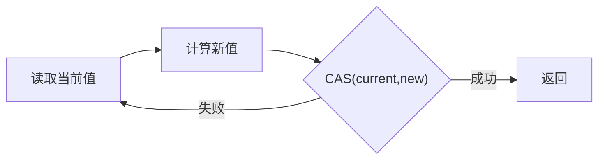

# CAS与原子类

> [!abstract] 一句话总结
> CAS 是乐观并发的核心原语，原子类基于 CAS 循环实现无锁更新，但要关注 ABA、自旋成本和热点竞争。

## 📌 这是什么

- CAS 比较内存值是否等于预期值，相等才更新为新值。
- AtomicInteger、AtomicReference、LongAdder 等类封装了常见原子更新。
- CAS 不等于无成本：竞争激烈时会持续自旋失败。

## 🤔 解决什么问题 / 为什么需要

- 实现计数器、状态机、无锁队列、AQS state 更新。
- 减少轻量并发场景中的锁阻塞和线程切换。
- 理解 ConcurrentHashMap、LongAdder、AQS 等 JUC 源码。

## 🧩 核心概念

| 概念 | 含义 | 精通要点 |
| ---- | ---- | -------- |
| CAS 三元组 | 内存位置、预期值、新值。 | 成功说明期间没有被其他线程改成不同值。 |
| 自旋 | 失败后循环重试。 | 低竞争有效，高竞争耗 CPU。 |
| ABA | 值从 A 变 B 又变 A，CAS 看不出变化。 | AtomicStampedReference 可带版本。 |
| LongAdder | 分段累加降低热点竞争。 | 最终一致统计，不适合强一致瞬时值。 |

## ⚙️ 工作原理 / 流程



## 🔍 源码 / 原理深挖

- 早期原子类多通过 Unsafe.compareAndSwapXxx，现代 JDK 也使用 VarHandle。
- AtomicInteger.getAndIncrement 本质是 CAS 循环。
- LongAdder 在竞争时把更新分散到多个 Cell，sum 时汇总 base 和 cells。

## 💻 代码实践 / 排查命令

```java
AtomicInteger counter = new AtomicInteger();
int next = counter.incrementAndGet();

AtomicReference<State> state = new AtomicReference<>(State.INIT);
boolean ok = state.compareAndSet(State.INIT, State.RUNNING);
```

## 🛠️ 排查 / 实践要点

- 高并发计数优先评估 LongAdder，低竞争或需要准确 CAS 状态转换用 AtomicXxx。
- 状态机更新用 compareAndSet 防止重复启动、重复关闭、重复支付。
- CAS 失败率高时考虑锁、分段、队列化或降低共享热点。

## ⚠️ 踩坑与注意事项

- 忽略 ABA 问题，特别是引用对象复用或栈/队列节点场景。
- 在 CAS 循环里执行复杂逻辑，失败重试会重复副作用。
- 用 LongAdder 做需要严格即时一致的库存扣减。

## 🎯 面试问题

> [!question] 高频问题
> - Q: CAS 有什么优缺点？
>   - A: 优点是无阻塞、避免线程切换，低竞争性能好；缺点是 ABA、自旋消耗 CPU、只能直接保证单变量原子更新。
> - Q: AtomicInteger 和 LongAdder 区别？
>   - A: AtomicInteger 单点 CAS，适合低竞争和需要精确值；LongAdder 分散热点，吞吐高，但 sum 不是严格线性一致。
> - Q: ABA 怎么解决？
>   - A: 引入版本号或标记，例如 AtomicStampedReference，或者避免节点复用，让 A 回来时也能识别为不同版本。

## 🧭 源码入口速查

- `AtomicInteger#getAndIncrement`：看 CAS 循环，失败后重读再试。
- `VarHandle#compareAndSet`：现代 JDK 推荐的变量句柄原子操作入口。
- `Striped64`、`LongAdder#add`、`Cell`：高竞争下分散热点的核心实现。
- `AtomicStampedReference`：通过版本号解决可观察的 ABA。

## 🧪 最小验证

```java
AtomicInteger stock = new AtomicInteger(10);
boolean ok;
do {
    int cur = stock.get();
    if (cur <= 0) throw new IllegalStateException("sold out");
    ok = stock.compareAndSet(cur, cur - 1);
} while (!ok);
```

CAS 循环里不要放发短信、写日志、扣券、RPC 这类副作用；CAS 失败会重试，副作用可能执行多次。先计算纯内存新值，CAS 成功后再做外部动作，或把外部动作放进有幂等保护的事务边界。

## ✅ 精通检查清单

- 能用自己的话讲清本主题解决的问题和适用边界。
- 能指出至少 2 个源码入口或底层机制。
- 能给出一个最小代码示例或一组线上排查命令。
- 能回答本页列出的高频面试题，并补充项目中的真实取舍。

## 🔗 关联笔记

- [[_index]]

## 📚 参考资料

- [Dev.java Tutorials](https://dev.java/learn/)
- [Oracle Java Documentation](https://docs.oracle.com/en/java/)
