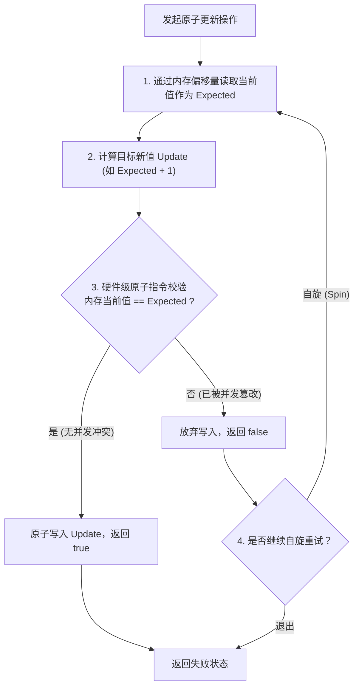
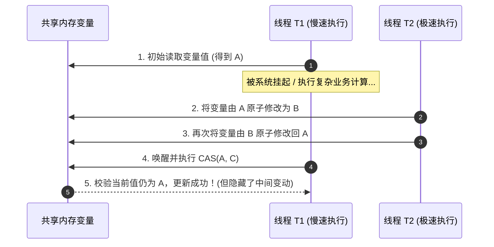
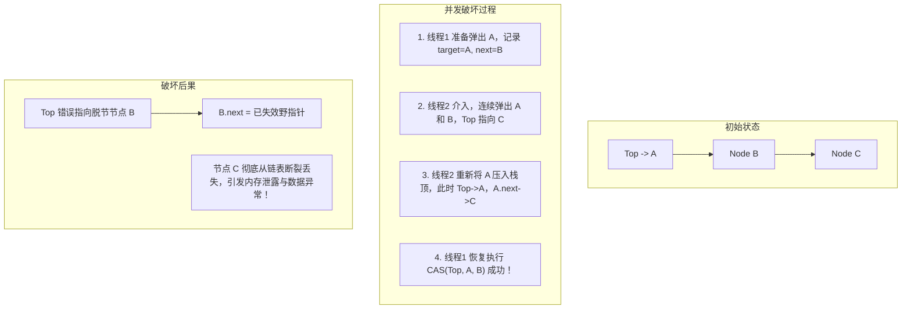
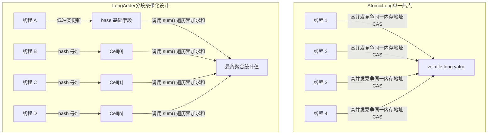

# 04 · CAS 原理与 JUC 原子类架构

> **导读**：在高并发场景下，传统的悲观互斥锁（如 `synchronized`）因线程上下文切换及内核态开销，在读多写少或短临界区操作中往往成为性能瓶颈。CAS（Compare-And-Swap）作为现代多核 CPU 架构直接支持的硬件级原子原语，为 Java 提供了无锁（Lock-Free）并发编程的基石。本文深入拆解 CAS 硬件指令、JDK `Unsafe` 机制、ABA 问题的内存级危害与版本号解法，以及高性能分段累加器 `LongAdder` 应对缓存伪共享（False Sharing）的底层设计。

---

## 一、CAS 核心定义与运行模型

### 1. 技术定义与三元操作数
CAS（Compare-And-Swap，比较并交换）是一种基于乐观并发策略的原子操作。它包含三个核心操作数：
- **`V`（Variable / Memory Offset）**：待操作的内存变量物理地址（内存偏移量）。
- **`E`（Expected / Expected Value）**：操作执行前线程读取到的预期原始值。
- **`U`（Update / New Value）**：校验成功后拟写入该内存地址的目标新值。

**原子执行语义**：
当且仅当内存地址 `V` 处的当前实时物理值等于预期值 `E` 时，处理器以不可中断的原子方式将该内存地址的值更新为 `U` 并返回 `true`；若内存值已被其他线程篡改导致不等于 `E`，则操作放弃更新并返回 `false`，由调用方自主决定是否重试（自旋）。



### 2. 乐观并发 vs 悲观互斥机制比对

| 对比维度 | 悲观互斥锁（如 `synchronized` / `ReentrantLock`） | 乐观无锁机制（CAS / 原子类） |
| :--- | :--- | :--- |
| **核心假设** | 假设并发冲突概率极高，每次访问资源前必须先加锁独占。 | 假设并发冲突概率较低，先尝试无锁操作，发生冲突后再自旋重试。 |
| **线程状态** | 未获取到锁的线程进入阻塞状态（`BLOCKED`/`WAITING`），涉及操作系统内核态切换与线程上下文切换（Context Switch）。 | 线程始终处于运行状态（`RUNNABLE`），在用户态执行自旋循环（Spin-Wait），零上下文切换成本。 |
| **适用场景** | 临界区业务耗时长、并发竞争极度激烈的大粒度同步场景。 | 临界区极短（如单纯数值累加、引用交换）、读多写少的轻量级同步场景。 |
| **性能瓶颈** | 线程挂起与唤醒的内核调用开销。 | 竞争极端激烈时持续自旋空转导致的 CPU 资源耗尽。 |

---

## 二、CAS 硬件级底层实现原理

### 1. `sun.misc.Unsafe` 与内存偏移量寻址
在 Java 虚拟机中，原子类并不能直接访问物理内存指针，而是借助 `Unsafe` 类中的本地方法（Native Method）实现对内存数据的直接操作：

```java
// 以 AtomicInteger 源码为例
public class AtomicInteger extends Number implements java.io.Serializable {
    private static final Unsafe unsafe = Unsafe.getUnsafe();
    private static final long valueOffset; // 字段在对象内存中的物理偏移量

    static {
        try {
            // 在 JVM 类加载时，计算出 value 字段在对象堆内存中的相对起始偏移地址
            valueOffset = unsafe.objectFieldOffset
                (AtomicInteger.class.getDeclaredField("value"));
        } catch (Exception ex) { throw new Error(ex); }
    }

    private volatile int value; // volatile 保证可见性

    public final boolean compareAndSet(int expect, int update) {
        // 调用 native 方法，直接通过对象基地址与偏移量进行内存 CAS
        return unsafe.compareAndSwapInt(this, valueOffset, expect, update);
    }
}
```

### 2. CPU 指令集：`LOCK CMPXCHG`
在 x86 多核处理器架构下，HotSpot 虚拟机的 `unsafe.cpp` 最终将 CAS 调用编译为一条汇编指令：**`lock cmpxchg`**。
- **`cmpxchg` 指令**：单核 CPU 下，该指令本身即是原子性的，比较目标操作数与寄存器值，相等则写入新值。
- **`lock` 前缀**：在多核（SMP）架构下，单纯的 `cmpxchg` 无法防御多个 CPU 核心同时访问同一内存地址。汇编指令添加 `lock` 前缀会触发硬件级总线仲裁：
  1. **总线锁定（Bus Lock）**：早期处理器通过在系统总线上发出 `LOCK#` 信号，独占共享总线，阻塞其他核心的所有内存访问。
  2. **缓存行锁定（Cache Line Lock）**：现代 CPU 普遍基于 **MESI 缓存一致性协议**，如果目标内存已被缓存在处理器的 Cache Line 中，`lock` 指令仅锁定该特定缓存行并强制写回主存，其他核心通过总线嗅探（Bus Snooping）使本地缓存行失效，大幅降低多核争用损耗。

---

## 三、CAS 的三大天然缺陷与工业级解决方案

### 1. 缺陷一：高并发下自旋导致的 CPU 空转消耗
- **技术现象**：当多线程对同一个变量发生激烈争用时，大量的 CAS 操作失败并陷入 `while (true)` 自旋重试。
- **底层影响**：CPU 核心持续处于计算满载状态，引发 CPU 利用率飙高甚至占满 100%，挤占正常业务线程的算力。
- **解决策略**：引入退避算法（如指数退避加自旋阈值），或改用分段锁/分段累加机制（如 `LongAdder`）。

### 2. 缺陷二：只能保证单个共享变量的原子操作
- **技术局限**：单个 CAS 操作只能作用于一个内存地址（4 字节或 8 字节字长），无法同时原子更新两个或多个独立变量（如同时扣减账户余额与记录流水号）。
- **解决策略**：
  1. 将多个变量封装到一个复合数据对象中，使用 **`AtomicReference`** 进行整个对象引用的原子 CAS 替换；
  2. 退回到锁机制（`synchronized` 或 `ReentrantLock`）构建复合临界区。

### 3. 缺陷三：经典的 ABA 问题（内存级深度分析）

#### ① 什么是 ABA 问题？
线程 T1 读取内存变量值为 A；在 T1 准备执行 CAS 之前，线程 T2 先后将变量修改为 B，随后又修改回 A。当 T1 发起 CAS 校验时，发现内存值依然是预期中的 A，校验通过并成功执行写入。但该变量在这段间隔期内实际经历了状态跃迁。



#### ② 内存级破坏实战：无锁栈（Treiber Stack）节点丢失
纯数值计算场景下 ABA 可能影响有限，但在**指针引用链表/栈数据结构**中，ABA 会导致毁灭性的拓扑结构崩塌：



#### ③ 工业级解决方案：`AtomicStampedReference`
不仅比对目标引用对象本身，还必须同时比对**整数版本号/时间戳（Stamp）**：
```java
// 内部封装一个包含引用对象与整型版本号的不可变 Pair 节点
private static class Pair<T> {
    final T reference;
    final int stamp;
    private Pair(T reference, int stamp) {
        this.reference = reference;
        this.stamp = stamp;
    }
    static <T> Pair<T> of(T reference, int stamp) {
        return new Pair<T>(reference, stamp);
    }
}

// 只有当 reference == expectedReference 且 stamp == expectedStamp 时才允许更新
public boolean compareAndSet(V expectedReference, V newReference,
                             int expectedStamp, int newStamp) {
    Pair<V> current = pair;
    return
        expectedReference == current.reference &&
        expectedStamp == current.stamp &&
        ((newReference == current.reference &&
          newStamp == current.stamp) ||
         casPair(current, Pair.of(newReference, newStamp)));
}
```

---

## 四、超高性能分段累加器：LongAdder 底层机制

在双十一等超高并发统计场景下，`AtomicLong` 会因为全网线程强抢同一个内存地址的 CAS 而导致吞吐量急剧下滑。JDK 8 引入的 `LongAdder` 采用**空间换时间、分段累加（Striped 64）**的思想，将单一竞争点拆分为多个分段。

### 1. 架构拓扑与动态分流



### 2. 避免 CPU 缓存伪共享（False Sharing）
在多核架构中，CPU 缓存是以**缓存行（Cache Line，通常为 64 字节）**为基本读取单位的。如果 `Cell[]` 数组中的多个 `Cell` 对象在堆内存中物理相邻，它们极大概率会被加载进同一个 64 字节 Cache Line。
- **伪共享灾难**：当核心 1 修改 `Cell[0]` 时，会导致核心 2 缓存的整个 Cache Line 失效；核心 2 修改 `Cell[1]` 又导致核心 1 的缓存失效。两个核心互不操作同一个变量，却在硬件缓存层发生剧烈震荡（Cache Line Ping-Pong）。
- **HotSpot 应对方案**：在 `Cell` 类上标记 `@jdk.internal.vm.annotation.Contended` 注解。JVM 在对象的前后自动填充 128 字节的无用空间（Padding），确保每个 `Cell` 对象独自占据独立的缓存行，彻底消除伪共享。

```java
@jdk.internal.vm.annotation.Contended
static final class Cell {
    volatile long value;
    Cell(long x) { value = x; }
    final boolean cas(long cmp, long val) {
        return UNSAFE.compareAndSwapLong(this, valueOffset, cmp, val);
    }
    // ...
}
```

---

### 场景演示：影院抢座与防伪验真

- **在线选座提交（CAS 比较并交换）**：看准 5 排 8 号是空的（预期值 Expected），提交请求“若仍是空的则占下（写入 Update）”；若提交瞬间已被别人抢占，校验不通过即返回失败，手机页面自动刷新最新座位图重选（用户态自旋重试）；
- **一次性递增防伪标签（`AtomicStampedReference` 解决 ABA）**：寄递名表时若只看外观（纯对象引用比较），途中被掉包又换回原样（A $\to$ B $\to$ A）无法察觉；若包裹封口贴上递增版本号标签（`Stamp`），只要拆封变动过版本号必然从 `1` 变为 `3`，比对版本不匹配即可识破篡改；
- **多售票窗口分散排队（`LongAdder` 分段累加）**：超高并发抢票时不把所有人堆在一个窗口（`AtomicLong` 挤占同一变量自旋），而是分散到多个分窗口（`Cell[]` 数组）各自累计，最后合并求和。

---

## 六、JUC 原子类家族选型指南

Java 在 `java.util.concurrent.atomic` 包下提供了功能完善的原子类矩阵，生产选型建议如下：

| 分类 | 核心代表类 | 关键底层特征 | 典型适用场景 |
| :--- | :--- | :--- | :--- |
| **基础数值类型** | `AtomicInteger`、`AtomicLong`、`AtomicBoolean` | 单变量 CAS，基于 `volatile` + `Unsafe` 内存偏移量直接修改。 | 简单计数器、序列生成器、全局并发状态标志位。 |
| **引用类型** | `AtomicReference`、`AtomicStampedReference` | 对象指针的 CAS 替换；带版本号版本解决 ABA 问题。 | 多字段复合业务状态的无锁替换、链表/栈等复杂无锁数据结构。 |
| **数组类型** | `AtomicIntegerArray`、`AtomicReferenceArray` | 支持按数组下标索引对特定元素执行原子更新。 | 固定长度资源槽位管理、无锁哈希表存储桶更新。 |
| **分段高性能累加** | `LongAdder`、`DoubleAdder`、`LongAccumulator` | Striped64 架构，多 Cell 槽位分散写压力，防缓存行伪共享。 | 超高并发下的吞吐量压榨统计（如 QPS 指标统计、大促网站 PV/UV 累加）。 |

---

## 🧭 下一步

无论是 `synchronized` 的轻量级锁自旋，还是 JUC 中所有并发工具的内部计数驱动，底层都深深烙印着 CAS 的印记。
然而，单纯依赖 CAS 无法解决“线程排队、按序唤醒、公平性调度”等复杂的锁协同需求。
为此，Doug Lea 大师将 CAS 与 CLH 双向双链表队列融合，打造出了支撑整个 JUC 体系的航空母舰级核心框架——**AQS（AbstractQueuedSynchronizer）**。
请进入下一篇：[[05-AQS原理]]！
