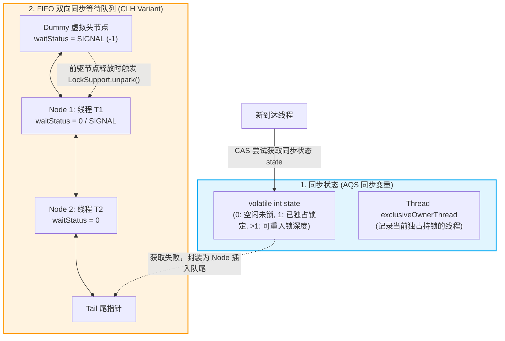
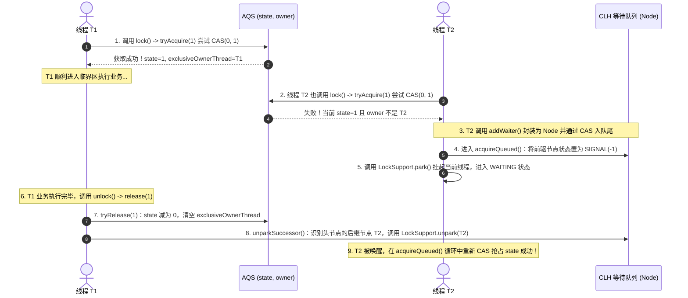

# 🏛️ 05 · AQS 原理（同步状态控制与 CLH 队列实现）

> **一句话导读**：AQS（`AbstractQueuedSynchronizer`）是 Java 并发包（J.U.C）的绝对核心底座。它通过一个由 `volatile` 修饰的整数 `state` 维护同步状态，结合 FIFO 双向变体 CLH 队列与底层 `LockSupport` 线程挂起唤醒机制，为 `ReentrantLock`、`CountDownLatch`、`Semaphore` 等提供了工业级的高性能同步抽象。

---

## 🏗️ 一、AQS 的技术本质与三大核心组件

### 1. 核心数据结构
AQS 内部通过模板方法设计模式（Template Method Pattern）构建，其核心状态与数据结构由三部分组成：



### 2. 三大核心技术组件
1. **`volatile int state`（同步状态变量）**：
   - 使用 `volatile` 修饰的 32 位整数，配合 CPU 级的 CAS 原语保证状态修改的内存可见性与原子性。
   - **独占模式（Exclusive，如 `ReentrantLock`）**：`state = 0` 表示资源未被占用；`state = 1` 表示已被某线程独占锁定；若同一线程再次获取该锁，`state` 递增累加（代表**可重入次数**），释放时相应递减，直至归零完全释放。
   - **共享模式（Shared，如 `Semaphore`、`CountDownLatch`）**：`state` 表示剩余可用的资源许可证数量，或倒计数计数器。
2. **`exclusiveOwnerThread`（独占锁持有线程引用）**：
   - 继承自 `AbstractOwnableSynchronizer`，记录当前持有独占锁的具体 `Thread` 实例。
   - 用于在发生并发加锁时校验当前线程是否为锁持有者（`Thread.currentThread() == getExclusiveOwnerThread()`），以决定是否允许重入或抛出非法释放异常。
3. **CLH 同步等待队列（FIFO 双向链表）**：
   - 当线程获取同步状态失败时，AQS 将该线程及等待状态封装为一个 **`Node` 节点**，通过 CAS 安全追加到队列尾部（Tail）。
   - 队列采用双向链表（含 `prev` 和 `next` 指针），头节点为不存储具体线程的**虚拟哨兵头节点（Dummy Head）**。
   - 阻塞挂起机制：排队线程通过 `LockSupport.park()` 挂起休眠（状态为 `WAITING`），让出 CPU 执行权；当持有锁的线程释放资源后，调用 `LockSupport.unpark()` 唤醒头节点的后继有效节点。

---

### 3. 场景演示：VIP 服务窗口运转模型

- **办事柜台占用状态（`volatile int state`）**：柜台空闲（`state = 0`）时任何人可直接办理；柜台被占（`state = 1`）时后续人员必须排队；同一人办连带业务则累加登记（可重入深度累加）；
- **柜台正在办理人姓名牌（`exclusiveOwnerThread`）**：记录当前持有独占锁的具体线程，重入时直接放行；
- **大厅候客长椅（CLH 双向同步队列）**：未能直接办上业务的人员被引导到长椅依序就座，避免在大厅无序乱转自旋消耗 CPU；
- **长椅最前端接待台（虚拟头节点 Dummy Head）**：作为哨兵导引标志，不对应实际办理人员；
- **排队人员闭目养神（`LockSupport.park()`）**：排队人员无需时刻盯着柜台，直接挂起休眠，等待前驱唤醒；
- **办完离场拍醒后排（`LockSupport.unpark()`）**：前排人员办理完毕离场时，负责唤醒后排相邻的一位人员接替办理。

---

## 🏃 三、核心执行流程：独占锁的获取与释放（以 ReentrantLock 为例）

### 1. 获取锁的完整时序与底层源码剖析
调用 `lock.lock()` 时，其内部调用的是 AQS 的模板方法 `acquire(int arg)`：

```java
// AQS 核心模板方法：acquire
public final void acquire(int arg) {
    if (!tryAcquire(arg) &&
        acquireQueued(addWaiter(Node.EXCLUSIVE), arg))
        selfInterrupt();
}
```

底层运行分步时序如下：



### 2. 深入细节：前驱节点的 `SIGNAL` 状态到底是干嘛的？
很多工程师在看 AQS 源码时困惑：**为什么当前节点休眠前，必须把前驱节点的 `waitStatus` 改成 `Node.SIGNAL`（-1）？**

- **技术原理解析**：
  - AQS 是双向链表。当一个节点即将调用 `LockSupport.park()` 进入深度休眠之前，必须确保未来有人能负责叫醒它。
  - AQS 的唤醒机制规定：**每个节点在释放锁时，只负责唤醒它紧邻的后继节点（`node.next`）**。
  - 因此，当前节点在休眠前，主动通过 `prev` 指针找到自己的前驱节点，用 CAS 将前驱的 `waitStatus` 设为 `SIGNAL`（相当于给前排打招呼：“你在前面办完释放锁的时候，务必负责唤醒我”）。
  - 如果设置失败（前驱节点已取消），当前节点会向前遍历剔除失效节点，直到找到有效的前驱重新挂载。

---

## ⚖️ 四、公平锁 vs 非公平锁：底层源码差异

在实例化 `ReentrantLock` 时，可通过构造参数指定策略：
- `new ReentrantLock(false)`：非公平锁（默认）；
- `new ReentrantLock(true)`：公平锁。

### 1. 源码关键差异
对比两者在 `tryAcquire(int acquires)` 中的核心判断：

```java
// 非公平锁实现：NonfairSync
final boolean nonfairTryAcquire(int acquires) {
    final Thread current = Thread.currentThread();
    int c = getState();
    if (c == 0) {
        // 🚨 只要 state 为 0，不管队列里有没有人在排队，直接强行插队 CAS 抢锁！
        if (compareAndSetState(0, acquires)) {
            setExclusiveOwnerThread(current);
            return true;
        }
    }
    // ... 可重入处理
}

// 公平锁实现：FairSync
protected final boolean tryAcquire(int acquires) {
    final Thread current = Thread.currentThread();
    int c = getState();
    if (c == 0) {
        // 🛡️ 抢锁前必须先调用 hasQueuedPredecessors() 查询前面是否有人排队！
        if (!hasQueuedPredecessors() &&
            compareAndSetState(0, acquires)) {
            setExclusiveOwnerThread(current);
            return true;
        }
    }
    // ... 可重入处理
}
```

### 2. 为什么非公平锁是生产默认选型？
- **非公平锁（Non-fair）的性能吞吐优势**：
  - 线程从操作系统内核态挂起（`park`）到被唤醒（`unpark`），存在**上下文切换与调度延迟**（通常需耗费数微秒）。
  - 在非公平锁模式下，当锁刚好被释放时，恰好有一个新进来的活跃线程正在 CPU 上运行。它不需要经历上下文切换，直接插队抢到锁并执行完毕。
  - 这种“趁热打铁”机制极大提高了系统的整体吞吐量（Throughput），因此生产环境默认使用非公平锁。
- **代价与风险**：排队在队列深处的线程可能会发生短暂的“线程饥饿（Starvation）”。若业务要求按严格请求时间顺序处理，则需指定公平锁。

---

## 🧠 一分钟复盘核心记忆卡

- **AQS 三基石**：`volatile int state`（同步状态） + `exclusiveOwnerThread`（持锁人引用） + FIFO 变体 CLH 双向同步队列。
- **休眠与唤醒**：底层使用 `LockSupport.park()`（挂起）与 `LockSupport.unpark(thread)`（唤醒），线程入队前驱打上 `SIGNAL` 标记。
- **公平与非公平本质**：公平锁在 CAS 抢锁前通过 `hasQueuedPredecessors()` 校验是否有人排队；非公平锁不管队列有无人，直接 CAS 插队。
- **独占与共享模式**：独占模式仅允许单线程持有（`ReentrantLock`），共享模式维护资源许可证倒计数（`CountDownLatch` / `Semaphore`）。

---

## 🔗 关联阅读

- [[06-ReentrantLock与读写锁|ReentrantLock 条件队列与锁机制]]
- [[07-线程池原理与参数|线程池调度流水线与生产调优]]
- [[12-JUC同步工具类|CountDownLatch、CyclicBarrier 与 Semaphore]]
- [[../10-知识串联与专题/01-JMM到JUC并发工具的完整链路|JMM 到 JUC 架构全链路串联]]
