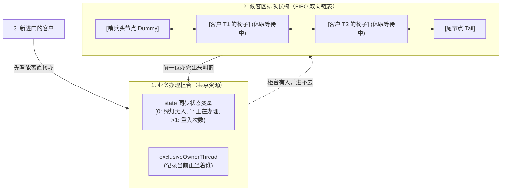
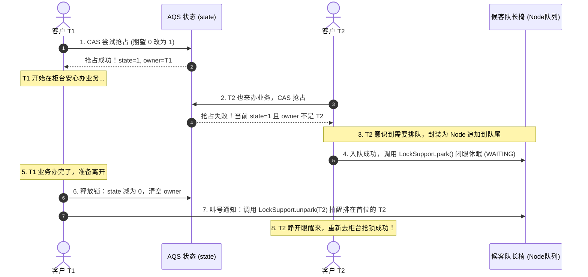
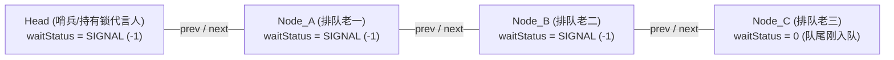
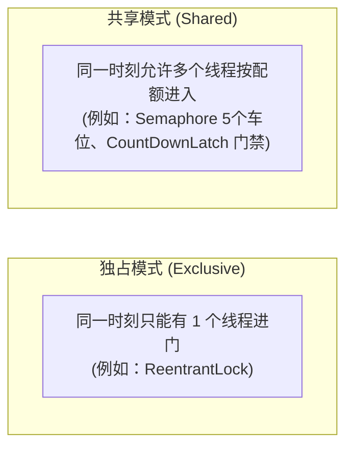

# 🏛️ 05 · AQS 原理（用银行大堂讲透 JUC 的心脏）

> **一句话导读**：AQS 听起来如同天书，但它的本质就是一家“配备了智能排队叫号系统的银行 VIP 大厅”**。搞懂了它，整个 JUC 包的底层逻辑就全部豁然开朗。

---

## 🏦 核心心智模型：银行 VIP 办事大厅

AQS 的全称是 `AbstractQueuedSynchronizer`（抽象队列同步器）。它是 `ReentrantLock`、`Semaphore`、`CountDownLatch` 等诸多 JUC 神器的核心底座。

如果脱离代码来看，AQS 的内部结构其实就是一家极具秩序的银行大厅：



### AQS 的三大核心组件（人话版）：

1. **`volatile int state`（柜台信号灯）**：
   - 用一个整数表示资源的占用情况。
   - 在独占锁（如 `ReentrantLock`）中：`0` 表示柜台空闲，`1` 表示有人正在办业务；如果同一位客户又办了其他业务，`state` 累加变成 `2`（**可重入次数**）。
2. **`exclusiveOwnerThread`（当前持锁人）**：
   - 柜台上挂的牌子，写着当前正在办业务的客户是谁（比如线程 T1）。
3. **CLH 双向链表队列（大厅的候客长椅）**：
   - 没抢到锁的线程怎么办？不可能让他们像无头苍蝇一样在柜台前自旋乱转（消耗 CPU）。
   - AQS 会把线程包装成一个 **`Node` 节点**，安排到大厅的长椅上老老实实坐下，然后调用 `LockSupport.park()` 让其**闭眼休眠**，等待前排的人办完后来叫醒自己。

---

## 🏃 走一遍完整流程：抢锁、排队与唤醒

让我们通过两个打工人 T1 和 T2 的行为，完整推演一次 AQS 的内部流转：



---

## ⚖️ 公平锁 vs 非公平锁：插队者的博弈

在 `new ReentrantLock(true)` 时是公平锁，默认 `new ReentrantLock()` 是非公平锁。它们的区别到底在哪？

### 1. 非公平锁（默认，高吞吐量）：
- **生活场景**：新来的客户刚推门进来，发现正好前一个人办完起身、柜台亮了绿灯（`state=0`）。**他不管长椅上排了多长的队伍，直接一步跨上去抢占柜台！**
- **为什么这么设计？** 因为把长椅上休眠的线程叫醒（操作系统上下文切换）需要耗费几微秒的时间。如果在这几微秒的空档期内，刚好有新来的活跃线程直接顺手把活干完了，整个系统的吞吐量就会大幅提升！
- **代价**：排在长椅上的倒霉蛋可能会被多次插队，产生短暂的“饥饿”。

### 2. 公平锁（先来后到）：
- **生活场景**：新来的客户推门进来，先转头看一眼候客区的长椅（调用 `hasQueuedPredecessors()` 方法）。
- **规则**：**只要长椅上有人在排队，就算当前柜台刚好空着，新客户也绝对不准抢，必须老老实实去长椅最后排队！**

---

## 💡 为什么 AQS 必须采用“双向链表”？

这是大厂高频面试题：“为什么普通的单向链表搞不定 AQS，非要用前后两个指针的双向链表？”

| 原因 | 深度剖析 |
| :--- | :--- |
| **1. 支持中途取消与超时放弃** | 如果某个排队的线程设置了 `tryLock(1, TimeUnit.SECONDS)` 超时，或者收到了 `interrupt()` 中断通知，**它必须从队伍中间退出**。单向链表若想摘除某个节点，必须从头节点 O(N) 挨个往后遍历才能找到它的前驱；而双向链表通过 `node.prev` 可以在 **O(1) 时间内直接定位前驱节点**，优雅出队！ |
| **2. 稳定高效的前向通知机制** | 采用**“链式唤醒责任制”**：队伍中**每个节点准备休眠（`park`）前，都会把它正前方紧挨着的那个节点（前驱 `prev`）的状态改成 `SIGNAL`**（相当于对前一个人说：“哥们，你办完离开时记得拍醒我”）。每个节点只用对自己的前驱交代，无需全局轮询。 |

### 🔍 深度拆解：什么是“前驱”？到底是谁把谁改成了 SIGNAL？

很多同学对“前驱”产生过误解：*“难道只有排在第一个的节点去把持有锁的节点改成 SIGNAL 吗？”*

**答案是：队伍里的每一个人，都在把紧挨着自己正前方的那个人改成 SIGNAL！**



1. **什么是“前驱（Predecessor）”？**
   - 在双向链表里，对于任何一个节点 `Node`，**紧排在它正前方的那个节点就是它的前驱（`node.prev`）**，紧排在它正后方的就是它的后继（`node.next`）。
   - **Node_C 的前驱是 Node_B**；**Node_B 的前驱是 Node_A**；**Node_A 的前驱是 Head（哨兵头节点）**。
2. **谁把谁改成了 `SIGNAL`？（多米诺骨牌式的交代）**：
   - **Node_A 入队准备闭眼睡觉前**：它抓住自己的前驱 `Head`，把 `Head` 改成 `SIGNAL`（交代 Head：“等持有锁的线程办完离开，叫醒我 Node_A”）；
   - **Node_B 入队准备闭眼睡觉前**：它抓住自己的前驱 `Node_A`，把 `Node_A` 改成 `SIGNAL`（交代 Node_A：“未来等你拿到锁、办完离开时，叫醒我 Node_B”）；
   - **Node_C 入队准备闭眼睡觉前**：它抓住自己的前驱 `Node_B`，把 `Node_B` 改成 `SIGNAL`（交代 Node_B：“未来等你办完离开时，叫醒我 Node_C”）。
3. **连锁唤醒过程**：
   - 当前持有锁的线程释放锁时，查看 `Head.waitStatus == SIGNAL`，于是调用 `unpark` **叫醒排第一的 Node_A**；
   - Node_A 醒来抢到锁，**Node_A 变成新的 Head**；
   - 等 Node_A 未来办完释放锁时，查看自己的状态是 `SIGNAL`，就会顺理成章去叫醒它的后继 **Node_B**！
   - **这就是 AQS 最精妙的“链式责任制”：每个人只盯紧自己前面的人，层层交接，秩序井然！**

---

## 🎭 独占模式 vs 共享模式

AQS 是一个极具扩展性的模板模式（Template Pattern）框架，它支持两种核心资源的争夺方式：



- **独占模式**：子类重写 `tryAcquire(int)` 和 `tryRelease(int)`。别人进了你就得等。
- **共享模式**：子类重写 `tryAcquireShared(int)` 和 `tryReleaseShared(int)`。
  - 每次获取成功后，如果发现 `state` 还有剩余配额，它不仅自己进去，还会**顺手传播唤醒（`doReleaseShared`）后面的同伴一起进去**！

---

## 💻 极简代码看懂 AQS 的状态流动

保存为 `AqsStateWalkDemo.java`：

```java
import java.util.concurrent.locks.ReentrantLock;

public class AqsStateWalkDemo {
    public static void main(String[] args) {
        ReentrantLock lock = new ReentrantLock();

        System.out.println("1. 初始状态：没人持锁，isLocked=" + lock.isLocked());

        lock.lock(); // 第一次加锁：state 变为 1
        try {
            System.out.println("2. T1 第一次拿锁：isLocked=" + lock.isLocked() + "，重入次数=" + lock.getHoldCount());
            
            lock.lock(); // 第二次重入加锁：state 累加为 2
            try {
                System.out.println("3. T1 再次重入：重入次数=" + lock.getHoldCount());
            } finally {
                lock.unlock(); // 释放一次：state 递减为 1
            }

            System.out.println("4. 释放一次后：依然处于锁定状态，重入次数=" + lock.getHoldCount());
        } finally {
            lock.unlock(); // 完全释放：state 归零，唤醒等待队列
        }

        System.out.println("5. 完全释放后：isLocked=" + lock.isLocked());
    }
}
```

**控制台输出：**
```text
1. 初始状态：没人持锁，isLocked=false
2. T1 第一次拿锁：isLocked=true，重入次数=1
3. T1 再次重入：重入次数=2
4. 释放一次后：依然处于锁定状态，重入次数=1
5. 完全释放后：isLocked=false
```

---

## 🧠 一分钟复盘核心记忆卡

- **核心骨架**：`state` 整数状态 + `Node` 双向等待队列 + `LockSupport.park/unpark` 线程休眠唤醒。
- **加锁主线**：尝试修改 state -> 成功则登记 owner -> 失败则包装成 Node 挂入队尾 -> 调用 park() 睡觉。
- **解锁主线**：修改 state 减计数 -> 归零则释放 owner -> 找到队列首位有效等待节点 -> 调用 unpark() 叫醒。

---

## 🧭 下一步

搞懂了 AQS 这套底层排队引擎，我们就可以来看看基于它打造的最强主力锁——**`ReentrantLock`**，以及在高频读场景下性能卓越的**读写锁**。
请进入下一篇：[[06-ReentrantLock与读写锁]]！
