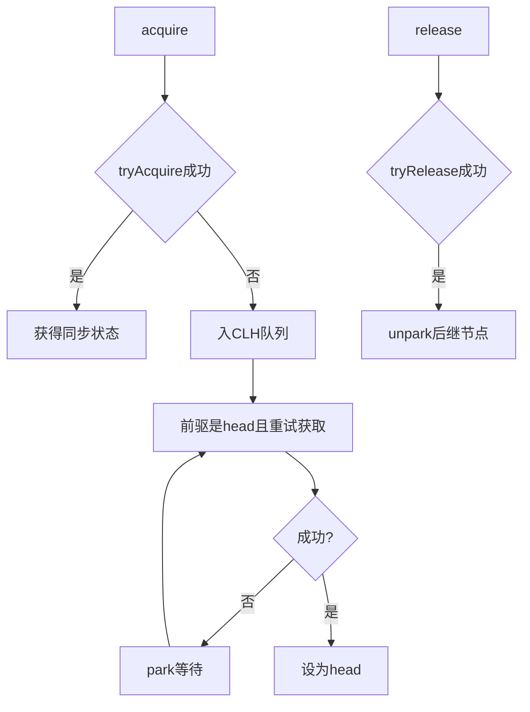

# AQS原理

> [!abstract] 一句话总结
> AQS 用一个 volatile state 和 CLH 等待队列抽象同步器，是 ReentrantLock、Semaphore、CountDownLatch 的源码底座。

## 📌 这是什么

- AQS 全称 AbstractQueuedSynchronizer，子类通过 tryAcquire/tryRelease 等方法定义获取和释放语义。
- state 表示同步状态，含义由子类决定，例如锁重入次数、许可数、倒计数。
- 获取失败的线程进入 FIFO 等待队列，并通过 LockSupport.park 挂起。

## 🤔 解决什么问题 / 为什么需要

- 读懂 JUC 锁、门闩、信号量、读写锁的共同模型。
- 解释公平锁/非公平锁、可中断获取、超时获取和 Condition。
- 面试常要求画出 AQS acquire/release 流程。

## 🧩 核心概念

| 概念 | 含义 | 精通要点 |
| ---- | ---- | -------- |
| state | volatile int 同步状态。 | 通过 CAS 修改。 |
| CLH 队列 | 等待线程组成的双向队列。 | 节点保存线程、等待状态和前后驱。 |
| 独占/共享 | 独占一次只有一个线程成功，共享可多个线程成功。 | Lock 独占，Semaphore/CountDownLatch 共享。 |
| ConditionObject | 条件队列。 | await 释放锁并等待 signal 转移。 |

## ⚙️ 工作原理 / 流程



## 🔍 源码 / 原理深挖

- acquire 会先 tryAcquire，失败后 addWaiter 入队，再 acquireQueued 自旋/挂起。
- release 会调用 tryRelease，完全释放后唤醒 head 后继节点。
- ReentrantLock.Sync 继承 AQS，NonfairSync/FairSync 只是在抢锁时是否检查队列前驱不同。

## 💻 代码实践 / 排查命令

```java
class OneShotLatch {
    private final Sync sync = new Sync();
    void await() { sync.acquireShared(1); }
    void signal() { sync.releaseShared(1); }

    static class Sync extends AbstractQueuedSynchronizer {
        protected int tryAcquireShared(int arg) {
            return getState() == 1 ? 1 : -1;
        }
        protected boolean tryReleaseShared(int arg) {
            setState(1);
            return true;
        }
    }
}
```

## 🛠️ 排查 / 实践要点

- 排查锁等待：jstack 看 LockSupport.park 和 AbstractQueuedSynchronizer 栈。
- 公平锁吞吐通常低于非公平锁，但可降低饥饿风险。
- Condition await 必须在持锁状态调用，signal 后线程还要重新竞争锁。

## ⚠️ 踩坑与注意事项

- 把 AQS 队列理解成操作系统锁队列，忽略 Java 层节点状态和 park/unpark。
- signal 后以为等待线程立即执行，实际只是转移/唤醒，仍需重新获得锁。
- 自定义同步器 tryRelease 未正确返回完全释放状态。

## 🎯 面试问题

> [!question] 高频问题
> - Q: AQS 核心是什么？
>   - A: 一个 volatile state 表示同步状态，一个 CLH 等待队列管理获取失败的线程，子类实现 tryAcquire/tryRelease 定义具体语义。
> - Q: AQS 获取锁失败后做什么？
>   - A: 线程封装成 Node 入队，在前驱为 head 时重试获取，仍失败则通过 LockSupport.park 挂起，释放时由前驱唤醒。
> - Q: 公平锁和非公平锁区别？
>   - A: 公平锁抢锁前检查队列中是否有前驱，非公平锁允许新线程先 CAS 抢 state，因此吞吐更高但可能不公平。

## 🧭 源码入口速查

- `AbstractQueuedSynchronizer#acquire`：独占获取主入口，先尝试，再入队，再 park。
- `addWaiter`、`enq`、`acquireQueued`：CLH 队列入队、自旋、挂起的关键路径。
- `release`、`unparkSuccessor`：释放同步状态并唤醒后继。
- `acquireShared/releaseShared`：CountDownLatch、Semaphore、读锁等共享模式入口。
- `ConditionObject#await/signal`：条件队列和同步队列之间的节点转移。

## 🧪 最小验证

```java
ReentrantLock lock = new ReentrantLock(true);
lock.lock();
try {
    // 让其他线程阻塞后 jstack，可看到 AbstractQueuedSynchronizer.acquire 栈
} finally {
    lock.unlock();
}
```

AQS 排障看两类栈：线程是否 park 在 AQS 队列里，持锁线程在做什么。只看到很多线程 WAITING 不代表 AQS 有问题，真正要找的是哪个业务线程长时间持有 state 或 signal 条件遗漏。

## ✅ 精通检查清单

- 能用自己的话讲清本主题解决的问题和适用边界。
- 能指出至少 2 个源码入口或底层机制。
- 能给出一个最小代码示例或一组线上排查命令。
- 能回答本页列出的高频面试题，并补充项目中的真实取舍。

## 🔗 关联笔记

- [[_index]]

## 📚 参考资料

- [Dev.java Tutorials](https://dev.java/learn/)
- [Oracle Java Documentation](https://docs.oracle.com/en/java/)
