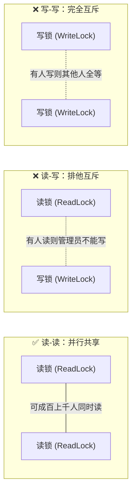

# 🚪 06 · ReentrantLock 与读写锁（高级锁门艺术与读写分离）

> **一句话导读**：如果说 `synchronized` 是传统的机械挂锁，那么 `ReentrantLock` 就是全功能的“智能电子门禁”**——它不仅能限时等候、随时响应警报，还支持“大家一起看书、一人修改清场”的高性能读写分离！

---

## 🤔 灵魂拷问：有了 synchronized，为什么还要 ReentrantLock？

Java 官方早就自带了语言级的 `synchronized` 关键字，为什么 JUC 还要大费周章搞出一个 `ReentrantLock` 显式锁？

因为机械挂锁（`synchronized`）在复杂商业实战中有三大**致命软肋**：

| 业务痛点 | `synchronized` 的尴尬 | `ReentrantLock` 的解法 |
| :--- | :--- | :--- |
| **1. 想要超时放弃，避免死等卡死** | ❌ **无法设置超时**。拿不到锁就一直死等（BLOCKED），在微服务高并发下很容易拖垮线程池造成雪崩。 | ✅ **`tryLock(timeout, unit)`**：最多等 3 秒，等不到我就放弃，降级走兜底逻辑！ |
| **2. 想要响应外部中断** | ❌ **死等期间对中断免疫**。外面怎么叫喊，它都在死等锁，关都关不掉。 | ✅ **`lockInterruptibly()`**：等锁期间如果收到催退的中断信号，立刻放弃等待撤退。 |
| **3. 想要公平先来后到** | ❌ **无法指定**，完全是非公平竞争。 | ✅ **`new ReentrantLock(true)`**：支持配置公平锁。 |
| **4. 读多写少的高并发优化** | ❌ **一刀切互斥**。读操作也要排队。 | ✅ **读写分离锁 `ReentrantReadWriteLock`**：读读并行，吞吐量翻倍！ |

---

## 🛠️ ReentrantLock 标准代码模板与避坑军规

`ReentrantLock` 属于显式锁，必须手动加锁、手动释放。

```java
import java.util.concurrent.locks.ReentrantLock;

public class LockTemplateDemo {
    private final ReentrantLock lock = new ReentrantLock();

    public void doBusiness() {
        // 🚨 避坑军规 1：加锁必须写在 try 的外面一行！
        lock.lock(); 
        try {
            // 核心临界区业务逻辑
            System.out.println("安全执行业务操作...");
        } finally {
            // 🚨 避坑军规 2：释放锁必须写在 finally 的第一行！
            lock.unlock(); 
        }
    }
}
```

> [!CAUTION]
> **为什么加锁严禁写在 `try` 块内部？（3 步连环翻车剖析）**
> 
> ```java
> try {
>     lock.lock(); // 💥 假设在这里发生异常（如 OOM、被中断、或前置代码抛异常）
>     doBusiness();
> } finally {
>     lock.unlock(); // 🚨 此时根本未加锁成功，强行 unlock 触发连环车祸！
> }
> ```
> 
> 1. **finally 强制执行**：根据 JVM 规范铁律，只要代码一踏进 `try` 块，无论里面抛出任何异常，`finally` 块都必须被无条件强制执行。
> 2. **未持锁强行释放**：当前线程加锁失败，根本不是锁的主人；此时强行调用 `unlock()`，底层校验失败会当场抛出全新异常：`IllegalMonitorStateException`（非法监视器状态异常）。
> 3. **致命异常覆盖**：在 Java 异常处理机制中，`finally` 块抛出的新异常会**彻底吞没、掩盖掉 `try` 块原本抛出的真实元凶异常**！最终日志里只有误导性的“非法锁状态”，线上原本真正致命的 OOM 或业务空指针被彻底抹杀，导致排障直接陷入死胡同！

---

## ⏱️ 四大加锁姿势：总有一款适合你的业务

| 加锁方法 | 大白话解释 | 核心应用场景 |
| :--- | :--- | :--- |
| **`lock()`** | 不拿到锁誓不罢休，死等到底 | 普通关键业务，必须确保执行 |
| **`tryLock()`** | 探头看一眼，能拿就拿，拿不到立刻转头走（毫秒都不等） | 避免重复执行的定时任务、防并发防刷 |
| **`tryLock(time, unit)`** | 蹲守等待指定时长，超时还没开门就转头走 | 微服务接口调用，设置 SLA 超时兜底 |
| **`lockInterruptibly()`** | 允许在等锁过程中被催命中断打断 | 支持可取消的长事务任务 |

### 实战演示：超时放弃（避免系统雪崩）

```java
import java.util.concurrent.TimeUnit;
import java.util.concurrent.locks.ReentrantLock;

public class TryLockTimeoutDemo {
    private static final ReentrantLock lock = new ReentrantLock();

    public static void main(String[] args) throws InterruptedException {
        // 线程 1 长期霸占锁
        Thread t1 = new Thread(() -> {
            lock.lock();
            try {
                System.out.println("线程 1：我拿到锁了，故意睡 3 秒...");
                Thread.sleep(3000);
            } catch (InterruptedException e) {
                Thread.currentThread().interrupt();
            } finally {
                lock.unlock();
                System.out.println("线程 1：释放锁。");
            }
        });

        // 线程 2 只愿意等 1 秒
        Thread t2 = new Thread(() -> {
            try {
                Thread.sleep(100); // 确保 t1 先拿到锁
                System.out.println("线程 2：尝试拿锁，最多等 1 秒...");
                if (lock.tryLock(1, TimeUnit.SECONDS)) {
                    try {
                        System.out.println("线程 2：侥幸抢到锁！");
                    } finally {
                        lock.unlock();
                    }
                } else {
                    System.out.println("线程 2：超时了！我不等了，去走降级兜底业务！");
                }
            } catch (InterruptedException e) {
                Thread.currentThread().interrupt();
            }
        });

        t1.start();
        t2.start();
        t1.join();
        t2.join();
    }
}
```

**运行输出：**
```text
线程 1：我拿到锁了，故意睡 3 秒...
线程 2：尝试拿锁，最多等 1 秒...
线程 2：超时了！我不等了，去走降级兜底业务！
线程 1：释放锁。
```

---

## 📖 读写锁（ReentrantReadWriteLock）：图书馆借阅哲学

在真实的电商系统或社交软件中，**90% 以上的请求都是“只读”请求**（看商品详情、看文章），修改写操作只占极少数。
如果用普通的独占排他锁，读与读之间也要排队，吞吐量直接惨遭腰斩！

为了解决这个问题，`ReentrantReadWriteLock` 奉上了**读写分离锁**：



> 💡 **核心口诀**：
> - **读-读共享**：大家只是在图书馆安静看书，互不打扰，几百个人可以同时进来看（共享锁）。
> - **读-写互斥**：有人在看书，管理员就不能把书抽走涂改；管理员在修书时，任何人不得进来看。
> - **写-写互斥**：两个管理员不能同时修同一本书，必须一个修完另一个再修（独占锁）。

### 读写锁实战代码

```java
import java.util.concurrent.locks.ReentrantReadWriteLock;

public class ReadWriteCacheDemo {
    private final ReentrantReadWriteLock rwLock = new ReentrantReadWriteLock();
    private final ReentrantReadWriteLock.ReadLock readLock = rwLock.readLock();
    private final ReentrantReadWriteLock.WriteLock writeLock = rwLock.writeLock();
    
    private String cacheData = "初始默认数据";

    // 读数据：读锁保护，允许多线程并发读
    public String read() {
        readLock.lock();
        try {
            System.out.println(Thread.currentThread().getName() + " 正在读取: " + cacheData);
            return cacheData;
        } finally {
            readLock.unlock();
        }
    }

    // 写数据：写锁独占保护，同一时刻只允许一人写
    public void write(String newData) {
        writeLock.lock();
        try {
            System.out.println(Thread.currentThread().getName() + " 开始写入新数据: " + newData);
            this.cacheData = newData;
        } finally {
            writeLock.unlock();
        }
    }
}
```

---

## ⚠️ 读写锁的高级陷阱：锁降级与锁升级

这是大厂面试的经典连环追问：

### 1. 锁降级（允许并且推荐）：
- **定义**：持有了**写锁**的线程，在没有释放写锁之前，**先获取读锁**，然后再释放写锁。
- **目的**：确保自己写完的数据在释放写锁后，依然能被自己持续读取，期间绝不被其他写线程篡改！

```java
writeLock.lock(); // 1. 拿写锁
try {
    // 业务修改
    data = "新数据";
    
    readLock.lock(); // 2. 降级：在持写锁期间拿读锁
} finally {
    writeLock.unlock(); // 3. 释放写锁（此时仍持有读锁）
}

try {
    // 4. 继续安全地使用数据
    System.out.println("使用刚写完的数据：" + data);
} finally {
    readLock.unlock(); // 5. 最后释放读锁
}
```

### 2. 锁升级（绝对禁止！）：
- **定义**：持有了**读锁**的线程，直接尝试去拿**写锁**。
- **后果**：**直接引发死锁！**
  - 想象一下：两个线程同时持有读锁，都在等对方把读锁释放掉好让自己拿到写锁，结果谁也不让谁，系统永久卡死！
  - 因此 Java 的 `ReentrantReadWriteLock` **明确不支持锁升级**。

---

## 🚀 性能天花板：StampedLock 乐观读

读写锁虽好，但在极高频读的场景下，大量读锁可能会把写线程“活活饿死”（写线程一直拿不到锁）。
Java 8 引入了 **`StampedLock`**，它支持**乐观读（Optimistic Read）**：
- 读的时候**完全不上锁**，只是记录一个戳记（Stamp）；
- 读完之后校验一下戳记有没有被写线程改动过（`validate(stamp)`）；
- 如果没改动过，直接用数据（零锁开销，性能堪比原子变量！）；
- 如果被改动了，再退化成悲观读锁重新读。

---

## 🧠 一分钟复盘记忆卡

1. **选型决策树**：
   - 简单并发场景、代码要求极致简洁：优先选 `synchronized`（现代 JVM 优化得非常快）。
   - 需要超时放弃、响应中断、公平策略：选 `ReentrantLock`。
   - 极高比例的读多写少场景：选 `ReentrantReadWriteLock` 或 `StampedLock`。
2. **铁律**：`lock()` 写在 `try` 外面，`unlock()` 写在 `finally` 里面！

---

## 🧭 下一步

单靠锁只能解决“排队独占”的问题。如果一个线程拿到了锁，但发现条件不满足（比如队列是空的，没法取数据），它该怎么把锁让出来、怎么去通知别人呢？
请进入下一篇：[[13-线程协作与阻塞队列]]！
