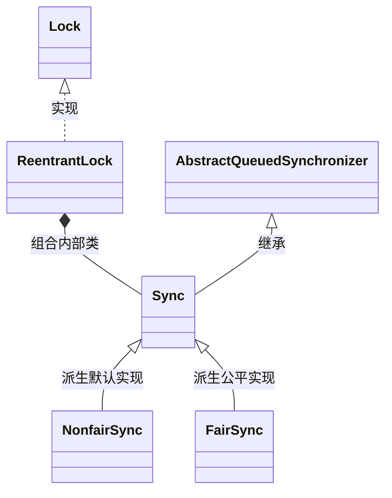

# 06 · ReentrantLock 与读写锁底层原理与实战规范

> **导读**：虽然 Java 原生提供了语言级的 `synchronized` 关键字，但在复杂工业级并发系统中，其不支持超时等待、不可响应中断及无法读写分离等局限性尤为突出。基于 AQS 框架构建的 `ReentrantLock` 与 `ReentrantReadWriteLock` 提供了高度灵活的显式锁控制。本文从 AQS 状态位切分、四种加锁语义时序、锁降级内存保障，到 `StampedLock` 乐观读机制，进行全方位的技术解析与避坑剖析。

---

## 一、显式锁演进背景与核心能力对比

### 1. 原生 `synchronized` 与 `ReentrantLock` 深度能力矩阵

| 对比维度 | `synchronized`（内置监视器锁） | `ReentrantLock`（显式锁） |
| :--- | :--- | :--- |
| **底层实现机制** | JVM 字节码层面（`monitorenter`/`monitorexit`），依赖 HotSpot `ObjectMonitor` | Java API 层面，基于 AQS 框架与 CAS 原语实现 |
| **锁释放机制** | JVM 自动释放（无论正常退出或异常抛出均由异常表保证） | 必须在 `finally` 块中显式手动调用 `unlock()`，否则引发锁泄露 |
| **等待响应中断** | ❌ **不支持**（线程在阻塞等待锁期间对 `Thread.interrupt()` 免疫） | ✅ **完全支持**（`lockInterruptibly()` 可在等待中响应中断退出排队） |
| **超时获取能力** | ❌ **不支持**（获取不到锁只能无限期阻塞，易引发线程池雪崩） | ✅ **完全支持**（`tryLock(timeout, unit)` 具备限时轮询与降级兜底能力） |
| **调度公平性** | ❌ **仅支持非公平锁** | ✅ **支持公平锁与非公平锁**（构造函数传入 `boolean fair`） |
| **条件等待队列** | 仅支持单一内置等待队列（`wait()` / `notify()`） | 支持通过 `newCondition()` 绑定多个独立的条件队列（精细化定向唤醒） |

---

## 二、ReentrantLock 架构与加锁机制

`ReentrantLock` 内部定义了抽象静态内部类 `Sync`（继承自 AQS），并分别派生出 `NonfairSync`（非公平同步器）与 `FairSync`（公平同步器）。



### 1. 四大加锁 API 语义与底层行为

| 加锁方法 | 底层 AQS 调度行为 | 线程状态与中断反应 | 生产适用场景 |
| :--- | :--- | :--- | :--- |
| **`lock()`** | 调用 `acquire(1)`。获取失败则将线程打包入队，阻塞挂起。 | 挂起期间忽略中断信号，仅记录中断状态，直到成功获取锁后返回。 | 必须保证串行处理的核心交易业务链路。 |
| **`tryLock()`** | 直接执行一次非公平的 `tryAcquire(1)`。 | **零阻塞**，无论成功失败瞬间返回 `boolean`。 | 避免重复触发的定时任务调度、接口防重幂等校验。 |
| **`tryLock(time, unit)`** | 调用 `doAcquireNanos(1, nanosTimeout)`。进入超时等待自旋。 | 在限定时限内挂起等待，若超时未获锁返回 `false`；等待中收到中断立即抛出 `InterruptedException`。 | 存在强 SLA 耗时保护的分布式或微服务调用链路。 |
| **`lockInterruptibly()`** | 调用 `acquireInterruptibly(1)`。 | 阻塞等待锁期间，一旦检测到线程中断标志位，立即退出同步队列并抛出 `InterruptedException`。 | 支持外部优雅取消的长时间批处理任务、防范死锁链条。 |

### 2. 标准编码规范与连环翻车根因分析

```java
import java.util.concurrent.locks.ReentrantLock;

public class StandardLockPattern {
    private final ReentrantLock lock = new ReentrantLock();

    public void executeBusiness() {
        // 🚨 铁律一：加锁操作必须紧贴在 try 块外部紧邻上一行！
        lock.lock();
        try {
            // 临界区业务逻辑
        } finally {
            // 🚨 铁律二：解锁操作必须写在 finally 块的第一行！
            lock.unlock();
        }
    }
}
```

> [!CAUTION] 深度剖析：为什么 `lock.lock()` 严禁放入 `try` 块内？
> 
> ```java
> try {
>     lock.lock(); // 💥 假设在此处发生异常（如 OOM、类加载错误或由于前置语句抛出异常）
>     doBusiness();
> } finally {
>     lock.unlock(); // 此时线程并未真正持有锁，强行触发 unlock！
> }
> ```
> 
> 底层连环翻车的三重连锁反应：
> 1. **JVM 规范保证 finally 必定执行**：无论 `try` 块内因何种异常退出，程序计数器均强行跳转至 `finally` 对应的字节码段。
> 2. **未持锁抛出新异常**：当前线程未成功获取锁，AQS 状态校验不通过，`unlock()` 内部直接抛出 `IllegalMonitorStateException`（非法监视器状态异常）。
> 3. **原始真凶异常被掩盖**：在 Java 异常抛出模型中，`finally` 块中产生的异常会**覆盖并吞没** `try` 块原本抛出的原始异常。运维监控与错误日志中仅能看到误导性的 `IllegalMonitorStateException`，原本致命的内存溢出（OOM）或配置异常被彻底隐藏，排障成本呈几何级数增加。

---

## 三、ReentrantReadWriteLock（读写分离锁）深度剖析

在绝大多数互联网业务场景中（如商品详情页浏览、论坛文章查阅），读操作与写操作的比例通常高达 10:1 甚至 100:1。若使用传统独占锁，读读互斥会造成极大的算力浪费。

### 1. 读写状态的高低 16 位切分（State Bit Slicing）
AQS 内部仅使用一个 32 位的整型变量 `state` 来维护同步状态。`ReentrantReadWriteLock` 通过巧妙的**按位切割（Bit Slicing）**，仅凭一个整数同时承载读锁与写锁状态：

```
00000000 00000010  |  00000000 00000001
[ 高 16 位：读锁持有总计数 ]  |  [ 低 16 位：写锁重入计数 ]
```

```java
// 读写锁同步器源码位运算实现
abstract static class Sync extends AbstractQueuedSynchronizer {
    static final int SHARED_SHIFT   = 16;
    static final int SHARED_UNIT    = (1 << SHARED_SHIFT);
    static final int MAX_COUNT      = (1 << SHARED_SHIFT) - 1; // 65535
    static final int EXCLUSIVE_MASK = (1 << SHARED_SHIFT) - 1; // 0x0000FFFF

    // 获取读锁持有次数（无符号右移 16 位，截取高 16 位）
    static int sharedCount(int c)    { return c >>> SHARED_SHIFT; }
    
    // 获取写锁重入次数（低 16 位按位与掩码）
    static int exclusiveCount(int c) { return c & EXCLUSIVE_MASK; }
}
```

### 2. 读写互斥规则矩阵

| 当前已持有的锁类型 | 后续请求：读锁（ReadLock） | 后续请求：写锁（WriteLock） |
| :--- | :--- | :--- |
| **无锁状态** | ✅ 立即获取（共享模式） | ✅ 立即获取（独占模式） |
| **已被持有读锁（共享）** | ✅ **共享并行**（读读兼容，高 16 位计数累加） | ❌ **排他阻塞**（读写互斥，写线程挂起排队） |
| **已被持有写锁（独占）** | ❌ **排他阻塞**（写读互斥，禁止脏读） | ❌ **排他阻塞**（写写互斥，禁止并发修改） |

### 3. 写线程防饥饿机制
在非公平模式下，为了防止源源不断的读请求持续获取读锁而导致写线程永久处于等待状态（**写饥饿 / Write Starvation**）：
- 当读线程尝试获取读锁时，底层会调用 `apparentlyFirstQueuedIsExclusive()` 检查；
- **如果同步队列中第一个排队的等待节点是写线程（独占模式），则当前后续申请读锁的线程必须停止插队、主动进入队列排队**，优先让写锁得到执行机会。

---

## 四、高级特性与陷阱：锁降级 vs 锁升级

### 1. 锁降级（Lock Downgrading）：完全支持且推荐
- **定义**：同一个线程在持有**写锁**的前提下，**先获取读锁**，随后**释放写锁**的过程。
- **技术必要性**：确保写操作对后续读逻辑的绝对可见性，并防止在释放写锁与申请读锁的间隙被其他并发写线程切入篡改数据。

```java
public void processCachedData() {
    rwLock.readLock().lock();
    if (!cacheValid) {
        // 必须先释放读锁，才能获取写锁
        rwLock.readLock().unlock();
        rwLock.writeLock().lock();
        try {
            if (!cacheValid) { // 双重检查
                data = modifyData();
                cacheValid = true;
            }
            // 🌟 核心步骤：在持有写锁时直接获取读锁（锁降级）
            rwLock.readLock().lock();
        } finally {
            // 释放写锁，此时当前线程依然持有读锁，其他写线程无法切入
            rwLock.writeLock().unlock();
        }
    }

    try {
        useData(data); // 此时处于读锁安全保护下
    } finally {
        rwLock.readLock().unlock();
    }
}
```

### 2. 锁升级（Lock Upgrading）：明确禁止（避免死锁）
- **定义**：线程在持有**读锁**的状态下，不释放读锁直接尝试获取**写锁**。
- **底层死锁模型**：若两个并发线程 T1 和 T2 同时持有读锁，随后两者均执行 `writeLock.lock()`。T1 等待 T2 释放读锁才能拿写锁，T2 也在等待 T1 释放读锁才能拿写锁。双方互相等待对方释放资源，形成环路等待，**必然导致系统永久死锁**。因此，`ReentrantReadWriteLock` 在底层机制上直接禁止锁升级。

---

## 五、StampedLock 乐观读：突破读写锁吞吐瓶颈

Java 8 引入了 `StampedLock`，其核心突破在于提供了**乐观读模式（Optimistic Reading）**：
- **乐观读不加锁**：获取乐观读戳记（Stamp）时完全不修改任何内存状态位，零 CAS 开销，写线程完全无需阻塞；
- **读后校验**：数据读取完成后，调用 `validate(stamp)` 校验读取期间是否有写线程进入并篡改数据。若无改动直接使用；若已被篡改，再升级为悲观读锁重新加载。

```java
import java.util.concurrent.locks.StampedLock;

public class PointOptimisticRead {
    private double x, y;
    private final StampedLock sl = new StampedLock();

    public double distanceFromOrigin() {
        // 1. 获取乐观读版本戳记（零锁开销）
        long stamp = sl.tryOptimisticRead();
        double currentX = x, currentY = y;

        // 2. 校验在读取变量期间，是否有写锁介入
        if (!sl.validate(stamp)) {
            // 3. 校验失败，说明数据已被篡改，升级为悲观读锁
            stamp = sl.readLock();
            try {
                currentX = x;
                currentY = y;
            } finally {
                sl.unlockRead(stamp);
            }
        }
        return Math.sqrt(currentX * currentX + currentY * currentY);
    }
}
```

---

### 场景演示：档案阅览与调度响应

- **多名读者同时翻看古籍（共享读锁 `ReadLock`）**：读者只看不改，成百上千人可并行阅读（AQS 读锁计数累加）；
- **修复师清场修补古籍（独占写锁 `WriteLock`）**：修书时排他互斥，所有人必须退出等待，且同一时刻仅允许一人动笔（AQS 写锁独占）；
- **修好页面按住书放读者进（锁降级 Lock Downgrading）**：修补完成后，在未释放写锁之前直接加读锁，再释放写锁，确保刚修好的页面对读者立即可见且中途不被其他写者插足；
- **限时等候批复（带超时加锁 `tryLock(time, unit)`）**：工区调度申请总闸权限，最多等待 10 分钟，超时拿不到锁立即执行降级兜底；
- **遇险紧急撤退（可中断加锁 `lockInterruptibly()`）**：等锁期间收到外部撤离中断信号，立刻停止排队并抛出中断异常退出。

---

## 🧭 下一步

通过 `ReentrantLock` 和读写锁，我们实现了复杂的单资源互斥与共享访问控制。
然而，在分布式或多线程协同批处理系统中，我们常常需要解决多线程之间的“集结等待”、“令牌限流”与“栅栏同步”等协作问题。
JUC 基于 AQS 共享模式衍生出了强大的同步工具类家族。
请进入下一篇：[[12-JUC同步工具类]]！
