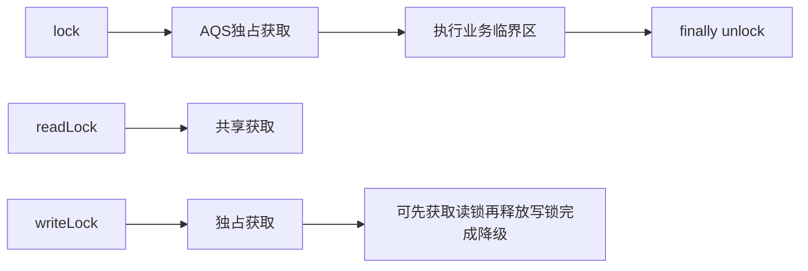

# ReentrantLock与读写锁

> [!abstract] 一句话总结
> ReentrantLock 提供比 synchronized 更灵活的显式锁能力，读写锁通过共享读和独占写优化读多写少场景。

## 📌 这是什么

- ReentrantLock 基于 AQS，支持可中断、超时、公平/非公平和多个 Condition。
- ReentrantReadWriteLock 读锁共享、写锁独占，适合读多写少且临界区较长的场景。
- 显式锁必须在 finally 中释放。

## 🤔 解决什么问题 / 为什么需要

- 需要 tryLock、lockInterruptibly、多条件队列时 synchronized 不够灵活。
- 读多写少缓存、配置、路由表等场景可用读写锁提高并发读。
- 理解锁降级、锁升级风险和公平策略。

## 🧩 核心概念

| 概念 | 含义 | 精通要点 |
| ---- | ---- | -------- |
| 可重入 | 同一线程重复获取锁，state 递增。 | 释放次数必须匹配。 |
| 公平锁 | 按队列先后获取。 | 减少饥饿，牺牲吞吐。 |
| Condition | 一把锁可创建多个等待条件。 | 比 Object wait/notify 更细粒度。 |
| 读写锁 | 读读共享，读写/写写互斥。 | 写锁可降级为读锁，读锁升级写锁易死锁。 |

## ⚙️ 工作原理 / 流程



## 🔍 源码 / 原理深挖

- ReentrantLock 默认非公平，构造参数 true 可启用公平锁。
- ReentrantReadWriteLock 用 AQS state 的高 16 位表示读计数，低 16 位表示写重入计数。
- ConditionObject await 会释放当前锁状态，signal 后进入同步队列重新抢锁。

## 💻 代码实践 / 排查命令

```java
private final ReentrantLock lock = new ReentrantLock();

void update() throws InterruptedException {
    if (lock.tryLock(100, TimeUnit.MILLISECONDS)) {
        try {
            mutateSharedState();
        } finally {
            lock.unlock();
        }
    }
}
```

## 🛠️ 排查 / 实践要点

- 接口超时敏感场景用 tryLock(timeout) 失败后降级，避免无限等待。
- 读写锁要压测读写比例，写多或临界区很短时可能不如普通锁。
- 线程栈中看到 ReentrantLock 等待，结合锁持有线程和业务调用链缩小临界区。

## ⚠️ 踩坑与注意事项

- lock 后忘记 finally unlock。
- 持锁执行远程调用或慢 SQL。
- 尝试从读锁直接升级到写锁，多个读线程同时升级会互相等待。

## 🎯 面试问题

> [!question] 高频问题
> - Q: ReentrantLock 相比 synchronized 优势？
>   - A: 支持可中断、超时、尝试获取、公平锁和多个 Condition；但需要手动释放，使用复杂度更高。
> - Q: 读写锁适合什么场景？
>   - A: 读多写少、读临界区较长、共享数据一致性要求高的场景；写多或临界区很短时收益有限。
> - Q: 什么是锁降级？
>   - A: 线程持有写锁时先获取读锁，再释放写锁，从独占写状态降为共享读状态，保证数据在降级期间不被其他写线程修改。

## 🧭 源码入口速查

- `ReentrantLock.NonfairSync#lock`：先 CAS 抢 state，再进入 AQS acquire。
- `ReentrantLock.FairSync#tryAcquire`：抢锁前检查 `hasQueuedPredecessors`。
- `ReentrantReadWriteLock.Sync#tryAcquireShared`：读锁共享获取，关注写锁持有和读计数。
- `ReentrantReadWriteLock.Sync#tryAcquire`：写锁独占获取，关注可重入和读锁阻塞。
- `ConditionObject#await`：释放锁、进入条件队列、被 signal 后再进同步队列。

## 🧪 最小验证

```java
rw.writeLock().lock();
try {
    reload();
    rw.readLock().lock(); // 锁降级：持写锁时先拿读锁
} finally {
    rw.writeLock().unlock();
}
try {
    readSnapshot();
} finally {
    rw.readLock().unlock();
}
```

读写锁收益取决于读临界区时间和写比例。读操作只是读一个 volatile 引用时，读写锁可能比普通 volatile 快照更慢；读操作需要遍历大结构且写很少时，读写锁才更容易赢。

## ✅ 精通检查清单

- 能用自己的话讲清本主题解决的问题和适用边界。
- 能指出至少 2 个源码入口或底层机制。
- 能给出一个最小代码示例或一组线上排查命令。
- 能回答本页列出的高频面试题，并补充项目中的真实取舍。

## 🔗 关联笔记

- [[_index]]

## 📚 参考资料

- [Dev.java Tutorials](https://dev.java/learn/)
- [Oracle Java Documentation](https://docs.oracle.com/en/java/)
