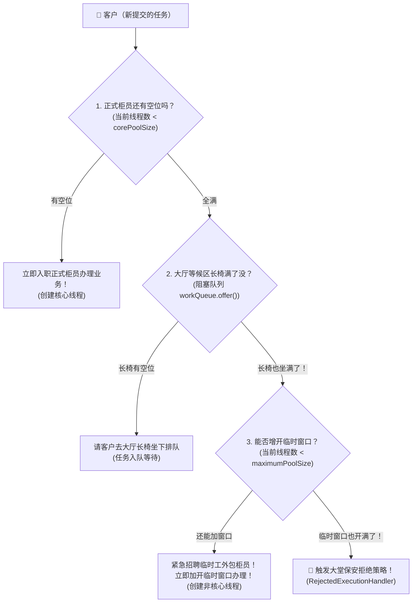
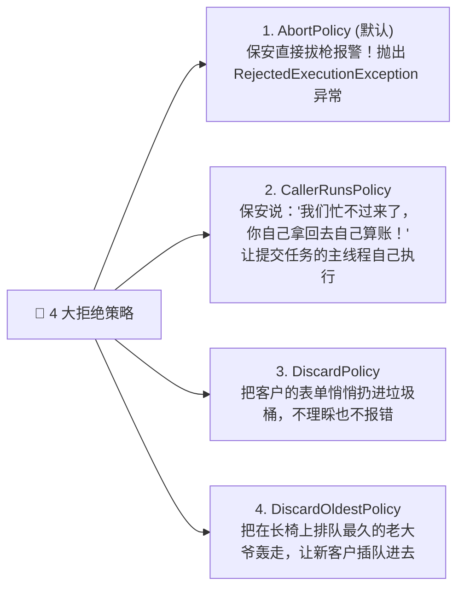

# 🏭 07 · 线程池原理与参数（银行网点运营之道与生产防坑）

> **一句话导读**：在生产环境裸奔 `new Thread()` 相当于自寻死路！理解了“银行网点柜台运营”模型，7 大核心参数、4 大拒绝策略以及阿里巴巴规范的血泪教训全都能一网打尽。

---

## 🚨 为什么生产代码严禁随意 `new Thread()`？

很多人在写 Demo 时图省事直接 `new Thread(() -> ...).start()`。但在工业级服务端开发中，这会引发**毁灭性灾难**：

1. **内存被无情吃光**：每个 Java 平台线程默认要分配约 1MB 的栈内存（`-Xss`）。高并发下如果瞬间涌入 2000 个请求创建 2000 个线程，直接吞掉 2GB 内存！
2. **CPU 全在摸鱼切换**：操作系统在几千个线程之间疯狂进行上下文切换（Context Switch），真正跑业务的时间还不如保存现场和恢复现场的时间多！
3. **系统当场暴毙**：很快就会抛出可怕的 `java.lang.OutOfMemoryError: unable to create native thread`，操作系统拒绝再分配线程，整个 JVM 进程直接崩溃下线！

> 💡 **线程池的核心价值**：**池化技术，资源复用，限制总量，排队削峰。**

---

## 🏦 核心心智模型：银行网点运营之道

`ThreadPoolExecutor` 的运转逻辑，跟现实中的一家**大型银行营业厅**完全一模一样：



---

## ⚙️ 7 大核心参数人话大拆解

查看 `ThreadPoolExecutor` 的全参构造函数：

```java
public ThreadPoolExecutor(
    int corePoolSize,
    int maximumPoolSize,
    long keepAliveTime,
    TimeUnit unit,
    BlockingQueue<Runnable> workQueue,
    ThreadFactory threadFactory,
    RejectedExecutionHandler handler
)
```

| 参数名称 | 银行比喻 | 技术含义与行为规则 |
| :--- | :--- | :--- |
| **`corePoolSize`** | **正式在编柜员数** | 线程池常驻的“核心员工”。即便当前没有业务，他们也不会被辞退，随时待命。 |
| **`maximumPoolSize`** | **全网点最大柜台数** | 网点所能容纳的**最大线程总数**（包含核心柜员 + 紧急临时工）。 |
| **`keepAliveTime`** | **临时工辞退考察期** | 业务高峰期过后，如果临时工闲置超过了这个时间，银行直接将其**辞退回收**，直到总线程数缩回 `corePoolSize`。 |
| **`unit`** | **考察期的时间单位** | 例如 `TimeUnit.SECONDS`。 |
| **`workQueue`** | **大堂等候区长椅** | 存放待处理任务的**阻塞队列**（如 `ArrayBlockingQueue`）。 |
| **`threadFactory`** | **人事招聘 HR** | 负责给新入职的线程起名字、设置优先级、设为守护线程等。**生产规范：务必给线程起有意义的前缀名（如 `order-pool-%d`），排查日志救命！** |
| **`handler`** | **大堂保安拒绝策略** | 任务队列满了、最大线程数也满了，新来的任务怎么处理？ |

---

## 🛑 4 大拒绝策略：大堂保安的 4 种处置手段

当等候区长椅坐满、临时窗口也开满了，新客户还在源源不断冲进来，大堂保安出场：



> [!TIP]
> **生产最佳实践推荐**：
> - **重要核心交易业务**：推荐自定义拒绝策略，或者配合 `CallerRunsPolicy`。让主线程亲自执行，既能保证任务不丢失，又能天然给上游限速（因为主线程去跑业务了，没法再继续塞新任务了！）。
> - **记录告警日志**：拒绝发生往往意味着系统承载力达到极限，务必打印 Error 级别日志或触发飞书/钉钉告警，通知工程师扩容！

---

## 💣 阿里规约血泪史：为什么严禁使用 Executors 工具类？

《阿里巴巴 Java 开发手册》有一条红线规范：
> **【强制】线程池不允许使用 `Executors` 去创建，而是通过 `ThreadPoolExecutor` 的方式显式创建！**

为什么官方提供的 `Executors` 成了人人喊打的“定时炸弹”？

```java
// 💣 炸弹 1：内存打爆
ExecutorService fixedPool = Executors.newFixedThreadPool(10);
ExecutorService singlePool = Executors.newSingleThreadExecutor();
// 致命原因：底层使用的是 LinkedBlockingQueue，默认容量是 Integer.MAX_VALUE（近 21 亿！）
// 任务疯狂堆积在队列里，直接引发 OOM！

// 💣 炸弹 2：线程数打爆
ExecutorService cachedPool = Executors.newCachedThreadPool();
// 致命原因：底层允许创建的 maximumPoolSize 是 Integer.MAX_VALUE（近 21 亿！）
// 来一个请求就建一个线程，瞬间把操作系统线程资源抽干，报 unable to create native thread！
```

---

## 💻 工业级标准：手写一个安全的线程池

保存为 `SafeThreadPoolDemo.java`：

```java
import java.util.concurrent.*;
import java.util.concurrent.atomic.AtomicInteger;

public class SafeThreadPoolDemo {
    public static void main(String[] args) {
        // 1. 自定义 ThreadFactory：给线程起一个好听易辨识的名字
        ThreadFactory customThreadFactory = new ThreadFactory() {
            private final AtomicInteger count = new AtomicInteger(1);
            @Override
            public Thread newThread(Runnable r) {
                Thread t = new Thread(r, "order-worker-" + count.getAndIncrement());
                t.setDaemon(false); // 明确为用户线程
                return t;
            }
        };

        // 2. 规范实例化线程池：核心2、最大4、队列有界容量3、超时30秒、主线程分流拒绝
        ThreadPoolExecutor pool = new ThreadPoolExecutor(
                2,                                 // 核心线程数
                4,                                 // 最大线程数
                30, TimeUnit.SECONDS,              // 临时工空闲存活时间
                new ArrayBlockingQueue<>(3),       // 必须显式使用有界阻塞队列！
                customThreadFactory,               // 自定义 HR 命名
                new ThreadPoolExecutor.CallerRunsPolicy() // 队列打满时让调用者自己跑
        );

        // 提交 8 个任务观察流动过程：
        // 任务 1, 2 -> 进核心线程
        // 任务 3, 4, 5 -> 进队列长椅排队
        // 任务 6, 7 -> 队列满了，开临时工线程 3, 4 执行
        // 任务 8 -> 全部打满，触发 CallerRunsPolicy 由 main 线程执行
        for (int i = 1; i <= 8; i++) {
            final int taskId = i;
            pool.execute(() -> {
                System.out.println("任务 [" + taskId + "] 正在被执行，执行线程: " + Thread.currentThread().getName());
                try {
                    Thread.sleep(500);
                } catch (InterruptedException e) {
                    Thread.currentThread().interrupt();
                }
            });
        }

        // 优雅停机：不再接收新任务，等待已提交任务执行完毕
        pool.shutdown();
    }
}
```

---

## 📊 生产调优：核心线程数到底应该配多少？

面试官常问：“你们生产环境线程池的核心参数怎么配的？”
很多网传的简单公式（CPU 密集型配 `N+1`，I/O 密集型配 `2N`）在现代复杂的微服务架构下**非常教条且不实用**！

### 科学计算法则：
1. **CPU 密集型（复杂加解密、压缩计算、音视频转码）**：
   - 特点：CPU 一直在 100% 满负荷运算，没有 I/O 阻塞。
   - **推荐配比**：`CPU 核心数 + 1`（多留 1 个是为了防止偶发的缺页中断等页切换）。
2. **I/O 密集型（绝大部分 Web 后端业务：调 MySQL、读 Redis、调用第三方 HTTP 接口）**：
   - 特点：大部分时间打工人都在等待网络返回，CPU 处于闲置摸鱼状态。
   - **理论公式**：`核心线程数 = CPU 核心数 * (1 + 线程等待时间 / 线程工作时间)`。
   - 例如：一个接口总耗时 100ms，其中只有 10ms 在算数据，90ms 在等数据库，比例就是 `1 + 90/10 = 10`。如果是 8 核 CPU，核心线程数可以开到 `8 * 10 = 80` 个左右！

> 🌟 **进阶思维：动态线程池（美团高可用实践）**：
> 任何静态写在 `application.yml` 里的参数都会过时。
> 现代企业级架构通常采用**动态线程池**（如开源框架 `Dynamic-Tp` 或 `Hippo4j`），支持在不重启服务的情况下，通过配置中心（Nacos/Apollo）动态调整 `corePoolSize` 和 `maximumPoolSize`，并实时监控队列堆积率。

---

## 🧠 一分钟复盘核心记忆卡

- **执行顺序法则**：**核心满 → 进队列 → 队列满 → 扩最大 → 最大满 → 触发拒绝**。
- **参数避坑**：绝不用 `Executors` 无脑创建，阻塞队列必须有界，线程必须赋予明确业务名。
- **优雅关闭**：`shutdown()` 关门等下班，`shutdownNow()` 粗暴拉电闸。

---

## 🧭 下一步

线程池执行的任务通常有两种：只管扔出去不管结果的（`Runnable`），以及**需要拿到返回结果的（`Callable`）**。
如何高效获取多线程并发执行的结果？
请进入下一篇：[[15-Future与ForkJoin任务模型]]！
