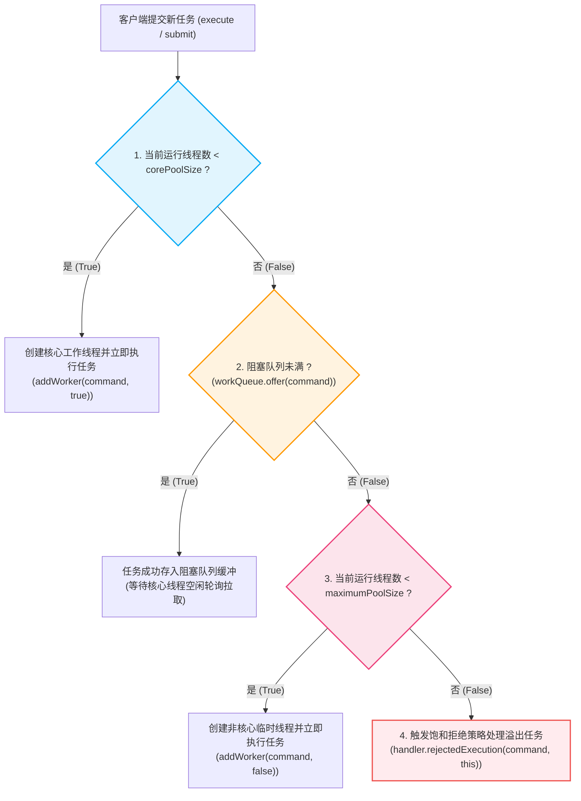
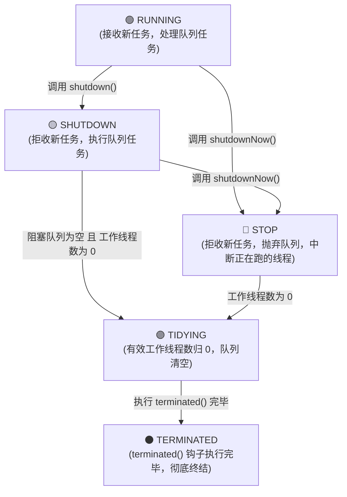

# 🏭 07 · 线程池原理与参数（运行机制与生产实践）

> **一句话导读**：在生产环境随意 `new Thread()` 极易引发资源枯竭！理解 `ThreadPoolExecutor` 的底层任务调度流水线、7 大核心参数、4 大拒绝策略与动态调优，是构建高并发高可用后端服务的基本功。

---

## 🚨 为什么生产代码严禁随意 `new Thread()`？

在业务代码中随意通过 `new Thread(() -> ...).start()` 创建非受控线程，会引发严重生产隐患：

1. **内存过度消耗**：每个 Java 平台线程默认分配约 1MB 栈内存（`-Xss`）。高并发下若瞬时创建数千个线程，将直接消耗数 GB 物理内存。
2. **CPU 上下文切换开销剧增**：线程数过多会导致操作系统内核频繁进行线程调度与上下文切换（Context Switch），真正用于业务计算的时间被严重压缩。
3. **资源枯竭导致进程崩溃**：当系统句柄或内存耗尽时，会直接抛出 `java.lang.OutOfMemoryError: unable to create native thread`，导致整个 JVM 进程异常退出。

> 💡 **线程池的核心价值**：**降低资源消耗（重复利用已有线程）、提高响应速度（任务到达即执行，免去创建耗时）、提高线程的可管理性（统一定量、调度与监控）。**

---

## 🏛️ 核心运行机制：任务提交与调度流程

### 1. 任务调度流程
当客户端向线程池提交一个 `Runnable` 任务（调用 `execute(Runnable command)`）时，`ThreadPoolExecutor` 底层严格遵循如下四个递进阶段：



### 2. 调度执行的内部逻辑要点
1. **优先保障核心线程**：即使当前有空闲的核心线程，只要当前总线程数小于 `corePoolSize`，提交新任务时依然会**优先创建新的核心线程**，直到核心线程数达到设定值。
2. **队列优先于扩容**：当核心线程数满后，后续任务**优先进入阻塞队列等待**，而不是立刻扩容非核心线程。只有在**阻塞队列已满且无法再写入任务**时，才会触发非核心线程的创建。
3. **两级饱和熔断**：当工作线程总数达到 `maximumPoolSize` 且阻塞队列已满时，宣告线程池全面饱和，新任务交由 `RejectedExecutionHandler` 拒绝策略接管。

---

## ⚙️ 7 大核心参数详解

查看 `ThreadPoolExecutor` 的标准全参构造函数：

```java
public ThreadPoolExecutor(
    int corePoolSize,
    int maximumPoolSize,
    long keepAliveTime,
    TimeUnit unit,
    BlockingQueue<Runnable> workQueue,
    ThreadFactory threadFactory,
    RejectedExecutionHandler handler
)
```

### 1. 核心参数说明

| 参数名称 | 参数类型 | 技术定义与底层运行机制 | 生产配置建议 |
| :--- | :--- | :--- | :--- |
| **`corePoolSize`** | `int` | **核心线程数**。线程池常驻保有的工作线程数量。即使这些线程处于空闲等待状态，也不会被垃圾回收或终止（除非显式调用 `allowCoreThreadTimeOut(true)`）。 | CPU 密集型推荐配 `CPU+1`；I/O 密集型根据阻塞比调大。 |
| **`maximumPoolSize`** | `int` | **最大线程数**。线程池允许创建的工作线程总数上限（核心线程数 + 非核心临时线程数）。必须满足 `maximumPoolSize >= corePoolSize` 且 `>= 1`。 | 必须根据机器物理内存与瞬时峰值严格设定有界上限。 |
| **`keepAliveTime`** | `long` | **非核心空闲线程存活时间**。当线程池中的线程数量超过 `corePoolSize` 时，多余的非核心线程若在指定时间内未拉取到新任务（`workQueue.poll(keepAliveTime, unit)` 超时），将被终止销毁，直至线程数缩减回 `corePoolSize`。 | 突发流量场景建议设为 30~60 秒，平稳后自动释放内存。 |
| **`unit`** | `TimeUnit` | **存活时间的时间单位**。与 `keepAliveTime` 配合使用，如 `TimeUnit.SECONDS`、`TimeUnit.MILLISECONDS`。 | 通常使用 `TimeUnit.SECONDS`。 |
| **`workQueue`** | `BlockingQueue<Runnable>` | **任务阻塞队列**。用于缓冲等待执行任务的阻塞队列。当核心线程全部忙碌时，新提交的任务通过 `offer()` 尝试排队。 | **严禁无界队列**！推荐 `ArrayBlockingQueue` 或显式指定容量的 `LinkedBlockingQueue`。 |
| **`threadFactory`** | `ThreadFactory` | **线程创建工厂**。用于创建新 `Thread` 对象的工厂接口。可在其中统一定制线程名称前缀、守护线程标记（Daemon）、线程优先级及未捕获异常处理器（UncaughtExceptionHandler）。 | **生产强制要求**：赋予有明确业务含义的线程名前缀（如 `order-exec-%d`）。 |
| **`handler`** | `RejectedExecutionHandler` | **饱和拒绝策略**。当任务队列已满且当前线程数已达 `maximumPoolSize` 时，线程池无法承接新任务时所调用的兜底回调接口。 | 核心交易推荐 `CallerRunsPolicy` 或自定义降级告警策略。 |

---

### 2. 场景演示：政务大厅服务模型

- **常设固定窗口（`corePoolSize`）**：平时全职在岗，新任务到来优先分配给空闲的固定窗口处理；
- **等候排队长椅（`workQueue`）**：固定窗口全满时，后续任务进入长椅排队等候；
- **加开临时窗口（非核心线程）**：当长椅也坐满时，大厅紧急加开临时窗口直接处理新到来的任务；
- **全厅最大窗口上限（`maximumPoolSize`）**：大厅物理承载极限，固定窗口加临时窗口的总和；
- **临时窗口空闲撤销（`keepAliveTime` + `unit`）**：高峰过去后，临时窗口空闲超过指定时限即被关闭撤销，恢复到仅有固定窗口；
- **工号编制科（`threadFactory`）**：负责给每个新创建的线程统一发放规范名称与属性；
- **客流超载分流预案（`handler` 拒绝策略）**：当所有窗口全开且长椅坐满时，对新任务启动饱和拒绝。

---

## 🛑 4 大内置拒绝策略详解

当阻塞队列已满且工作线程总数达到 `maximumPoolSize` 时，线程池无法继续接收任务，将调用 `RejectedExecutionHandler.rejectedExecution(Runnable r, ThreadPoolExecutor executor)`。

### 1. 策略行为对比

| 策略类名 | 运行时技术行为 | 系统影响与潜在风险 | 适用业务场景 |
| :--- | :--- | :--- | :--- |
| **`AbortPolicy`**（默认） | 直接抛出运行时异常 `RejectedExecutionException`。 | **中断外部调用流程**。调用线程必须显式捕获该异常，否则向上蔓延导致业务中断。 | 系统默认策略；适用于必须让调用端感知失败并做事务回滚的核心接口。 |
| **`CallerRunsPolicy`** | **退回给调用者线程同步执行**。由提交任务的外部线程（如 `main` 线程或 Web 容器的 HTTP Worker 线程）亲自执行该任务的 `run()` 方法。 | **对上游形成背压反作用力（Backpressure）**。调用者线程去执行任务期间，无法再继续向线程池提交新任务，天然减缓任务涌入速率。 | **生产高频推荐**。既能确保任务不丢失，又能平滑削峰。 |
| **`DiscardPolicy`** | **静默丢弃**。直接忽略并丢弃当前新任务，不执行任何操作，亦不抛出任何异常。 | **数据完全静默丢失**。上游调用端完全无法感知任务是否成功执行，无法定位丢失原因。 | 仅适用于允许高比率丢弃、只做抽样统计或非关键指标埋点的场景。 |
| **`DiscardOldestPolicy`** | **丢弃队首任务**。调用 `workQueue.poll()` 丢弃队列头部等待时间最久的任务，然后重新调用 `executor.execute(r)` 尝试提交当前新任务。 | **引发排队早期的业务死于非命**。被丢弃的任务往往已经等待较长时间，可能导致业务逻辑断裂。 | 仅适用于新数据能够完全覆盖旧数据的特定状态同步场景。 |

---

### 2. 场景演示：大堂客流处置预案

- **拒开发票并当场红牌报警（`AbortPolicy`）**：接待处向客户出示“客流超限通知书”直接拒办，并向上级系统亮起红灯抛出异常，中断调用链。
- **让客户自己拿自助终端办理（`CallerRunsPolicy`）**：工作人员交由客户在自助机自行办理（调用者线程亲自执行），客户自己操作期间无法再提交新业务，天然形成背压削峰。
- **悄悄把业务单据扔进废纸篓（`DiscardPolicy`）**：既不办理也不告知客户，数据静默丢失无感知。
- **劝退排在最前面等待最久的人（`DiscardOldestPolicy`）**：工作人员将等候区最先取号的人劝退离开（丢弃队头任务），腾出座位让刚进门的新客户入座。

---

## 🔄 线程池的 5 大生命周期状态与 ctl 位运算揭秘

在面试与源码阅读中，**“线程池的生命周期状态是如何流转的？”** 以及 **“`ctl` 变量是如何用一个原子整型同时表达状态与线程数的？”** 是被问及频率极高的底层考点。

### 1. 灵魂控制变量：`ctl` 的高低位设计

在 `ThreadPoolExecutor` 源码中，所有的状态流转与线程数统计，全靠一个 `AtomicInteger` 类型的变量掌控：

```java
// 核心状态控制变量：打包了 runState（高 3 位）和 workerCount（低 29 位）
private final AtomicInteger ctl = new AtomicInteger(ctlOf(RUNNING, 0));

private static final int COUNT_BITS = Integer.SIZE - 3; // 32 - 3 = 29 位
private static final int COUNT_MASK = (1 << COUNT_BITS) - 1; // 低 29 位全 1（掩码）

// 拆包方法：
private static int runStateOf(int c)     { return c & ~COUNT_MASK; } // 获取运行状态（保留高 3 位）
private static int workerCountOf(int c)  { return c & COUNT_MASK; }  // 获取有效工作线程数（保留低 29 位）
private static int ctlOf(int rs, int wc) { return rs | wc; }         // 组装 ctl
```

> [!question]- 第一性原理追问：线程池为什么要把运行状态与工作线程数合二为一写入单个 ctl 变量？
> - **传统双变量做法的缺陷**：若拆成两个独立的原子变量（如 `AtomicInteger state` 和 `AtomicInteger workerCount`），当需要同时判断并更新“线程池是否处于 RUNNING 且线程数是否小于 corePoolSize”时，由于无法对两个独立变量实现无锁的跨变量原子更新，就必须引入重量级的全局互斥锁（如 `synchronized` 或 `ReentrantLock`），极大削弱并发吞吐量。
> - **Doug Lea 的位运算设计**：将两者压缩至同一个 32 位整型中，**只需一次硬件级 CAS 操作，就能同时原子更新状态与线程数**，全程无锁化：
>   - **高 3 位（runState）**：表示线程池的生命周期状态（5 种状态至少需要 3 位：$2^3 = 8 > 5$）；
>   - **低 29 位（workerCount）**：表示当前有效的工作线程数（最大可支持 $2^{29}-1 \approx 5.36$ 亿个线程，完全满足生产极限需要）。

---

### 2. 线程池的 5 大运行状态

源码中定义的 5 大状态及其常量数值如下：

| 状态名称 | 高 3 位二进制值 | 十进制整型大小 | 核心运行行为 |
| :--- | :--- | :--- | :--- |
| **`RUNNING`** | `111`（`-1 << 29`） | 负数（最小） | **正常接客**。能够接收新提交的任务，也能处理阻塞队列中排队的任务。 |
| **`SHUTDOWN`** | `000`（`0 << 29`） | `0` | **温和停机**。**不再接收新任务**（新任务走拒绝策略），但**会把阻塞队列中已排队的任务继续执行完毕**。 |
| **`STOP`** | `001`（`1 << 29`） | 正数 | **暴力叫停**。不接新任务，**抛弃并清空阻塞队列**，向所有正在运行的工作线程发送 `interrupt()` 中断信号。 |
| **`TIDYING`** | `010`（`2 << 29`） | 更大正数 | **打扫战场**。所有任务已终结，有效工作线程数为 0。此时即将触发执行 `terminated()` 钩子方法。 |
| **`TERMINATED`** | `011`（`3 << 29`） | 最大正数 | **彻底终结**。`terminated()` 钩子方法执行完毕，线程池生命周期彻底结束。 |

> 💡 **状态单调递增的小巧思**：
> 状态值从 `RUNNING (-1) -> SHUTDOWN (0) -> STOP (1) -> TIDYING (2) -> TERMINATED (3)` 是**严格单调递增**的。
> 因此源码在判断“线程池是否还在正常运行”时极其高效：直接判断 `c < SHUTDOWN` 即可（只有 RUNNING 是负数）。

---

### 3. 状态流转全景图



---

### 4. 高频面试考点：`shutdown()` vs `shutdownNow()`

| 对比维度 | `shutdown()`（优雅平缓停机） | `shutdownNow()`（暴风骤雨停机） |
| :--- | :--- | :--- |
| **状态变迁** | 从 `RUNNING` 变为 **`SHUTDOWN`** | 从 `RUNNING` 或 `SHUTDOWN` 跃迁为 **`STOP`** |
| **新任务接收** | 拒绝接收（触发饱和拒绝策略） | 拒绝接收（触发饱和拒绝策略） |
| **队列积压任务** | **继续执行**，直至队列任务全部消化完毕 | **直接丢弃**，并将其作为 `List<Runnable>` 返回给调用端 |
| **正在跑的线程** | **不中断**（仅中断空闲等待任务的 Worker 线程） | **全量发送 `Thread.interrupt()` 中断信号**尝试叫停 |
| **生产推荐场景** | 容器/微服务优雅发布、下线（配合 `awaitTermination`） | 系统紧急避险、逃生，或优雅停机超时后的兜底强杀 |

---

## 💣 阿里规约深度剖析：为什么严禁使用 Executors 工具类？

《阿里巴巴 Java 开发手册》明确规定：
> **【强制】线程池不允许使用 `Executors` 去创建，而是通过 `ThreadPoolExecutor` 的方式显式创建！**

官方提供的 `Executors` 快捷工厂方法隐藏着极具破坏性的资源隐患：

```java
// 隐患 1：LinkedBlockingQueue 无界队列引发 OOM
ExecutorService fixedPool = Executors.newFixedThreadPool(10);
ExecutorService singlePool = Executors.newSingleThreadExecutor();
// 底层实现：内部使用的是无参 LinkedBlockingQueue，其默认容量为 Integer.MAX_VALUE（近 21.4 亿！）
// 致命风险：当并发请求涌入且任务处理耗时较长时，任务在内存中无限堆积，迅速榨干 JVM 堆内存，直接引发 java.lang.OutOfMemoryError: Java heap space。

// 隐患 2：允许创建的最大线程数无界引发物理线程耗尽
ExecutorService cachedPool = Executors.newCachedThreadPool();
// 底层实现：maximumPoolSize 被直接硬编码为 Integer.MAX_VALUE，搭配不存储元素的 SynchronousQueue
// 致命风险：每一个新任务到来，若无空闲线程就会立即创建新物理线程。瞬时高并发下将瞬间创建数千上万个线程，抽干操作系统栈内存与句柄资源，
// 抛出致命的 java.lang.OutOfMemoryError: unable to create native thread，直接击垮整个操作系统进程。
```

---

## 💻 工业级标准：规范化配置线程池示例

保存为 `SafeThreadPoolDemo.java`：

```java
import java.util.concurrent.*;
import java.util.concurrent.atomic.AtomicInteger;

public class SafeThreadPoolDemo {
    public static void main(String[] args) {
        // 1. 自定义 ThreadFactory：赋予清晰业务前缀与异常捕获
        ThreadFactory customThreadFactory = new ThreadFactory() {
            private final AtomicInteger count = new AtomicInteger(1);
            @Override
            public Thread newThread(Runnable r) {
                Thread t = new Thread(r, "order-exec-worker-" + count.getAndIncrement());
                t.setDaemon(false); // 明确声明为非守护线程
                // 生产建议：设置未捕获异常处理器，防止任务抛出未捕获异常导致线程静默消亡
                t.setUncaughtExceptionHandler((thread, ex) -> {
                    System.err.printf("线程 [%s] 执行任务异常崩溃: %s%n", thread.getName(), ex.getMessage());
                });
                return t;
            }
        };

        // 2. 规范化构建线程池：严格明确有界队列容量与背压拒绝策略
        ThreadPoolExecutor pool = new ThreadPoolExecutor(
                2,                                                 // 核心线程数 corePoolSize
                4,                                                 // 最大线程数 maximumPoolSize
                30L, TimeUnit.SECONDS,                             // 非核心线程空闲存活时间 keepAliveTime
                new ArrayBlockingQueue<>(3),                       // 必须使用有界阻塞队列！容量显式固定为 3
                customThreadFactory,                               // 自定义线程工厂
                new ThreadPoolExecutor.CallerRunsPolicy()          // 饱和拒绝策略：回退给调用线程执行
        );

        // 提交 8 个任务，观察内部流水线流转：
        // 任务 1, 2 -> 核心线程直接创建并执行
        // 任务 3, 4, 5 -> 核心线程已占满，任务进入有界队列排队
        // 任务 6, 7 -> 队列已满，触发非核心临时线程创建并执行
        // 任务 8 -> 线程总数已达 maximumPoolSize(4) 且队列已满(3)，触发 CallerRunsPolicy 由 main 线程执行
        for (int i = 1; i <= 8; i++) {
            final int taskId = i;
            pool.execute(() -> {
                System.out.printf("任务 [%d] 开始执行，执行线程: %s%n", taskId, Thread.currentThread().getName());
                try {
                    Thread.sleep(500);
                } catch (InterruptedException e) {
                    Thread.currentThread().interrupt();
                }
            });
        }

        // 3. 优雅停机：不再接受新任务，等待已提交任务执行完毕
        pool.shutdown();
    }
}
```

---

## 📊 生产调优：核心线程数科学估算法则

网传的教条公式（如 CPU 密集型配 `N+1`，I/O 密集型配 `2N`）在混合型微服务架构下往往偏差较大。

### 生产估算原则：
1. **CPU 密集型业务（复杂加解密、音视频编解码、数学矩阵计算）**：
   - 特点：线程几乎一直在使用 CPU 进行计算，很少发生 I/O 等待。
   - **参数配置**：`corePoolSize = CPU 核心数 + 1`。多分配 1 个线程是为了应对偶尔的缺页中断等页切换开销。
2. **I/O 密集型业务（Web 后端业务：数据库查询、Redis 读写、RPC/HTTP 远程调用）**：
   - 特点：线程大部分时间在等待网络或磁盘 I/O 返回，CPU 利用率较低。
   - **理论推导公式**：
     $$\text{核心线程数} = \text{CPU 核心数} \times \left(1 + \frac{\text{线程等待时间}}{\text{线程工作时间}}\right)$$
   - 例如：一个接口平均耗时 100ms，其中计算耗时 10ms，网络 I/O 等待耗时 90ms，则等待/工作比为 9。在 8 核机器上，理论建议线程数约为 $8 \times (1 + 9) = 80$。

> 🌟 **进阶实践：动态线程池（Dynamic ThreadPool）**：
> 静态写死在配置文件中的线程池参数难以应对突发流量。现代高可用架构推荐采用**动态线程池**方案（如开源的 `Dynamic-Tp` 或 `Hippo4j`）：
> - 将核心线程数、最大线程数、队列容量等参数与配置中心（Nacos / Apollo）打通；
> - 支持运行时无需重启热更新参数；
> - 实时采集线程池活跃度、队列排队长度并推送告警。

---

## 🧠 一分钟复盘核心记忆卡

- **任务调度顺序**：**核心线程未满直接建线程 $\to$ 核心满则进阻塞队列 $\to$ 队列满则扩充至最大线程数 $\to$ 最大线程仍满则触发拒绝策略**。
- **状态与 ctl 设计**：单个 `AtomicInteger ctl` 原子掌控全局——高 3 位为状态（`RUNNING` < `SHUTDOWN` < `STOP` < `TIDYING` < `TERMINATED`，严格递增），低 29 位为工作线程数；无需多变量加互斥大锁。
- **安全构建准则**：严禁用 `Executors` 创建无界队列或无界线程池，阻塞队列必须指定有界容量，线程必须带业务名称前缀。
- **停机区别**：`shutdown()` 平缓停止（不再接新任务，消化排队任务），`shutdownNow()` 强行中断（中断执行中线程，排队任务丢弃并返回列表）。

---

## 🔗 关联阅读

- [[05-AQS原理|AQS 原理与 CLH 同步队列]]
- [[06-ReentrantLock与读写锁|ReentrantLock 条件队列与锁机制]]
- [[15-Future与ForkJoin任务模型|Future、Callable 与 ForkJoin 任务模型]]
- [[../10-知识串联与专题/06-线程池-CompletableFuture-MQ异步链路|线程池到异步链路全景]]
