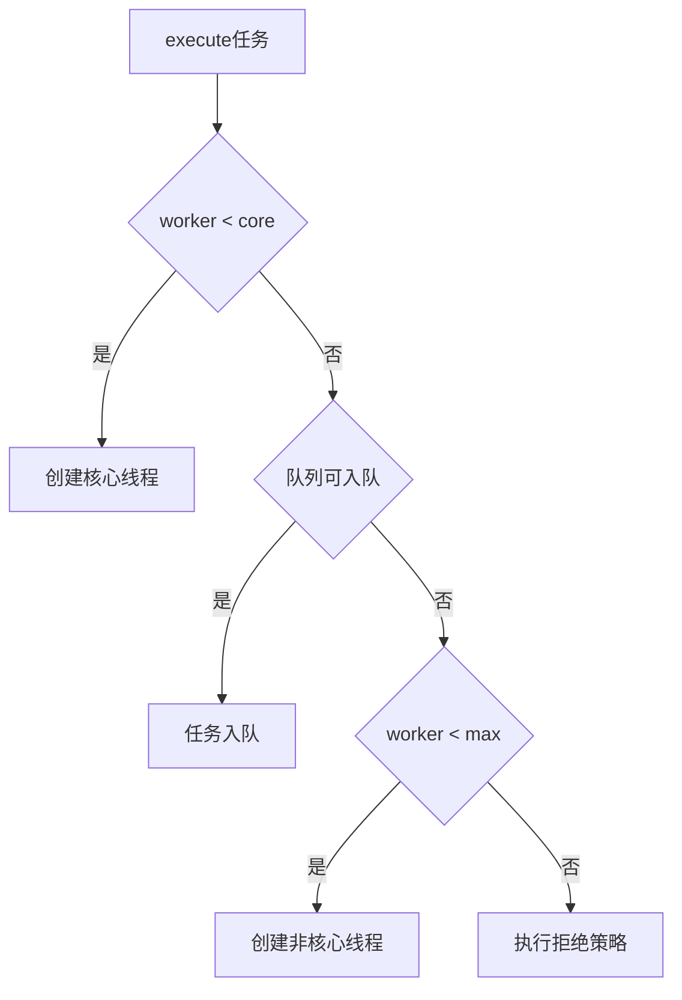

# 线程池原理与参数

> [!abstract] 一句话总结
> 线程池通过复用线程、队列缓冲和拒绝策略治理并发，核心是任务提交流程和参数之间的联动。

## 📌 这是什么

- ThreadPoolExecutor 核心参数包括 corePoolSize、maximumPoolSize、keepAliveTime、workQueue、threadFactory、handler。
- execute 流程不是先到 max，而是先 core，再队列，再 max，最后拒绝。
- 线程池参数必须和任务类型、下游容量、队列策略和降级方案一起设计。

## 🤔 解决什么问题 / 为什么需要

- 避免无限创建线程导致 OOM 或上下文切换爆炸。
- 给突发流量提供缓冲，同时在系统过载时可拒绝、降级或背压。
- 面试常要求解释参数、执行流程、如何估算大小和线上排查。

## 🧩 核心概念

| 概念 | 含义 | 精通要点 |
| ---- | ---- | -------- |
| corePoolSize | 核心线程数。 | 任务到来优先创建到 core。 |
| maximumPoolSize | 最大线程数。 | 只有队列满后才继续创建到 max。 |
| workQueue | 等待队列。 | 有界队列是生产实践常用选择。 |
| RejectedExecutionHandler | 拒绝策略。 | Abort、CallerRuns、Discard、DiscardOldest 或自定义。 |
| ThreadFactory | 创建线程并命名。 | 便于排查。 |

## ⚙️ 工作原理 / 流程



## 🔍 源码 / 原理深挖

- ThreadPoolExecutor 用 ctl 同时编码运行状态和 worker 数。
- Worker 继承 AQS，用于管理线程执行和中断。
- getTask 从队列取任务，结合 keepAliveTime 决定非核心线程是否回收。

## 💻 代码实践 / 排查命令

```java
ThreadPoolExecutor pool = new ThreadPoolExecutor(
    8, 32,
    60, TimeUnit.SECONDS,
    new ArrayBlockingQueue<>(1000),
    r -> new Thread(r, "order-worker-" + THREAD_ID.incrementAndGet()),
    new ThreadPoolExecutor.CallerRunsPolicy());
```

## 🛠️ 排查 / 实践要点

- CPU 密集型线程数接近 CPU 核心数；IO 密集型根据等待/计算比例增加，但必须受下游容量约束。
- 监控 activeCount、poolSize、queueSize、completedTaskCount、rejectCount 和任务耗时。
- 队列堆积时先判断是流量突增、下游慢、锁竞争还是线程数不足。

## ⚠️ 踩坑与注意事项

- Executors.newFixedThreadPool 默认无界队列，可能 OOM。
- newCachedThreadPool 最大线程近似无限，流量异常时可能打爆机器。
- 多个业务共用一个线程池，慢任务拖垮快任务。
- 拒绝策略只打印日志不告警不降级。

## 🎯 面试问题

> [!question] 高频问题
> - Q: 线程池 execute 流程？
>   - A: 先判断是否小于核心线程数，是则创建线程；否则尝试入队；队列满且小于最大线程数则创建非核心线程；还不行就拒绝。
> - Q: 线程池参数怎么设置？
>   - A: 结合任务类型、CPU 核数、IO 等待比例、下游容量、峰值流量和延迟目标，用压测验证，并设置有界队列和明确拒绝策略。
> - Q: 为什么不推荐 Executors 快捷工厂？
>   - A: 很多快捷工厂隐藏无界队列或无限线程风险，生产中更推荐显式创建 ThreadPoolExecutor。

## 🧭 源码入口速查

- `ThreadPoolExecutor#execute`：核心线程、入队、最大线程、拒绝策略的真实顺序。
- `ThreadPoolExecutor#addWorker`：创建 worker 并启动线程，关注 `ctl` 状态检查。
- `ThreadPoolExecutor#getTask`：队列取任务、超时回收、线程池关闭的分支。
- `ThreadPoolExecutor.Worker#runWorker`：任务执行、异常处理、`afterExecute` 钩子。
- 队列源码：`ArrayBlockingQueue` 有界数组，`LinkedBlockingQueue` 默认容量很大，`SynchronousQueue` 不存储任务。

## 🧪 最小验证

```java
ThreadPoolExecutor p = new ThreadPoolExecutor(
    1, 2, 30, TimeUnit.SECONDS,
    new ArrayBlockingQueue<>(1),
    r -> new Thread(r, "demo-pool"),
    new ThreadPoolExecutor.AbortPolicy());
```

连续提交 4 个长任务：第 1 个创建 core，第 2 个入队，第 3 个创建 max，第 4 个触发拒绝。这个实验能纠正“先加到 max 再入队”的常见误解。

生产参数必须绑定下游容量：如果数据库连接池只有 20，给查询线程池配 200 线程只会制造等待和超时。线程池监控至少要有活跃线程、队列长度、拒绝数、任务耗时、线程池维度的 trace 标签。

## ✅ 精通检查清单

- 能用自己的话讲清本主题解决的问题和适用边界。
- 能指出至少 2 个源码入口或底层机制。
- 能给出一个最小代码示例或一组线上排查命令。
- 能回答本页列出的高频面试题，并补充项目中的真实取舍。

## 🔗 关联笔记

- [[_index]]

## 📚 参考资料

- [Dev.java Tutorials](https://dev.java/learn/)
- [Oracle Java Documentation](https://docs.oracle.com/en/java/)
