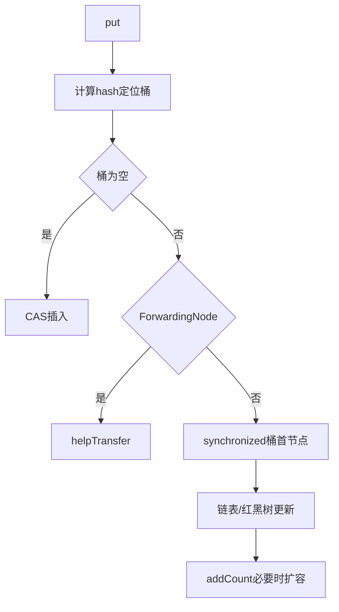

# 并发容器-ConcurrentHashMap

> [!abstract] 一句话总结
> ConcurrentHashMap 通过 CAS、桶级 synchronized、扩容协作和分散计数实现高并发 Map，是 HashMap 的并发替代方案。

## 📌 这是什么

- JDK 8 ConcurrentHashMap 不再使用 Segment，主结构也是 Node[]。
- 空桶插入用 CAS，非空桶更新锁住桶首节点，冲突严重时树化。
- size 统计使用 baseCount + CounterCell，类似 LongAdder 降低热点竞争。

## 🤔 解决什么问题 / 为什么需要

- 多线程共享读写 Map 时避免 HashMap 数据竞争。
- 理解 computeIfAbsent、putIfAbsent、merge 等原子复合操作。
- 面试常比较 HashMap、Hashtable、ConcurrentHashMap 的锁粒度和扩容机制。

## 🧩 核心概念

| 概念 | 含义 | 精通要点 |
| ---- | ---- | -------- |
| CAS 插入 | 空桶通过 casTabAt 放入节点。 | 避免无竞争时加锁。 |
| 桶锁 | 非空桶 synchronized 锁住首节点。 | 锁粒度是桶，不是整表。 |
| sizeCtl | 控制初始化和扩容状态。 | 负数表示正在初始化或扩容。 |
| ForwardingNode | 扩容迁移标记。 | 读写遇到它会帮助迁移或跳转新表。 |
| CounterCell | 分散计数。 | 降低 size 更新竞争。 |

## ⚙️ 工作原理 / 流程



## 🔍 源码 / 原理深挖

- putVal 中 tabAt/casTabAt 使用 Unsafe/VarHandle 进行 volatile 访问和 CAS。
- transfer 扩容时多个线程可领取 stride 区间协作迁移。
- get 基本无锁，通过 volatile 读 table 和节点链表完成。

## 💻 代码实践 / 排查命令

```java
ConcurrentHashMap<String, LongAdder> counts = new ConcurrentHashMap<>();
counts.computeIfAbsent("ok", k -> new LongAdder()).increment();

String old = map.putIfAbsent(key, value);
```

## 🛠️ 排查 / 实践要点

- 缓存加载用 computeIfAbsent，但 mappingFunction 要短小，不要在里面长时间阻塞或递归更新同一个 map。
- 高频统计用 ConcurrentHashMap<K, LongAdder>。
- 排查偶发阻塞时看线程是否卡在 ConcurrentHashMap.compute 或 synchronized 桶锁。

## ⚠️ 踩坑与注意事项

- 以为 ConcurrentHashMap 的复合读改写天然安全，实际要用 compute/merge/putIfAbsent。
- 在 computeIfAbsent 中做慢 RPC，导致同桶其他更新等待。
- 依赖 size/isEmpty 做强一致业务判断。

## 🎯 面试问题

> [!question] 高频问题
> - Q: JDK 8 ConcurrentHashMap 如何保证并发安全？
>   - A: 空桶 CAS 插入，非空桶锁桶首节点，table 和节点关键字段 volatile 可见，扩容时通过 ForwardingNode 和 helpTransfer 协作迁移。
> - Q: ConcurrentHashMap 的 get 要加锁吗？
>   - A: 通常不加锁，依赖 volatile 读 table、节点 value/next 和不可变 key/hash 来保证可见性。
> - Q: size 为什么不是简单计数器？
>   - A: 单个计数器高并发更新竞争大，ConcurrentHashMap 用 baseCount 加 CounterCell 分散更新，统计时汇总。

## 🧭 源码入口速查

- `ConcurrentHashMap#putVal`：空桶 CAS、非空桶 synchronized、树化、计数和扩容入口都在这里。
- `initTable`：通过 `sizeCtl` CAS 控制只有一个线程初始化 table。
- `transfer`、`helpTransfer`：扩容迁移和多线程协作迁移。
- `ForwardingNode#find`：迁移期间读请求如何跳到新表。
- `addCount`、`fullAddCount`：`baseCount + CounterCell` 分散计数。

## 🧪 最小验证

```java
ConcurrentHashMap<String, String> cache = new ConcurrentHashMap<>();
String v = cache.computeIfAbsent("k", k -> loadSlowly(k));
```

`computeIfAbsent` 的 mappingFunction 在桶级同步路径内有执行窗口。这里做慢 RPC、递归更新同一个 map 或等待另一个持有同桶锁的任务，都会放大阻塞。缓存加载要考虑超时、隔离、singleflight 或本地 Future 占位。

## ✅ 精通检查清单

- 能用自己的话讲清本主题解决的问题和适用边界。
- 能指出至少 2 个源码入口或底层机制。
- 能给出一个最小代码示例或一组线上排查命令。
- 能回答本页列出的高频面试题，并补充项目中的真实取舍。

## 🔗 关联笔记

- [[_index]]

## 📚 参考资料

- [Dev.java Tutorials](https://dev.java/learn/)
- [Oracle Java Documentation](https://docs.oracle.com/en/java/)
