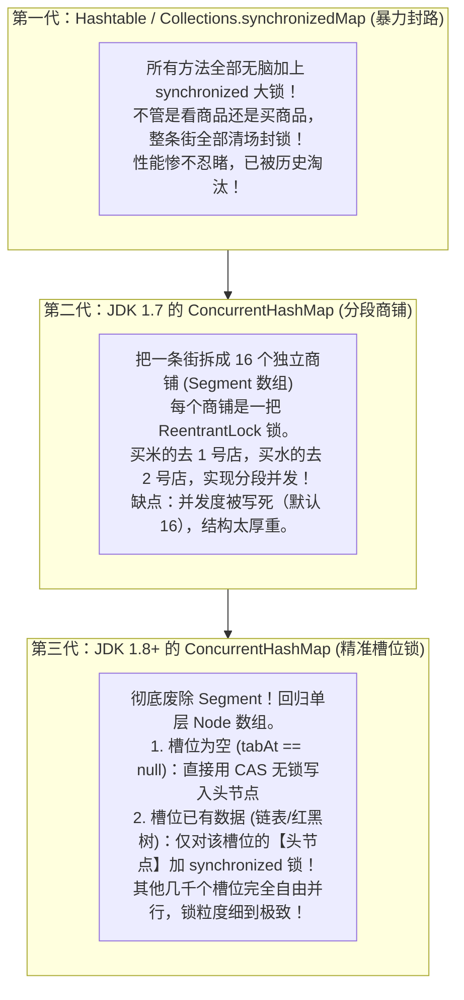
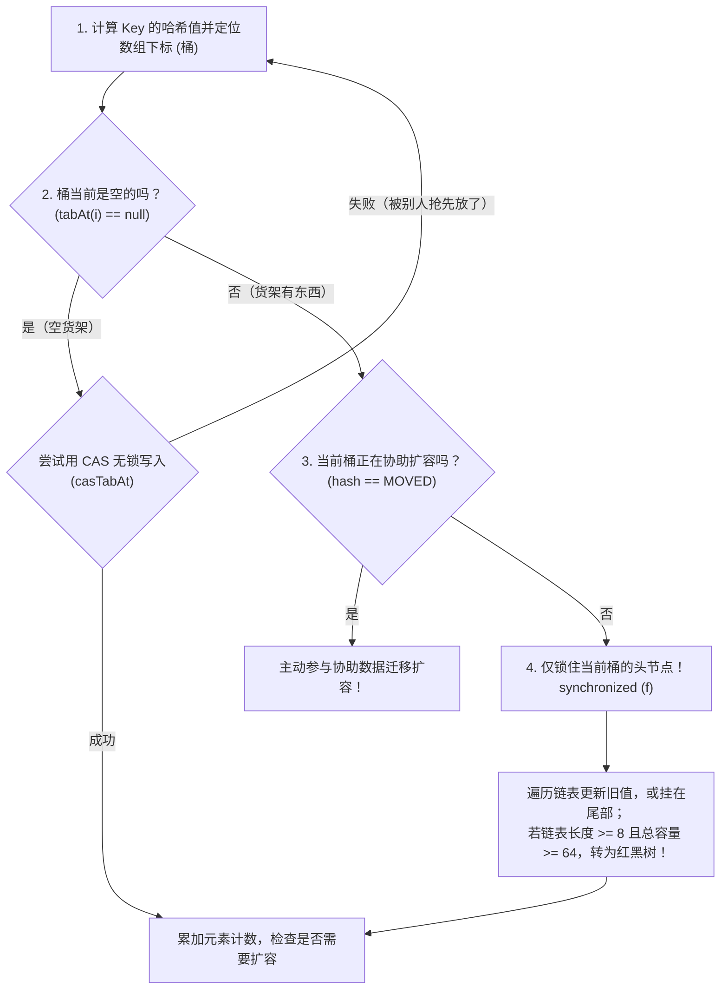

# 🗄️ 08 · 并发容器 ConcurrentHashMap（万能高并发字典的演进与底层实现）

> **一句话导读**：既要支持海量并发写入，又要保证极速读取，它是 Java 集合中最精密的“瑞士军刀”。看懂了它从“整条街封路”到“精准货架锁”的进化史，Java 面试的核心考点就尽在掌握。

---

## 💥 为什么普通的 HashMap 在并发下是灾难？

很多人刚学 Java 时容易犯一个严重错误：在多线程接口里直接使用 `HashMap`。这会导致两大**致命事故**：

1. **数据莫名其妙丢失**：两个线程同时 `put`，算出的哈希桶位置一样，线程 A 的新节点直接把线程 B 的新节点覆盖掉了，造成脏写和漏单。
2. **CPU 飙升 100% 死循环（JDK 7 经典 Bug）**：早期 JDK 7 的 HashMap 在多线程扩容时采用“头插法”，两个线程并发重排链表指针，会导致链表形成**环形死循环**！下次一旦有线程去 `get` 这个键，就会在这个环里无限打转，瞬间把服务器 CPU 跑满 100%！（虽然 JDK 8 换成尾插法修复了死循环，但并发丢失数据依然无法避免）。

---

## 🏛️ 三代并发字典的进化史：从整街封路到货架加锁

为了解决高并发访问 Map 的问题，Java 工程师们经历了三个历史维度的技术变革：



---

## 🔬 JDK 8+ 的 putVal 执行大揭秘

以现代 Java 的底层逻辑为例，我们来看看往 `ConcurrentHashMap` 里 `put` 一个键值对时，底层到底发生了什么：



> 💡 **核心精妙之处**：
> 1. **空桶首节点直接走 CAS**：在绝大多数哈希均匀分布的场景下，首个节点存入完全是无锁纯 CAS 的，零线程挂起，性能极度炸裂！
> 2. **冲突只锁头节点**：如果发生了哈希碰撞，也只锁住该槽位的首个 Node。如果有 1024 个桶，理论上可以支持上千个线程同时并发修改不同槽位的数据！

---

## ⚡ 为什么读操作 `get()` 连锁都不需要加？

大厂高频面试题：“`ConcurrentHashMap` 写入时要加锁，为什么它的 `get()` 方法全程完全不需要加任何锁，还能保证线程安全？”

**答案藏在它的底层数据结构定义中：**

```java
// Node 核心源码节选
static class Node<K,V> implements Map.Entry<K,V> {
    final int hash;
    final K key;
    // 🚨 关键：val 和 next 指针全部被 volatile 修饰！
    volatile V val;
    volatile Node<K, V> next;
}
```

- **`volatile V val`**：确保任何写线程修改了值，读线程一抬头**立刻看到最新值**（保证可见性）。
- **`volatile Node<K, V> next`**：确保写线程往链表后面追加了新节点、或者红黑树发生调整，读线程顺着指针遍历时绝不会读到旧指针或悬空指针。
- **结论**：读操作完全通过 `volatile` 的内存屏障实现安全读取，根本无需加锁排队，读吞吐量达到物理极限！

---

## 🧮 高并发下怎么统计总数？（`size()` 的智慧）

如果有成千上万个线程同时在往 Map 里塞数据，如果每个线程都去把一个全局的 `size` 变量加 1，那这个变量就会成为超级热点瓶颈。

`ConcurrentHashMap` 巧妙借鉴了我们在 04 篇学到的 **`LongAdder` 分段计数思想**：
- 内部维护了一个 `baseCount` 和一个 `CounterCell[]` 数组。
- 并发低时，直接 CAS 累加 `baseCount`；
- 一旦冲突剧烈，线程自动哈希分散到各自的 `CounterCell` 槽位单独累加；
- 当你调用 `map.size()` 或 `mappingCount()` 时，它把 `baseCount` 和各个分段槽位的值加在一起汇总返回！

---

## ⚠️ 生产最大误区：不要把“单方法安全”误当成“复合操作安全”！

这是 90% 的初级程序员都会踩的深坑：

```java
// ❌ 翻车现场：依然存在并发安全漏洞！
if (!map.containsKey("ticket")) { // 步骤 1：检查
    map.put("ticket", "张三");    // 步骤 2：插入
}
```

> 🚨 **为什么翻车？**
> `containsKey()` 是线程安全的，`put()` 也是线程安全的。**但把它们连起来就不是原子的了！**
> 线程 A 和线程 B 同时执行了步骤 1，都发现 `ticket` 不存在；接着线程 A 把票卖给了张三，紧接着线程 B 毫不客气地把票改成了李四！

### ✅ 正确姿势：使用原子复合 API

```java
ConcurrentHashMap<String, String> map = new ConcurrentHashMap<>();

// 1. 不存在才放入（原子操作，解决上面的 if-put 漏洞）
String previous = map.putIfAbsent("ticket", "张三");

// 2. 不存在则通过计算生成放入（高频用于本地缓存加载）
map.computeIfAbsent("configKey", k -> loadFromDatabase(k));

// 3. 统计计数器累加（原子合并）
ConcurrentHashMap<String, Integer> countMap = new ConcurrentHashMap<>();
countMap.merge("visit_pv", 1, Integer::sum);
```

---

## 💥 终极大厂必考：为什么 ConcurrentHashMap 坚决不允许 Key 或 Value 为 null？

在普通单线程的 `HashMap` 中，Key 和 Value 都可以是 `null`。
但只要你在 `ConcurrentHashMap` 里执行 `map.put(null, "val")` 或 `map.put("key", null)`，JVM 会**毫不留情地当场抛出 `NullPointerException`！**

> 🏛️ **并发大师 Doug Lea 的权威解答：为了彻底消灭“二义性”（Ambiguity）！**

### 什么是二义性？
假设在某个并发系统中允许 Value 为 `null`，现在线程 A 执行：
```java
Object val = map.get("order_1001"); // 返回了 null
```
此时线程 A 陷入了无法解决的灵魂拷问：
- **情况 1**：这个订单根本**不存在**，从未被放进去过？
- **情况 2**：这个订单确实**存在**，但当时存进去的值**恰好就是 `null`**？

在**单线程**的普通 `HashMap` 里，你可以从容地调用 `map.containsKey("order_1001")` 来确认是否存在；
但在**多线程高并发**环境下：
- 在线程 A 调用 `get()` 得到 `null`，再接着去调用 `containsKey()` 的**微秒瞬间**；
- 线程 B 可能正好把这个 key 给**删除了**，或者线程 C 正好把这个 key **插入进去了**！
- 此时此刻你再去查 `containsKey()`，得到的结果早就已经被并发修改扭曲了！
- **结论：在并发世界里，“不存在”与“值为 null”的二义性是无法被原子区分的！为了保障系统的绝对严谨与确定性，Doug Lea 在设计之初就一刀切禁止了一切 `null`！**

---

## 🧠 一分钟复盘核心记忆卡

1. **底层架构**：JDK 8 采用 `Node[]` 数组 + 链表 / 红黑树，使用 **CAS（首节点） + synchronized（桶头节点）** 保护写入。
2. **无锁读取**：`Node.val` 和 `Node.next` 使用 `volatile` 修饰，`get()` 全程零锁极速查询。
3. **复合防坑**：涉及“检查再修改”逻辑，必须使用 `putIfAbsent`、`computeIfAbsent` 等原子复合方法。
4. **拒绝 null**：为了根除多线程环境下 `get()` 与 `containsKey()` 之间的**二义性歧义**，Key 和 Value 严禁为 `null`。

---

## 🧭 下一步

在现代高并发开发中，除了传统的操作系统级平台线程，Java 21 带来了一项震撼全球的划时代黑科技——**虚拟线程（Virtual Threads）**。
它是如何让单机轻松承载百万并发的？
请进入下一篇：[[11-虚拟线程深入]]！
