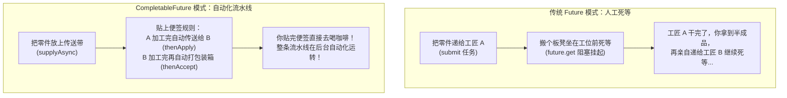
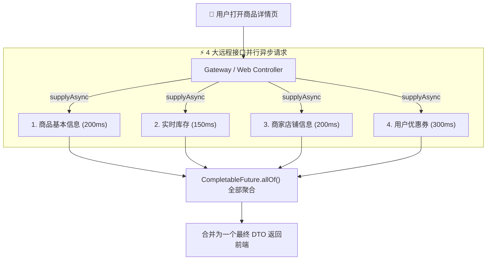

# 🚀 09 · CompletableFuture 异步编程（现代异步终极答案与微服务聚合）

> **一句话导读**：告别阻塞死等的旧时代！`CompletableFuture` 就像一条高度智能的**“现代化汽车流水线”**，把复杂的异步并发、多接口并行聚合与异常降级写得如同流水般优雅顺滑。

---

## 🏭 CompletableFuture 核心设计思想与异步编排

先对比两种编程模式的体感差异：



---

## 🔤 核心 API 解码：三招彻底打破死记硬背

`CompletableFuture` 拥有近 50 个 API，初学者常被绕晕。但只要掌握官方命名的 **三大规律**，就能一眼看穿：

### 规律一：看动词后缀（入参和出参的差别）
- **`thenApply(Function)`**：**加工转换**。有入参、**有返回值**（比如：把订单对象转换成订单金额）。
- **`thenAccept(Consumer)`**：**纯消费**。有入参、**无返回值**（比如：拿到结果后打印日志或发一条短信）。
- **`thenRun(Runnable)`**：**收尾通知**。无入参、**无返回值**（比如：整条流水线跑完，拉响下班警报）。

### 规律二：看是否带 `Async`（谁来跑下一步）
- **`thenApply(...)`（不带 Async）**：通常由上一步执行完成的那个线程直接顺带把下一步跑了（零线程切换成本）。
- **`thenApplyAsync(..., executor)`（带 Async）**：把下一步重新包装为一个新任务，丢进指定的线程池重新排队调度。

### 规律三：看任务组合关系
- **`thenCombine`**：**双剑合璧**。两个独立任务并行跑，**两个都跑完了**，把两份结果合并在一起。
- **`thenCompose`**：**链式串联（扁平化）**。任务 A 跑完后的结果，作为任务 B 的启动入参（类似流处理的 `flatMap`，避免嵌套泛型）。
- **`allOf` / `anyOf`**：**集群多任务**。`allOf` 等待所有任务全结束；`anyOf` 谁跑得快就拿谁的。

---

## 🛒 生产王牌实战：电商详情页多微服务并行聚合

在真实的微服务或高并发 Web 接口中，商品详情页通常需要依赖多个上游系统：



- **传统串行调用耗时**：`200 + 150 + 200 + 300 = 850ms`（接口极慢！）。
- **CompletableFuture 并行聚合**：**耗时只取决于最慢的那一个，仅需约 300ms！性能提升接近 3 倍！**

### 💻 工业级实战代码（包含独立线程池与异常兜底）

保存为 `ProductAggregatorCompletableDemo.java`：

```java
import java.util.concurrent.*;

public class ProductAggregatorCompletableDemo {
    // 🚨 生产铁律 1：必须使用自定义业务线程池，严禁裸奔使用默认公共池！
    private static final ExecutorService bizPool = new ThreadPoolExecutor(
            4, 8, 60, TimeUnit.SECONDS,
            new ArrayBlockingQueue<>(100),
            r -> new Thread(r, "product-agg-pool-"),
            new ThreadPoolExecutor.CallerRunsPolicy()
    );

    public static void main(String[] args) {
        long start = System.currentTimeMillis();

        // 1. 异步查商品基本信息
        CompletableFuture<String> baseInfoFuture = CompletableFuture.supplyAsync(() -> {
            sleep(200);
            return "iPhone 16 Pro Max";
        }, bizPool);

        // 2. 异步查库存
        CompletableFuture<Integer> stockFuture = CompletableFuture.supplyAsync(() -> {
            sleep(150);
            return 88;
        }, bizPool);

        // 3. 异步查店铺信息
        CompletableFuture<String> shopFuture = CompletableFuture.supplyAsync(() -> {
            sleep(200);
            return "Apple 官方旗舰店";
        }, bizPool);

        // 4. 异步查优惠券（模拟这个服务偶尔超时或故障）
        CompletableFuture<String> couponFuture = CompletableFuture.supplyAsync(() -> {
            sleep(300);
            if (true) {
                // 模拟远程服务抛异常
                throw new RuntimeException("优惠券系统忙");
            }
            return "满5000减500";
        }, bizPool).exceptionally(ex -> {
            // 🚨 生产铁律 2：非核心业务必须优雅降级兜底！
            System.err.println("⚠️ 优惠券查询失败，启动降级: " + ex.getMessage());
            return "暂无可用优惠券";
        });

        // 5. 编排聚合任务：创建一个聚合监听器（非阻塞，纳秒级瞬间返回）
        CompletableFuture<Void> allFutures = CompletableFuture.allOf(
                baseInfoFuture, stockFuture, shopFuture, couponFuture
        );

        // 阻塞当前主线程，等待上述所有并行任务全部完成（耗时取决于最慢的一个任务，约 300ms）
        allFutures.join();

        long cost = System.currentTimeMillis() - start;

        // 6. 组装聚合结果
        System.out.println("\n🎉 商品详情组装完成 (总耗时: " + cost + "ms):");
        System.out.println("----------------------------------------");
        System.out.println("商品名称: " + baseInfoFuture.join());
        System.out.println("剩余库存: " + stockFuture.join());
        System.out.println("所属店铺: " + shopFuture.join());
        System.out.println("优惠活动: " + couponFuture.join());
        System.out.println("----------------------------------------");

        bizPool.shutdown();
    }

    private static void sleep(long ms) {
        try { Thread.sleep(ms); } catch (InterruptedException ignored) {}
    }
}
```

---

## 🛡️ 异步异常处理与兜底机制

在异步调用链中，异常不会直接向上传递至主线程，必须通过专属的异步异常处理方法进行捕获与降级转换：

| 异常处理方法 | 触发时机与运行机制 | 能否转换/替换返回值？ | 场景类比说明（辅助理解） |
| :--- | :--- | :---: | :--- |
| **`exceptionally(fn)`** | **仅在上游发生异常时触发执行**。接收抛出的 `Throwable`，允许返回预设的兜底默认值，使调用链恢复正常流转。 | ✅ **能** | 类比为故障备用方案，返回兜底默认值 |
| **`handle((res, ex) -> ...)`** | **无论上游成功或抛出异常均会触发执行**。双参数同时接收结果与异常，支持统一转换并返回最终数据。 | ✅ **能** | 类比为统一收尾转换，无论成败均产出最终统一结果 |
| **`whenComplete((res, ex) -> ...)`** | **无论上游成功或抛出异常均会触发执行**。仅用于监听通知、打日志或释放资源，不能改变原本的返回值或异常。 | ❌ **不能** | 类比为旁路监控感知，仅观察记录而不干涉原结果 |

---

## 💣 生产血泪避坑：为什么严禁省略 Executor 参数？

很多教程在写示例时喜欢写：
```java
CompletableFuture.supplyAsync(() -> queryData()); // 没传自定义线程池！
```

> [!CAUTION]
> **线上崩溃血泪教训**：
> 如果不指定线程池，`CompletableFuture` 默认使用的是 JVM 全局的 **`ForkJoinPool.commonPool()`**！
> - 这个全局池的线程数等于你的机器 `CPU 核心数 - 1`（如果是 4 核机器，全局只有 3 条线程！）。
> - 更要命的是：**全 JVM 所有的 `parallelStream()` 和其他省略线程池的异步调用共用这区区几条线程！**
> - 一旦某个人在异步任务里写了个慢 I/O（比如调用耗时 5 秒的外部支付网关），**瞬间就会把全局公共池的所有线程占死**，导致全站所有原本轻量级的并行任务全面瘫痪排队，引发雪崩！
> - **铁律：生产代码中调用 `supplyAsync` / `runAsync` 时，必须传入业务专属的自定义 `ThreadPoolExecutor`！**

---

## 🧠 一分钟复盘核心记忆卡

1. **链式思维**：`supplyAsync`（生产） -> `thenApply`（转换） -> `thenAccept`（消费） -> `exceptionally`（降级）。
2. **多任务聚合**：微服务接口聚合首选 `CompletableFuture.allOf(...)`，把串行耗时压榨为最慢单接口耗时。
3. **隔离防护**：强制使用自定义业务线程池，隔离慢 RPC 故障。

---

## 🧭 下一步

在多线程并发执行时，不同线程如何保存自己独立的上下文信息（如当前登录用户 ID、链路跟踪 TraceId），而不被其他线程串台污染？
请进入下一篇：[[10-ThreadLocal详解]]！
