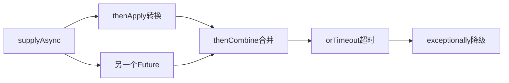

# CompletableFuture异步编程

> [!abstract] 一句话总结
> CompletableFuture 把异步任务、回调编排和异常处理组合成流水线，但必须显式治理线程池、超时和异常。

## 📌 这是什么

- CompletableFuture 既是 Future，也是 CompletionStage，可串联 thenApply、thenCompose、thenCombine、exceptionally 等阶段。
- Async 后缀方法如果不传 Executor，通常使用 ForkJoinPool.commonPool。
- 异步编程的难点不是写链式调用，而是超时、取消、异常、线程池隔离和上下文传递。

## 🤔 解决什么问题 / 为什么需要

- 并行调用多个下游服务，降低整体响应时间。
- 把回调地狱整理成可组合阶段。
- 面试常考 thenApply/thenCompose 区别、allOf 异常处理和线程池使用。

## 🧩 核心概念

| 概念 | 含义 | 精通要点 |
| ---- | ---- | -------- |
| CompletionStage | 一个异步阶段及其后续依赖。 | 每个阶段可转换、消费、组合。 |
| thenApply | 同步转换结果。 | 返回普通值。 |
| thenCompose | 扁平化异步结果。 | 返回 CompletionStage 时避免嵌套。 |
| thenCombine | 合并两个独立任务结果。 | 适合并行请求。 |
| exceptionally/handle | 异常恢复或统一处理。 | handle 同时拿到结果和异常。 |

## ⚙️ 工作原理 / 流程



## 🔍 源码 / 原理深挖

- CompletableFuture 内部用 result 保存结果或异常包装，依赖栈保存后续 Completion。
- 阶段完成时触发依赖节点执行；Async 阶段会提交到 Executor。
- allOf 只返回 CompletableFuture<Void>，需要再 join 各子任务取结果。

## 💻 代码实践 / 排查命令

```java
ExecutorService ioPool = Executors.newFixedThreadPool(32);
CompletableFuture<User> userFuture = CompletableFuture.supplyAsync(
    () -> userClient.get(userId), ioPool);
CompletableFuture<List<Order>> ordersFuture = CompletableFuture.supplyAsync(
    () -> orderClient.list(userId), ioPool);

CompletableFuture<UserView> view = userFuture.thenCombine(ordersFuture, UserView::new)
    .orTimeout(800, TimeUnit.MILLISECONDS)
    .exceptionally(ex -> UserView.fallback(userId));
```

## 🛠️ 排查 / 实践要点

- 所有生产异步任务传入业务专属 Executor，避免污染 commonPool。
- 并行 RPC 要设置单个调用超时和整体超时，并准备降级值。
- allOf 后收集结果时逐个处理异常，避免一个失败吞掉其他成功结果。

## ⚠️ 踩坑与注意事项

- 在 CompletableFuture 链中调用 get/join 阻塞同一个小线程池，造成线程饥饿。
- 忘记处理异常，异常只在 join/get 时才暴露。
- ThreadLocal、MDC、事务上下文在线程切换后丢失。

## 🎯 面试问题

> [!question] 高频问题
> - Q: thenApply 和 thenCompose 区别？
>   - A: thenApply 把结果映射为普通值；thenCompose 用于返回另一个 CompletionStage 的异步函数，并把嵌套 Future 扁平化。
> - Q: CompletableFuture 默认用什么线程池？
>   - A: Async 方法不传 Executor 时通常使用 ForkJoinPool.commonPool；非 Async 方法可能在完成前一阶段的线程上执行。
> - Q: allOf 怎么拿结果和处理异常？
>   - A: allOf 只表示全部完成，返回 Void；完成后需要保存原 futures 并逐个 join/handle，异常要在子任务或汇总阶段处理。

## 🧭 源码入口速查

- `CompletableFuture#supplyAsync`：不传 Executor 时进入 commonPool。
- `CompletableFuture#completeValue/completeThrowable`：结果或异常如何写入 `result`。
- `Completion#tryFire`：阶段完成后触发依赖节点。
- `thenCompose` 对应扁平化依赖，`thenCombine` 对应两个独立阶段合并。
- `orTimeout/completeOnTimeout`：JDK 9+ 内置超时，但不会自动取消底层正在执行的阻塞调用。

## 🧪 最小验证

```java
ExecutorService pool = Executors.newFixedThreadPool(8);
CompletableFuture<String> f = CompletableFuture
    .supplyAsync(() -> callA(), pool)
    .thenCombine(CompletableFuture.supplyAsync(() -> callB(), pool), (a, b) -> a + b)
    .orTimeout(500, TimeUnit.MILLISECONDS)
    .exceptionally(ex -> "fallback");
```

异步链路上线要记录每个子任务耗时、异常和超时来源。`orTimeout` 让 Future 完成异常，不等于 HTTP 请求或 JDBC 查询已经停止；底层客户端仍要配置 socket/read/query timeout，线程池也要和调用方隔离。

## ✅ 精通检查清单

- 能用自己的话讲清本主题解决的问题和适用边界。
- 能指出至少 2 个源码入口或底层机制。
- 能给出一个最小代码示例或一组线上排查命令。
- 能回答本页列出的高频面试题，并补充项目中的真实取舍。

## 🔗 关联笔记

- [[_index]]

## 📚 参考资料

- [Dev.java Tutorials](https://dev.java/learn/)
- [Oracle Java Documentation](https://docs.oracle.com/en/java/)
