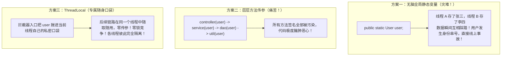
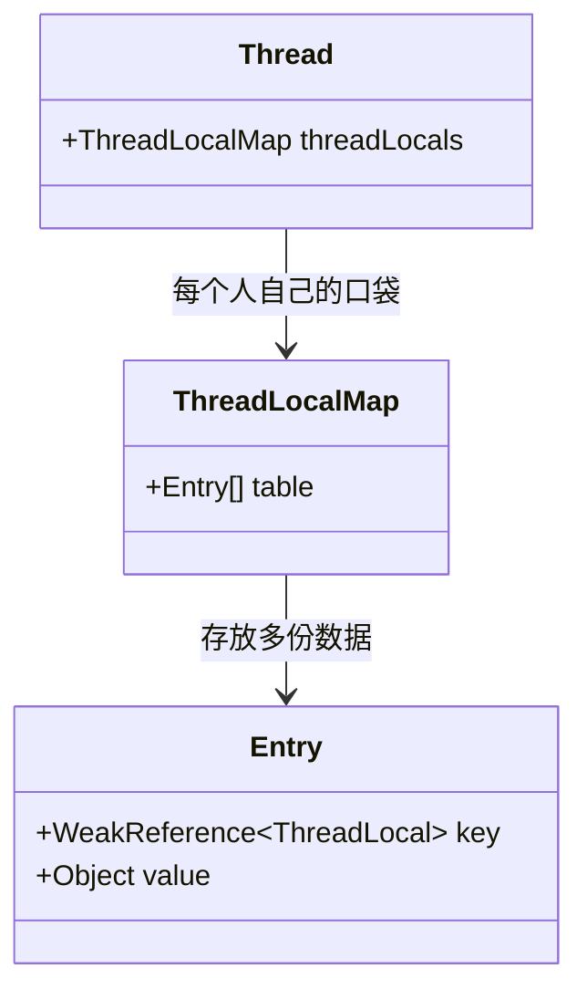
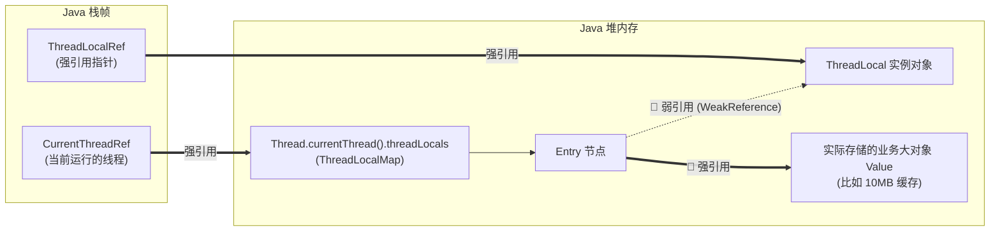

# 🎒 10 · ThreadLocal 详解（打工人的私密口袋与内存泄漏防坑）

> **一句话导读**：既不想一层层繁琐传参，又不想加锁排队？`ThreadLocal` 就像为每个打工人量身定制的**“专属私密工装口袋”**。搞懂它的内存引用链和生产清理铁律，你就能彻底攻克这个面试大杀器。

---

## 👔 ThreadLocal 核心设计思想与线程数据隔离

在企业级 Web 开发中，我们经常遇到这种需求：
> 用户发起一个 HTTP 请求。在 Controller 层拦截器拿到了用户的 `UserContext`（用户 ID、租户编码、链路跟踪 `TraceId`）。
> 后续的 Service 层、DAO 层、工具类方法全都要用到这个 `UserContext`。

**我们该怎么传递它？**



---

## 🔍 底层真相大揭秘：数据到底存在哪里？

很多初学者看着 `threadLocal.set(user)`，直觉上以为数据是存在 `ThreadLocal` 实例里的，或者以为它内部维护了一个全局大 Map。

**这是最大的认知误区！现实恰恰完全相反！**

### 1. 核心架构关系



### 2. 源码级真相：`threadLocal.set(value)` 到底在干嘛？

我们直接看 JDK 中 `ThreadLocal.java` 的底层源码，只有短短几行：

```java
// ThreadLocal.java 核心源码
public void set(T value) {
    // ① 获取当前正在执行这行代码的线程对象！
    Thread t = Thread.currentThread();
    
    // ② 拿到这个线程对象自己肚子里私有的 Map (即 t.threadLocals 属性)
    ThreadLocalMap map = getMap(t);
    
    // ③ 往该线程自己的私有 Map 里面存入：
    //    Key   -> this（就是当前调用的 ThreadLocal 对象自己！）
    //    Value -> 你传进来的业务大对象 value！
    if (map != null) {
        map.set(this, value);
    } else {
        createMap(t, value);
    }
}
```

再看 `get()` 是如何取回的：

```java
public T get() {
    Thread t = Thread.currentThread();
    ThreadLocalMap map = getMap(t);
    if (map != null) {
        // 以自己 (this) 为 Key，去当前线程的 Map 里查出 Entry
        ThreadLocalMap.Entry e = map.getEntry(this);
        if (e != null) {
            return (T)e.value; // 取出关联的 Value！
        }
    }
    return setInitialValue();
}
```

> 💡 **核心总结**：
> - **存储宿主**：数据根本不在 `ThreadLocal` 里，而是在**当前线程自己的 `Thread.currentThread().threadLocals` 成员变量中**（去中心化，每个人背自己的背包）；
> - **角色分工**：`ThreadLocal` 实例自身只是一把**“钥匙（Key）”**，负责在调用 `set` / `get` 时走过去拉开当前线程自己的背包，按钥匙匹配读写对应格子的 Value。

---

## 💥 震撼面试官：弱引用为什么会引发内存泄漏？

面试官最爱问：“为什么 `ThreadLocal` 会发生内存泄漏？为什么要用弱引用？”
这道题用一张**对象引用关系链图**就能讲得明明白白：



> 📌 **图中的变量名词通俗解读（扫清代码对照盲区）**：
> - **`ThreadLocalRef`**：就是你在业务代码中声明的**变量名**（例如 `public static final ThreadLocal<User> HOLDER = new ThreadLocal<>()` 中的 `HOLDER`，或者方法内部的局部变量引用）。它是外部强引用的根（GC Root）。
> - **`CurrentThreadRef`**：代表当前正在运行这段代码的线程实例（`Thread.currentThread()`）。
> - **`t.threadLocals` 属性归属**：该属性 100% 属于 `Thread` 实例自身；`new ThreadLocal<>()` 时根本不会给线程赋值，而是在线程**第一次调用 `set()` 时才懒加载（按需分配）**创建出专属的 `ThreadLocalMap`。

### 🔬 逐帧慢动作分析：

1. **为什么 Key 要设计成弱引用？**
   - 如果 Key 是强引用，那么只要你的线程还在跑，哪怕你的业务方法已经执行完了、栈里的 `ThreadLocalRef` 已经销毁了，这个 `ThreadLocal` 对象也**永远无法被垃圾回收**！
   - 设计为**弱引用**的好处是：只要栈上的强引用断开，下一次 GC 发生时，JVM 会自动把 Key（ThreadLocal 对象）回收掉，Key 自动变成 `null`。
2. **那为什么还会内存泄漏？（致命元凶：线程池 + Value 强引用！）**
   - 当 Key 被 GC 回收变成 `null` 之后，在 `Entry` 数组里就出现了一个个 `[key: null, value: 10MB大对象]` 的**死魂灵**。
   - 在传统的单次线程中，线程执行完毕死掉后，整个 `Thread` 和它的 `ThreadLocalMap` 会被一并回收，不会泄漏。
   - **但现代企业级项目全部使用线程池！核心线程永远不会死亡！**
   - 此时存在一条顽固的强引用链：
     `Thread (常驻核心线程) -> ThreadLocalMap -> Entry -> Value (业务大对象)`
   - **结果**：Key 已经成了 null，你再也无法通过代码拿到这个 Value；但 GC 又因为强引用链的存在绝对不敢回收它！随着请求成千上万次涌入，这些无家可归的 Value 越堆越多，最终直接引爆 **`OutOfMemoryError`（OOM 内存溢出）！**
> [!question]- 灵魂追问：既然 Key 设为弱引用会导致内存泄漏，为什么不干脆把 Value 也设计成弱引用？
> **致命灾难**：在业务代码中，当我们在拦截器或前置方法执行 `threadLocal.set(user)` 后，局部变量 `user` 随着方法出栈立即被销毁。此时在整个 JVM 堆内存中，**唯有当前线程的 `ThreadLocalMap` 还在引用这个 `user` 对象**！
> - 如果 Value 也是弱引用，后续业务逻辑还在执行期间，只要 JVM 发生了一次垃圾回收（GC），**GC 会直接把没有任何强引用的 Value 当场回收为 `null`**！
> - 后续业务代码调用 `threadLocal.get()` 就会凭空拿到 `null`，引发大量随机、难以复现的 `NullPointerException`！
> - **设计结论**：为了履行业务契约（“只要当前线程在执行，存入的数据绝不能凭空消失”），**Value 必须是强引用**；消除泄漏的唯一可靠方案是**在 `finally` 中显式调用 `remove()`**。

---

## 🛡️ 生产铁律：`remove()` 必须写在 `finally` 块中！

防止内存泄漏的解药极其简单，但必须作为团队研发规范严格落实：

```java
public class UserContextHolder {
    // 静态常量，作为全局唯一的访问钥匙
    private static final ThreadLocal<String> USER_CONTEXT = new ThreadLocal<>();

    public static void set(String userId) {
        USER_CONTEXT.set(userId);
    }

    public static String get() {
        return USER_CONTEXT.get();
    }

    // 🚨 核心救命方法：清空当前线程口袋里的脏数据
    public static void clear() {
        USER_CONTEXT.remove();
    }
}
```

### 标准业务使用模板

```java
public class WebRequestInterceptor {
    public void handleRequest(String userId) {
        try {
            // 1. 请求刚进来，放入上下文
            UserContextHolder.set(userId);
            
            // 2. 模拟后续深层次业务调用，零传参使用
            doService();
        } finally {
            // 🚨 铁律：在 finally 的第一行执行 remove()，绝不带到下一次请求！
            UserContextHolder.clear();
        }
    }

    private void doService() {
        System.out.println("当前登录用户 ID: " + UserContextHolder.get());
    }
}
```

### 🔬 源码解密：`remove()` 底层究竟做了什么？

为什么只要调了 `remove()` 就能彻底根治内存泄漏？看 JDK 底层源码的“外科手术式”清理过程：

```java
// ThreadLocal.java
public void remove() {
    ThreadLocalMap m = getMap(Thread.currentThread());
    if (m != null) {
        m.remove(this); // 驱动当前线程自己的 Map 移除自身
    }
}

// ThreadLocalMap 核心清理源码 (expungeStaleEntry)
tab[i].value = null; // 💥 关键第 1 步：将 Entry 对业务大对象（Value）的强引用彻底剪断！
tab[i] = null;       // 💥 关键第 2 步：将数组槽位里的 Entry 自身置为 null！
size--;
```

- **结论**：`remove()` 物理切断了 `Entry -> Value` 的强引用链，使业务大对象沦为可被 GC 回收的垃圾，下一次 GC 即可彻底清场，从源头上消除了线程池长寿线程引发的内存泄漏！

---

> [!question]- 进阶追问：子线程想继承父线程的 ThreadLocal 上下文数据怎么办？
> 在异步解耦与多线程调用场景中，常见方案对比与生产陷阱：
> 1. **普通 `ThreadLocal`**：**无法继承**。子线程具有独立的 `ThreadLocalMap`，数据完全隔离无法读取；
> 2. **`InheritableThreadLocal`**：仅在显式执行 `new Thread()` 创建新物理线程的瞬间，JDK 会在底层将父线程上下文浅拷贝一份到子线程；
>    - **⚠️ 生产致命陷阱**：在**线程池环境彻底失效**！因为线程池中的核心工作线程是预先创建且长寿复用的，执行新提交的任务时不会触发新线程创建逻辑，极易读取到上一个任务残留的陈旧脏数据；
> 3. **生产级终极方案：阿里开源 `TransmittableThreadLocal`（TTL）**：
>    - 专门解决线程池上下文传递问题。通过对 `ExecutorService` 或 `Runnable/Callable` 任务进行装饰（如 `TtlExecutors`），在任务提交时抓取父线程快照，在子线程执行前载入并在 finally 中恢复清理，是分布式链路追踪（如 SkyWalking、Sleuth）的底层核心底座。

---

## 🧠 一分钟复盘核心记忆卡

1. **数据归属**：数据存在 `Thread` 内部的 `ThreadLocalMap` 里，`ThreadLocal` 本身只是一把查数据的 Key。
2. **内存泄漏元凶**：**核心线程池长期常驻 + Entry.value 是强引用**。
3. **生产黄金守则**：**先 `set`，在 `finally` 中必 `remove`！**

---

## 🧭 下一步

学完了任务编排与线程隔离，我们即将进入第四阶段——**高并发重器与前沿革命**。
第一站，就是 Java 领域被优化到了极致的性能怪兽字典——**`ConcurrentHashMap`**。
请进入下一篇：[[08-并发容器-ConcurrentHashMap]]！
